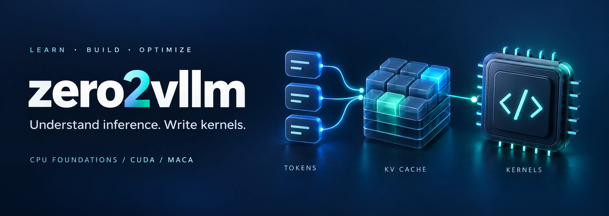

<div align="center">
  
  <h1>zero2vllm</h1>
  <p>
    <a href="./README.md"></a>
    <a href="./README_en.md"></a>
  </p>
  <h3>📚 Build and Understand vLLM from Scratch</h3>
  <p><em>Understand how LLMs generate tokens, manage caches, and schedule requests; then write and optimize kernels to understand vLLM from the inside out.</em></p>
</div>

<div align="center">
  <a href="https://github.com/xpxpxp2001xpxpxp/zero2vllm/stargazers"></a>
  <a href="https://github.com/xpxpxp2001xpxpxp/zero2vllm/forks"></a>
  <a href="https://github.com/xpxpxp2001xpxpxp/zero2vllm"></a>
  
  
  
  <a href="./docs/README.md"></a>
  <a href="./LICENSE"></a>
</div>

<div align="center">
  <p>Inference fundamentals · Quantization kernels · Start on CPU · NVIDIA CUDA / MetaX MACA</p>
  <p>Start with small experiments, build a teaching inference engine, and explore the real vLLM source.</p>
</div>

---

[Start here](#start-here) · [Quick start](#quick-start) · [Course outline](#course-outline) · [Features and optimizations](#features-and-optimizations) · [Learning paths](#learning-paths) · [Framework reading map](#framework-reading-map) · [Current progress](#current-progress) · [Contributing](#contributing)

[Documentation](docs/README.md) · [Roadmap](docs/roadmap.md) · [Changelog](CHANGELOG.md) · [License](LICENSE)

> **Course under construction.** All six Part 1 lessons (1.1–1.6) now include full text, CPU code, commands, exercises with answers, and a shared runner. The INT4 Linear lab, seven topic guides, and configuration templates for both GPU backends are also available. The full teaching engine and later chapters are in development. A100/C500 GPU experiments await validation on hardware.
>
> **Language:** this README includes the full English overview and outline. Linked course chapters, labs, and supporting documents are currently primarily in Chinese.

## Start here

Choose an entry point based on your experience, then follow the [learning paths](docs/learning-paths.md). The full **19-part, 126-chapter** scope appears below.

| Your starting point | First material | What you will produce |
| --- | --- | --- |
| You know Python and want to understand inference | [Lesson 1: from tokens to next-token prediction](docs/chapters/01-next-token.md) | Calculate attention by hand and explain how the last logit row selects the next token |
| You have deployed models and want to read source code | [Requests, state, and tensors](docs/chapters/01-request-lifecycle.md) | A request call chain separating scheduling decisions from model execution |
| You work on quantization or want to write kernels | [CPU INT4 Linear lab](docs/labs/02-int4-linear.md) → [Quantization guide](docs/chapters/05-quantization-operators.md) | A report on bit layouts, error, and storage, preparing for GPU kernels |
| You have a working GPU environment and want to optimize | [Experiment guidelines](docs/experiments.md) → [Profiling guide](docs/chapters/04-compile-profiling.md) | An experiment design with a fixed workload and separate correctness, quality, and performance checks |

For your first pass, follow the [short route through existing materials](docs/learning-paths.md#先用现有材料走通一条短路线). Algorithms are covered together in **9.2 Quantization algorithms**. The quantization path emphasizes strategy, data layouts, kernel implementation, tuning, and vLLM integration.

**Study the complete first part:** the [Part 1 learning and command guide](docs/chapters/part1-guide.md) covers generation, caching, performance metrics, model structures, sampling, and numerical correctness.

The [guides and knowledge-source map](docs/knowledge-base.md) connect the topics to 38 reference documents. A 🧩 marker means some material is available; it does not mean a full chapter or GPU validation is complete.

## Why this course

Asking a model to generate a sentence is a starting point for understanding inference systems. Looking inside raises concrete questions:

- Why do processing a long prompt and generating tokens one by one have different performance bottlenecks?
- How should we store earlier tokens' K/V tensors and allocate GPU memory as concurrency grows?
- When one request finishes, how does another join the running batch?
- When moving a model to another GPU platform, which logic can be shared, and which kernels and dependencies need adaptation?
- How do correctness checks and performance data tell us whether a change helped?

**zero2vllm organizes the course around these questions, with vLLM as the main source-code reference.** We start with examples small enough to calculate by hand, then progressively implement model forward passes, generation loops, KV caching, scheduling, and serving, connecting the teaching implementation to a production inference framework.

The learning pattern is **question → principle → minimal implementation → experiment → source-code mapping**. Each chapter works toward something you can run, observe, or check. Advanced sections address performance and platform differences; chapter status markers show what has been delivered.

## What you will learn

These are the goals for the complete course. See [current progress](#current-progress) for available material.

- **Understand inference:** connect tokenization, attention, prefill, decode, and token-by-token generation.
- **Build a teaching engine:** progress from a simple loop to cache management, continuous batching, paged caching, and streaming services.
- **Read vLLM source:** trace request entry points, scheduling, KV management, model execution, and attention backends.
- **Study optimization strategies:** APC, FlashAttention, compilation and graph execution, weight/activation/KV quantization, speculative decoding, and DBO.
- **Understand distributed design:** TP, PP, DP, EP, CP, PCP, DCP, SP, MoE, KV transfer, and disaggregated serving.
- **Explore serving capabilities:** multimodality, pooling, LoRA, structured outputs, tool calling, reasoning outputs, weight updates, and operations.
- **Design credible experiments:** compare output correctness and measure time to first token, generation speed, throughput, and tail latency.
- **Understand platform adaptation:** identify shared logic, runtime requirements, and kernel differences across CUDA and MACA.
- **Practice engineering collaboration:** pin experiment versions, prepare minimal reproductions, read patches, and validate changes.

## Who this is for

**Students and beginners:** you know basic Python and want to understand inference systems. Start with the CPU labs and follow the foundation path. The course will introduce the matrix multiplication, PyTorch, and Transformer concepts needed along the way.

**Engineers with prior experience:** you know PyTorch or model deployment and want to explore scheduling, caching, source code, profiling, and MetaX GPU adaptation. Enter through the relevant topic and its engineering extensions.

Prerequisites:

- Required: Python functions, classes, lists, and basic debugging.
- Recommended: matrix operations and neural-network forward passes; basic PyTorch before working with real models.
- Introduced as needed: CUDA/GPU programming, C++, and low-level kernels in the backend and optimization sections.

## Learning paths

| Path | Entry point | Main sequence and deliverables |
| --- | --- | --- |
| Student | CPU starter lab, 0.1/0.3, and Part 1 | Mathematical reference → request/cache simulation → real small model → vLLM mapping; build an explainable teaching engine in stages |
| Engineer | Establish one platform baseline; use Part 17's measurement methods early | Call chain and bottlenecks → individual optimizations → combination regressions → platform and distributed extensions |
| Quantization specialist | Establish a baseline, then enter at 9.3: strategy design | Tensor contract → Q/DQ and packing → quantized GEMV/GEMM → tuning → vLLM integration and serving ablations |

See the [learning paths](docs/learning-paths.md) for chapter order, milestones, GPU requirements, and the division of work across related chapters. Each chapter shares a core explanation with engineering extensions and platform notes. The [detailed curriculum](docs/curriculum.md) retains the full technical scope.

**Available now:** complete all six Part 1 lessons and CPU experiments, continue with the INT4 Linear lab, read the topic guides, and inspect the logical block allocator and configuration templates. Without a GPU, finish the CPU stages first and defer the real-model generation exercise in 0.2.

### Choose experiments for your hardware

| Available environment | Where to start | Later practice |
| --- | --- | --- |
| Ordinary computer with a CPU | Current causal-attention and KV cache labs, plus the logical block simulation | Learn the fundamentals and analyze existing experiment records |
| An available NVIDIA GPU | Run a small model when the selected software version and memory capacity permit | Follow the CUDA path through the GPU chapters |
| MetaX C500 | Use the matching official software stack | Follow the MACA path through the GPU chapters |
| No GPU access yet | Complete the CPU coding exercises | Analyze the maintainer's real GPU records as they are published |

**A single A100 and a single C500 are our first planned validation targets.** You only need to choose one GPU path. Minimum GPU memory requirements will be documented from measurements for each model and experiment.

## Quick start

### 1. Complete the first lesson: from tokens to next-token prediction

With **Python 3.11+**, run this from the repository root. No third-party packages, model downloads, or GPU are required:

```bash
python -m zero2vllm next-token-demo --output runs/lesson-01/default.json
```

Start with five teaching tokens and two-dimensional vectors. Inspect embeddings, Q/K/V, causal attention, logits, and the generation loop. The default input is “我 喜欢”; the first prediction is token ID `2`, and `verification.passed` should be `true`. Weights are hand-set for arithmetic and have no trained language ability.

Read the [lesson and five exercises](docs/chapters/01-next-token.md) (Chinese) alongside the [recorded output](reports/lesson-01-next-token.json). Allow approximately 60–90 minutes for calculation, experiments, and self-checks.

The [Part 1 guide](docs/chapters/part1-guide.md) includes all six lessons, commands, parameter explanations, and exercises. Run 28 cases, the full test suite, and document checks together:

```bash
python scripts/run_part1.py
```

Reports are saved under `runs/part1/`, including `summary.json`. Metric examples use an explicitly simulated timeline; capacity and roofline values are analytical estimates, not GPU measurements.

### 2. Continue with KV cache

After downloading or cloning the repository, run this from the root directory containing `pyproject.toml`. You need **Python 3.11+**; no model download or third-party packages are required.

```bash
python -m zero2vllm demo
```

The experiment uses a single-head attention model with fixed random weights. It compares generation by full recomputation against generation with a KV cache, checking scores across the entire vocabulary (logits) at every step.

The default prompt contains 4 tokens and generates 8 new tokens:

| Check | Expected result |
| --- | --- |
| Generated token IDs | Identical across both paths |
| Maximum logits error | At most `1e-12` |
| Positions processed by Q/K/V projections | 60 for full recomputation; 11 with caching |

This small model illustrates computation; its token IDs have no natural-language meaning. Projection counts cannot be directly converted into a GPU speedup.

Continue with the [KV cache correctness lab](docs/labs/01-kv-cache.md), or inspect the [recorded results](reports/cpu-kv-cache.json).

### 3. Save results and run checks

```bash
python -m zero2vllm demo --output runs/cpu-kv-cache.json
python -m unittest discover -s tests -v
```

Try changing the prompt or output length. Predict the repeated computation before checking the result.

### 4. Quantization path: run INT4 Linear

```bash
python -m zero2vllm quant-demo --output runs/cpu-int4-linear.json
```

This experiment implements Q/DQ with groups along K, signed INT4 packing, and two quantized Linear reference paths. Defaults exercise tail groups and odd-length packing. Reports distinguish implementation error from quantization error and include scales in storage accounting. See the [lab](docs/labs/02-int4-linear.md). This is a CPU mathematical reference; fused GPU kernels and vLLM integration are still to be implemented.

### 5. Prepare a GPU path

```bash
python -m zero2vllm doctor --output runs/environment.json
python -m zero2vllm profile configs/cuda-a100.toml
python -m zero2vllm profile configs/maca-c500.toml
```

These commands collect environment information and check configuration. The templates report actual versions that still need to be filled in. A complete configuration lets you preview launch arguments for use inside the container. Deployment instructions will be completed alongside A100/C500 hardware validation; see [backend environments and configuration](docs/backends.md).

## Course outline

<!-- BEGIN course-outline -->

This edition plans **19 parts and 126 chapters**, alongside two standalone CPU labs. Linked chapter titles lead to available lessons or topic guides; status markers distinguish completed chapters from partial material. See the [detailed curriculum](docs/curriculum.md) for prerequisites, exercises, and hardware requirements. Chapter materials are currently primarily in Chinese.

**Status: ✅ complete with local validation; 🧩 partial material or code available; 📋 planned, chapter text pending.** Upstream availability does not mean a feature has been tested in this project.

[✅ CPU starter lab: checking correctness with and without KV cache](docs/labs/01-kv-cache.md)

[✅ CPU quantization lab: INT4 packing, group scales, and Linear](docs/labs/02-int4-linear.md)

| Part | Scope | Chapters |
| --- | --- | --- |
| Part 0 | Before You Begin | 3 |
| Part 1 | Understanding LLM Inference | 6 |
| Part 2 | Building a Teaching Inference Engine from Scratch | 7 |
| Part 3 | Inside the Real vLLM | 5 |
| Part 4 | Single-GPU Baselines on CUDA and MACA | 3 |
| Part 5 | KV Cache, Prefix Caching, and Long Contexts | 9 |
| Part 6 | Scheduling, Batching, and Overlapped Execution | 6 |
| Part 7 | Attention and High-Performance Kernels | 7 |
| Part 8 | Compilation, CUDA Graphs, and Execution Optimization | 7 |
| Part 9 | Quantization Algorithms, Kernel Implementation, and Inference Acceleration | 11 |
| Part 10 | Speculative Decoding | 9 |
| Part 11 | Parallelism and Distributed Execution | 10 |
| Part 12 | MoE and Communication Optimization | 6 |
| Part 13 | Disaggregated Serving and KV Transfer | 6 |
| Part 14 | Model Types, Multimodality, and Adapters | 7 |
| Part 15 | Serving APIs and Generation Features | 7 |
| Part 16 | Weight Loading, Memory, and the RL Inference Lifecycle | 6 |
| Part 17 | Evaluation, Profiling, and Optimization Methods | 6 |
| Part 18 | Platform Extensions, Deployment, and Open-Source Contributions | 5 |

<details>
<summary>Part 0 · Before You Begin (3 chapters)</summary>

| Chapter | Topics to cover | Status |
| --- | --- | --- |
| 0.1 Learning paths and environment setup | Python, Linux, containers, driver/runtime/framework versions, CPU and two GPU backend paths | 🧩 |
| 0.2 Your first model generation | Offline LLM inference, online serving, streaming requests, tokenizers, and chat templates | 📋 |
| 0.3 Working with experiments and source code | Pinned revisions, configurations/logs/call chains, minimal reproductions, and raw data | 📋 |

Sources and further reading: [Datawhale zero-to-sglang](https://github.com/datawhalechina/zero-to-sglang) · [vLLM Quickstart](https://docs.vllm.ai/en/stable/getting_started/quickstart/) · [GPU Installation and Hardware Requirements](https://docs.vllm.ai/en/stable/getting_started/installation/gpu/).

</details>

<details>
<summary>Part 1 · Understanding LLM Inference (6 chapters)</summary>

| Chapter | Topics to cover | Status |
| --- | --- | --- |
| 1.1 [From tokens to next-token prediction](docs/chapters/01-next-token.md) | Tokenizers, embeddings, Transformers, causal attention, and the LM head | ✅ |
| 1.2 [Prefill and decode](docs/chapters/01-prefill-decode.md) | Compute-bound vs. bandwidth-bound work, HBM/SRAM, the roofline model, and arithmetic intensity | ✅ |
| 1.3 [What KV cache does](docs/chapters/01-kv-cache.md) | Cache updates, position offsets, MHA/MQA/GQA, and memory per token | ✅ |
| 1.4 [Reading performance results](docs/chapters/01-performance-metrics.md) | TTFT, TPOT, ITL, throughput, goodput, P50/P95/P99, and queuing | ✅ |
| 1.5 [Model architectures and long-context basics](docs/chapters/01-model-structures.md) | RoPE, ALiBi, sliding windows, MLA, sparse/linear attention, and SSMs | ✅ |
| 1.6 [Sampling and numerical correctness](docs/chapters/01-sampling-correctness.md) | Greedy decoding, temperature, top-k/top-p/min-p, penalties, seeds, and EOS/stop conditions | ✅ |

Sources and further reading: [Supported Models and Tasks](https://docs.vllm.ai/en/stable/models/supported_models/) · [Generative Models](https://docs.vllm.ai/en/stable/models/generative_models/) · [Benchmark CLI](https://docs.vllm.ai/en/stable/benchmarking/cli/).

</details>

<details>
<summary>Part 2 · Building a Teaching Inference Engine from Scratch (7 chapters)</summary>

| Chapter | Topics to cover | Status |
| --- | --- | --- |
| 2.1 Building a minimal PyTorch model | Forward pass, generation loop, RMSNorm/RoPE/MLP, and agreement with the CPU reference | 📋 |
| 2.2 Loading real model weights | Configuration, safetensors, weight mapping, tokenizers, and model revisions | 📋 |
| 2.3 Request and cache lifecycles | Creation, execution, completion, cancellation, exceptions, and cache ownership | 📋 |
| 2.4 From static to continuous batching | Iteration-level scheduling, active queues, token budgets, and request admission/removal | 📋 |
| 2.5 Paged caching | Logical/physical blocks, block tables, slot mapping, and device KV storage | 🧩 |
| 2.6 Prefix caching | Cross-request sharing, reference counts, hash matching, eviction, and invalidation | 📋 |
| 2.7 HTTP and streaming output | Async iteration, backpressure, disconnects, cancellation propagation, and request errors | 📋 |

Sources and further reading: [Transformers](https://github.com/huggingface/transformers) · [nano-vllm](https://github.com/GeeeekExplorer/nano-vllm) · [mini-sglang](https://github.com/sgl-project/mini-sglang) · [Architecture Overview](https://docs.vllm.ai/en/stable/design/arch_overview/).

</details>

<details>
<summary>Part 3 · Inside the Real vLLM (5 chapters)</summary>

| Chapter | Topics to cover | Status |
| --- | --- | --- |
| 3.1 [A request's journey through vLLM](docs/chapters/01-request-lifecycle.md) | Input processing → EngineCoreClient → EngineCore → Executor/Worker/ModelRunner; request IDs, IPC, streaming queues, and cancellation | 🧩 |
| 3.2 [Scheduling and KV management in vLLM](docs/chapters/02-scheduling-cache.md) | Input processing, scheduler outputs, KVCacheManager, BlockPool, and execution feedback | 🧩 |
| 3.3 [Model execution and attention backends](docs/chapters/01-request-lifecycle.md) | Registration/initialization/weight loading/postprocessing; input_ids, positions, slot_mapping, attention metadata, and sampling | 🧩 |
| 3.4 [V1 and ModelRunner evolution](docs/chapters/01-request-lifecycle.md) | V0/V1 vs. MRV1/MRV2; persistent state and execution order, StagedWriteTensor, GPU metadata, sampling, and graph management | 🧩 |
| 3.5 [Resolving configuration and capabilities](docs/chapters/01-request-lifecycle.md) | EngineArgs, VllmConfig, environment variables, platform defaults, precedence, and validation | 🧩 |

Sources and further reading: [Architecture Overview](https://docs.vllm.ai/en/stable/design/arch_overview/) · [Model Runner V2](https://docs.vllm.ai/en/stable/design/model_runner_v2/) · [Hugging Face Integration](https://docs.vllm.ai/en/stable/design/huggingface_integration/) · [vLLM Features and Compatibility](https://docs.vllm.ai/en/stable/features/) · [OpenAI-compatible Server](https://docs.vllm.ai/en/stable/serving/online_serving/openai_compatible_server/).

</details>

<details>
<summary>Part 4 · Single-GPU Baselines on CUDA and MACA (3 chapters)</summary>

| Chapter | Topics to cover | Status |
| --- | --- | --- |
| 4.1 The CUDA path and A100 baseline | Upstream vLLM, CUDA/PyTorch, GPU memory specifications, starting in eager mode, and offline/online inference | 🧩 |
| 4.2 The MACA path and C500 baseline | vLLM-MetaX, MACA, mcoplib, official images, and version compatibility | 🧩 |
| 4.3 The same experiment on two platforms | Matched weights/inputs/sampling/workloads, dtype, backend differences, and error tolerances | 📋 |

Sources and further reading: [GPU Installation and Hardware Requirements](https://docs.vllm.ai/en/stable/getting_started/installation/gpu/) · [vLLM-MetaX](https://github.com/MetaX-MACA/vLLM-metax) · [MetaX Installation](https://vllm-metax.readthedocs.io/en/stable/getting_started/installation/maca.html) · [MetaX Quickstart](https://vllm-metax.readthedocs.io/en/stable/getting_started/quickstart.html).

</details>

<details>
<summary>Part 5 · KV Cache, Prefix Caching, and Long Contexts (9 chapters)</summary>

| Chapter | Topics to cover | Status |
| --- | --- | --- |
| 5.1 [PagedAttention and cache layouts](docs/chapters/02-scheduling-cache.md) | Page size, block tables, slot mapping, NHD/HND and newer layouts, and fragmentation | 🧩 |
| 5.2 [Automatic Prefix Caching](docs/chapters/02-scheduling-cache.md) | APC full-block matching, uncached suffix computation, prefill savings, final-token/logits boundaries; comparison with radix-based caching | 🧩 |
| 5.3 [Cache keys and sharing isolation](docs/chapters/02-scheduling-cache.md) | Chained hashes, token/multimodal/LoRA identities, cache salts, and hash algorithms | 🧩 |
| 5.4 [Cache lifecycle and routing](docs/chapters/02-scheduling-cache.md) | Reference counts, LRU, eviction, preemption/recomputation, reset, KV events, and affinity routing | 🧩 |
| 5.5 Cache management for hybrid models | Full/SWA/SSM groups, Hybrid KV Cache Manager, page alignment, and shared layers | 📋 |
| 5.6 State caching for Mamba and linear models | Mamba1/2, GDN, convolution/SSM states, checkpoints, ReplaySSM, and RecoverSSM | 📋 |
| 5.7 KV offloading and tiered caching | Native offloading/LMCache, GPU ↔ CPU transfers, async swap-in/swap-out, storage, and connectors | 📋 |
| 5.8 Context extension and KV sharing | RoPE scaling/YaRN, model length, sliding windows, and cross-layer KV sharing/fast prefill | 📋 |
| 5.9 IndexCache and sparse index caching | Cross-layer reuse of DSA top-k indices, reuse frequency, and sparse-attention accuracy | 📋 |

Sources and further reading: [Automatic Prefix Caching](https://docs.vllm.ai/en/stable/features/automatic_prefix_caching/) · [Prefix Caching Design](https://docs.vllm.ai/en/stable/design/prefix_caching/) · [Cache Configuration and Dtypes](https://github.com/vllm-project/vllm/blob/main/vllm/config/cache.py) · [Hybrid KV Cache Manager](https://docs.vllm.ai/en/stable/design/hybrid_kv_cache_manager/) · [KV Offloading](https://docs.vllm.ai/en/stable/features/kv_offloading_usage/) · [Context Extension](https://docs.vllm.ai/en/stable/features/context_extension/) · [IndexCache](https://docs.vllm.ai/en/stable/features/index_cache/).

</details>

<details>
<summary>Part 6 · Scheduling, Batching, and Overlapped Execution (6 chapters)</summary>

| Chapter | Topics to cover | Status |
| --- | --- | --- |
| 6.1 [Continuous batching and scheduling policies](docs/chapters/02-scheduling-cache.md) | FCFS, priority, waiting/running queues, fairness, preemption, and starvation | 🧩 |
| 6.2 [Chunked Prefill](docs/chapters/02-scheduling-cache.md) | Chunked prefill, mixed prefill/decode, long-request thresholds, and partial-prefill budgets | 🧩 |
| 6.3 [Token and GPU memory budgets](docs/chapters/02-scheduling-cache.md) | max_num_seqs, max_num_batched_tokens, version-specific scheduled-token limits, max_model_len, and KV/encoder/speculation budgets | 🧩 |
| 6.4 Async scheduling and output processing | CPU/GPU overlap, input preparation, sampling feedback, async output, and cancellation boundaries | 📋 |
| 6.5 [Comparing DBO and TBO](docs/chapters/06-parallel-moe-disagg.md) | vLLM Dual Batch Overlap, ubatches, compute/communication overlap; comparison with SGLang TBO/SBO | 🧩 |
| 6.6 Scheduling combinations and evolution | Async scheduling × speculative decoding × graphs × PP/LoRA; historical multi-step/best-of behavior | 📋 |

Sources and further reading: [Optimization and Tuning](https://docs.vllm.ai/en/stable/configuration/optimization/) · [Scheduler Configuration](https://github.com/vllm-project/vllm/blob/main/vllm/config/scheduler.py) · [Dual Batch Overlap](https://docs.vllm.ai/en/stable/design/dbo/) · [SGLang EP: TBO/SBO](https://github.com/sgl-project/sglang/blob/main/docs/docs/advanced_features/expert_parallelism.mdx).

</details>

<details>
<summary>Part 7 · Attention and High-Performance Kernels (7 chapters)</summary>

| Chapter | Topics to cover | Status |
| --- | --- | --- |
| 7.1 [FlashAttention principles](docs/chapters/03-attention-kernels.md) | IO-aware tiling, online softmax, SRAM reuse, and exact attention | 🧩 |
| 7.2 FlashAttention versions and integration | FA1/FA2/FA3/FA4, varlen, prefill/decode, and device/dtype requirements | 📋 |
| 7.3 [Selecting an attention backend](docs/chapters/03-attention-kernels.md) | FlashInfer, Triton, SDPA/FlexAttention, CPU/ROCm/XPU, and automatic selection | 🧩 |
| 7.4 MLA and sparse attention | FlashMLA, CUTLASS MLA, FlashInfer MLA, DSA/MSA, and model-specific backends | 📋 |
| 7.5 [Decode and shared-prefix attention](docs/chapters/03-attention-kernels.md) | Partitioned reduction, split-K, variable-length/paged attention, cascade attention, and shared prefixes | 🧩 |
| 7.6 [Linear layers and fused kernels](docs/chapters/03-attention-kernels.md) | Triton vector add → reduction/softmax → matmul → attention; GEMM/GEMV, RMSNorm, RoPE, SwiGLU, CUDA/CUTLASS/CuTeDSL | 🧩 |
| 7.7 [Kernel selection and tuning](docs/chapters/03-attention-kernels.md) | Marlin, Machete, DeepGEMM, Humming, FlashInfer, b12x, autotuning, and JIT | 🧩 |

Sources and further reading: [Attention Backend Registry](https://github.com/vllm-project/vllm/blob/main/vllm/v1/attention/backends/registry.py) · [Attention Backend Support Matrix](https://docs.vllm.ai/en/stable/design/attention_backends/) · [FlashAttention Implementation and Versions](https://github.com/Dao-AILab/flash-attention) · [Linear/MoE Kernel Configuration](https://github.com/vllm-project/vllm/blob/main/vllm/config/kernel.py) · [CustomOp](https://docs.vllm.ai/en/stable/design/custom_op/) · [Triton Fused Attention Tutorial](https://triton-lang.org/main/getting-started/tutorials/06-fused-attention.html).

</details>

<details>
<summary>Part 8 · Compilation, CUDA Graphs, and Execution Optimization (7 chapters)</summary>

| Chapter | Topics to cover | Status |
| --- | --- | --- |
| 8.1 [torch.compile integration](docs/chapters/04-compile-profiling.md) | Dynamo/FX/Inductor and Triton TTIR/TTGIR/target code; guards, graph breaks, dynamic shapes, and piecewise compilation | 🧩 |
| 8.2 [CUDA Graph execution modes](docs/chapters/04-compile-profiling.md) | NONE/PIECEWISE/FULL/FULL_DECODE_ONLY/FULL_AND_PIECEWISE | 🧩 |
| 8.3 [Shape specialization and compilation caches](docs/chapters/04-compile-profiling.md) | Capture sizes, padding, warmup, cache keys, recompilation, and startup cost | 🧩 |
| 8.4 [Compute fusion passes](docs/chapters/04-compile-profiling.md) | Norm+Quant, Act+Quant, Attention+Quant, QK Norm+RoPE, and RoPE+KV | 🧩 |
| 8.5 Communication fusion and Async TP | GEMM/collective overlap, all-reduce+RMSNorm, SP, and symmetric memory | 📋 |
| 8.6 Optimization levels, CustomOp, and vLLM IR | Optimization presets, pass precedence, operator dispatch/lowering, and platform overrides | 📋 |
| 8.7 Multimodal graphs and compilation debugging | ViT CUDA Graphs, encoder compilation, dynamic inputs, fallbacks, and DBO/speculation combinations | 📋 |

Sources and further reading: [torch.compile Integration](https://docs.vllm.ai/en/stable/design/torch_compile/) · [Compilation Modes and Fusion Passes](https://github.com/vllm-project/vllm/blob/main/vllm/config/compilation.py) · [CUDA Graphs](https://docs.vllm.ai/en/stable/design/cuda_graphs/) · [Optimization Levels](https://docs.vllm.ai/en/stable/design/optimization_levels/) · [vLLM IR](https://docs.vllm.ai/en/stable/design/vllm_ir/) · [ViT CUDA Graphs](https://docs.vllm.ai/en/stable/design/cuda_graphs_multimodal/).

</details>

<details>
<summary>Part 9 · Quantization Algorithms, Kernel Implementation, and Inference Acceleration (11 chapters)</summary>

| Chapter | Topics to cover | Status |
| --- | --- | --- |
| 9.1 [Low-precision representations and compute paths](docs/chapters/05-quantization-operators.md) | INT4/INT8 and FP8/FP4/MX formats; scales/zero points, rounding/saturation, granularity; storage/multiply/accumulation precision | 🧩 |
| 9.2 [Quantization algorithms](docs/chapters/05-quantization-operators.md) | Compare error objectives, calibration, clipping, rounding, error compensation, and equivalent transformations; GPTQ/AWQ as case studies, PTQ vs. QAT | 🧩 |
| 9.3 [Quantization strategies and precision allocation](docs/chapters/05-quantization-operators.md) | W/A/KV, weight-only vs. low-precision computation, static/dynamic, online/offline, layer/group/expert mixed precision, and workload awareness | 🧩 |
| 9.4 [Writing quantization and data-reordering kernels](docs/chapters/05-quantization-operators.md) | amax/reduction, Q/DQ, per-token/per-group scales, INT4 nibble packing, sign extension, reordering, and tail blocks | 🧩 |
| 9.5 [Weight-only GEMV and GEMM](docs/chapters/05-quantization-operators.md) | W4A16/W8A16, packed layouts, fused tiled dequantization, scale reuse, small-M decode, and large-M prefill | 🧩 |
| 9.6 Low-precision GEMM and scaling | W8A8/W4A8, conditional INT8/FP8/FP4 paths, dynamic activation quantization, group scaling, accumulation precision, zero-point compensation, and epilogues | 📋 |
| 9.7 [Kernel fusion and tuning](docs/chapters/05-quantization-operators.md) | Norm/Act+Quant, GEMM epilogues, tiling, L2/shared-memory reuse, pipelines/double buffering, registers, split-K, and autotuning | 🧩 |
| 9.8 KV quantization and attention integration | KV formats/layouts, per-head/per-token scales, quantized writes/fused reads, low-bit dequantization, outlier layers, and long-context error | 📋 |
| 9.9 MoE expert quantization and grouped computation | Per-expert precision/scales, activation quantization after routing, grouped GEMM, packed layouts, load imbalance, and communication integration | 📋 |
| 9.10 [Integrating quantized kernels into vLLM](docs/chapters/05-quantization-operators.md) | QuantizationConfig → get_quant_method → create_weights → load → process_weights_after_loading → apply; layouts/sharding/dispatch/fallbacks | 🧩 |
| 9.11 [From kernel gains to end-to-end acceleration](docs/chapters/05-quantization-operators.md) | Microbenchmark → layer → model → serving; prefill/decode, numerical error and model quality, TTFT/TPOT/goodput, and amortizing preprocessing | 🧩 |

Students start with the mathematical reference, packing, and basic GEMM; quantization engineers can begin with strategy and kernel design. See the [quantization course design](docs/quantization-design.md) for the running experiment, tensor contracts, and acceptance criteria.

Sources and further reading: [Quantization and Hardware Support](https://docs.vllm.ai/en/stable/features/quantization/) · [vLLM Quantization Method and Configuration Interfaces](https://github.com/vllm-project/vllm/blob/main/vllm/model_executor/layers/quantization/base_config.py) · [Linear/MoE Kernel Configuration](https://github.com/vllm-project/vllm/blob/main/vllm/config/kernel.py) · [Triton Matrix Multiplication Tutorial](https://triton-lang.org/main/getting-started/tutorials/03-matrix-multiplication.html) · [Marlin Quantized Kernel Implementation](https://github.com/IST-DASLab/marlin) · [Quantized KV Cache](https://docs.vllm.ai/en/stable/features/quantization/quantized_kvcache/) · [Quantization Method Registry](https://github.com/vllm-project/vllm/blob/main/vllm/model_executor/layers/quantization/__init__.py) · [Online Quantization](https://docs.vllm.ai/en/stable/features/quantization/online/) · [LLM Compressor](https://docs.vllm.ai/en/stable/features/quantization/llm_compressor/).

</details>

<details>
<summary>Part 10 · Speculative Decoding (9 chapters)</summary>

| Chapter | Topics to cover | Status |
| --- | --- | --- |
| 10.1 [Drafting, verification, and rejection sampling](docs/chapters/07-speculation-serving.md) | Target/draft distributions, acceptance rates, rollback, extra tokens, and distribution-preservation conditions | 🧩 |
| 10.2 N-gram and suffix methods | ngram, ngram_gpu, prompt lookup, suffix matching, and adaptive depth | 📋 |
| 10.3 Separate draft models | Draft models, vocabulary alignment, draft TP, memory budgets, and speculative token counts | 📋 |
| 10.4 EAGLE and EAGLE3 | Feature prediction, draft trees/verification, hidden-state extraction, and compatible models | 📋 |
| 10.5 MTP and native multi-token prediction | MTP modules, weights, shared states, model families, and rollback for hybrid models | 📋 |
| 10.6 Other draft methods and parallel proposals | MLP speculator, Medusa, PARD, DFlash/DSpark, speculators, and custom proposers | 📋 |
| 10.7 Dynamic speculation and adaptive verification | Dynamic Speculative Decoding, workload awareness, confidence, and Adaptive Verification | 📋 |
| 10.8 [Speculation, caching, and execution combinations](docs/chapters/07-speculation-serving.md) | KV allocation/rollback, CUDA Graphs, async scheduling, LoRA/quantization/multimodality/CP | 🧩 |
| 10.9 [Acceptance rates and actual gains](docs/chapters/07-speculation-serving.md) | Per-request/per-position acceptance rates, accepted tokens, drafting costs, and effective throughput | 🧩 |

Sources and further reading: [Speculative Decoding](https://docs.vllm.ai/en/stable/features/speculative_decoding/) · [Speculative Methods and Model Types](https://github.com/vllm-project/vllm/blob/main/vllm/config/speculative.py) · [EAGLE](https://docs.vllm.ai/en/stable/features/speculative_decoding/eagle/) · [MTP](https://docs.vllm.ai/en/stable/features/speculative_decoding/mtp/) · [Dynamic Speculative Decoding](https://docs.vllm.ai/en/stable/features/speculative_decoding/dynamic_speculative_decoding/) · [Adaptive Verification](https://docs.vllm.ai/en/stable/features/speculative_decoding/adaptive_verification/).

</details>

<details>
<summary>Part 11 · Parallelism and Distributed Execution (10 chapters)</summary>

| Chapter | Topics to cover | Status |
| --- | --- | --- |
| 11.1 [Parallel dimensions and communication basics](docs/chapters/06-parallel-moe-disagg.md) | TP/PP/DP/EP/CP/PCP/DCP/SP, ranks/groups, all-reduce/all-gather/reduce-scatter/all-to-all | 🧩 |
| 11.2 [Tensor Parallelism](docs/chapters/06-parallel-moe-disagg.md) | TP, column/row parallelism, vocabulary parallelism, attention heads, and KV replication | 🧩 |
| 11.3 [Pipeline Parallelism](docs/chapters/06-parallel-moe-disagg.md) | PP, layer partitioning, uneven partitions, microbatches, and pipeline bubbles | 🧩 |
| 11.4 [Data Parallelism](docs/chapters/06-parallel-moe-disagg.md) | DP, replicas, internal/external/hybrid load balancing, and dense vs. MoE models | 🧩 |
| 11.5 [Context Parallelism concepts](docs/chapters/06-parallel-moe-disagg.md) | CP along the context dimension, long sequences, Q/KV distribution, and ring/all-gather algorithms | 🧩 |
| 11.6 [Prefill Context Parallelism](docs/chapters/06-parallel-moe-disagg.md) | PCP, prefill-token partitioning, rank expansion, TP/PCP combinations, and cache layouts | 🧩 |
| 11.7 [Decode Context Parallelism](docs/chapters/06-parallel-moe-disagg.md) | DCP, decode KV sharding, process-group reuse, MLA/GQA, ag_rs/a2a, and Q replication | 🧩 |
| 11.8 Sequence Parallelism and Async TP | SP activation partitioning, integration with TP, fusion passes, and sequence-parallel MoE paths | 📋 |
| 11.9 [Combining parallelism and planning topology](docs/chapters/06-parallel-moe-disagg.md) | TP × PP × DP × PCP, DCP/EP group reuse, NVLink/PCIe/RDMA/NUMA | 🧩 |
| 11.10 Distributed launch and debugging | mp/Ray/external launchers, node discovery, communication timeouts, NCCL/P2P, and failures | 📋 |

Sources and further reading: [Parallelism and Scaling](https://docs.vllm.ai/en/stable/serving/parallelism_scaling/) · [Parallel Configuration and Degree Validation](https://github.com/vllm-project/vllm/blob/main/vllm/config/parallel.py) · [Context Parallel Deployment](https://docs.vllm.ai/en/stable/serving/context_parallel_deployment/) · [Data Parallel Deployment](https://docs.vllm.ai/en/stable/serving/data_parallel_deployment/) · [Expert Parallel Deployment](https://docs.vllm.ai/en/stable/serving/expert_parallel_deployment/) · [Compilation Modes and Fusion Passes](https://github.com/vllm-project/vllm/blob/main/vllm/config/compilation.py).

</details>

<details>
<summary>Part 12 · MoE and Communication Optimization (6 chapters)</summary>

| Chapter | Topics to cover | Status |
| --- | --- | --- |
| 12.1 [The MoE computation path](docs/chapters/06-parallel-moe-disagg.md) | Routers, top-k, shared/routed experts, dispatch, expert computation, and combine | 🧩 |
| 12.2 [Expert Parallelism](docs/chapters/06-parallel-moe-disagg.md) | EP, expert partitioning, attention DP/TP and expert groups, placement, and redundant experts | 🧩 |
| 12.3 Fused MoE kernels | Modular kernels, prepare/finalize, quantized layouts, and batched/mega MoE | 📋 |
| 12.4 All-to-all backends | All-gather/reduce-scatter, DeepEP, MoRI, NIXL EP, and FlashInfer NVLink | 📋 |
| 12.5 [EPLB and elastic expert parallelism](docs/chapters/06-parallel-moe-disagg.md) | EPLB, rearrangement/redundancy, async balancing, Elastic EP, scaling, and failure recovery | 🧩 |
| 12.6 MoE overlap and combined tuning | DBO, shared-expert overlap, communication fusion, quantization, and disaggregated serving combinations | 📋 |

Sources and further reading: [Expert Parallel Deployment](https://docs.vllm.ai/en/stable/serving/expert_parallel_deployment/) · [Parallel Configuration and Degree Validation](https://github.com/vllm-project/vllm/blob/main/vllm/config/parallel.py) · [Fused MoE Modular Kernel](https://docs.vllm.ai/en/stable/design/fused_moe_modular_kernel/) · [MoE Kernel Features](https://docs.vllm.ai/en/stable/design/moe_kernel_features/) · [Linear/MoE Kernel Configuration](https://github.com/vllm-project/vllm/blob/main/vllm/config/kernel.py) · [Dual Batch Overlap](https://docs.vllm.ai/en/stable/design/dbo/).

</details>

<details>
<summary>Part 13 · Disaggregated Serving and KV Transfer (6 chapters)</summary>

| Chapter | Topics to cover | Status |
| --- | --- | --- |
| 13.1 [Prefill-decode disaggregation](docs/chapters/06-parallel-moe-disagg.md) | PD disaggregation, independent phase scaling, TTFT/TPOT targets, and routing | 🧩 |
| 13.2 [The KV Connector protocol](docs/chapters/06-parallel-moe-disagg.md) | Scheduler/worker roles, async storage/retrieval, lifecycle, cleanup after failures, and KV events | 🧩 |
| 13.3 Connectors and tiered storage | NIXL, Mooncake/Store, LMCache, MoRIIO, FlexKV, HF3FS, and native offloading | 📋 |
| 13.4 [Heterogeneous parallelism and transfer compatibility](docs/chapters/06-parallel-moe-disagg.md) | Different P/D TP/PCP/DCP degrees, KV layouts, block sizes, dtypes, and model consistency | 🧩 |
| 13.5 Encoder disaggregation and caching | Multimodal encoders, EC transfer, embedding caches, and renderer separation | 📋 |
| 13.6 [Distributed serving lifecycles](docs/chapters/06-parallel-moe-disagg.md) | Push/pull, leases/notifications, timeouts, retries, load-failure recovery, and cache affinity | 🧩 |

Sources and further reading: [Disaggregated Prefilling](https://docs.vllm.ai/en/stable/features/disagg_prefill/) · [Disaggregated Encoder](https://docs.vllm.ai/en/stable/features/disagg_encoder/) · [KV Connector Registry](https://github.com/vllm-project/vllm/blob/main/vllm/distributed/kv_transfer/kv_connector/factory.py) · [NIXL Compatibility Matrix](https://docs.vllm.ai/en/stable/features/nixl_connector_compatibility/) · [KV Offloading](https://docs.vllm.ai/en/stable/features/kv_offloading_usage/).

</details>

<details>
<summary>Part 14 · Model Types, Multimodality, and Adapters (7 chapters)</summary>

| Chapter | Topics to cover | Status |
| --- | --- | --- |
| 14.1 [Model registration and execution tasks](docs/chapters/01-request-lifecycle.md) | Generative/pooling models, runners/tasks, native implementations/Transformers backend, and encoder-decoder models | 🧩 |
| 14.2 Text generation and scoring | Generation, logprobs/prompt logprobs, score, generative scoring, and version-specific beam search behavior | 📋 |
| 14.3 Pooling tasks | Embeddings, token embeddings, classification/token classification, rewards, and reranking/scoring | 📋 |
| 14.4 The multimodal input pipeline | Images/video/audio, processor caches, input budgets, placeholders, and multimodal embeddings | 📋 |
| 14.5 Multimodal execution optimization | Encoder batching/DP, ViT attention/FP8, encoder compilation/graphs, and EC caches | 📋 |
| 14.6 LoRA and multi-tenant adaptation | Multi-LoRA, mixed batches, dynamic loading/unloading, CPU caches, resolvers, and default multimodal LoRA | 📋 |
| 14.7 Prompt embeddings and specialized architectures | Prompt embeds, custom I/O, MLA/hybrid SSMs, discrete-diffusion dLLM canvas/denoising, and the scope of Omni extensions | 📋 |

Sources and further reading: [Supported Models and Tasks](https://docs.vllm.ai/en/stable/models/supported_models/) · [Pooling Models](https://docs.vllm.ai/en/stable/models/pooling_models/) · [Multimodal Inputs](https://docs.vllm.ai/en/stable/features/multimodal_inputs/) · [LoRA Adapters](https://docs.vllm.ai/en/stable/features/lora/) · [Prompt Embedding Inputs](https://docs.vllm.ai/en/stable/features/prompt_embeds/) · [ViT CUDA Graphs](https://docs.vllm.ai/en/stable/design/cuda_graphs_multimodal/) · [Discrete Diffusion Language Model Configuration](https://github.com/vllm-project/vllm/blob/main/vllm/config/diffusion.py).

</details>

<details>
<summary>Part 15 · Serving APIs and Generation Features (7 chapters)</summary>

| Chapter | Topics to cover | Status |
| --- | --- | --- |
| 15.1 [Offline and online entry points](docs/chapters/07-speculation-serving.md) | LLM/AsyncLLM, chat/complete/serve/run-batch, OpenAI Batch, and SSE streaming | 🧩 |
| 15.2 API feature map | Completions/Chat/Responses, Embeddings/Score/Rerank, audio/realtime APIs, and tokenize/detokenize | 📋 |
| 15.3 Structured outputs | JSON Schema, regex, choice, grammar, structural tags, and XGrammar/Guidance | 📋 |
| 15.4 Tool calling | tool_choice, auto/named/required tools, parallel tools, parsers, and chat templates | 📋 |
| 15.5 Reasoning and interleaved thinking | Reasoning parsers, content separation, thinking budgets, tool rounds, and interleaved reasoning | 📋 |
| 15.6 Custom sampling and processors | Custom logits processors, logit bias, allowed/blocked tokens, and custom arguments/I/O | 📋 |
| 15.7 [Serving operations and scaling](docs/chapters/07-speculation-serving.md) | Frontend process scaling, rate limiting/backpressure, cancellation, health checks, metrics, and framework integrations | 🧩 |

Sources and further reading: [OpenAI-compatible Server](https://docs.vllm.ai/en/stable/serving/online_serving/openai_compatible_server/) · [Structured Outputs](https://docs.vllm.ai/en/stable/features/structured_outputs/) · [Tool Calling](https://docs.vllm.ai/en/stable/features/tool_calling/) · [Reasoning Outputs](https://docs.vllm.ai/en/stable/features/reasoning_outputs/) · [Interleaved Thinking](https://docs.vllm.ai/en/stable/features/interleaved_thinking/) · [Custom Logits Processors](https://docs.vllm.ai/en/stable/features/custom_logitsprocs/).

</details>

<details>
<summary>Part 16 · Weight Loading, Memory, and the RL Inference Lifecycle (6 chapters)</summary>

| Chapter | Topics to cover | Status |
| --- | --- | --- |
| 16.1 [Model resolution and weight loading](docs/chapters/01-request-lifecycle.md) | Local/Hugging Face/ModelScope sources, revisions, safetensors, sharded state, and lazy loading | 🧩 |
| 16.2 Efficient loading and startup | fastsafetensors, Run:ai Streamer, Tensorizer, InstantTensor, loading concurrency, and JIT warmup | 📋 |
| 16.3 Weight offloading and memory budgets | CPU weight offloading, prefetch/UVA paths, KV offloading, pinned memory, and graph memory | 📋 |
| 16.4 Sleep, wake, and pause/resume | Sleep levels, releasing weights/KV, wake tags, pausing/resuming, and cache resets | 📋 |
| 16.5 Weight updates and transfer | Weight Transfer, IPC/NCCL/Sharded RDT, layerwise reloading, and version consistency | 📋 |
| 16.6 Reinforcement-learning inference integration | RLHF/async rollouts, alternating training and inference, distribution replay, routed experts, and TRL | 📋 |

Sources and further reading: [Model Resolution](https://docs.vllm.ai/en/stable/configuration/model_resolution/) · [Conserving Memory](https://docs.vllm.ai/en/stable/configuration/conserving_memory/) · [Sleep Mode](https://docs.vllm.ai/en/stable/features/sleep_mode/) · [Weight Transfer](https://docs.vllm.ai/en/stable/training/weight_transfer/) · [Async Reinforcement Learning](https://docs.vllm.ai/en/stable/training/async_rl/) · [Layerwise Reloading](https://docs.vllm.ai/en/stable/training/layerwise/).

</details>

<details>
<summary>Part 17 · Evaluation, Profiling, and Optimization Methods (6 chapters)</summary>

| Chapter | Topics to cover | Status |
| --- | --- | --- |
| 17.1 [Benchmark tools and workloads](docs/chapters/04-compile-profiling.md) | bench latency/throughput/serve/startup/mm-processor, trace replay, and synthetic/real data | 🧩 |
| 17.2 [Latency targets and parameter searches](docs/chapters/04-compile-profiling.md) | SLOs/goodput, concurrency, input/output distributions, sweeps, Pareto tradeoffs, and cold/warm caches | 🧩 |
| 17.3 [Profiling across the stack](docs/chapters/04-compile-profiling.md) | PyTorch Profiler, Nsight/vendor tools, CPU/GPU timelines; matching semantics/shapes/dtypes, invocation counts and durations, and the critical path | 🧩 |
| 17.4 Observability and per-request metrics | Prometheus/Grafana, OpenTelemetry, KV/scheduling/speculation/MoE metrics, and per-request metrics | 📋 |
| 17.5 Quality, reproducibility, and batch invariance | Numerical tolerances, model quality, long contexts, seeds, batch invariance, and the cost of determinism | 📋 |
| 17.6 [System ablations and capstone projects](docs/chapters/04-compile-profiling.md) | APC × Chunked Prefill × Graphs × Quantization × Speculation, costs across two platforms, and capacity planning | 🧩 |

Sources and further reading: [Benchmark CLI](https://docs.vllm.ai/en/stable/benchmarking/cli/) · [Parameter Sweeps](https://docs.vllm.ai/en/stable/benchmarking/sweeps/) · [Profiling vLLM](https://docs.vllm.ai/en/stable/contributing/profiling/) · [Production Metrics](https://docs.vllm.ai/en/stable/usage/metrics/) · [Per-Request Metrics](https://docs.vllm.ai/en/stable/features/per_request_metrics/) · [Batch Invariance](https://docs.vllm.ai/en/stable/features/batch_invariance/).

</details>

<details>
<summary>Part 18 · Platform Extensions, Deployment, and Open-Source Contributions (5 chapters)</summary>

| Chapter | Topics to cover | Status |
| --- | --- | --- |
| 18.1 Platforms and plugins | Out-of-tree platforms, model/operator/quantization/LoRA/I/O plugins, and capability detection | 📋 |
| 18.2 Adapting to C500 | MACA/mcoplib, attention/quantization/graph capabilities, configuration migration, and numerical/performance debugging | 📋 |
| 18.3 Other hardware and framework comparisons | ROCm/XPU/CPU/TPU/other plugins; the scope of SGLang, TensorRT-LLM, llama.cpp, and vLLM-Omni | 📋 |
| 18.4 Deployment and the surrounding ecosystem | Docker/Kubernetes/Helm/Ray/Nginx, routing, llm-d/Dynamo/Production Stack, and application integrations | 📋 |
| 18.5 From an issue to a contribution and version maintenance | Unit/integration/performance checks, minimal reproductions, PRs, deprecation migration, and feature inventory updates | 📋 |

Sources and further reading: [Plugin System](https://docs.vllm.ai/en/stable/design/plugin_system/) · [CustomOp](https://docs.vllm.ai/en/stable/design/custom_op/) · [vLLM-MetaX](https://github.com/MetaX-MACA/vLLM-metax) · [MetaX Supported Models](https://vllm-metax.readthedocs.io/en/stable/models/supported_models.html) · [Kubernetes Deployment](https://docs.vllm.ai/en/stable/deployment/k8s/) · [vLLM Features and Compatibility](https://docs.vllm.ai/en/stable/features/) · [SGLang Hyperparameter Tuning](https://docs.sglang.io/docs/advanced_features/hyperparameter_tuning).

</details>

<!-- END course-outline -->

## Features and optimizations

The scope follows **vLLM's official feature documentation, design notes, and source registries reviewed on 2026-09-15**. See the [full feature map](docs/vllm-feature-map.md) for terminology, hardware conditions, combination experiments, and registered entries. The [14 groups and 233 named registration/configuration entries](docs/feature-inventory.json) help track omissions; this count includes aliases, model mappings, and placeholders.

### Coverage highlights

| Topic | Included content |
| --- | --- |
| Quantization | Unified algorithm comparisons, W/A/KV strategies and mixed precision; Q/DQ, INT4 packing, weight-only GEMV/GEMM, low-precision matmul, fusion/pipeline/memory tuning, KV/expert quantization, vLLM kernel integration, and end-to-end ablations |
| Caching | Paged KV, APC/prefix caching, hashes/salts/isolation, eviction/reset, KV events, prefix-match granularity, hybrid/SWA/Mamba/GDN states, checkpoints, KV sharing/offloading, and IndexCache |
| Attention and kernels | FlashAttention 1/2/3/4, FlashInfer, Triton, SDPA/FlexAttention, FlashMLA/CUTLASS MLA, sparse/paged/variable-length/cascade attention, GEMM/GEMV, fused kernels, and autotuning |
| Scheduling and overlap | Continuous batching, FCFS/priority, Chunked Prefill, token/memory budgets, preemption, async scheduling, DBO, TBO/SBO comparisons, shared-expert overlap, and Async TP |
| Compilation and graphs | torch.compile, dynamic shapes, specialization, compilation caches, JIT warmup, all CUDA Graph modes, compute/communication fusion passes, optimization levels, CustomOp, vLLM IR, and ViT graphs |
| Speculative decoding | Draft models, N-gram/GPU N-gram, suffix methods, EAGLE/EAGLE3, MTP, MLP/Medusa/PARD, DFlash/DSpark, custom proposers, dynamic speculation, adaptive verification, acceptance rates, and rollback |
| Parallelism | **TP, PP, DP, EP, CP, PCP, DCP, SP**; process groups, tensor layouts, combined degrees, collectives, topology, and mp/Ray/multi-node debugging |
| MoE | Routers/top-k, expert placement, dispatch/combine, fused/modular/mega MoE, DeepEP/MoRI/NIXL, EPLB, Elastic EP, load balancing, and communication overlap |
| Disaggregated serving | PD, KV Connector, NIXL/Mooncake/LMCache/FlexKV/HF3FS, heterogeneous parallel mappings, tiered caching, encoder/EC disaggregation, leases/notifications, and failure recovery |
| Models and serving | Discrete-diffusion dLLMs, multimodality, pooling/embedding/classification/reward/reranking, LoRA, prompt embeddings, structured outputs, tool calling, reasoning/interleaved thinking, and batch/streaming/audio APIs |
| Lifecycle and operations | Efficient weight loading, weight offloading, sleep/wake, pause/resume, weight transfer/reloading, RL rollouts, benchmarks/sweeps, SLOs/goodput, profiling, monitoring, batch invariance, and platform plugins |

### Parallelism reference

| Name | What is partitioned | Key distinction |
| --- | --- | --- |
| TP | Tensors/weights within a layer | Relates to heads, MLPs, vocabulary, and collectives |
| PP | Model layers/stages | Requires analysis of pipeline bubbles and load balance |
| DP | Requests/replicas | Process-group relationships differ for dense and MoE models |
| EP | MoE experts | Token routing and all-to-all; do not simply add another independent multiplier |
| CP | Context dimension | Written out as Context Parallelism in this course |
| PCP | Prefill sequence computation | Expands the process dimension in the reviewed source; runtime support still depends on the model and backend |
| DCP | Decode context KV | Reuses process groups; do not multiply the GPU count again |
| SP | Sequence dimension of some intermediate activations | Works with TP/compilation and MoE paths; distinct from PCP/DCP |

**Chunked Prefill is sometimes also abbreviated CP, but it is a scheduling strategy that can be studied on one GPU.** See the [parallelism notes](docs/vllm-feature-map.md) and [upstream parallel configuration](https://github.com/vllm-project/vllm/blob/main/vllm/config/parallel.py) for valid PCP/DCP degrees, Q/KV distribution, and model constraints.

**TBO is included as a comparison topic; the vLLM feature uses the official name DBO (Dual Batch Overlap).** The course covers DBO, async scheduling, Async TP, and SGLang's TBO/SBO separately so their parameters remain distinct. [vLLM DBO design](https://docs.vllm.ai/en/stable/design/dbo/).

### Study scope and experiment scope

- Single A100/C500: establish a model baseline, then validate caching, scheduling, attention, compilation, quantization, speculation, and serving capabilities individually.
- Multiple GPUs/nodes: TP/PP/DP/EP/PCP/DCP/SP/DBO and disaggregated serving have dedicated chapters, derivations, and experiment designs. Measuring real communication performance requires additional hardware.
- Hardware/model-specific features: FP8/FP4, particular FlashAttention generations, sparse models, and specialized kernels are included with their support conditions.
- Feature combinations: design ablations for APC × Chunked Prefill, Quantization × KV dtype, Graphs × Speculation, EP × DBO, and PD × parallel mappings.

These chapters are **course plans**. GPU measurements on A100/C500 remain pending. A validated support matrix will be built feature by feature using pinned versions and hardware records.

## Framework reading map

Other projects can clarify different layers of vLLM's design. The table describes the course's planned reading perspectives; source-code exercises should use a pinned version of each project.

| Project | Role in the course | Questions to bring to the code |
| --- | --- | --- |
| [Transformers](https://github.com/huggingface/transformers) | Reference for model definitions, loading, and generation | How is a model defined and loaded? How does the generation loop invoke its forward pass? |
| [nano-vllm](https://github.com/GeeeekExplorer/nano-vllm) | Compact vLLM-style implementation to study | How do caching, scheduling, and model execution form a small engine? |
| [mini-sglang](https://github.com/sgl-project/mini-sglang) | Modular teaching implementation to study | How do chunked prefill, prefix caching, and scheduling work together? |
| [vLLM](https://github.com/vllm-project/vllm) | Main source reference and production-serving experiments | How are PagedAttention, continuous batching, and model execution implemented? |
| [SGLang](https://github.com/sgl-project/sglang) | Comparative reading on caches and runtimes | How does RadixAttention organize prefix reuse, and how does it compare with vLLM cache management? |
| [llama.cpp](https://github.com/ggml-org/llama.cpp) | Further reading for local inference and constrained resources | How do C/C++ execution, quantization, and CPU/GPU cooperation affect deployment choices? |
| [TensorRT-LLM](https://github.com/NVIDIA/TensorRT-LLM) | Further reading on NVIDIA platform optimization | How do runtimes and specialized kernels interact? Which hardware conditions underlie performance results? |
| [vLLM-MetaX](https://github.com/MetaX-MACA/vLLM-metax) | Official plugin and source for the MACA path | How do platform plugins, adapted kernels, and software versions fit together? |

Students first build small implementations and then read the corresponding project code. Engineers can compare implementations around one question. **Reading coverage and the platforms actually tested in this project are tracked separately.**

## How the two backend paths work

The course and experiment methodology are shared; runtime environments are managed per backend:

| Path | Runtime stack | First validation target | Current status |
| --- | --- | --- | --- |
| NVIDIA CUDA | Upstream vLLM with the matching CUDA/PyTorch environment | One A100 | Configuration template available; hardware validation pending |
| MetaX MACA | vLLM + vLLM-MetaX + matching MACA/operator libraries | One C500 | Configuration template available; hardware validation pending |

Use matching models, inputs, dtypes, sampling parameters, and workload methods where possible. Record drivers, images, attention backends, and actual versions separately. Establish correctness and performance baselines on each platform before analyzing differences. [Environment guide](docs/backends.md) · [Experiment records](docs/experiments.md).

The teaching engine starts with checkable reference implementations and gradually incorporates optimized kernels. Today's CPU mathematical experiments and logical block simulation are the starting points for PyTorch and GPU implementations.

## Current progress

Current code version: **v0.1.0.dev0**.

| Available work | Validation or reading entry |
| --- | --- |
| Engineering design, course layers, and milestone acceptance criteria | [Engineering design](docs/engineering.md), [roadmap](docs/roadmap.md) |
| 19-part, 126-chapter outline and feature/optimization index | [Detailed curriculum](docs/curriculum.md), [feature map](docs/vllm-feature-map.md), [consistency checks](reports/curriculum-checks.json) |
| All six Part 1 lessons: full text, CPU code, command parameters, exercises, and a shared runner | [Part 1 guide](docs/chapters/part1-guide.md), [runner](scripts/run_part1.py), [validation record](reports/validation.md) |
| Causal attention, KV caching, and greedy generation | [Reference code](zero2vllm/reference/attention.py), [starter lab](docs/labs/01-kv-cache.md) |
| Independent logical block allocation and reclamation simulation | [Block manager](zero2vllm/reference/blocks.py); not yet connected to attention |
| Environment collection and A100/C500 configuration checks | [Environment tools and configuration](docs/backends.md) |
| CPU mathematical references and local check results | [Validation record](reports/validation.md), [KV results](reports/cpu-kv-cache.json), [INT4 results](reports/cpu-int4-linear.json) |
| 38 reference documents mapped to the course, plus seven topic guides | [Knowledge-source map](docs/knowledge-base.md), [update report](reports/knowledge-update.md) |
| Three learning paths, chapter responsibilities, and outline synchronization checks | [Learning paths](docs/learning-paths.md), [maintenance guide](CONTRIBUTING.md), [framework review](reports/framework-review.md) |

**Next:** work through Part 1 and its integrated exercises, then build the PyTorch teaching engine in Part 2. A100/C500 environments and small-model baselines can be prepared alongside this work. GPU quantization kernels and vLLM integration follow the [roadmap](docs/roadmap.md). Each milestone is accepted through code, written explanation, and validation records together.

## Repository structure

```text
zero2vllm/
├── README.md                   # Chinese project overview
├── README_en.md                # English overview and full outline
├── docs/                       # Curriculum, labs, design, and platform guides
│   ├── assets/                 # Shared course banner
│   ├── curriculum-catalog.json # Chapters, exercises, hardware, status, and sources
│   ├── curriculum-en.json      # English outline translations by chapter ID
│   ├── feature-inventory.json  # Reviewed backend and configuration entries
│   ├── knowledge-sources.json  # Reference paths, hashes, and chapter mappings
│   ├── knowledge-base.md       # Seven guides and reference-use notes
│   ├── chapters/               # Six Part 1 lessons, study guide, and topic guides
│   ├── learning-paths.md       # Three paths and cross-chapter responsibilities
│   ├── vllm-feature-map.md     # Features, parallelism terms, and constraints
│   ├── labs/                   # Available experiment tutorials
│   └── templates/              # Chapter and experiment-record templates
├── zero2vllm/
│   ├── reference/              # CPU mathematical references and block simulation
│   ├── profiles.py             # Configuration validation for both backends
│   ├── environment.py          # Environment inventory
│   └── cli.py                  # Six Part 1 experiments / demo / quant-demo / doctor / profile
├── vllm/                       # Optional local reference library; ignored by Git
├── configs/                    # A100 and C500 environment templates
├── scripts/                    # Environment collection and course/document checks
├── examples/part1/              # Explicitly simulated request timeline
├── tests/                      # Math, cache behavior, and configuration checks
├── reports/                    # Actual results and validation records
├── .github/                    # CPU CI, issue forms, and PR template
├── CONTRIBUTING.md             # Contribution workflow and course maintenance
├── CHANGELOG.md                # Change history
├── LICENSE                     # CC BY-NC-SA 4.0 legal text
├── .editorconfig               # Text formatting conventions
├── .gitattributes              # Git line-ending conventions
├── .gitignore                  # Local configs, model weights, and run caches
└── pyproject.toml
```

The code evolves in one source tree; future stage tags will correspond to course milestones. See the [engineering design](docs/engineering.md) for module responsibilities.

## FAQ

**How far can I get without a GPU?**

You can complete the CPU KV cache, INT4 packing, and Linear labs now; read seven guides; modify the logical block simulation; and work through scheduling, partitioning, and communication budgets by hand. GPU kernels and actual serving performance require the relevant hardware.

**Do I need CUDA knowledge or both an A100 and a C500?**

Start with Python and the foundation labs. Choose one GPU path for practical work. Low-level programming is introduced as needed in backend and optimization chapters.

**How does “building a mini-vLLM” relate to the current code?**

It is a course milestone. Mathematical references and some cache logic are available; the full PyTorch model, scheduler, and service are still being developed according to the outline.

**Do I need multiple GPUs before studying parallelism?**

Start with CPU derivations and simulations of tensor partitioning, process groups, and communication costs, then read the source. Real communication, DBO, EP, and multi-node performance require matching hardware; single-GPU results cannot validate them.

**How is comprehensive coverage maintained?**

The target is the public official feature and configuration scope at the recorded review date, with registry inventories and chapter mappings. Models, backends, plugins, and combinations keep changing. Updates record additions, deprecations, and platform conditions; an outline is not a permanently complete support matrix.

**Will the course track every framework's latest version?**

The current guides record their sources and scope. Full source-code experiments and GPU validation will pin tags/commits, plugins, and environments. New versions will be adopted after separate validation. Other frameworks retain their own version and experiment conditions.

## Contributing

Start with a small, concrete problem:

- Improve a concept explanation, derivation, or exercise.
- Add correctness checks; reproduce and fix caching or scheduling problems.
- Contribute actual A100/C500 environment and experiment records.
- Write source-reading notes, performance analyses, or environment debugging reports.

Chapters use a shared **foundations + hands-on lab + engineering extensions** structure. State actual runtime conditions and delivery status. Include relevant checks for code changes and raw data for performance claims.

[Contribution guide](CONTRIBUTING.md) · [Chapter template](docs/templates/chapter.md) · [Experiment guidelines](docs/experiments.md) · [Maintainer publishing guide](docs/github-publishing.md)

## References and acknowledgments

The course structure is inspired by [Datawhale zero-to-sglang](https://github.com/datawhalechina/zero-to-sglang): connect fundamentals, incremental implementation, and real source-code reading into one learning journey. Thanks to the vLLM, SGLang, nano-vllm, mini-sglang, Transformers, llama.cpp, TensorRT-LLM, and MetaX communities for their public code and technical resources.

This project's design and current code were written independently. See the framework reading map above and the [reference list](docs/references.md) for sources and their roles.

---

If this project helps you, please give it a Star ⭐!

## 📄 License

[](https://creativecommons.org/licenses/by-nc-sa/4.0/)

This work is licensed under a [Creative Commons Attribution-NonCommercial-ShareAlike 4.0 International License](https://creativecommons.org/licenses/by-nc-sa/4.0/).

---

<div align="center">

Helping more people systematically learn how LLM inference engines work

Made with ❤️ by zero2vllm

</div>
