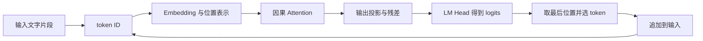

# 1.1 从 token 到下一步预测

> 第一节正式技术课。基础必读，含工程进阶。设备：CPU。正文、示例与练习已编写，本地数学验证通过。预计学习时间：60—90 分钟，含手算与实验。

[课程首页](../../README.md) · [完整目录](../curriculum.md) · [学习路线](../learning-paths.md)

## 学习目标

完成本课后，你应当能够：

1. 区分文字片段、token ID、Embedding 向量和模型输出分数。
2. 沿一次前向计算标出各张量的形状。
3. 手算一个两位置、单头的因果 Attention，说明未来位置为什么不能参与计算。
4. 解释为什么用输入最后一个位置的 logits 预测下一个 token。
5. 运行生成循环，看到新 token 怎样成为下一轮输入。
6. 区分“计算过程正确”与“生成内容有语言质量”。

**过关产出：一份实验 JSON、一张张量维度表，以及对本课五道练习的解释。**

## 前置知识与版本

- 会使用 Python 列表、循环和下标；点积与矩阵乘在本课补充。
- Python 3.11+，普通 CPU；不需要 PyTorch、GPU、容器、模型下载或账户。
- 适用代码：本仓库 `0.1.0.dev0` 中包含 `next-token-demo` 的课程版本。复现时另记实际 `git rev-parse HEAD`，不能只依赖尚未发布的开发版号。
- 本地验证：Windows / CPython 3.11.9。A100/C500 服务与 GPU 性能不属于本课的验证结果。

## 先运行，再带着结果阅读

在包含 `pyproject.toml` 的仓库根目录运行：

```bash
python --version
python -m zero2vllm next-token-demo --output runs/lesson-01/default.json
```

命令会在终端打印结果，并自动建立输出目录。先在 JSON 中找到下面几项；字段之间还有完整矩阵，暂时不用全部看懂：

```json
{
  "input.token_ids": [0, 1],
  "trace.next_token_logits": [0.330238, 1.669762, 2.0, -0.330238, -1.669762],
  "generation.new_token_ids": [2, 2, 2],
  "generation.decoded_text": "我喜欢推理推理推理",
  "verification.passed": true
}
```

这里是便于阅读的**字段路径摘录**，小数保留六位；原文件采用嵌套结构并保留计算精度。已有运行记录见 [CPU 第一课结果](../../reports/lesson-01-next-token.json)。

先记住一个问题：**输入只有两个 token，为什么输出分数有五个？** 读到 LM Head 时，你应该能回答。

## 1. 从一个问题开始：模型怎样接着写

输入“我喜欢”，模型要做的第一件事，是给“接下来出现哪个 token”计算分数。

一次生成可以分成两个步骤：

1. **前向计算**：根据已有输入，得到词表中各个候选 token 的 logits。
2. **选择与继续**：按解码规则选出一个 token，把它接到输入末尾，再开始下一轮。

本课采用贪心选择：每轮选择分数最大的 token。我们研究的是自回归语言模型的一条基础计算路径；真实生成还会涉及采样、停止条件与批处理。[Transformers 文本生成说明](https://huggingface.co/docs/transformers/en/llm_tutorial)



这张图描述本课的小模型。它抽出了真实 Transformer 中的一段计算，没有画出本课尚未实现的多层、多头、MLP 和归一化。

## 2. 文字、token ID 与向量是三件事

### 2.1 Tokenizer 把文字映射为编号

真实 Tokenizer 按模型对应的规则和词表处理文本。一个 token 可能对应整个词、子词、字符或字节片段；不能预设“一个汉字就是一个 token”。不同模型的切分和编号也可能不同。[Tokenizer 官方说明](https://huggingface.co/docs/transformers/en/tokenizer_summary)

为了让第一课能离线手算，我们只定义五个教学词项：

| ID | 教学词项 | Embedding 向量 |
| --- | --- | --- |
| 0 | 我 | `[1, 0]` |
| 1 | 喜欢 | `[0, 1]` |
| 2 | 推理 | `[1, 1]` |
| 3 | 模型 | `[-1, 0]` |
| 4 | 。 | `[0, -1]` |

示例接收已经用空格分开的词项：

```text
"我 喜欢" → ["我", "喜欢"] → [0, 1]
```

代码中的 `encode_pieces()` 只负责空白切分和查表，**不是 Qwen 等模型的真实 Tokenizer**。输入 `我喜欢` 会被当作一个未知词项并报错。这里有意要求空格，让你看清切分与编号两个环节。

### 2.2 Embedding 是按 ID 查表

ID 是整数下标。ID `1` 并不表示向量长度为 1，也不代表某种语义强度。

我们的 Embedding 权重表有 5 行、2 列：每行对应一个词项，每个词项用 2 个数表示。查出 ID `[0, 1]` 对应的两行，就得到输入矩阵：

```text
X = [[1, 0],    ← “我”
     [0, 1]]    ← “喜欢”
```

实际代码先把词项向量和对应位置向量相加。本课为简化手算，把所有位置向量设为 `[0, 0]`，因此相加后仍是 `X`。这只是本例的参数设置；位置表示及 RoPE 等方法在 1.5 展开。

### 2.3 先看懂三个维度

本课用 `T` 表示输入长度，`D` 表示向量维度，`N` 表示词表大小：

```text
T = 2       两个输入位置
D = 2       每个位置用两个数表示
N = 5       一共有五个候选词项
```

| 对象 | 一般形状 | 本例形状 | 读法 |
| --- | --- | --- | --- |
| token ID | `[T]` | `[2]` | 两个编号 |
| Embedding 权重 | `[N, D]` | `[5, 2]` | 五行向量表 |
| 输入 `X` | `[T, D]` | `[2, 2]` | 每个输入位置一行 |
| `Wq/Wk/Wv/Wo` | `[D, D]` | `[2, 2]` | 本例四个投影矩阵 |
| `Q/K/V` | `[T, D]` | `[2, 2]` | 每个位置的查询、键和值 |
| Attention 分数与权重 | `[T, T]` | `[2, 2]` | 行表示谁在查询，列表示看哪个位置 |
| Attention 输出与残差后表示 | `[T, D]` | `[2, 2]` | 保持每位置向量维度 |
| LM Head 权重 | `[D, N]` | `[2, 5]` | 映射到五个词表分数 |
| 全部位置的 logits | `[T, N]` | `[2, 5]` | 每个输入位置各有五个候选分数 |

本例省略了大小为 1 的 batch 维度。真实模型中的头维度、头数和 GQA 分组在后续章节单独说明。

## 3. 手算一次因果 Attention

### 3.1 点积和投影

两个向量的点积，是把对应元素相乘再求和：

```text
[a, b] · [c, d] = a*c + b*d
```

用一个行向量乘矩阵时，对矩阵每一列分别做点积。代码中的 `linear(vector, weight)` 就执行这个操作。

Attention 使用三种投影：`Q = X Wq`、`K = X Wk`、`V = X Wv`。可以把 Q 理解为当前位置的查询，K 用来计算匹配分数，V 提供被加权汇总的内容；它们都是数值向量。

本课把 `Wq/Wk/Wv` 都设为单位矩阵，因此：

```text
Wq = Wk = Wv = [[1, 0],
                [0, 1]]

Q = K = V = [[1, 0],
             [0, 1]]
```

三者相等是我们为了手算选定的参数，不是 Attention 对权重的要求。

### 3.2 计算匹配分数

单头 scaled dot-product attention 的分数为：

$$
S = \frac{QK^\top}{\sqrt{D}}
$$

`K` 转置后形状仍是 `[2, 2]`，但每一列现在对应一个位置的 key。两两做点积：

```text
Q K^T = [[1, 0],
         [0, 1]]

S = [[0.707107, 0       ],
     [0,        0.707107]]
```

例如 `S[1][0]` 表示位置 1 的 query 与位置 0 的 key 的匹配分数。点积缩放与因果掩码来自标准 Attention 计算形式；本课数值例子为独立构造。[Attention Is All You Need，§3.2](https://arxiv.org/pdf/1706.03762)

### 3.3 因果掩码：每个位置只能看自己和前面

位置 0 只有“我”，不能使用位置 1 的“喜欢”来预测它后面的 token。位置 1 则可以同时使用“我”和“喜欢”。

```text
可见性 = [[可以, 禁止],
          [可以, 可以]]

掩码后分数 = [[0.707107, -∞      ],
              [0,         0.707107]]
```

**被遮挡的分数不能简单写成 0。** 因为 `exp(0)=1`，它仍会分到权重。数学上可用负无穷；本课代码直接把未来位置排除在 softmax 输入之外，再为它们补上零权重。

JSON 的 `masked_scores` 用 `null` 标记被遮挡位置，这是记录格式，不是模型把 `null` 当数字计算。

### 3.4 Softmax 把每行分数变成权重

对一行分数 `s`：

$$
\operatorname{softmax}(s)_j = \frac{e^{s_j}}{\sum_k e^{s_k}}
$$

位置 0 只有一个可见位置，所以它的权重是 `[1, 0]`。

位置 1 的可见分数是 `[0, 1/√2]`：

```text
α = exp(0) / (exp(0) + exp(1/√2)) ≈ 0.330238
β = exp(1/√2) / (exp(0) + exp(1/√2)) ≈ 0.669762

A = [[1,        0       ],
     [0.330238, 0.669762]]
```

每行权重之和为 1，未来位置的权重为 0。代码会先减去每行最大值再求指数，以减少数值溢出风险；这个平移不会改变 softmax 的结果。

### 3.5 用权重汇总 V，再加回残差

注意力上下文为 `C = A V`。本例的 `V` 是单位矩阵，因此：

```text
C = [[1,        0       ],
     [0.330238, 0.669762]]
```

模型再计算输出投影 `C Wo`，并加回输入 `X`。本课 `Wo` 也为单位矩阵：

```text
H = X + C Wo

H = [[2,        0       ],
     [0.330238, 1.669762]]
```

第二行同时保留了当前输入位置的表示，并混入历史上下文的信息。到这里，每个位置仍然只有 2 个数；还没有得到五个候选词项的分数。

## 4. LM Head：从向量变成词表分数

### 4.1 为什么得到五个 logits

本课 LM Head 权重为：

```text
W_head = [[1, 0, 1, -1,  0],
          [0, 1, 1,  0, -1]]
             我 喜欢 推理 模型 。
```

上面的词项标签按五列依次对应；权重矩阵为 `[2, 5]`。计算 `L = H W_head`，就把每个位置的二维表示投影到五维分数：

```text
L[0] = [2,        0,        2, -2,        0       ]
L[1] = [0.330238, 1.669762, 2, -0.330238, -1.669762]
```

词表里有五个词项，所以每行有五个分数。输入长度只决定有多少行。

**Logits 是未归一化分数，可以为负，也不要求和为 1。** 若希望得到本轮词表分布，可对最后一行 logits 做 softmax：

| 候选 ID | 词项 | 最后一行 logit | Softmax 后的概率，约 |
| --- | --- | --- | --- |
| 0 | 我 | 0.330238 | 0.092764 |
| 1 | 喜欢 | 1.669762 | 0.354100 |
| 2 | 推理 | 2.000000 | 0.492660 |
| 3 | 模型 | -0.330238 | 0.047922 |
| 4 | 。 | -1.669762 | 0.012554 |

这些概率只是这个手工模型的数值结果，不能解释为它理解中文后的置信度。

### 4.2 为什么只取最后一行

位置 `i` 的输出用于预测**位置 `i+1`** 的 token：

```text
位置 0：只看到“我”          → 预测“我”之后的 token
位置 1：看到“我 喜欢”       → 预测整个 prompt 之后的 token
```

现在用户已经给出了完整 prompt“我 喜欢”。要接着它生成，应使用 `L[1]`，也就是 `logits[-1]`。

如果拿第一行，就只使用了“我”的上下文；如果沿两个位置那一维求最大值，也没有得到合法的词表选择规则。生成时要先选对位置，再在这一行的**词表维度**上选 token。

### 4.3 两次 softmax 的对象不同

| 发生位置 | 输入对象 | 归一化的维度 | 解决的问题 |
| --- | --- | --- | --- |
| Attention 内部 | 当前 query 对可见 key 的分数 | 上下文位置 | 从哪些位置汇总多少信息 |
| 词表输出处 | 最后位置的 logits | 候选 token | 下一个 token 的分布是什么 |

本课贪心选择直接对 logits 求 `argmax`。Softmax 保持大小关系，因此不必先计算概率才能找出最大项。这里额外输出概率，是为了帮助你分清 logits 与概率；它没有改变生成规则。

## 5. 把一个 token 接回去：生成循环

默认第一步选中 ID `2`，对应“推理”。它被追加到输入：

```text
第 1 次：输入 [0, 1]       → 取第 1 行 logits → 输出 2
第 2 次：输入 [0, 1, 2]    → 取第 2 行 logits → 输出 2
第 3 次：输入 [0, 1, 2, 2] → 取第 3 行 logits → 输出 2
```

行号从 0 开始。最终把五个词项拼接为“我喜欢推理推理推理”。这是固定运行三步的结果，没有 EOS 停止逻辑。

关键循环可以概括为：

```python
# 教学伪代码；可运行实现见 attention.py 中的 generate。
for step in range(max_new_tokens):
    logits = model.forward_full(prompt + generated, counter)[-1]
    next_id = max(range(model.vocab_size), key=logits.__getitem__)
    generated.append(next_id)
```

真实 Transformer 会把输入表示经过多层计算后交给 LM Head。我们的手工模型没有训练，连续输出“推理”只说明所选权重下这个词项分数最高。**模型有前向与生成循环，并不等于它已经具备语言能力。**

后面会把三件事情分别补齐：1.2 观察首次处理与后续生成的差异；1.3 复用历史 K/V；Part 2 接入 PyTorch 与真实模型权重。

## 6. 代码阅读：只跟一条调用链

```text
next-token-demo
  └─ next_token_experiment()
       ├─ encode_pieces()      文字片段 → ID
       ├─ teaching_model()     显式设置本课的五词项模型
       ├─ generate()           复用已有完整重算生成循环
       └─ trace_forward()      展开第一轮中间量，并对照已有 forward_full()
```

| 代码入口 | 先关注什么 |
| --- | --- |
| [next_token.py](../../zero2vllm/reference/next_token.py) | 手工词表、所有权重、每个中间矩阵与输出记录 |
| [attention.py](../../zero2vllm/reference/attention.py) | `linear`、`softmax`、`forward_full`、`generate`；这一课先读完整重算路径 |
| [test_next_token.py](../../tests/test_next_token.py) | 手算黄金值、最后一行选择、因果性、输入与上下文边界 |

`trace_forward()` 是为课程增加的可观察展开；实际多步生成继续使用原有模型。报告中的 `max_abs_reference_error` 检查展开结果是否与原有 `forward_full()` 一致。

只比较两个实现还不够：如果两个实现都犯了同一种错误，它们也可能相等。所以测试另用本课的手算表达式检查 logits，并覆盖非单位投影、非零位置向量和追加未来 token 的情况。

## 7. 动手练习与参考答案

先自己预测，再运行。每道题在个人笔记中写出依据，不能只贴 `passed: true`。

### 练习 A：标出维度

把输入改成“我 喜欢 推理”，保持词表和模型宽度不变。写出 `X`、`QK^T`、`W_head`、logits 与下一词分数的形状。

```bash
python -m zero2vllm next-token-demo --prompt "我 喜欢 推理" --max-new-tokens 1 --output runs/lesson-01/three-tokens.json
```

<details>
<summary>参考答案 A</summary>

`X: [3, 2]`；`QK^T: [3, 3]`；`W_head: [2, 5]`；logits: `[3, 5]`；最后一行: `[5]`。只改变输入长度，不会改变词表大小或权重的形状。

</details>

### 练习 B：手算最后位置

对默认输入独立计算 `α = 1/(1+exp(1/√2))`，再写出最后位置的五个 logits。说明最大项在哪里。

<details>
<summary>参考答案 B</summary>

`α ≈ 0.3302384506733431`；残差后的表示为 `[α, 2-α]`；logits 为 `[α, 2-α, 2, -α, α-2]`。最大项为下标 `2`，对应“推理”。

</details>

### 练习 C：只输入一个 token

改为只输入“我”，只生成一步。预测 Attention 权重，以及最高分并列时会返回哪个词项。

```bash
python -m zero2vllm next-token-demo --prompt "我" --max-new-tokens 1 --output runs/lesson-01/one-token.json
```

<details>
<summary>参考答案 C</summary>

Attention 权重为 `[[1.0]]`。logits 为 `[2, 0, 2, -2, 0]`，ID `0` 和 `2` 并列。现有 Python 生成循环按 ID 从小到大遍历，`max` 在并列时保留先遇到的项，因此返回 ID `0`。这是本示例的并列处理约定，不能直接推广为所有 GPU 后端的约定。

</details>

### 练习 D：能不能看到未来

比较默认实验与练习 A 的 `trace.all_position_logits`：新增第三个输入 token 后，前两行是否改变？如果把被遮挡位置的 score 直接填成 `0`，会发生什么？

<details>
<summary>参考答案 D</summary>

前两行保持一致，因为因果 Attention 不读取新增的未来位置。用 `0` 分数代替遮挡，会使未来位置在 softmax 中获得非零权重，破坏因果约束。对应回归见 `test_future_tokens_leave_existing_rows_unchanged`。

</details>

### 练习 E：识别输入错误

执行下面的命令，解释错误发生在计算链的哪个位置，并修正输入：

```bash
python -m zero2vllm next-token-demo --prompt "我喜欢"
```

<details>
<summary>参考答案 E</summary>

它应报告 `Unknown teaching token` 并以状态码 `2` 退出。错误发生在教学词项查表阶段，尚未执行 Attention。改成 `--prompt "我 喜欢"`；真实模型应使用其配套 Tokenizer，而不是照搬本课的空格规则。

</details>

## 8. 工程进阶与平台说明

工程师可以额外检查以下问题：

- **权重布局**：本课权重按 `[输入维度, 输出维度]` 存放，`linear` 计算行向量乘矩阵。接入其他框架时，先核实它保存的是哪一种布局，再决定是否转置。
- **输入位置**：本例位置向量为零，正文手算无法单独证明位置偏移处理正确；测试会使用非零位置向量与非单位投影进行补充对照。
- **生成边界**：最多处理 16 个输入位置。最后一个输出返回后不必再次前向；预算按生成循环真正消耗的位置检查。
- **正确性口径**：检查全部位置的 logits 和因果约束，再看最终 token。只比较 token，可能遗漏分数已经错误但最大项没有变化的情况。

A100 和 C500 学习本课使用同一条 CPU 路径。这里没有选择注意力后端、安装 CUDA/MACA、执行 GPU 内核或测量性能。本课的完整重算与后续 KV Cache 实验共用数学参考；APC、FlashAttention、量化和图执行等组合留待对应章节验证。

## 9. 常见问题与排错

| 现象 | 检查与处理 |
| --- | --- |
| 找不到 `zero2vllm` 模块 | 回到包含 `pyproject.toml` 和 `zero2vllm/` 的仓库根目录 |
| 提示不存在 `next-token-demo` 命令 | 当前 checkout 可能早于本课；核对课程版本和 `python -m zero2vllm --help` |
| 找不到 Python 或版本太低 | 先准备 Python 3.11+；Windows 有多个版本时可用 `py -3.11 -m zero2vllm ...` 选择对应解释器 |
| 未知教学词项 | 使用上表中的词项，并用空格分隔；标点 `。` 也要单独分隔 |
| 提示超过上下文容量 | 缩短 prompt 或减少输出步数；本课模型上下文上限是 16 |
| 输出不断重复“推理” | 这是手工权重的预期结果；本课验证计算过程，没有训练语言模型 |
| 终端显示不方便阅读 | 用编辑器按 UTF-8 打开 `--output` 保存的 JSON 文件 |

## 10. 完成标准与下一课

你可以用下面的清单验收第一课：

- [ ] 默认命令运行成功，JSON 中 `verification.passed` 为 `true`。
- [ ] 不看答案，填对练习 A 的五组维度。
- [ ] 手算得到默认 logits，逐项与 JSON 对照；手工取六位小数时用 `1e-6` 量级核对，代码内部对照容差为 `1e-12`。
- [ ] 说明两个 softmax 各自沿哪个维度归一化。
- [ ] 说明为什么取最后一行，以及下一轮输入如何增加一个 token。
- [ ] 完成单 token、追加输入与未知词项实验，解释结果。
- [ ] 能说明哪些结论来自数学参考，哪些仍需要真实模型和 GPU 实验。

维护者本地运行的验收入口：

```bash
python -m unittest discover -s tests -p test_next_token.py -v
python scripts/course_docs.py --check
```

**下一课：1.2《Prefill 与 Decode》。** 我们会继续使用这条生成链，比较首次处理整个 prompt 与后续逐 token 生成的计算对象、形状和工作量。已有 [KV Cache 引导实验](../labs/01-kv-cache.md)可先观察；缓存容量与缓存正确性的完整推导在 1.3 展开。

## 参考资料与复现记录

- [Attention Is All You Need](https://arxiv.org/abs/1706.03762)，§3.2：Attention 的基本形式与因果约束；本课矩阵和词表独立构造。
- [Transformers Tokenization algorithms](https://huggingface.co/docs/transformers/en/tokenizer_summary)：真实分词的补充阅读，本课没有安装或调用该库。
- [Transformers Text generation](https://huggingface.co/docs/transformers/en/llm_tutorial)：生成过程与解码的补充阅读，本课没有运行其模型示例。
- [本课默认原始结果](../../reports/lesson-01-next-token.json)与[本地验证记录](../../reports/validation.md)。上游资料查阅日期：2026-09-15。
