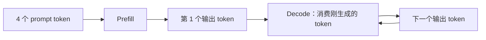

# 1.2 Prefill 与 Decode

[本篇目录](../README.md) · [全部课程](../../README.md) · [上一节 1.1](../01-next-token/README.md) · [下一节 1.3](../03-kv-cache/README.md)

> 基础必读，含工程进阶。CPU 正文、参考代码、实验与练习已提供。计算量/访存估算使用明确的假设；没有 GPU 延迟或带宽实测。建议 90—120 分钟。

[Part 1 学习与命令总表](../README.md) · [上一课：下一词预测](../01-next-token/README.md) · [下一课：KV Cache](../03-kv-cache/README.md)

## 学习目标与前置

- 画出一次 Prefill 和后续 Decode 的输入、输出及缓存状态。
- 对给定 prompt/output 长度计算模型调用次数、投影位置数和 Attention 配对数。
- 根据 `X[M,K] × W[K,N]` 推导 FLOPs、最低数据搬运量和算术强度。
- 使用 Roofline 解释一个给定形状的潜在限制，并说明估算遗漏了什么。

前置：完成 1.1，知道 `logits[-1]` 与因果掩码。Python 3.11+，无需 PyTorch 或 GPU。适用代码为含 `phase-demo` 的 `0.1.0.dev0` checkout；复现记录代码 commit 和工作区状态。

## 1. 先把两阶段放到同一条生成链

假设 prompt 是 `[1,2,3,4]`，需要生成 8 个 token。

**Prefill** 处理已经给出的输入序列，形成上下文表示与 K/V，最后位置的 logits 通常用于选出第一个新 token。它不是“先不生成，只负责加载模型”。模型权重加载、编译和预热属于另外的工作。

**Decode** 继续生成。在普通自回归、启用 KV Cache 且没有推测解码的路径中，每个请求每轮消费上一步生成的一个 token，得到下一个 token 的分数。



本例共 8 次前向调用：1 次 Prefill，7 次 Decode。第 8 个输出已经返回，若请求结束，就无需再消费它。推测解码、Chunked Prefill 和混合批次会改变每次调度处理的形状，不能照搬“一次调用只生成一个 token”的计数到所有执行方式。

## 2. 运行并逐步读结果

在仓库根目录运行：

```bash
python -m zero2vllm phase-demo --output .local/runs/part-01-inference/02-prefill-decode/phase-default.json
python -m zero2vllm phase-demo --help
```

代码入口：[phases.py](../../../../zero2vllm/reference/phases.py)。它复用 [attention.py](../../../../zero2vllm/reference/attention.py) 的缓存前向，与完整重算生成逐步对齐。

对照[本地默认原始结果](results/baseline/02-phases.json)；更改参数后的结果由你的运行生成。

先打开 `steps`，再看 `cached_work` 与 `full_recompute_work`。默认 CPU 模型宽度为 8：

| 步骤 | 阶段 | 输入 token 数 | 本次位置编号 | Q 形状 | 更新后 K/V 形状 | Attention 配对数 |
| --- | --- | --- | --- | --- | --- | --- |
| 1 | Prefill | 4 | 0—3 | `[4,8]` | 各 `[4,8]` | `1+2+3+4=10` |
| 2 | Decode | 1 | 4 | `[1,8]` | 各 `[5,8]` | 5 |
| 3 | Decode | 1 | 5 | `[1,8]` | 各 `[6,8]` | 6 |
| … | … | … | … | … | … | … |
| 8 | Decode | 1 | 10 | `[1,8]` | 各 `[11,8]` | 11 |

检查字段：

- `input_token_ids`：此轮实际送入缓存前向的 token。
- `absolute_positions`：它们在整个序列中的位置，不是本次输入列表的局部下标。
- `projected_positions`：本轮计算了几个位置的 Q/K/V；它不是 FLOP 数。
- `attention_score_pairs`：本轮计算了多少 query/key 位置对；不含向量点积的宽度。
- `next_token_logits`：完整词表上的分数。
- `verification.passed`：缓存与重算生成对齐，默认最大 logits 差为 0。

## 3. 手算工作量：先数对象，再算 FLOPs

记 prompt 长度为 `P`，输出个数为 `O≥1`。

```text
完整重算投影位置数 = P + (P+1) + … + (P+O-1)
                  = O*P + O*(O-1)/2

缓存路径投影位置数 = P + O - 1

Prefill 因果配对数 = P*(P+1)/2
后续 Decode 配对数 = (P+1) + … + (P+O-1)
```

代入 `P=4,O=8`：

```text
重算投影位置 = 60；缓存投影位置 = 11
缓存总配对数 = 10+5+6+7+8+9+10+11 = 66
重算总配对数 = 10+15+21+28+36+45+55+66 = 276
```

缓存没有消灭新 query 对历史 K/V 的访问。长上下文 Decode 仍可能有大量 KV 读取；位置数减少比例不能直接当作 GPU 加速比。

完整 Attention 的主要乘加还要乘头数和头维度。忽略 softmax 等额外操作时，`QKᵀ` 与 `AV` 约为每个可见位置对 `4d` FLOPs。真正的 fused kernel 可能计算被 mask 的 tile 或执行额外步骤，所以它也只是数学工作量。

## 4. 从矩阵乘看计算与数据搬运

对一个线性层：

```text
X[M,K] × W[K,N] → Y[M,N]
```

`M` 是本轮参与计算的位置数。单请求 Prefill 可有较大的 `M`；普通 Decode 每请求通常提供一个位置，批处理后 `M` 可以等于多请求的有效 token 数。

按乘法、加法各算一次的常用计数约定：

```text
FLOPs ≈ 2*M*K*N
```

假设每个元素占 `b` 字节、权重和输入各读一次、输出写一次：

```text
权重字节 = K*N*b
输入与输出字节 = (M*K + M*N)*b
理想搬运字节 = (K*N + M*K + M*N)*b
算术强度 AI = FLOPs / 理想搬运字节，单位 FLOP/byte
```

`M` 较小时，读入一份大权重却只计算少量输出，权重复用低。增大 `M`，多个位置共用同一份权重，算术强度通常上升。实际缓存命中、权重量化、激活格式和 tile 重读都会改变搬运量。

### HBM、SRAM 与寄存器

| 层级 | 可以怎样理解 | 与本课关系 |
| --- | --- | --- |
| HBM / 设备显存 | 保存大规模权重、激活和 KV 的设备存储 | 容量大，但数据仍需要搬到计算单元附近 |
| 片上 SRAM / shared memory 等 | kernel 分块暂存和复用的数据 | 减少同一块数据反复访问显存，受容量与硬件布局限制 |
| 寄存器 | 线程执行中保存操作数和累加结果 | 很近且很有限，使用过多也可能影响并发 |

这是计算层级的概念图，不是对所有 CUDA/MACA 架构细节的统一定义。L2、访存合并、bank conflict、occupancy 和具体容量在算子章节结合平台解释。

## 5. Roofline：给定假设下的下界

假设有效计算上限为 `F_peak`，数据搬运带宽为 `BW`：

```text
计算时间下界 = FLOPs / F_peak
搬运时间下界 = bytes / BW
理想时间下界 = max(计算时间下界, 搬运时间下界)
性能上界 = min(F_peak, AI*BW)
转折点 AI = F_peak / BW
```

这里取 `max` 是允许理想重叠后的下界，不是声称计算和传输一定完全重叠。Roofline 用于建立瓶颈假设；不能把这个下界报告为真实延迟。[Roofline 原始技术报告](https://www2.eecs.berkeley.edu/Pubs/TechRpts/2008/EECS-2008-134.html)

本实验的**分析模型**独立于宽度为 8 的 CPU 实验。默认取 `K=N=4096,b=2`，假设设备峰值 100 TFLOP/s、带宽 1000 GB/s；这些数值是教学输入，**没有绑定 A100 或 C500**。

| 项目 | Prefill 分析模型 | Decode 分析模型 |
| --- | --- | --- |
| `M` | 128 | 1 |
| FLOPs | 4,294,967,296 | 33,554,432 |
| 理想搬运字节 | 35,651,584 | 33,570,816 |
| AI，约 | 120.471 FLOP/byte | 0.999512 FLOP/byte |
| 计算下界，约 | 0.042950 ms | 0.000336 ms |
| 搬运下界，约 | 0.035652 ms | 0.033571 ms |
| 本假设中更大的下界 | 计算 | 搬运 |

报告位于 `gemm_estimates`，每项单独标记为 `analytical_estimate`。`--bandwidth-gbps` 在本课程明确使用十进制 **GB/s**，不是 Gbit/s；1 TFLOP/s = `10^12` FLOP/s。

## 6. 改参数时知道自己改了什么

| 参数 | 默认 | 修改对象 |
| --- | --- | --- |
| `--prompt` | `1,2,3,4` | CPU 生成输入，ID 在 0—15 内 |
| `--max-new-tokens` | 8 | CPU 输出步数，至少 1；受上下文 128 约束 |
| `--seed` | 7 | CPU 小模型的权重随机种子 |
| `--prefill-tokens` | 128 | 线性层估算的 Prefill `M` |
| `--decode-batch` | 1 | 线性层估算的 Decode `M`；不会创建 CPU 多请求调度器 |
| `--width` | 4096 | 线性层估算的 `K=N`；不会改变 CPU 模型宽度 |
| `--peak-tflops` / `--bandwidth-gbps` | 100 / 1000 | 分析模型假设，必须为正有限数 |
| `--output` | 不保存 | JSON 文件；父目录自动创建 |

```bash
python -m zero2vllm phase-demo --prompt 1,2 --max-new-tokens 3 --output .local/runs/part-01-inference/02-prefill-decode/phase-short.json
python -m zero2vllm phase-demo --decode-batch 64 --output .local/runs/part-01-inference/02-prefill-decode/phase-batch64.json
python -m zero2vllm phase-demo --peak-tflops 50 --bandwidth-gbps 500 --output .local/runs/part-01-inference/02-prefill-decode/phase-assumptions.json
```

只修改 `--decode-batch` 时，CPU 轨迹应保持相同，分析模型的 `M` 和 AI 改变。想测真实 batching，需要多请求引擎、调度及 GPU 计时，不能从该开关推断实测吞吐。

## 7. 练习与答案

### A. 改短输入

对 `P=2,O=3`，先写出每次调用输入长度和位置号，再运行上面的短输入命令。

<details>
<summary>参考答案 A</summary>

缓存输入长度 `[2,1,1]`，绝对位置依次 `[0,1]、[2]、[3]`。重算投影 `2+3+4=9`，缓存投影 `2+1+1=4`；配对数分别 `3+6+10=19` 与 `3+3+4=10`。

</details>

### B. 独立算一个 GEMM

`M=2,K=3,N=4,b=2`，FLOPs 和搬运量是多少？

<details>
<summary>参考答案 B</summary>

FLOPs 为 `2*2*3*4=48`；权重 24 字节；输入 12 字节；输出 16 字节；合计 52 字节。AI 为 `48/52≈0.923077`，不能把元素数直接当字节数。

</details>

### C. Decode 一定受带宽限制吗

运行 batch64 例子，并解释大批次、长 KV、权重量化可能怎样改变判断。

<details>
<summary>参考答案 C</summary>

更大 `M` 提高权重复用，使 GEMM AI 上升，但该假设下是否越过转折点仍要计算。长 KV 带来这里未计入的缓存读取；量化减少部分字节同时增加解码/缩放操作，并改变可用计算峰值。必须针对真实算子和负载分析。

</details>

### D. 为什么不能把 Prefill Python 循环耗时当 GPU Prefill 延迟

<details>
<summary>参考答案 D</summary>

本参考逐位置使用 Python 列表，未实现 GPU 的并行矩阵乘、tile、异步提交和显存层级。它证明输入语义与计数，不是设备执行效率。

</details>

## 8. 排错、工程进阶与完成标准

若出现 `Generation exceeds...`，检查 `P+O-1≤128`；若宽度或带宽为 0，估算应直接报错，不能返回无穷大结果。运行命令时从项目根目录开始。

工程师继续画出一个真实模型层的 QKV、Attention、输出投影、MLP 形状，并分开估算权重、KV 和激活。GPU 测量需预热、同步、固定 batch/token 分布，并记录 A100/C500 各自实际软件栈；此处不先填入预计值。

- [ ] 解释第一个输出来自哪次调用，最后一个输出为何没有继续前向。
- [ ] 独立算出默认 60/11 与 276/66。
- [ ] 算对 GEMM 的 FLOPs、字节和单位。
- [ ] 修改分析参数并解释结果，区分 CPU 轨迹与假设估算。
- [ ] `verification.passed` 为 `true`，能说明这个检查的范围。

验证代码见 [test_part1.py](../../../../tests/reference/test_part1.py) 的 `PhaseTests`。下一节详细展开 [KV Cache 的内容、更新和容量](../03-kv-cache/README.md)。参考资料查阅日期：2026-09-15。
