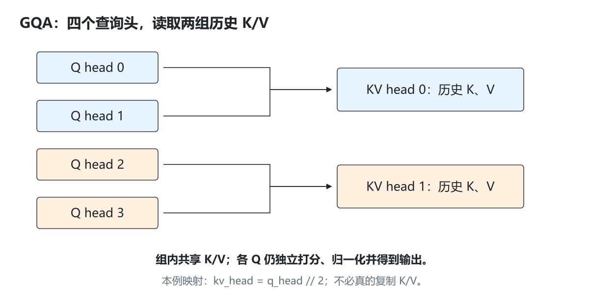

# 1.3 KV Cache 的作用

[本篇目录](../README.md) · [全部课程](../../README.md) · [上一节 1.2](../02-prefill-decode/README.md) · [下一节 1.4](../04-performance-metrics/README.md)

> 基础必读，含工程进阶。CPU 缓存、分块与 GQA 数学参考已实现；容量是按结构计算的 payload，不是实测显存占用。建议 90—120 分钟。


## 学习目标与准备

完成后应能解释为什么缓存 K/V、位置如何继续、GQA 如何共享 KV heads，以及如何估算每 token 的缓存容量。交付三份记录：生成对照、分块轨迹、容量对照。

前置：1.1 与 1.2。Python 3.11+，无第三方依赖。代码为含 `kv-demo` 的 `0.1.0.dev0` checkout；本地验证环境见[验证记录](../../../../reports/history/validation-before-restructure.md)。

## 1. 为什么历史 K/V 可以复用

在固定权重、固定位置、因果 Attention 的模型中，历史位置 `j` 的表示不依赖后来追加的 token。历史 K/V 因此可以保留；新位置计算自己的 Q/K/V，再查询历史缓存。

```text
第一次：输入 [t0,t1,t2]
        缓存 K=[k0,k1,k2]，V=[v0,v1,v2]
        最后一个 query q2 用于得到下一词分数

第二次：输入刚生成的 t3，位置必须是 3
        追加 k3、v3
        q3 查询 [k0,k1,k2,k3]，汇总 [v0,v1,v2,v3]
```

**为什么通常不缓存 Q？** 之后的新 token 需要自己的 query；过去的 query 对应已经做过的预测。基础自回归路径一般没有再次使用历史 Q 的需要。某些专门模型或优化可能有其他缓存对象，必须按实际算法定义。

**缓存复用有前提。** 换了模型权重、LoRA、位置解释或影响该表示的输入，旧缓存可能不再有效。跨请求前缀共享还需要匹配条件、引用计数和隔离；不能仅凭 token 文本相似就共用 Python 列表。可先用 2.6 的 CPU 实验观察共享，再在 Part 5 对照真实 vLLM 的 APC。

## 2. 先运行完整生成对照

```bash
python -m zero2vllm demo --output .local/runs/part-01-inference/03-kv-cache/kv-generation.json
```

这条已有命令比较每一步完整词表的 logits：默认 4 个输入、8 个输出，重算投影 60 个位置，缓存投影 11 个位置；最大 logits 差应不超过 `1e-12`。详细轨迹解释见[原引导实验](lab.md)。

本课新增命令查看分块输入、实际 K/V 和 GQA：

```bash
python -m zero2vllm kv-demo --output .local/runs/part-01-inference/03-kv-cache/kv-default.json
python -m zero2vllm kv-demo --help
```

它包含三个相互独立的小实验：

默认运行的[原始 JSON](results/baseline/03-cache.json)可供逐项复核。

| JSON 字段 | 内容 | 模型或假设 |
| --- | --- | --- |
| `chunks`、`cached_keys`、`cached_values` | 同一段 prompt 分块送入缓存前向 | 单头、宽度 8、固定随机权重 |
| `grouped_query_example` | 按组读取与显式复制 K/V 的输出比较 | 4 个 Q heads、2 个 KV heads、头维度 2 |
| `capacity_estimates` | MHA/GQA/MQA 的理论 payload | 默认 32 层、32 个 Q heads、头维度 128、元素 2 字节 |

三者的形状都在报告中明示；不要用第三项的 512 MiB 解释第一项 Python 小模型的进程内存。

## 3. 分块 Prefill：局部下标不等于绝对位置

默认输入 `[1,2,3,4,5]`，`chunk_size=2`：

| 调用 | 本次输入 | 调用前缓存长度 / offset | 绝对位置 | 调用后缓存长度 |
| --- | --- | --- | --- | --- |
| 1 | `[1,2]` | 0 | `[0,1]` | 2 |
| 2 | `[3,4]` | 2 | `[2,3]` | 4 |
| 3 | `[5]` | 4 | `[4]` | 5 |

第三次输入只有 1 个 token，这是正常尾块。每次调用中：

```python
# 关键逻辑摘录，完整实现位于 attention.py。
offset = len(cache.keys)
for i, token in enumerate(tokens):
    hidden = model._embed(token, offset + i)
    # 在绝对位置 offset+i 计算新 Q/K/V，再追加缓存并做因果 Attention。
```

本代码的查表位置向量不是零，故错误地把新块位置从 0 开始会改变结果。1.1 中位置向量全零，单靠那个特例无法抓到这个 bug。

注意：本参考循环逐位置追加，因此同一块中后面的 token 也不会泄漏到前面。在 GPU 矩阵实现中，这个约束需要正确的带 offset 因果 mask。例如已有 3 个历史 token，再处理两个新位置时，可见列分别为 `0—3` 与 `0—4`，不能直接套一个没有偏移的 `2×5` 左上角三角矩阵。

```bash
python -m zero2vllm kv-demo --chunk-size 1 --output .local/runs/part-01-inference/03-kv-cache/kv-chunk1.json
python -m zero2vllm kv-demo --chunk-size 3 --output .local/runs/part-01-inference/03-kv-cache/kv-chunk3.json
```

两份报告的分块过程不同，但拼接后的 logits 和最后 K/V 应相同；`max_abs_chunk_logit_error` 应不超过 `1e-12`。

## 4. MHA、MQA、GQA 到底改了什么

设 Q head 数为 `Hq`，KV head 数为 `Hkv`。

| 结构 | 头数关系 | 谁共享 K/V |
| --- | --- | --- |
| MHA | `Hkv=Hq` | 每个 Q head 使用自己的 K/V head |
| MQA | `Hkv=1` | 所有 Q heads 共用一组 K/V |
| GQA | `1<Hkv<Hq` | 每组 Q heads 共用一个 KV head |

本教学实现要求 `Hq % Hkv == 0`，分组采用连续头编号：

```text
Hq=4,Hkv=2，group_size=2
Q head 0、1 → KV head 0
Q head 2、3 → KV head 1
kv_head = q_head // group_size
```

K/V 存储不需要真的复制成 4 个头；每个 Q head 按组索引即可。实验同时用显式复制的 4 头版本做数学对照，默认最大差为 0。显式复制适合解释，并不是节约显存的实现。

GQA 是模型结构和训练相关选择，不是把一个已有 MHA 模型的缓存头数改小就一定等价。上面的数值对齐只比较**同一套共享 K/V**的两种读取方式。[GQA 论文](https://arxiv.org/abs/2305.13245)

### 4.1 共享的是 K/V，四个 query 仍各算各的权重



*图｜相同颜色表示读取同一组 K/V；Q head 0 与 1 的查询向量可以不同，因此它们的 Attention 权重和输出也可以不同。*

例如 Q0 更偏向历史开头、Q1 更偏向最近位置，即使二者读取同一份 K/V，点积结果也不必相同。GQA 没有把两份 query 合成一份，也没有要求各头输出一致。报告的正确性对照，是比较“按组索引”和“先复制 K/V 再读取”这两种实现；两边仍使用同样的 query。

### 4.2 缓存内容、存放位置与使用权

这三个问题会在第二篇分开实现：1.3 先检查缓存里的数值；[2.5 分页缓存](../../part-02-engine/05-paged-caching/README.md)解释逻辑位置怎样找到物理张量；[2.6 前缀缓存](../../part-02-engine/06-prefix-caching/README.md)解释两个请求共享物理块后，谁还在使用它。数值相同不代表可以任意释放，物理地址变化也不应改变模型结果。

## 5. 从每 token 推到整段序列的容量

假设各层结构相同，K/V 宽度相等，完整缓存所有位置：

```text
每 token、每层元素数 = 2 * Hkv * d_head
每 token、全部层字节 = 2 * L * Hkv * d_head * b
总 payload 字节 = B * T * 2 * L * Hkv * d_head * b
```

其中 `2` 代表 K 和 V，`L` 是层数，`B` 是等长请求数，`T` 是每请求已缓存长度，`b` 是每元素字节数。变长请求应把 `B*T` 改成各请求缓存长度之和。

默认教学配置 `L=32,Hq=32,d_head=128,b=2,T=4096,B=1`：

| 结构 | `Hkv` | 每 token 全层字节 | 4096 token 总量 |
| --- | --- | --- | --- |
| MHA | 32 | 524,288 = 512 KiB | 2 GiB |
| GQA | 8 | 131,072 = 128 KiB | 512 MiB |
| MQA | 1 | 16,384 = 16 KiB | 64 MiB |

`KiB=2^10`、`MiB=2^20`、`GiB=2^30` 字节。设备规格中常见十进制 GB，比较时需统一单位。

报告包含 `bytes_per_token_all_layers`、`payload_bytes`、`payload_mib`、`payload_gib`。改变负载：

```bash
python -m zero2vllm kv-demo --sequence-length 8192 --batch-size 4 --output .local/runs/part-01-inference/03-kv-cache/kv-capacity.json
python -m zero2vllm kv-demo --kv-heads 4 --output .local/runs/part-01-inference/03-kv-cache/kv-gqa4.json
```

第一条的默认 GQA payload 为 `512 MiB × 2 × 4 = 4 GiB`。这里只估算容量，不会真的创建 8192 token 的 CPU 模型输入。

### 这还不是进程所需的全部显存

真实预算还包括权重、激活、通信/算子 workspace、图执行 buffer、页尾浪费、分配器开销及运行时保留空间。量化 KV 还可能有 scale、对齐和特定布局。混合层、Sliding Window、MLA 或并行复制的存储不能机械套用同一公式。

例如块大小为 `Pblock` 时，单请求预留的 token 槽位可按 `ceil(T/Pblock)*Pblock` 计算；多个请求应各自向上取整后求和。APC 共享块还涉及物理唯一块和逻辑引用的区别。

## 6. 代码契约与错误处理

代码入口：[kv_geometry.py](../../../../zero2vllm/reference/kv_geometry.py)、[attention.py](../../../../zero2vllm/reference/attention.py)。

| 函数 | 输入和输出 | 关键约束 |
| --- | --- | --- |
| `forward_cached(tokens, cache, counter)` | 一块 token → 对应各位置 logits；追加 K/V | 缓存属于同一模型；K/V 长度一致；先检查整块是否合法 |
| `grouped_attention(q,k,v)` | 最新位置的所有 Q heads，历史 K/V → 每头输出 | K/V 布局为 `[T,Hkv,d]`；Q 为 `[Hq,d]`；所有历史位置都可见 |
| `kv_capacity(...)` | 结构与长度 → 字节估算 | 所有维度为正整数；`Hq` 可整除 `Hkv` |
| `cache_experiment(...)` | prompt/分块/容量参数 → 三组实验报告 | 计算轨迹与容量估算的参数域分别保存 |

`forward_cached` 在修改缓存前验证整块 token，避免前半块已写入、后半块才发现非法 ID。它拒绝跨模型实例使用缓存，即使两个实例恰好用了相同 seed。该所有权约束是本工程的防误用设计。

不要直接编辑缓存列表来模拟生产环境回收。1.3 的 `BlockPool` 示例只演示逻辑分配；2.5 已把块池接到 CPU K/V 张量与参考 Attention，2.6 再加入前缀共享。GPU 分页算子在后续专题独立验证。

## 7. 练习与答案

### A. 尾块与位置

默认 5 个输入改成 `chunk_size=3`，写出 offset 和更新后长度。

<details>
<summary>参考答案 A</summary>

两次调用：输入 `[1,2,3]`，offset 0，位置 `[0,1,2]`，长度 3；输入 `[4,5]`，offset 3，位置 `[3,4]`，长度 5。

</details>

### B. GQA 分组

若 `Hq=8,Hkv=2`，Q head 5 读取哪个 KV head？若 `Hq=8,Hkv=3` 呢？

<details>
<summary>参考答案 B</summary>

组大小为 4，`5//4=1`，读取 KV head 1。8 不能被 3 整除，不满足本实现的分组契约，应报错。

</details>

### C. 显存预算

`L=24,Hkv=4,d=128,b=2`，一个请求缓存 2048 token，payload 多大？

<details>
<summary>参考答案 C</summary>

每 token `2*24*4*128*2=49,152` 字节，即 48 KiB。2048 token 共 `100,663,296` 字节，即 96 MiB。还没有加权重、激活和运行时开销。

</details>

### D. Cache 正确性

同样生成了 ID `[2,2,2]`，能说明缓存实现正确吗？

<details>
<summary>参考答案 D</summary>

不能。分数偏差可能尚未改变 argmax；必须对齐同一权重、输入、位置、采样规则下的完整 logits。还需分块、边界和隔离检查。1.6 提供“token 相同但分数错误”的可运行反例。

</details>

## 8. 排错与验收

`chunk_size=0`、负数维度、不能整除的头数应报错。`--sequence-length` 只影响估算；真正超出 CPU 上下文限制时，应缩短 `--prompt`。位置错误通常表现为第一块对齐、第二块开始偏离。

- [ ] 保存生成对照和至少两种分块的结果。
- [ ] 解释缓存保存 K/V 而非历史 Q 的原因。
- [ ] 标出每块的绝对位置，说明未来 token 不能进入当前 query。
- [ ] 手算 MHA/GQA/MQA 的字节数，列出公式不包含的部分。
- [ ] 说明 GQA 读取等价不代表任意模型之间质量等价。

测试见 [test_attention.py](../../../../tests/reference/test_attention.py) 与 [test_part1.py](../../../../tests/reference/test_part1.py) 的 `CacheGeometryTests`。A100/C500 实际容量和吞吐需各自测量；本课只交付 CPU 数学和存储推导。参考查阅：2026-09-15。
