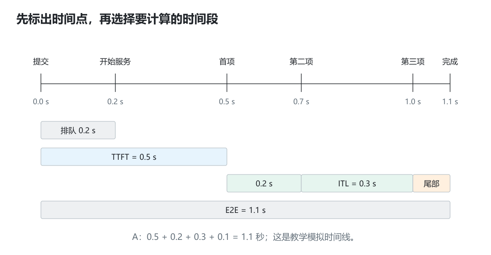
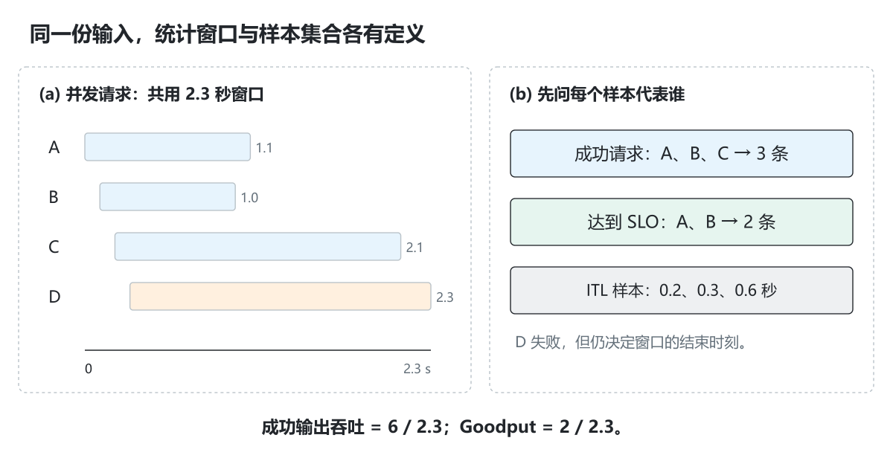

# 1.4 如何读性能结果

[本篇目录](../README.md) · [全部课程](../../README.md) · [上一节 1.3](../03-kv-cache/README.md) · [下一节 1.5](../05-model-structures/README.md)

> 基础必读，含工程进阶。提供可重算的事件数据与指标代码。默认数据是手工构造的教学模拟，不是 A100/C500 测量。建议 90—120 分钟。


[逐步实验](lab.md) · [练习与答案](exercises.md) · [原创图解](assets/README.md)

前两节已经说明缓存怎样减少重复计算。接下来要回答：**减少了工作，用户就一定更早看到答案吗？** 请求可能排队，输出可能等待传输，其他请求还可能占用执行资源。先把每个时间点记清楚，才知道优化改善了哪个环节。

本节始终围绕同一份四请求数据。先手算 A，再看四个请求一起运行时的统计；最后只改一个条件，检查哪些指标应该变化。

## 学习目标与准备

本课结束时，你应能从原始事件重算 TTFT、TPOT、ITL、吞吐、Goodput 与 P50/P95/P99，并明确说明每个指标的分母、样本和时间窗口。

前置：知道 Prefill/Decode。只需 Python 3.11+；不需要部署模型。代码为含 `metrics-demo` 的 `0.1.0.dev0` checkout。

先运行：

```bash
python -m zero2vllm metrics-demo --output .local/runs/part-01-inference/04-performance-metrics/metrics-default.json
python -m zero2vllm metrics-demo --help
```

输入：[request-events.json](data/request-events.json)。实现：[metrics.py](../../../../zero2vllm/reference/metrics.py)。

已运行的[默认指标报告](results/baseline/04-metrics.json)保留完整模拟输入和全部重算结果。

## 1. 从请求的一条时间线开始

我们记录每个请求的：提交时间、开始服务时间、每个输出 token 的时间、完成时间和成功/失败状态。**以下时间都在同一个时钟下，以秒为单位。**

```text
提交             开始服务        第一个 token      后续 token       完成
 arrival ---------- start -------- t0 ------ t1 ------ t2 ---------- finish
         排队                首次处理与其他开销       生成与传输
```

不要拿客户端 wall clock 减服务端未校准的 wall clock 来计算排队时间。生产采集可能需要单调时钟、同进程事件或分布式追踪；没有这些证据时，排队时间应标为不可得。

本例为四个并发且长度不同的请求：

| 请求 | 提交 | 开始服务 | 输出 token 时刻 | 完成 | 状态 |
| --- | --- | --- | --- | --- | --- |
| A | 0.0 | 0.2 | `[0.5,0.7,1.0]` | 1.1 | 成功 |
| B | 0.1 | 0.4 | `[0.9]` | 1.0 | 成功，只有 1 个输出 |
| C | 0.2 | 0.7 | `[1.4,2.0]` | 2.1 | 成功 |
| D | 0.3 | 0.8 | `[]` | 2.3 | 失败 |

这些值独立构造，目的是暴露常见统计问题。报告保留 `record_type=simulation` 和完整输入，运行指标代码不会把它变成真实性能数据。

### 1.1 先统一单位和观测位置

`0.5s` 就是 `500ms`；若一份日志写 `500`，另一份写 `0.5`，直接相减会产生数值上合法、含义上错误的结果。本节所有字段以 `_s` 结尾，明确使用秒。

对一段真实生成，至少能在三个位置计时：引擎提交 token、服务端交出数据、客户端读到内容。它们之间有队列和传输过程，测出的 TTFT 不必相同。本节模拟数据把事件放在同一个时钟下，目的是先学会计算；后面 [2.7 的三种完成边界](../../part-02-engine/07-http-and-streaming-output/README.md)可帮助理解真实服务怎样采集。



*图 1｜A 的同一条模拟时间线可以算出不同指标。这里每段长度按时间比例绘制，所有数字来自本节输入数据。*

把时间点和时间段分开：`0.5` 是首项发生的时刻；`0.5−0.0` 才是等待首项的时长。`finished_s` 是请求真正结束的时刻，并不要求与最后一个 token 的时间相等。

## 2. TTFT：等到第一个 token 多久

```text
TTFT = 首个输出 token 时间 - 请求提交时间
```

默认例子：A 为 `0.5-0.0=0.5s`，B 为 `0.9-0.1=0.8s`，C 为 `1.4-0.2=1.2s`。D 没有输出 token，TTFT 为 `null`，不是 0。

TTFT 包含排队、首次处理以及所选观测位置之前的传输/调度等开销，不能直接当作 Prefill kernel 时间。若采集到的是第一个有内容的网络事件，应称“首内容延迟”，并记录测量口径。

### 排队和端到端延迟

```text
queue = 开始服务 - 提交
E2E = 完成 - 提交
```

A 的 queue 为 0.2s，E2E 为 1.1s。最后 token 在 1.0s，但完成事件是 1.1s；这 0.1s 仍属于 E2E，不属于相邻 token 间隔。

### 2.1 为什么有些指标是 null

`null` 表示这个量没有定义或没有观测到。D 没有任何输出，无法计算“等到首项多久”；B 只有一项输出，没有相邻间隔。把两者填成 0，会把失败请求和短请求误当成响应特别快的样本。

但缺少某项指标，不等于整个请求记录应该删除。D 仍贡献失败数、排队统计和窗口结束时间；B 仍贡献成功数、TTFT、E2E 与一个成功输出 token。不同统计量需要各自选择合适的样本。

## 3. ITL 与 TPOT：逐间隔和每请求平均

对输出时刻 `t0,t1,…,t(N-1)`：

```text
ITL_i = t_i - t_(i-1)，i=1…N-1
TPOT = (t_(N-1)-t0)/(N-1)，要求 N>=2
```

| 请求 | ITL | TPOT |
| --- | --- | --- |
| A | `[0.2,0.3]` 秒 | `(1.0-0.5)/2=0.25s` |
| B | `[]` | `null`，没有相邻 token |
| C | `[0.6]` 秒 | `(2.0-1.4)/1=0.6s` |

**为什么分母是 N−1？** N 个 token 之间只有 N−1 个间隔。第一个 token 的等待已由 TTFT 描述。如果使用 `(finish-arrival)/N`，会把排队、首 token 和完成尾部混入另一个量。

### TPOT 均值不等于所有 ITL 的均值

默认成功请求中，TPOT 有两个样本：`[0.25,0.6]`，均值 0.425s。ITL 有三个样本：`[0.2,0.3,0.6]`，均值约 0.366667s。

前者每个请求各有一票；后者每个 token 间隔各有一票。长输出请求在第二种口径中权重更高，两者不同是正常结果。字段分别为 `distributions.tpot_s` 与 `distributions.itl_s`。

### 把加权关系写出来

如果所有纳入统计的请求都至少输出两项，设请求 r 有 `N_r` 个输出，则所有 ITL 的均值为：

```text
Σ_r [(N_r−1) × TPOT_r] / Σ_r (N_r−1)
```

代入 A、C：`(2×0.25 + 1×0.6)/(2+1)=1.1/3`。A 在这里有两个间隔样本，所以权重是 2；按请求平均 TPOT 时 A 和 C 的权重都为 1。先确定要回答“平均一条请求怎样”还是“平均一个间隔怎样”，再选择口径。

还可以做一次相加自检。对于至少两个输出的请求：

```text
E2E = TTFT + 所有 ITL 之和 + 最后输出到完成的尾部时长
A: 1.1 = 0.5 + 0.2 + 0.3 + 0.1
```

若两边差很多，先查测量位置、单位和漏记事件，再分析模型性能。

### 网络 chunk 不能直接当作一个 token

一个流式事件可能包含多个 token，甚至只有角色元数据。若只能记录 chunk 到达时间，不能把 chunk 间隔直接称为模型 ITL，也不应为一个 chunk 内的 token 编造不同时间。

本工具要求 `timestamp_kind=per_token_same_clock`，拒绝 `stream_chunk`。它能检查字段和值，无法替你证明采集过程真的产生了逐 token 时间；原始日志和采集器仍需要人工核对。[vLLM 指标设计](https://docs.vllm.ai/en/stable/design/metrics/)

## 4. 吞吐先确定同一个测量窗口

本课窗口定义：

```text
begin = 所有请求中最早提交时间
end = 所有请求中最晚完成时间，包含失败请求
duration = end-begin
```

默认 `duration=2.3-0.0=2.3s`。在此窗口内：

```text
请求总数 = 4，成功数 = 3，失败数 = 1
成功输出 token 数 = 3+1+2=6
成功率 = 3/4 = 75%
成功请求吞吐 = 3/2.3 ≈ 1.304348 request/s
输出 token 吞吐 = 6/2.3 ≈ 2.608696 token/s
```

失败请求即使输出了部分 token，本工具也不将其计入“成功输出 token 吞吐”，但保留该请求的事件和失败数量。这是明确的统计契约，不是所有基准工具的唯一口径。

不能把各请求的 E2E 相加作为此处的窗口。并发请求在时间上重叠；相加得到的是请求时间总量。也不能平均各请求的 token/s 来替代窗口内总吞吐。

### 4.1 并发不能把时间重复计入分母



*图 2｜左图的四条请求时间相互重叠，公共窗口仍只有 2.3 秒；右图说明成功请求、达标请求与 ITL 样本是不同集合。*

想象两台打印机在同一秒各打印一页：这一秒总共完成两页，吞吐是每秒两页。不能把两台各自的一秒相加，再说系统每秒只完成一页。并发请求的窗口统计采用相同原则。

本节窗口包含启动和最后排空阶段。真实压测也可以约定固定稳态窗口，但那需要重新说明窗口内到达、跨窗口完成、未完成请求如何计数，不能沿用同一字段名就默认定义相同。

### 4.2 吞吐变高，单个请求也可能等得更久

以下是另一个独立的假设：方案甲在 1 秒内完成 1 条请求，方案乙把 4 条一起处理，在 2 秒内全部完成。请求吞吐从 1 增加到 2 request/s，但每条请求的完成等待从 1 秒变成 2 秒。这不是任何 GPU 的实测，只用于说明两个目标可以向不同方向变化。

因此一份比较至少同时给出负载、成功率、TTFT/TPOT 的分布和公共窗口吞吐。输入/输出长度、到达节奏或质量要求变了，也可能改变结果；不能仅看到 token/s 上升就归因于某个算子优化。

## 5. Goodput：成功且达到延迟目标的请求

先确定目标再看结果。本例默认：

- TTFT ≤ 0.9s。
- 对至少两个输出 token 的请求，TPOT ≤ 0.35s。
- 只有一个输出 token 时，TPOT 不定义，本例只应用 TTFT 条件。
- 请求必须成功。

A、B 满足目标；C 超过目标；D 失败。因此：

```text
good_requests = 2
Goodput = 2/2.3 ≈ 0.869565 request/s
占全部请求的达标比例 = 2/4 = 50%
```

若只对成功请求计算达标比例，则是 `2/3`，但不能把它替换成“全部请求中有 66.7% 满足服务承诺”。报告使用 `good_fraction_all_requests` 明示分母。

重新设定目标：

```bash
python -m zero2vllm metrics-demo --ttft-slo 0.4 --tpot-slo 0.2 --output .local/runs/part-01-inference/04-performance-metrics/metrics-strict.json
```

成功率、吞吐和原始延迟应完全不变，达标请求数变为 0。这条命令只重新统计，没有优化服务器。SLO 是服务目标，不能为了让结果好看而事后悄悄放宽。

## 6. P50/P95/P99：样本与插值方法

本代码使用排序后的线性插值，零基下标为：

```text
index = (n-1)*p
lo=floor(index)，hi=ceil(index)
percentile = sorted[lo] + (sorted[hi]-sorted[lo])*(index-lo)
```

TTFT 样本 `[0.5,0.8,1.2]` 中，`n=3`：

```text
P50: index=1      → 0.8
P95: index=1.9    → 0.8+(1.2-0.8)*0.9=1.16
P99: index=1.98   → 1.192
```

这是三个教学样本的插值，**不是已经获得稳定的线上尾延迟结论**。记录样本数，真实测量应覆盖足够请求和重复轮次。其他库可能采用 nearest-rank、不同插值或直方图估算，必须先统一算法再对比。

### 不要平均多轮 P99

第一轮样本 `[1,1]`，第二轮 `[100]`，各自 P95 为 1 与 100，平均得到 50.5。合并样本 `[1,1,100]` 的 P95 却是 90.1。

如果要给出总体分位数，应合并原始样本再计算；如果报告“每轮 P95 的中位数”，就明确这是轮间汇总，不能称作合并请求 P95。

### 6.1 读报告时先问“哪些请求没有进入分布”

本工具的 TTFT、TPOT、ITL 与成功 E2E 分布只统计成功请求，排队分布则包含全部请求。失败请求很多时，成功请求的 P99 仍可能很好看。因此延迟分位数必须与成功率一起读。

另外，P99 不是“最慢那个请求”，也不是“99% 的请求都必然满足某个承诺”。它是给定样本、给定算法下的分位数估计；本例只有三个 TTFT 样本，主要用于练习插值。

## 7. 自己提供事件数据

复制示例文件到 `.local/runs/part-01-inference/04-performance-metrics/my-events.json`，修改一个变量后运行：

```bash
python -m zero2vllm metrics-demo --input .local/runs/part-01-inference/04-performance-metrics/my-events.json --output .local/runs/part-01-inference/04-performance-metrics/my-metrics.json
```

需要保留的字段：

| 字段 | 含义与约束 |
| --- | --- |
| `schema_version` | 1 |
| `record_type` | 教学数据为 `simulation`；真正设备记录才可使用 `measured_gpu` 并附外部证据 |
| `timestamp_kind` | `per_token_same_clock` |
| `requests[].id` | 非空且唯一 |
| `arrival_s/work_started_s/finished_s` | 非负有限数，提交 ≤ 开始 ≤ 完成 |
| `token_times_s` | 非递减数组，元素位于开始与完成之间 |
| `status` | `ok` 或 `error`；本课成功请求至少有一个输出 token |

时间不能填字符串、毫秒混入秒、NaN 或无穷大。相等的 token 时间允许表示观测精度有限，但需要说明采集含义。读取不存在文件、非法 JSON、事件倒序均以错误码 2 退出。

## 8. 练习与答案

本节有 [10 组练习与参考答案](exercises.md)。先独立完成手算，再用[实验页](lab.md)检查结果；说明输入、输出和比较口径，比仅提交通过标记更重要。

### 从源码回到报告的四步

打开 [metrics.py](../../../../zero2vllm/reference/metrics.py)：先找逐请求循环，核对 `ttft`、`tpot` 和 `itl`；再看 `successes` 如何筛选样本；随后看 `begin/end` 如何选窗口；最后看 `_summary` 调用了哪种分位数算法。每读完一步，回到 JSON 找对应字段，避免把整份报告当成一个不可解释的总分。

注意 `verification.passed` 只说明输入结构、时序和统计流程通过检查。它无法证明时间戳来自真实设备，更不能证明修改以后更快；这种结论需要对照负载和采集证据。

## 9. 工程进阶与完成标准

真实 A100/C500 实验另记录模型/Tokenizer 版本、实际 token 长度、预热与测量区间、请求到达率/并发限制、错误和原始日志。客户端 E2E、服务端排队、GPU kernel 三个时间口径分别保存。字段名相同不能证明工具版本的定义相同，阅读所固定版本的统计实现。

- [ ] 手算全部四个请求，说明 `null` 不等于 0。
- [ ] 解释 TPOT 均值和 ITL 均值为何不同。
- [ ] 用统一窗口重算吞吐和 Goodput，不丢掉失败请求。
- [ ] 复算 P95，并报告样本数及算法。
- [ ] 修改一份事件副本，预测和验证变化。
- [ ] 保持模拟数据的来源标记，说明真实时间戳如何采集。

测试见 [test_part1.py](../../../../tests/reference/test_part1.py) 的 `MetricsTests`。进一步阅读[实验规范](../../../engineering/experiments.md)与[vLLM 指标设计](https://docs.vllm.ai/en/stable/design/metrics/)。资料查阅：2026-09-15。
