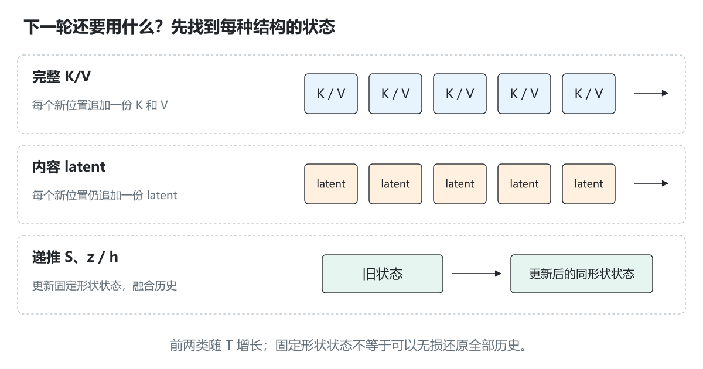
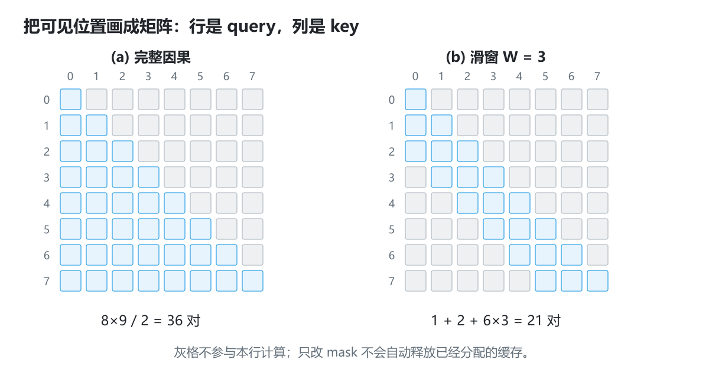
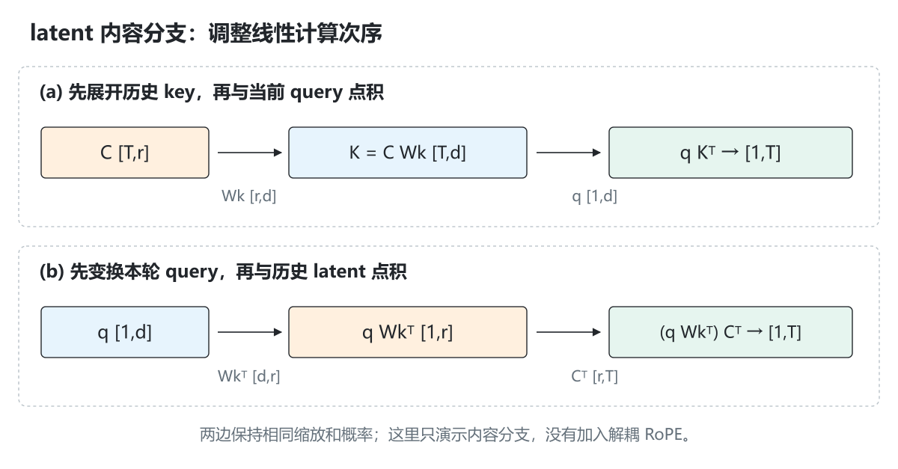

# 1.5 模型结构与长上下文基础

[本篇目录](../README.md) · [全部课程](../../README.md) · [上一节 1.4](../04-performance-metrics/README.md) · [下一节 1.6](../06-sampling-correctness/README.md)

> 基础必读，含工程进阶。提供 RoPE、ALiBi、滑窗、线性 Attention、latent 内容投影和标量 SSM 的独立 CPU 数学例子。它们不是完整的生产模型实现。建议 120—150 分钟，可分两次学习。


[逐步实验](lab.md) · [练习与答案](exercises.md) · [原创图解](assets/README.md)

在 1.3 中，我们把历史保存成越来越长的 K/V 列表。长输入到来后，自然会问三个问题：怎样让模型知道相距多远？每次必须读完整段历史吗？历史能否用另一种状态表示？本节按这三个问题组织，而不是要求一次记住所有结构名称。

**建议分两次阅读。** 第一遍读第 1—4 节，亲手算旋转与滑窗；第二遍读第 5—9 节，始终追问“下一步需要什么，上一轮要留下什么”。MLA、线性 Attention 和 SSM 在这里各用一个小例子建立直觉，具体模型结构与高性能实现留到后续专题。

## 学习目标与准备

这一课主要回答：**模型结构改变后，哪些表示需要保留，缓存多大，每个新 token 又需要读取什么？**

完成后应能推导二维旋转、手算带偏置/滑窗的 Attention、比较线性 Attention 的显式与递推形式，并区分 KV 序列、latent 序列和固定维度状态。

前置：1.1 的点积/softmax、1.3 的缓存形状。Python 3.11+；不需要 PyTorch、真实权重或 GPU。适用含 `structure-demo` 的 `0.1.0.dev0` checkout。

```bash
python -m zero2vllm structure-demo --output .local/runs/part-01-inference/05-model-structures/structure-default.json
python -m zero2vllm structure-demo --help
```

实现位于 [positions.py](../../../../zero2vllm/reference/positions.py)。默认序列长度 8、滑窗宽度 3；所有输入矩阵都保存在报告中。几个实验独立运行，不是把所有结构开关叠加到同一个语言模型里。

可对照[已保存的原始结果](results/baseline/05-structures.json)查看矩阵、位置对数量及各数学恒等式误差。

## 1. 先分清三类变化

| 变化 | 例子 | 主要改变 |
| --- | --- | --- |
| 表达位置或修改打分 | RoPE、ALiBi | query/key 或 attention score 如何体现位置 |
| 限制可见范围、改变缓存表示 | Sliding Window、稀疏 Attention、MLA | 访问哪些位置、保存哪些表示 |
| 改变聚合/递推结构 | 线性 Attention、SSM | 是否必须保留逐 token K/V，如何更新状态 |

这些是结构层面的选择。FlashAttention 主要优化某种 Attention 的计算与访存；PagedAttention 处理块式 KV 的存储/寻址；APC 复用匹配前缀。读源码时先确定模型结构，再检查可用算子后端。

### 1.1 “状态”到底指什么

此处的状态是：**本轮结束后保留，下一轮继续计算时要用的数据。** 模型权重通常固定，不随请求逐项增长；KV 则属于请求的运行状态。保存所有过去的 K/V 是一种选择，把历史逐步汇总进一个固定形状矩阵是另一种选择。



*图 1｜逐 token 的 KV、逐 token 的 latent、固定形状递推状态分别回答不同的存储问题。图形不表示真实模型参数规模；固定形状也不表示无限历史都能无损恢复。*

下面把“维度”和“元素数量”分开看。例如一个 `2×3` 矩阵有 6 个元素；如果每个 token 都保存它，T 个位置就是 `6T`；如果始终更新同一个矩阵，持久状态仍是 6 个元素。这一步只数状态，不包括权重、输入输出日志和临时空间。

### 1.2 为什么位置表示需要单独讨论

一个孤立的 query 只根据 `q·k` 打分时，看到的是向量内容。若把历史 K 行和对应 V 行一起交换，这一行 Attention 的加权和不会因此知道“原来的距离是多少”。真实因果网络还有 mask 和层间信息，但显式位置机制让模型能直接使用位置关系。

RoPE 把位置写进 Q/K 的旋转；ALiBi 把距离写进打分偏置。两者都要与因果可见范围配合，不能替代未来位置的屏蔽。

## 2. RoPE：在每对坐标上旋转

把向量的一对坐标 `[a,b]` 旋转角度 `θ`：

```text
a' = a*cos(θ) - b*sin(θ)
b' = a*sin(θ) + b*cos(θ)
```

本例向量维度 `d` 必须是正偶数，使用**相邻配对**：`(0,1)、(2,3)…`。第 `j` 对的频率与位置角度为：

```text
frequency_j = base^(-2*j/d)
angle_j = position * frequency_j
```

默认 `base=10000`。对 `d=2`、向量 `[1,0]`、位置 1，输出是 `[cos(1),sin(1)]`，约 `[0.540302,0.841471]`。

先把旋转当成平面上的箭头：`[1,0]` 指向右边，旋转 1 弧度后指向右上方，箭头长度仍为 1。这里使用弧度；1 弧度约为 57.3 度，不能把位置 1 误读为旋转 1 度。

四维情况下只是同时转两支二维箭头。`d=4,base=10000` 时，第一对的频率是 1，第二对是 0.01；位置 3 的角度分别是 3 和 0.03 弧度。不同坐标对以不同速率变化，使位置不只体现为一个统一角度。

| 相邻坐标对 | 频率 | 位置 0 的角度 | 位置 3 的角度 |
| --- | --- | --- | --- |
| `(0,1)` | 1 | 0 | 3 |
| `(2,3)` | 0.01 | 0 | 0.03 |

不要把“按位置旋转”理解成把向量元素重新排序；计算会改变每对坐标的数值，维度和 token 数保持不变。

### 2.1 两个可检查的性质

**旋转保持长度。** 同一对坐标的平方和不变，因此整个向量的平方范数也保持。

**旋转后的点积携带相对位置。** 使用同一组频率时：

```text
dot(R(m)q, R(n)k) = dot(q, R(n-m)k)
```

所以把两边位置同时加上同一个偏移，点积保持不变。默认实验比较 `(m,n)=(7,10)` 和 `(0,3)`，误差约 `1.11e-16`；这是 CPU float 的数值误差，不要求符号级零误差。[RoFormer 论文](https://arxiv.org/abs/2104.09864)

#### 相对位置关系是怎样得到的

对一对坐标，把旋转写成矩阵 `R(θ)`。旋转矩阵的转置就是反向旋转，所以 `R(m)ᵀR(n)=R(n−m)`；放进点积就得到上面的等式。多个坐标对分别满足这个关系，最后相加仍成立。

这只是在固定 q、k 和同一组频率时比较旋转后的点积。不能进一步推断“完整多层模型在任意位置平移后 logits 都相同”：其他输入、窗口边界或位置缩放配置可能同时变化。实验先隔离一个数学问题，再检查下一层行为。

### 2.2 位置与缓存的连接

若缓存保存的是已经旋转后的 K，新 token 的 Q 和 K 必须使用正确的绝对位置；不能把 Decode 的位置每轮重置为 0。滑窗丢掉历史 token 后，缓存长度也不再等于总位置编号，需另外保存累计位置。

实际模型可能采用“前后半段配对”、部分维度旋转、不同 scaling、不同 cos/sin buffer 布局。看见公式相似还不足以直接共用 kernel；先对齐权重、配对方式和位置。

### 2.3 位置编码不等于长上下文质量保证

能为位置 100000 算出 sin/cos，不意味着模型在那么长的输入上表现可靠。训练长度、频率扩展方法、任务分布、注意力后端和内存预算都影响可用长度。本实验只验证旋转恒等式，没有验证外推质量。

## 3. ALiBi：在分数里加距离偏置

单个 head、因果位置 `j≤i` 下，可写成：

```text
score(i,j) = dot(q_i,k_j)/sqrt(d) - slope*(i-j)
```

正的 slope 使远位置获得更负的距离项。各 head 可使用不同斜率；本例只用手工 slope，不实现论文中的整套 head slope 分配。[ALiBi 论文](https://arxiv.org/abs/2108.12409)

假设两位置的 QK 点积都为 0，第二个位置的 slope 为 `ln(2)`：

```text
scores = [-ln(2),0]
softmax = [1/3,2/3]
V = [1,3]
output = (1/3)*1 + (2/3)*3 = 7/3
```

ALiBi 的距离惩罚不是因果掩码。未来位置仍必须排除；给它一个有限负数，仍可能获得非零权重。报告 `alibi_slope_0_5` 使用 slope=0.5，对全部默认输入位置计算结果。

## 4. Sliding Window：明确窗口包含谁

本课窗口 `W` **包含当前 token**。位置 `i` 只看：

```text
max(0,i-W+1) … i
```

例如 `T=8,W=3`：

| 查询位置 | 可见位置 | 位置对数量 |
| --- | --- | --- |
| 0 | `[0]` | 1 |
| 1 | `[0,1]` | 2 |
| 2 | `[0,1,2]` | 3 |
| 3 | `[1,2,3]` | 3 |
| 7 | `[5,6,7]` | 3 |

全因果 Attention 共 `T(T+1)/2=36` 对；滑窗共 `1+2+6*3=21` 对。报告分别放在 `dense_attention.score_pairs` 和 `sliding_window.score_pairs`。

```bash
python -m zero2vllm structure-demo --window 1 --output .local/runs/part-01-inference/05-model-structures/structure-self.json
python -m zero2vllm structure-demo --window 8 --output .local/runs/part-01-inference/05-model-structures/structure-full.json
```

`W=1` 时只看自己；`W≥T` 时可见范围与全因果一致。小窗口通常改变模型输出，不能要求它与完整 Attention 一样。

### 4.1 看得少，不自动等于分配得少

本 Python 代码限制参与计算的索引，仍保留完整输入列表。若要把显存降到窗口规模，需要缓存逐出、环形 buffer 或相应块管理，并保留绝对位置。本例没有实现设备缓存逐出。

多层局部 Attention 可以通过层间传播间接利用更远信息，但不等于每层直接读取所有历史。不同实现对“窗口大小是否含当前 token”也可能有不同约定；对齐公式和边界后再比较。[Mistral 7B 论文](https://arxiv.org/abs/2310.06825)

### 4.2 用一张可见性矩阵读懂窗口



*图 2｜行是 query 位置，列是 key 位置；蓝格参加计算，灰格不可见。先由因果条件排除右上角未来位置，再由窗口条件排除过远历史。T=8 时，蓝格数分别为 36 和 21。*

看位置 5：完整因果可读 `0,1,2,3,4,5`，宽度为 3 的窗口只读 `3,4,5`。位置 6 到来后窗口变成 `4,5,6`，但它的绝对位置仍是 6，不能因缓存只保留 3 项就写成位置 2。

假设每层都是宽度 W 的纯局部因果 Attention，位置 i 在一层最多直接访问到 `i−(W−1)`；经过 L 层，沿连接关系最多可追溯到 `i−L(W−1)`，序列开头处截断。例如 W=3、L=2，可间接覆盖最多 5 个输入位置。这是依赖路径的范围，不能保证模型同样有效地保留全部远端信息。

### 4.3 把 Prefill 的平方增长与单步 Decode 分开

对完整因果 Attention，一次处理 T 个位置需计算 `T(T+1)/2` 个位置对；T 翻倍后，这部分工作近似变为四倍。缓存 Decode 只处理一个新 query，但它仍要读取约 T 个历史 key，所以**单步**这部分工作随 T 线性增长。

滑窗把上述位置对数量限制为 `Σ_i min(i+1,W)`，当 T 大于 W 时，总量随 T 近似线性增长、单步读取至多 W 个位置。此处只计 Attention 主体；QKV/MLP 投影、索引、kernel tile 和实际访存仍要分别分析。

## 5. 稀疏 Attention：少计算哪些位置

滑窗是结构化稀疏的一种。其他图案可包括全局 token、固定块、周期连接、内容选择或检索得到的位置。

对每个 query 实际访问 `s` 个位置时，注意力主体工作可从与 `T²` 相关变成与 `T*s` 相关；但索引生成、路由、非连续读取和负载不均也有成本。一个 sparse score 图不保证 GPU 更快。

**稀疏计算不一定减少全部 KV 存储。** 如果未来 query 可能选中很早的任意位置，就仍可能需要保留完整历史 KV。只有结构/策略允许安全丢弃某些位置时，才可相应减少存储。

本课可运行的稀疏例子就是滑窗；内容检索或动态选择的完整 kernel 留在 Attention 专题。

## 6. MLA：压缩内容表示与吸收线性投影

MLA 的重要问题是如何避免逐 token 保存展开后的大量多头 K/V。理解时先看一个简化的内容分支恒等式：

```text
一个 token 的 latent 行向量：c
展开内容 key：k = c Wk
展开 value：v = c Wv

q kᵀ = q (c Wk)ᵀ = (q Wkᵀ) cᵀ
sum_j p_j (c_j Wv) = (sum_j p_j c_j) Wv
```

这里按本课程的行向量布局解释：`Wk` 为 `[r,d_key]`，`q` 为长度 `d_key` 的向量，吸收后的 query `q Wkᵀ` 为长度 `r`。可以先把 query 映射到 latent 空间，对 latent 打分；汇总 latent 后再做 value 展开。

### 6.1 先把矩阵形状写在每个箭头旁

| 变量 | 形状 | 含义 |
| --- | --- | --- |
| `C` | `[T,r]` | T 个位置各自的内容 latent |
| `Wk / Wv` | `[r,d_key] / [r,d_value]` | 将 latent 展开到 key/value 空间 |
| `q` | `[1,d_key]` | 当前 query |
| `q Wkᵀ` | `[1,r]` | 映射到 latent 空间的 query |
| `p C` | `[1,r]` | 用同一组概率汇总 latent |

这里是调整线性计算次序，并没有直接把一个任意已有模型的 KV 截短。举一个独立的整数例子：`c=[1,2]`，`Wk=[[1,0,1],[0,1,1]]`，`q=[2,3,1]`。

```text
先展开：k = [1,2,3]，q·k = 2×1 + 3×2 + 1×3 = 11
先变换 query：q Wkᵀ = [3,4]，[3,4]·[1,2] = 11
```

多个历史位置可以复用本轮变换后的 query。Value 一侧也可先用概率汇总 latent，再做一次投影。注意两边必须使用相同的分数缩放和概率；把中间维度改成 r 后，不能擅自把原有的 `sqrt(d_key)` 缩放也改掉。



*图 3｜两条路径计算同一个内容分支。图中把转置与形状写全；RoPE 位置分支没有放进这条简化等式，不能据此宣称实现了完整 MLA。*

### 6.2 怎么看现有实验

报告 `latent_content_identity` 使用两个 token、3 维 latent、2 维 key/value：

```text
两项未缩放点积分数约为 [0.121, -0.003]
两个 value 输出分量约为 [-0.059962, 0.123543]
```

代码比较显式展开与线性变换后的结果，默认最大差约 `2.43e-17`。小维度是为方便检查，不用于代表任何真实模型的压缩率。

真实 MLA 还要处理多头布局、解耦位置分支、投影吸收、特定 attention backend 等。若实现确实缓存每 token 一个 `r` 维共享 latent 及 `d_rope` 维位置 key，可用 `L*T*(r+d_rope)*b` 作对应缓存分量的估算；展开缓存、其他分支或不同实现会有不同账本。不能直接套用 MHA 的 `2*Hkv*d`，也不能只看到名字 MLA 就认定采用了压缩布局。[DeepSeek-V2 论文](https://arxiv.org/abs/2405.04434)

## 7. 线性 Attention：把历史汇总进状态

本课选择一个始终为正的特征映射：

```text
phi(x) = max(x,0)+1，逐元素作用
weight(q,k) = phi(q) · phi(k)
```

对第 `t` 步因果前缀，显式计算为：

```text
y_t = sum_j [(phi(q_t)·phi(k_j))*v_j] / sum_j [phi(q_t)·phi(k_j)]
```

利用结合律，可以递推：

```text
S_t = S_(t-1) + outer(phi(k_t), v_t)
z_t = z_(t-1) + phi(k_t)
y_t = (phi(q_t)^T S_t) / (phi(q_t)·z_t)
```

状态 `S` 为 `[d_phi,d_v]`，`z` 为 `[d_phi]`，其大小不随序列长度增长。默认两维例子只需 `2*2+2=6` 个持久状态元素。代码为了展示还保留输入与所有输出，它的整个 Python 进程内存并不是常数。

**显式形式与递推形式是在同一套 feature-map 算法内对齐。** 它们通常不等于 `softmax(QKᵀ)V`，不能当作后者的无损 kernel 优化。模型训练和质量需要单独考虑。[Linear Attention 论文](https://arxiv.org/abs/2006.16236)

手算单维例子：`q=[1,2]、k=[0,1]、v=[1,3]`。第二步 `phi(q)=3`，历史 `phi(k)=[1,2]`，权重比例为 `[3,6]`，输出为 `7/3`。

### 7.1 把第二步完整拆开

上面单维例子中，`q=[1,2]` 表示两个位置各有一个标量 query，不是某个位置有两个 head。第一步 `phi(k_0)=1,v_0=1`，所以 `S_0=1,z_0=1`。第二步 `phi(k_1)=2,v_1=3`，于是：

```text
S_1 = 1 + 2×3 = 7
z_1 = 1 + 2   = 3
phi(q_1) = 3
分子 = 3×7 = 21；分母 = 3×3 = 9；输出 = 7/3
```

展开全部历史得到权重 `[3,6]`，结果同样是 `(3×1+6×3)/(3+6)=7/3`。递推的意义在于，下一步不必再逐项读取这两个旧 key/value 来求这个和。

多维时的 `outer(k,v)` 是外积：长度 2 的 k 与长度 3 的 v 形成 `2×3` 矩阵，每项为 `k[a]×v[b]`。这正是为什么状态有 `d_phi*d_v` 项，而不只是 `d_phi+d_v` 项。实现中的双层循环就是把这个外积加到旧状态上。

正特征映射保证这里分母为正。若换成其他映射、带衰减或门控的公式，需要重新检查归一化和更新关系。不能一边改状态更新，一边继续引用原来的等价证明。

## 8. SSM：状态递推不等于保存 K/V 列表

先看一个标量线性时不变系统：

```text
h_t = a*h_(t-1) + b*x_t，h_initial=0
y_t = c*h_t
```

当 `a=0.5,b=1,c=2,x=[1,2,3]`：

| 输入 | 更新后状态 | 输出 |
| --- | --- | --- |
| 1 | 1 | 2 |
| 2 | 2.5 | 5 |
| 3 | 4.25 | 8.5 |

也能用展开形式 `y_t=Σ_j c*a^(t-j)*b*x_j` 检查递推是否正确，报告保留两条路径。

这只演示状态更新。Mamba 等选择性状态空间模型会让部分参数依赖输入，还涉及向量/矩阵状态、卷积和门控；不能把本例的固定卷积展开直接用于所有选择性 SSM。真实缓存还可能包括卷积状态；混合模型也可能同时保存 Attention KV 与 SSM 状态。[Mamba 论文](https://arxiv.org/abs/2312.00752)

### 8.1 展开三步，看清“记忆”从哪里来

把本节标量递推展开：

```text
h_0 = b*x_0
h_1 = a*b*x_0 + b*x_1
h_2 = a²*b*x_0 + a*b*x_1 + b*x_2
```

在 `a=0.5` 的例子里，越旧输入的系数越小。状态只有一个标量，但它融合了过去信息；我们通常不能从这个标量唯一还原每个历史输入。这与完整保存每个位置的 K/V 是不同的信息组织方式。

固定形状只是空间性质。若取 `a=1`，旧信息不衰减；若 `abs(a)>1`，某些历史贡献会放大。模型是否稳定、能记住什么，还与参数和输入相关。本课的固定系数推导只帮助理解递推，不能代替对选择性 SSM 的具体实现分析。

## 9. 把缓存对象与复杂度放到一张表

下面为单层、单请求的示意，省略 batch、层数、字节和部分 head 常数。`T` 是长度，`W` 是窗口，`r` 是 latent 宽度。

| 结构 | 主要持久状态 | 随长度的增长 | 需要注意 |
| --- | --- | --- | --- |
| MHA/GQA/MQA | 历史 K、V | `O(T*Hkv*d)` | 新 query 仍访问历史；GQA 主要改变 KV head 数 |
| 滑窗且实现逐出 | 最近窗口 K、V | `O(min(T,W)*Hkv*d)` | 只 mask 而不逐出并不会自动节省分配 |
| 一般稀疏 Attention | 可能仍是完整历史 KV | 依算法而定 | 访问数量少不等于可丢弃历史 |
| 压缩 MLA 路径 | latent 与位置 key 等 | 常与 `T*(r+d_rope)` 相关 | 必须核对所用实现真正保存什么 |
| 本课线性 Attention | `S` 与 `z` | 与 T 无关，`O(d_phi*d_v+d_phi)` | 改变了 Attention 公式；不等于 softmax |
| 本课标量 SSM | 一个状态 h | 与 T 无关 | 真实向量状态和卷积 buffer 有不同形状 |

RoPE/ALiBi 主要改变位置表示或 score，不会仅凭自身把完整 KV 变成固定大小。长上下文优化要同时考虑模型结构、缓存布局、kernel 和任务质量。

## 10. 练习与答案

本节有 [10 组练习与参考答案](exercises.md)。先独立完成手算，再用[实验页](lab.md)检查结果；说明输入、输出和比较口径，比仅提交通过标记更重要。

### 阅读一个新模型时，按四个问题定位

1. Q/K/V 或状态各是什么形状？哪些维度是位置，哪些是头和通道？
2. 一次 Decode 读取哪些旧内容，写入什么新内容？
3. 哪一步允许丢弃历史？若只是减少打分次数，是否仍要保留完整 KV？
4. 正确性参考应该是什么？同一个算法的显式与递推可以对齐；不同结构的输出通常需要分别验证任务质量。

再去检查 kernel 和布局，才能判断一个优化是在保持同一计算、改变存储方式，还是已经改变模型函数。

## 11. 排错与验收

RoPE 奇数宽度会报错；窗口必须为正整数；Q/K/V 的长度、维度与数值必须有效。命令的 `--sequence-length` 限制在 1—256，避免把 Python 展示代码当作长序列压测器。

- [ ] 完成十组练习，写出每种结构保存的状态。
- [ ] 默认 `verification.passed=true`，各数学对照误差 ≤ `1e-12`。
- [ ] 跑通 window1 与 window8 两个边界。
- [ ] 能指出哪些对照应该一致，哪些输出不同是预期。
- [ ] 不将压缩率、位置扩展能力或计数直接当成 GPU 性能/模型质量结论。

测试入口为 [test_part1.py](../../../../tests/reference/test_part1.py) 的 `StructureTests`。上述论文来源与查阅日期：2026-09-15；本课矩阵、标量例子和代码为独立教学构造。
