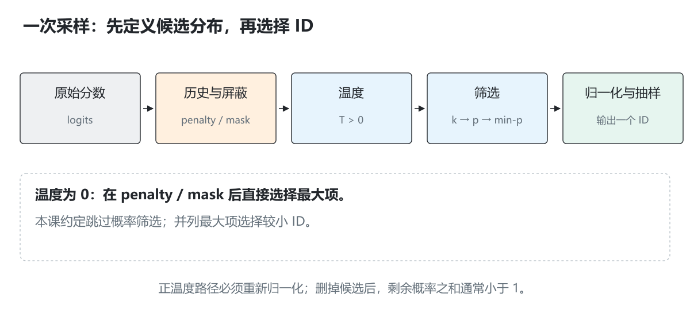
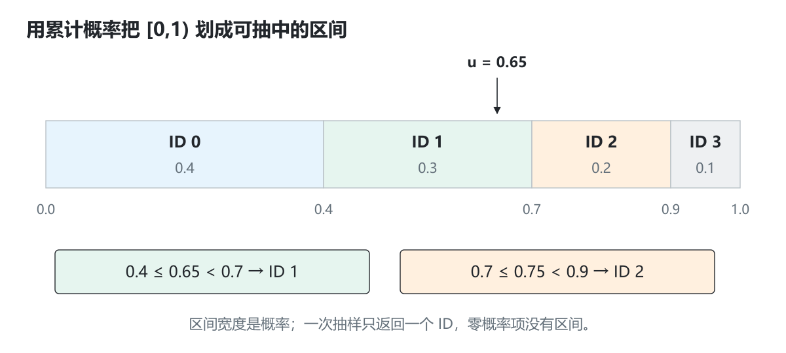
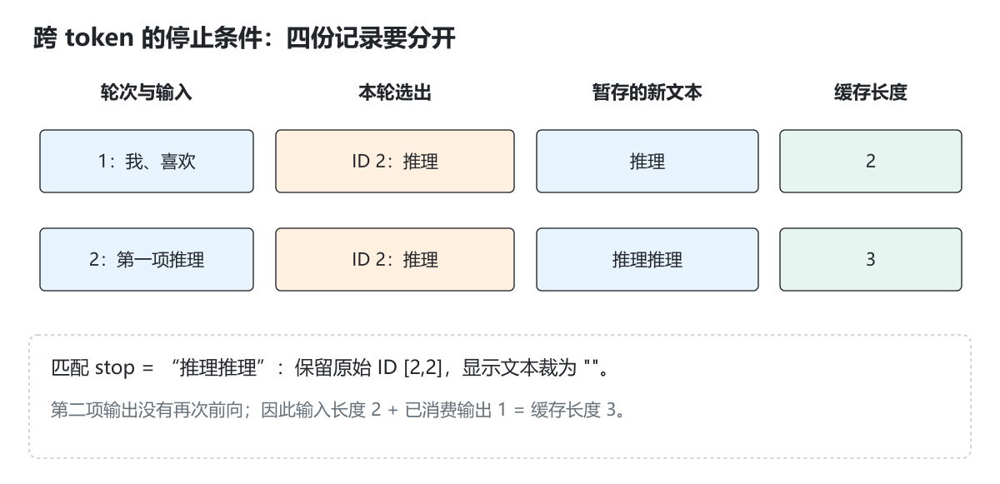

# 1.6 采样与数值正确性

[本篇目录](../README.md) · [全部课程](../../README.md) · [上一节 1.5](../05-model-structures/README.md) · [下一节 2.1](../../part-02-engine/01-pytorch-model/README.md)

> 基础必读，含工程进阶。CPU 小词表采样、penalty、停止条件与数值对照已实现。规则在本课显式定义，不能当作所有版本 vLLM 后端的逐位复刻。建议 120—150 分钟。


[逐步实验](lab.md) · [练习与答案](exercises.md) · [原创图解](assets/README.md)

第一课用最大分数选下一项，因此生成路径只有一个明确选择。实际生成经常从一个分布抽样，同样的 logits 也可能选出不同 token。与此同时，浮点误差又可能稍微改变这些分数。本节把这两件事分开：先说明**选择规则**，再检查**计算结果与停止行为**。

初学者先用四个候选做手算，弄清概率、累计区间和筛选，再回到五词项模型。量化方向重点读第 10 节：分数误差、候选集合变化、生成差异和任务质量需要逐层检查。

## 学习目标与准备

完成后应能解释和实现：贪心、temperature、top-k/top-p/min-p、三种 penalty、请求级随机数、EOS/token/string 停止与 logits 容差。

前置：1.1 中 logits、softmax、生成循环。只需 Python 3.11+，使用含 `sampling-demo` 的 `0.1.0.dev0` checkout；本地验证不依赖真实模型或 GPU。

```bash
python -m zero2vllm sampling-demo --output .local/runs/part-01-inference/06-sampling-correctness/sampling-default.json
python -m zero2vllm sampling-demo --help
```

实现：[sampling.py](../../../../zero2vllm/reference/sampling.py)。它复用第一课的五词项模型，但加入采样与停止逻辑。没有训练，重复词项和不通顺输出都是可能的。

默认参数的[完整运行报告](results/baseline/06-sampling.json)可对照概率、频率和数值反例。

## 1. 从 logits 到一个 token，中间还有哪些决定

本课程采用明确的执行顺序：

```text
原始 logits
  → 按历史应用 repetition / presence / frequency penalty
  → 屏蔽当前不允许的终止 token
  → temperature
  → top-k
  → top-p（在 top-k 剩余候选中归一化后计算累计概率）
  → min-p
  → 对保留候选重新归一化
  → 从分布抽一个 token
```

代码把 mask 与 penalty 放在同一轮遍历中，对未屏蔽项的数学结果符合上述描述。`temperature=0` 时，直接在 penalty/mask 后的 logits 上做贪心，跳过概率筛选。

每一步的 `generation.steps[].distribution` 保存原始 logits、penalty 后分数、保留 ID 与最终概率。不同框架的阈值边界、处理顺序和 kernel 可能不同，移植时需要核对固定版本源码；本课先让一套契约可解释、可验证。[vLLM SamplingParams](https://docs.vllm.ai/en/stable/api/vllm/sampling_params/)

### 1.1 分数、概率、一次选择分别是什么

Logit 是模型给候选项的实数分数，可以为负，也不要求和为 1。Softmax 把一组分数转换为和为 1 的概率；概率 0.4 表示按这个分布反复独立抽样时的理论比例，不表示本次输出“包含 40% 的这个 token”。一次选择最终仍得到一个整数 ID。



*图 1｜筛选修改允许抽到的候选及其概率；随机数只参与最后的选择。本课程约定先 top-k 再 top-p，温度为零另走贪心分支。*

后面反复使用 `[0.4,0.3,0.2,0.1]`，这是一个便于手算的概率分布。若要交给接收 logits 的函数，示例使用 `[ln(0.4),ln(0.3),ln(0.2),ln(0.1)]`，在温度为 1、无筛选时才能恢复原概率；不能直接把四个概率当 logits 输入后还期待概率保持不变。

## 2. Greedy：先把确定性基线固定下来

```bash
python -m zero2vllm sampling-demo --temperature 0 --max-new-tokens 3 --output .local/runs/part-01-inference/06-sampling-correctness/sampling-greedy.json
```

默认 prompt“我 喜欢”在第一步的 logits 约为：

```text
[0.330238, 1.669762, 2.0, -0.330238, -1.669762]
```

最大项 ID=2，三步均选择“推理”。本课程 `generated_text` **只包含新输出**，因此为“推理推理推理”；1.1 的 `generation.decoded_text` 包含 prompt，所以是“我喜欢推理推理推理”。先看字段契约，不能把字符串不同误认为生成不一致。

并列分数按 token ID 从小到大选第一个。Greedy 不需要随机数，也不要求先做 softmax；概率最大的下标与 logit 最大的下标相同。

## 3. Temperature：改变分布尖锐程度

对正数 `T`：

```text
p_i = exp(logit_i/T) / sum_j exp(logit_j/T)
```

`T<1` 通常让分布更集中，`T>1` 通常更平；它不会直接保证更正确或更有创造性。`T=0` 在实现中单独处理为贪心，不能直接做除零运算。

为了稳定计算，代码先减去最大分数：

```text
weight_i = exp((logit_i-max_logit)/T)
```

指数的输入不大于零，减少溢出。将所有 logits 同加一个常数不会改变结果；测试用 `[10000,9999]` 与 `[0,-1]` 对照。

```bash
python -m zero2vllm sampling-demo --temperature 0.5 --top-p 1 --output .local/runs/part-01-inference/06-sampling-correctness/sampling-temp05.json
python -m zero2vllm sampling-demo --temperature 1.5 --top-p 1 --output .local/runs/part-01-inference/06-sampling-correctness/sampling-temp15.json
```

比较 `probabilities`，再看实际抽样结果。一次恰好选中同一个 token 不能证明分布相同。

### 3.1 用概率比值解释温度

对两个候选 a、b，`p_a/p_b=exp((s_a−s_b)/T)`。当分数差固定，T 变小会放大正分差带来的优势；T 变大则使比值更接近 1。最大 logit 的位置不变，但其被抽中的概率会变化。

取原概率 `[0.4,0.3,0.2,0.1]` 对应的对数作为 logits。T=0.5 时，相当于把原概率平方再归一化：

```text
未归一化权重：[0.16,0.09,0.04,0.01]，总和 0.30
最终概率：[0.533333,0.300000,0.133333,0.033333]
```

这个例子只改变温度，关闭所有筛选。一次最终 token 可能与 T=1 相同，但分布显然已改变。

## 4. Top-k：固定候选数量

假设 temperature 后的完整分布为 `[0.4,0.3,0.2,0.1]`。`top_k=2` 保留前两个候选，重归一化得到：

```text
[0.4/0.7, 0.3/0.7, 0, 0] = [4/7,3/7,0,0]
```

本课规定 `top_k=0` 关闭筛选，正整数保留至多 k 项；k 大于词表大小时保留所有可用项。并列时按 ID 排序，保留数量不会因为分数相同而超过 k。负数会报错。

```bash
python -m zero2vllm sampling-demo --temperature 1 --top-k 2 --top-p 1 --output .local/runs/part-01-inference/06-sampling-correctness/sampling-topk.json
```

## 5. Top-p：累计概率达到阈值的最短前缀

将候选按概率降序排列，保留使累计概率**达到或超过 p**的最短前缀，包括越过阈值的那一个 token，然后重归一化。

对 `[0.4,0.3,0.2,0.1]`、`top_p=0.8`：

```text
前一项累计 0.4 < 0.8
前两项累计 0.7 < 0.8
前三项累计 0.9 >= 0.8
保留前三项，最终分布 [4/9,3/9,2/9,0]
```

Top-p 保留的数量随分布变化，不是“保留词表前 80%”。即使 p 很小，也至少保留最大项。

```bash
python -m zero2vllm sampling-demo --temperature 1 --top-p 0.8 --output .local/runs/part-01-inference/06-sampling-correctness/sampling-topp.json
```

**组合顺序会影响结果。** 本例若先 top-k=2，再 top-p=0.5，top-k 后的第一项已占 `4/7>0.5`，所以最后只剩 ID 0。阈值附近的浮点舍入也可能影响边界；跨实现对照要检查保留集合。

## 6. Min-p：与最大概率比较

本课保留满足 `p_i ≥ min_p * p_max` 的候选。它不是累计概率，也不是绝对概率下限。

对 `[0.4,0.3,0.2,0.1]`，`min_p=0.6` 的阈值是 `0.24`，保留 `[0.4,0.3]`。最大项不会被合法的 `[0,1]` min-p 阈值移除。

```bash
python -m zero2vllm sampling-demo --temperature 1 --top-p 1 --min-p 0.6 --output .local/runs/part-01-inference/06-sampling-correctness/sampling-minp.json
```

在同一候选集合上归一化不会改变“与最大概率的比值”，因此代码可以直接比较未归一化指数权重。它仍在 top-p 已保留的集合内操作。

### 6.1 三种筛选放在同一张账本上

| 单独使用的规则 | 检查什么 | 保留 ID | 重归一化之后 |
| --- | --- | --- | --- |
| top-k=2 | 排名前 2 | 0、1 | `[4/7,3/7,0,0]` |
| top-p=0.8 | 累计至少 0.8 | 0、1、2 | `[4/9,3/9,2/9,0]` |
| min-p=0.6 | 至少是最大概率的 0.6 倍 | 0、1 | `[4/7,3/7,0,0]` |

这三行碰巧有两行结果相同，但规则并不相同。换一个更平的分布，min-p 可能保留更多项；top-k 仍按数量限制。组合使用时也要按实际顺序逐步更新，不能把几份独立筛选结果直接相加。

## 7. 三种 penalty 分别看什么历史

设 token i 的分数为 `s_i`，在已生成输出中出现 `count_i` 次。

| 项目 | 本课使用的历史 | 规则 |
| --- | --- | --- |
| repetition penalty，r>0 | prompt 与新输出中出现过的 ID | 正分数除 r；负分数乘 r；不按次数反复应用 |
| presence penalty，a | 只看新输出 | 出现过一次以上就减 a |
| frequency penalty，b | 只看新输出 | 减 `b*count_i` |

repetition 的符号分支很重要：当 r>1 时，无论正负分数都向更不优先的方向变化。把负分数也除以 r 反而可能提高它的优先级。

手算：logits=`[4,-2,1]`，prompt=`[0,1]`，生成历史=`[1,1,2]`；r=2、a=0.5、b=0.25：

```text
ID 0：4/2 = 2               只在 prompt，不扣 presence/frequency
ID 1：(-2)*2 -0.5 -0.25*2 = -5
ID 2：1/2 -0.5 -0.25*1 = -0.25
```

```bash
python -m zero2vllm sampling-demo --repetition-penalty 1.2 --presence-penalty 0.5 --frequency-penalty 0.25 --output .local/runs/part-01-inference/06-sampling-correctness/sampling-penalties.json
```

本课程 presence/frequency 范围为 `[-2,2]`；负数会鼓励相应历史项。若重复是模型或提示造成的，调 penalty 不能代替模型质量分析。

### 7.1 为什么历史范围也属于接口契约

若输入 prompt 已经出现某词，repetition 会读取这个事实；本课 presence/frequency 则只统计新输出。即使三个参数都叫“防重复”，它们读取的数据也不同。调试时先打印历史 ID 和次数，再手算一个候选的分数变化，通常比只看生成句子更容易定位问题。

Penalty 改变 logits 的排序和差值，因此后续 top-k/top-p 的保留集合也可能改变。不能先在原分数上挑完候选，再假设在候选内补一个 penalty 与当前顺序完全等价。

## 8. Seed：复现的是一条具体随机路径

每次请求建立独立的 `random.Random(seed)`。同一代码、权重、输入、配置和随机数消耗顺序应产生相同结果；不依赖别的请求先消耗多少全局随机数。

```bash
python -m zero2vllm sampling-demo --seed 7 --output .local/runs/part-01-inference/06-sampling-correctness/sampling-seed7-a.json
python -m zero2vllm sampling-demo --seed 7 --output .local/runs/part-01-inference/06-sampling-correctness/sampling-seed7-b.json
python -m zero2vllm sampling-demo --seed 8 --output .local/runs/part-01-inference/06-sampling-correctness/sampling-seed8.json
```

前两次比较生成 ID 和分布，不比较每次都会更新的 `created_at_utc`。不同 seed 可能产生不同序列，也可能偶然相同；不能要求每个 seed 都有不同输出。

CPU Python RNG 与 GPU RNG、不同 kernel 的分数误差、batch 排列、推测采样和不同版本实现都可能改变路径。固定 seed 不是跨 A100/C500 逐 token 相同的保证。

### 一次抽样是怎样发生的

把 `[0,1)` 按概率切成四段：



*图 2｜本实现按 token ID 顺序累加；区间宽度才代表概率。u=0.65 落在 ID 1 的区间，u=0.75 则落在 ID 2 的区间。示例 u 是手工给定值，不宣称它们是某个 seed 的第一项。*

| ID | 概率 | 区间 |
| --- | --- | --- |
| 0 | 0.4 | `[0,0.4)` |
| 1 | 0.3 | `[0.4,0.7)` |
| 2 | 0.2 | `[0.7,0.9)` |
| 3 | 0.1 | `[0.9,1)` |

`draw` 先取一个 `rng.random()`，再从 ID 0 开始累计概率，首次满足 `u < cumulative` 就返回。概率为 0 的项没有区间，不应被抽到；末尾还有处理浮点累加缺口的保护。

对相同概率，不同的合法抽样实现可以保留相同分布，却不保证同 seed 逐项相同。例如另一个实现先按概率排序再分配区间，同一个 u 可能落到不同 ID。统计正确性与随机路径复现需要分别验收。

### 用频率检查分布

报告另有独立的四候选实验 `frequency_experiment`：基础分布 `[0.4,0.3,0.2,0.1]`，经过相同 temperature/筛选配置后重复抽样。该分布不使用语言生成历史，故 penalty 在这项空历史实验中没有作用。

默认 T=0.8、top-p=0.9，最终理论概率约 `[0.472054,0.329472,0.198474,0]`。本地 seed=7、2000 次实际计数为 `[972,617,411,0]`。频率不必与理论概率逐项相等。

对某候选概率 p，独立抽样 N 次的频率波动尺度约为 `sqrt(p*(1-p)/N)`。增加 `--draws` 可以观察波动降低；不能用少量抽样没有出现某 token 来证明其概率为零。

## 9. 停止规则必须和返回内容一起定义

### 9.1 长度与 EOS

`--max-new-tokens` 是新生成 ID 的上限，不包含 prompt。未达到其他停止条件时，结束原因是 `length`。允许 0，此时不做模型前向。

本教学词表没有真正的训练 EOS；可以显式把某个 ID 指定为演示终止项：

```bash
python -m zero2vllm sampling-demo --temperature 0 --eos-token-id 2 --output .local/runs/part-01-inference/06-sampling-correctness/sampling-eos.json
```

第一步选中 2，`finish_reason=eos`，`new_token_ids=[2]`，但 `generated_text` 为空。原始 ID 保留终止项，展示文本省略它。真实模型的 EOS 由其配套配置定义，不能假设句号就是 EOS。

### 9.2 Stop token ID

```bash
python -m zero2vllm sampling-demo --temperature 0 --stop-token-id 2 --output .local/runs/part-01-inference/06-sampling-correctness/sampling-stop-id.json
```

结果类似，但原因是 `stop_token`。`--stop-token-id` 可以重复。若同一 ID 同时属于 EOS 和 stop 集合，本实现优先报告 `eos`。

`--min-new-tokens N` 在已生成 ID 少于 N 时屏蔽终止 ID，达到 N 后才允许终止项。比如 min=1 时，需要先生成一个非终止项；随后抽到 EOS 时，原始 ID 序列可能有两个 ID。

### 9.3 Stop string 可以跨 token 边界

```bash
python -m zero2vllm sampling-demo --temperature 0 --stop "推理推理" --output .local/runs/part-01-inference/06-sampling-correctness/sampling-stop-string.json
```

第一步输出“推理”，第二步追加“推理”后才匹配完整停止字符串。结果为 ID `[2,2]`、`finish_reason=stop_string`，展示文本为空，因为本课移除了停止字符串及其后内容。

匹配只扫描**新生成文本**，不扫描 prompt；允许跨 token 片段。`--stop` 可以重复，不允许空字符串；同一轮多个匹配采用最早起点，同起点时按字符串字典序选择。min 条件满足后才检查本轮新增字符所完成的匹配，不会事后重新触发早已完成的匹配。

这个参考是整段缓冲输出，不发送实时流。真实流式服务为了避免把 stop 前缀过早发给用户，常需保留尚未确定的尾部文本，还要处理 Tokenizer 的解码边界；服务章节需要单独实现。2.7 当前传输数字 ID，也没有直接接入此处的文本 stop 缓冲。

### 9.4 上下文预算与停止是不同约束

教学模型最多前向处理 16 个位置，输入 `P` 与上限 `O` 必须满足 `P+max(O-1,0)≤16`。本实现预先检查完整预算，即使你预计会提前遇到 EOS，也不能提交超容量上限。

### 9.5 同时记录输入、选出 ID、显示文本和缓存



*图 3｜贪心生成“推理推理”并以这段字符串停止。两次选出 ID 2，但第二次前向只消费了第一项输出；匹配后展示文本被裁空，缓存长度为 3。*

这四种记录各有用途：输入用于复现模型；原始 ID 用于核对采样和计数；显示文本用于用户界面；缓存记录已经参与前向的位置。结束文本为空既可能是零输出，也可能是终止项被移除，必须结合停止原因判断。

## 10. 数值正确性：别只看最终 token

逐元素比较时用：

```text
abs(candidate-reference) <= atol + rtol*abs(reference)
```

`atol` 控制接近零的绝对容差，`rtol` 控制相对于参考值的误差。必须先检查形状和有限数值，不能让 `zip` 截掉多余元素，也不能忽略 NaN。

报告里有两个反例：

| 参考与候选 | 数值判断 | argmax 判断 |
| --- | --- | --- |
| `[2,1]` 与 `[20,1]` | 最大差 18，明显错误 | 都选择 ID 0 |
| `[1,1.0000001]` 与 `[1.0000002,1]` | 在示例容差内 | 最大项分别为 ID 1 与 0 |

当最高两个 logits 很接近时，小误差也可能改变贪心选择；一次 token 不同未必说明误差超过可接受范围。反过来，token 一样也完全不能证明分数正确。

正确性检查建议按下面顺序记录：

1. 输入、权重、位置、mask、张量布局相同。
2. 形状一致，没有 NaN/无穷大或全 mask 非法行。
3. 中间量和完整 logits 的误差、容差与最大项间隔。
4. 筛选后的保留集合与概率分布。
5. 固定采样规则下的生成与停止状态。
6. 真实任务质量与性能另行测量。

本课 CPU 双精度示例的容差不应直接复制到 BF16/FP16/量化 GPU 运算。容差要结合计算路径和任务效果制定；当前没有验证 A100/C500 的具体阈值。

### 10.1 浮点加法为什么会受次序影响

计算机能表示的浮点数是有限集合，一次运算结果可能需要舍入。在 Python 常见的双精度浮点下：

```python
(1e16 + (-1e16)) + 1.0  # 1.0
1e16 + ((-1e16) + 1.0)  # 0.0
```

第二种顺序里，`-1e16+1` 的那一点增量在舍入时丢失。这个例子说明归约次序可能影响结果；它不是某张 GPU 的误差测量。实际矩阵乘、融合运算、累加精度和量化都会带来各自的误差，需要按计算链定位。[Python 浮点说明](https://docs.python.org/3/tutorial/floatingpoint.html)

### 10.2 把容差公式代入两个数量级

若 `atol=1e-6,rtol=1e-5`：参考值为 0 时，允许差为 `1e-6`；参考值为 100 时，允许差为 `0.001001`。所以 `rtol` 并不意味着“每个元素都允许同样的绝对差”。

公式以 reference 为尺度，交换参考与候选后，阈值可能变化。报告应固定哪条是参考路径，并同时给出实际误差，避免仅显示一个通过标记。把容差调大直到通过也不能解释误差来源。

### 10.3 用最高两项间隔判断贪心稳定性

设参考最大项比第二大项高 Δ，每个 logit 的绝对误差不超过 ε。最坏情况下最大项下降 ε，第二大项上升 ε，间隔最多缩小 `2ε`。因此 **Δ > 2ε** 是保持原最大项的一个充分条件；若不满足，只能说存在翻转的可能，不代表一定翻转。

例如参考 `[2,1]`，Δ=1，若 ε=0.1，则间隔至少仍有 0.8；参考 `[1,1.0000001]` 的间隔只有 `1e-7`，相同数量级的小扰动就值得关注。这个推导用于 greedy；随机抽样还与概率区间和随机数有关。

### 10.4 生成分叉后，先固定输入前缀再比较

两条实现一旦在某一步选出了不同 token，下一步输入就已经不同。此后 logits 的差可能同时包含算法误差和不同输入造成的正常变化，不能把所有后续差异都归到“某个算子算错”。

定位数值问题时，可以先固定一条参考 token 路径，把完全相同的前缀逐步喂给两条实现，比较各层与 logits；再单独让它们自由生成，检查停止状态和任务质量。这种固定输入路径的检查常称为 teacher-forced 对照，它和最终生成评测回答不同问题。

量化也可沿此顺序：先检查相同输入下的 Q/DQ、线性层和 logits，再检查候选集合与分布，最后看真实任务效果。量化造成的可控近似与错误的打包/索引不是一类问题，应该保留独立参考和误差记录。

## 11. 命令参数速查

| 参数 | 默认 | 约束/含义 |
| --- | --- | --- |
| `--prompt` | `我 喜欢` | 五词项中用空格分隔的片段 |
| `--temperature` | 0.8 | 有限且 ≥0；0 单独走 greedy |
| `--top-k` | 0 | 非负整数；0 关闭 |
| `--top-p` | 0.9 | `(0,1]` |
| `--min-p` | 0 | `[0,1]` |
| `--repetition-penalty` | 1 | 正有限数；1 不改变 |
| `--presence-penalty` / `--frequency-penalty` | 0 / 0 | `[-2,2]` |
| `--seed` | 7 | CPU 请求级随机种子 |
| `--max-new-tokens` / `--min-new-tokens` | 8 / 0 | 非负整数，min 不超过 max；还受上下文预算约束 |
| `--eos-token-id` | 未设置 | 0—4 中的教学终止 ID |
| `--stop-token-id` / `--stop` | 空 | 可重复传入 ID / 非空字符串 |
| `--draws` | 2000 | 独立四词项频率实验次数，1—100000 |
| `--output` | 不保存 | 保存完整 JSON |

## 12. 练习与答案

本节有 [12 组练习与参考答案](exercises.md)。先独立完成手算，再用[实验页](lab.md)检查结果；说明输入、输出和比较口径，比仅提交通过标记更重要。

## 13. 排错与本篇验收

全候选被 mask 时直接报错；NaN/+inf 也报错，不能输出一个看似合法的概率。JSON 用 `null` 表示被屏蔽的负无穷 logits，数学中仍是排除候选。未知教学词项、空 stop、非法参数和上下文超限均应明确失败。

- [ ] 跑通 greedy、top-k、top-p、min-p、penalty 五类命令。
- [ ] 保存同 seed 两次结果，对比概率/ID 而非时间戳。
- [ ] 检查频率与理论概率的关系，并说明有限抽样波动。
- [ ] 复现 EOS、stop ID 与跨 token stop string 三种终止。
- [ ] 完成两个数值反例的解释，写清容差和 argmax 的关系。

回归见 [test_part1.py](../../../../tests/reference/test_part1.py) 的 `SamplingTests`。完成后回到 [Part 1 总表](../README.md)做综合练习，下一篇开始把这些部件接成 PyTorch 教学引擎。资料查阅：2026-09-15。
