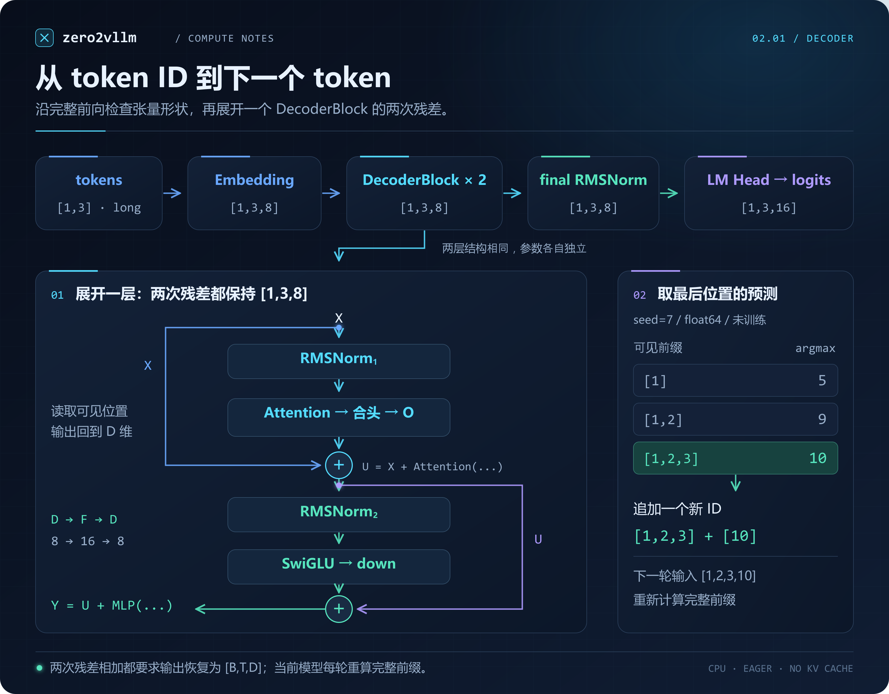
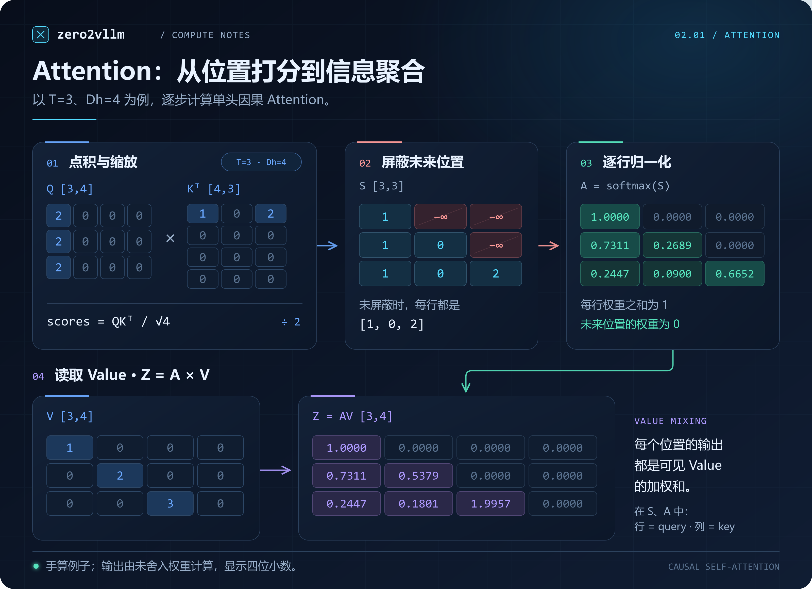
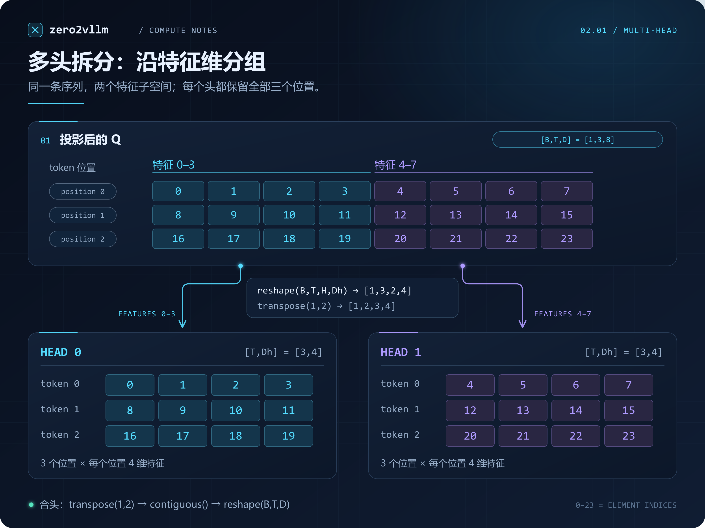
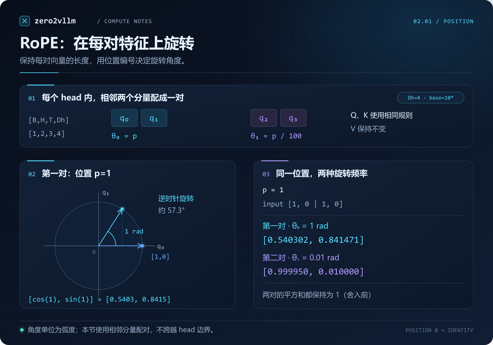

# 2.1 构建最小 PyTorch 模型

[本篇目录](../README.md) · [上一节 1.6](../../part-01-inference/06-sampling-correctness/README.md) · [实验](lab.md) · [练习](exercises.md) · [下一节 2.2](../02-loading-real-model-weights/README.md)

第一篇用纯 Python 写出了 Attention 和生成循环。这一节改用 PyTorch，把 Embedding、RMSNorm、多头 Attention、RoPE 和 MLP 组装成一个 Decoder。后面的权重加载、KV Cache 和批处理都在这个模型上继续做。

模型采用两层、两个注意力头，隐藏维度只有 8，全部计算可以在 CPU 上运行。这样设定是为了能直接打印中间张量，检查每一步的形状和数值。权重由固定种子生成，尚未训练；输出是词表大小为 16 的 token ID。

实现位于 [torch_decoder.py](../../../../zero2vllm/modeling/torch_decoder.py)，纯 Python 对照实现在 [reference/decoder.py](../../../../zero2vllm/reference/decoder.py)。文中的代码片段来自模型实现，部分省略了输入检查和中间值记录；完整运行命令见文末及 [lab.md](lab.md)。

## 1. 模型的输入和输出

先看一条包含三个 token 的输入：

```python
tokens = torch.tensor([[1, 2, 3]], dtype=torch.long)
```

外层列表表示 batch，内层列表表示一条序列，所以 `tokens.shape` 是 `[1,3]`。模型接收整数 ID，返回每个位置对下一个 token 的词表分数，也就是 logits：

```text
tokens [B,T] → Embedding → DecoderBlock × L → RMSNorm → LM Head → logits [B,T,V]
```

本文使用以下配置。`B`、`T` 取决于这次输入，其余维度由模型配置决定。

| 符号 | 数值 | 含义 |
| --- | --- | --- |
| B | 1 | batch 中的序列数 |
| T | 3 | 当前序列长度；命令行默认实验用四个 token |
| V | 16 | 词表大小，合法 ID 为 0–15 |
| D | 8 | 隐藏维度，每个位置用八个数表示 |
| H | 2 | 注意力头数，Q、K、V 的头数相同 |
| Dh | 4 | 每个头的维度，`D / H` |
| F | 16 | MLP 中间维度 |
| L | 2 | DecoderBlock 数量 |

`max_context=32` 限制单次前向的输入长度。模型支持同长度 batch，暂不处理 padding；向短序列末尾补 0，会被当成真实的 token 0 参与计算。



*图 1：本节模型的完整路径。下方展开一个 Block，蓝色旁路保留输入 X，紫色旁路保留第一次相加后的 U。右侧的 5、9、10 对应 `seed=7`、CPU float64 下三个位置的预测；本轮只追加最后位置的 10。*

### 1.1 Embedding 是查表

Embedding 的参数是一个 `[V,D]` 矩阵。本例有 16 行，每行八个浮点数。输入 `[[1,2,3]]` 就是依次取出第 1、2、3 行：

```python
x = self.embedding(tokens)   # [1,3,8]
```

其中 `x[0,2,:]` 是第三个 token 的八维向量。ID 3 只用来选择第 3 行，不会作为系数与权重相乘。输入从三个 token 改成四个时，`x` 变成 `[1,4,8]`，Embedding 参数仍然是 `[16,8]`。[PyTorch Embedding](https://docs.pytorch.org/docs/2.7/generated/torch.nn.Embedding.html)

这一点也区分了参数和中间状态：参数在模型构造、加载时确定；中间状态随本次输入产生。ID 使用 `torch.long`，Embedding 查出的向量与后续计算使用浮点类型。

### 1.2 在 PyTorch 中组织各层

模型构造时创建各个子模块。下面的 `c` 是 `DecoderConfig`，`dtype` 在本节取 `torch.float64` 或 `torch.float32`：

```python
self.embedding = nn.Embedding(c.vocab_size, c.width, dtype=dtype)
self.layers = nn.ModuleList([
    DecoderBlock(c, dtype) for _ in range(c.layers)
])
self.final_norm = RMSNorm(c.width, c.eps, dtype)
self.head = nn.Linear(c.width, c.vocab_size, bias=False, dtype=dtype)
```

这些定义放在 `TorchDecoder.__init__` 中，并在 `super().__init__()` 之后执行。`ModuleList` 让 PyTorch 能找到各层的参数，后续 `named_parameters()` 和 `state_dict()` 才能遍历它们。

对应的前向计算很短：

```python
x = self.embedding(tokens)
for i, layer in enumerate(self.layers):
    x = layer(x, trace, f'layers.{i}.')
x = self.final_norm(x)
logits = self.head(x)
```

这里 `trace` 是保存中间张量的字典，`layers.0.`、`layers.1.` 是记录名称的前缀。两层的结构相同，参数各自独立。经过一层后位置数不变，只更新各位置的特征。

`self.head` 把最后一维从 8 映射到 16。因此完整前向返回 `[1,3,16]`，而不是直接返回一个 ID；从 logits 中选 token 是生成循环的工作。

可以先用下表跟住形状，再逐段读实现。表中写的是实际计算形状；`q_rope`、`k_rope` 保存进 trace 时会临时合头，这一点在第 7 部分说明。

| 计算位置 | 三 token 示例的形状 | 最后几个维度表示什么 |
| --- | --- | --- |
| `embedding` | `[1,3,8]` | 3 个位置，每个位置 8 维 |
| Q/K/V 投影后 | `[1,3,8]` | 所有头的特征暂时放在同一维 |
| 分头与 RoPE 后 | `[1,2,3,4]` | 2 个头，各有 3 个位置、4 维特征 |
| `scores`、`probs` | `[1,2,3,3]` | 每个头内，query 位置 × key 位置 |
| `context` 合头后 | `[1,3,8]` | 两个头的输出重新拼接 |
| `gate`、`up`、`swiglu` | `[1,3,16]` | MLP 的 16 维中间特征 |
| `down`、Block 输出 | `[1,3,8]` | 回到隐藏维度，才能做残差相加 |
| `logits` | `[1,3,16]` | 16 个词表 ID 的预测分数 |

## 2. DecoderBlock 与 RMSNorm

一个 Block 包含 Attention 和 MLP 两个子层。两者之前各有一次 RMSNorm，之后各有一次残差相加。本节使用的顺序是：

$$
U = X + \operatorname{Attention}(\operatorname{RMSNorm}_1(X))
$$

$$
Y = U + \operatorname{MLP}(\operatorname{RMSNorm}_2(U))
$$

这叫 pre-norm：先归一化，再执行子层。两个加号都是逐元素相加，要求子层的输出恢复为 `[B,T,D]`。第二次相加保留的是 Attention 更新后的 `U`。

代码用变量 `x` 保存当前状态，因此两次更新都写成 `x = x + ...`：

```python
n = self.norm1(x)
# n 经过 Attention，得到合头后的 context
x = x + self.o(context)

n = self.norm2(x)
gate, up = self.gate(n), self.up(n)
down = self.down(F.silu(gate) * up)
x = x + down
```

如果第二次误加 Block 最初的输入，形状仍然合法，但会去掉第一次残差相加中保留的 Attention 更新项。检查这类错误需要对比中间数值，单看输出形状发现不了。

### 2.1 RMSNorm 沿哪个维度计算

对于某个位置的向量 $x\in\mathbb{R}^{D}$，RMSNorm 计算：

$$
y_i = \frac{x_i}{\sqrt{\frac{1}{D}\sum_{j=1}^{D}x_j^2+\epsilon}}\,\gamma_i
$$

分母由这个位置自己的 `D` 个特征计算，`gamma` 是长度为 `D` 的可学习参数。RMSNorm 不减均值；这是它与 LayerNorm 的一处区别。

```python
scale = torch.rsqrt(x.square().mean(dim=-1, keepdim=True) + self.eps)
y = x * scale * self.weight
```

`x` 为 `[1,3,8]` 时，`mean(dim=-1, keepdim=True)` 得到 `[1,3,1]`。三个位置各有一个缩放因子，乘法时沿特征维广播。若误写成 `x.square().mean()`，则所有位置共用一个标量，计算含义就变了。

取 `x=[3,4]`、`gamma=[2,1]`、`eps=3.5`，分母为 `sqrt((9+16)/2+3.5)=4`，输出是 `[1.5,1]`。较大的 `eps` 仅用于这个手算例子；模型配置为 `1e-6`。输入全零时，`eps` 避免除以零，输出仍为零。

本节归一化使用输入浮点类型计算。以后加入 BF16/FP16 时，还要讨论平方、归约和累加使用什么精度。

## 3. 多头因果 Attention

### 3.1 从 Q、K、V 到输出

先看一个三位置、四维单头的例子：从 Q、K 的点积得到分数，屏蔽未来位置，再用 softmax 权重加权 V。3.5 节会逐步计算图中的数值。



*图 2：本节绘制的单头计算图。图中 Q、K 已作为进入点积阶段的输入，不再额外执行 RoPE；数值来自独立手算例子，不是随机模型的中间输出。[图稿与数据说明](assets/README.md)。*

实际模型中的 Q、K、V 都来自同一个输入，但使用三组不同的投影参数。在本节 Block 内，这里的 X 是 RMSNorm 的输出：

$$
Q=XW_Q,\qquad K=XW_K,\qquad V=XW_V
$$

暂时省略 batch 和 head 维，设 `Q`、`K`、`V` 都是 `[T,Dh]`。`Q @ K.T` 的结果为 `[T,T]`，其中第 `i` 行、第 `j` 列等于 `q_i` 与 `k_j` 的点积。它表示位置 `i` 对位置 `j` 的打分。

沿每一行做 softmax 后得到权重矩阵 `A`，再计算 `A @ V`。输出的第 `i` 行是各个 `v_j` 的加权和：

$$
A=\operatorname{softmax}\left(\frac{QK^\mathsf{T}}{\sqrt{D_h}}+M\right),
\qquad z_i=\sum_j A_{ij}v_j
$$

这里 `M` 是加性因果 mask：允许访问的位置为 0，未来位置为负无穷。这样 softmax 后，未来位置的权重就是 0。点积缩放与多头计算的定义可参照 [Attention Is All You Need](https://arxiv.org/abs/1706.03762)。

Q 和 K 决定“各位置分配多少权重”，V 提供被加权汇总的内容。例如第三个位置的输出是 `A[2,0]*V[0] + A[2,1]*V[1] + A[2,2]*V[2]`。这一步发生了位置之间的信息混合。

### 3.2 分头改变的是特征维

单头公式写清楚后，多头的处理是在每个头上分别做同样的计算，再拼接各头的结果。



*图 3：本节绘制的分头示意。青色和紫色分别跟踪两组四维特征；数字 0–23 是元素编号，不是模型激活值。[可编辑图稿](assets/README.md)。*

本节的 Q、K、V 投影都是 `D → D` 的 Linear。先一次算出所有头的特征，再拆成 `H` 组，每组 `Dh` 个数：

```python
n = self.norm1(x)                       # [B,T,D]
q, k, v = self.q(n), self.k(n), self.v(n)

def split(value):
    return value.reshape(batch, length, heads, dim).transpose(1, 2)

q, k, v = split(q), split(k), split(v)   # [B,H,T,Dh]
```

代入本例，形状依次为 `[1,3,8] → [1,3,2,4] → [1,2,3,4]`。`reshape` 将每个位置的八维向量拆成两组四维，`transpose(1,2)` 再把 head 维放到序列维前面，让后续矩阵乘法在各头内独立进行。

用编号代替真实特征值，分头前后的对应关系如下：

```text
分头前，一个请求的三个位置：
position 0: [ 0,  1,  2,  3 |  4,  5,  6,  7]
position 1: [ 8,  9, 10, 11 | 12, 13, 14, 15]
position 2: [16, 17, 18, 19 | 20, 21, 22, 23]

head 0:                      head 1:
[[ 0,  1,  2,  3],          [[ 4,  5,  6,  7],
 [ 8,  9, 10, 11],           [12, 13, 14, 15],
 [16, 17, 18, 19]]           [20, 21, 22, 23]]
```

每个头都有完整的三个位置，不能把前几个 token 分给 head 0、后几个分给 head 1。本节是 MHA，因此 Q、K、V 都有两个头；GQA/MQA 的 KV 头数会不同。

### 3.3 在 Q、K 上加入 RoPE

分头本身不引入位置。代码接着对 Q 和 K 应用 RoPE，V 保持不变：

```python
q = apply_rope(q, self.config.rope_base)
k = apply_rope(k, self.config.rope_base)
```



*图 4：本节相邻配对 RoPE 的数值例子。输入为 `[1,0,1,0]`，左图按实际角度绘制第一对的旋转，右图给出两对的结果；图中的分量编号属于单个 head。*

本实现把每个头内相邻的两个分量配成一对。位置为 `p`，第 `i` 对分量的索引为 `2i`、`2i+1`，旋转角度和结果为：

$$
\theta_{p,i}=\frac{p}{10000^{2i/D_h}}
$$

$$
\begin{bmatrix}q'_{2i}\\q'_{2i+1}\end{bmatrix}
=
\begin{bmatrix}\cos\theta_{p,i}&-\sin\theta_{p,i}\\
\sin\theta_{p,i}&\cos\theta_{p,i}\end{bmatrix}
\begin{bmatrix}q_{2i}\\q_{2i+1}\end{bmatrix}
$$

`Dh=4` 时有两对分量。第一对的角度为 `p`，第二对为 `p/100`；位置 0 的角度都为 0，所以旋转不改变向量。位置 1 的第一对若为 `[1,0]`，旋转后就是 `[cos(1),sin(1)]`，约为 `[0.5403,0.8415]`。

Q、K 按各自所在位置旋转后再做点积，位置差就参与了 Attention 分数。旋转不改变每对分量的长度，也不改变张量形状。代码必须在每个 head 内配对，不能跨越头的边界。

这里使用的是相邻分量配对。一些模型使用前半区与后半区配对，加载真实 checkpoint 时需要匹配其权重和位置编码约定。这个教学模型也因此没有再给 Embedding 加绝对位置向量。

#### 从两维旋转到张量代码

`apply_rope` 的输入是 `[B,H,T,Dh]`。位置沿倒数第二维 `T` 生成，频率沿最后一维中的每一对分量生成：

```python
dim = x.shape[-1]
positions = torch.arange(x.shape[-2], dtype=x.dtype, device=x.device)
inv_freq = base ** (-torch.arange(0, dim, 2, dtype=x.dtype, device=x.device) / dim)
angle = positions[:, None] * inv_freq[None, :]
```

代入 `T=3`、`Dh=4`、`base=10000`：

```text
positions = [0, 1, 2]          # [T]
inv_freq  = [1, 0.01]          # [Dh/2]
angle     = [[0, 0.00],        # [T,Dh/2]
             [1, 0.01],
             [2, 0.02]]
```

每一行对应一个位置，每一列对应一对分量。接下来取出偶数、奇数下标，套用两维旋转公式：

```python
even, odd = x[..., 0::2], x[..., 1::2]      # [B,H,T,Dh/2]
rotated_even = even * angle.cos() - odd * angle.sin()
rotated_odd = even * angle.sin() + odd * angle.cos()
y = torch.stack((rotated_even, rotated_odd), dim=-1).flatten(-2)
```

`angle` 的 `[T,Dh/2]` 会广播到 batch 和 head 维。同一个位置、同一对分量使用相同角度，但各头原本的 Q/K 内容不同。`stack` 先得到 `[B,H,T,Dh/2,2]`，最后 `flatten(-2)` 恢复相邻顺序 `[q′₀,q′₁,q′₂,q′₃]`；如果直接把全部偶数结果与全部奇数结果拼接，分量顺序就会变成另一种配对约定。

#### 为什么点积中出现位置差

只看一对分量，记对应位置的旋转矩阵为 `R(p)`。保持原始内容向量 q、k 不变，将它们分别放在位置 m、n：

$$
(R(m)q)^\mathsf{T}(R(n)k)
=q^\mathsf{T}R(m)^\mathsf{T}R(n)k
=q^\mathsf{T}R(n-m)k
$$

所以这一部分的旋转取决于位置差 `n-m`。同时把两个位置加上 3，差值不变，点积也不变；每一对分量都满足这一关系，求和后仍成立。这是 RoPE 在 Attention 点积中引入相对位置的方式，可参照 [RoFormer 的推导](https://arxiv.org/html/2104.09864v5#S3.SS2)。这里固定的是原始 q、k；不能据此把整个 Decoder 的任意位移或输入修改都当成等价操作。

运行这个例子，查看两头、三个位置的旋转，并与逐对的标量计算比较：

```bash
python docs/chapters/part-02-engine/01-pytorch-model/examples/rope_math.py
```

head 0 在每个位置都使用 `[1,0,1,0]` 作为旋转前的输入，旋转后应看到：

```text
position 0: 1.000000 0.000000 1.000000 0.000000
position 1: 0.540302 0.841471 0.999950 0.010000
position 2: -0.416147 0.909297 0.999800 0.019999
```

例子还会检查每对分量的平方和、位置 0 的恒等变换，以及同时平移 Q/K 位置时点积不变。

#### 单 token 输入时的位置不能凭长度猜

当前函数通过 `arange(T)` 生成位置。生成循环每次传入完整前缀，因此位置始终为 `0,1,...,T-1`，与各 token 的真实位置一致。

以后接入 KV Cache，只传入位置 2 的一个新 token 时，`T=1` 并不意味着它位于位置 0。直接调用当前函数会错误地用角度 0 旋转。上面的脚本给出一个具体例子：正确的 Q@2 与 K@1 点积约为 `1.851421`；把新 Q 错当成位置 0 后，点积变为 `0.148479`。这是缩放和 mask 之前的原始点积。

因此接入增量计算时，需要让 RoPE 接收明确的 position 或 offset，并与已有 K 的位置一致。这是后续缓存接口需要解决的问题，本节仍使用完整前缀计算。

### 3.4 scores、mask 和 softmax

旋转之后执行以下几行：

```python
scores = (q @ k.transpose(-2, -1)) / math.sqrt(dim)  # [B,H,T,T]
future = torch.ones(length, length, dtype=torch.bool, device=x.device).triu(1)
probs = scores.masked_fill(future, float('-inf')).softmax(dim=-1)
context = probs @ v                                # [B,H,T,Dh]
```

`k.transpose(-2,-1)` 只交换最后两个维度，即从 `[B,H,T,Dh]` 变为 `[B,H,Dh,T]`。相乘后的两个 `T` 含义不同：行是 query 位置，列是 key 位置。

`triu(1)` 取严格上三角。三个位置对应的布尔矩阵是：

```text
future = [[False, True,  True ],
          [False, False, True ],
          [False, False, False]]
```

在 `masked_fill` 中，True 表示要屏蔽的位置。因此位置 0 只能读自己，位置 1 能读 0、1，位置 2 能读 0、1、2。这个 `[T,T]` mask 会广播到每个 batch 和每个 head。

0/1 可见性矩阵和加性 mask 要区分开。若用 1 表示可见、0 表示不可见，就需要先转换或用条件填充；直接把它加到 `scores` 上，只会给可见位置加 1，未来位置仍有有限分数，不能达到屏蔽效果。

`softmax(dim=-1)` 在 key 维归一化，每个 query 对可见 key 的权重和为 1。若误写成 `dim=-2`，就会沿 query 维归一化；形状没有变化，但 Attention 的含义已经不同。

### 3.5 算一遍三位置的 Attention

取一个头，`T=3`、`Dh=4`。为了方便计算，直接给出进入点积阶段的 Q、K、V；它们是单独构造的例子，不是前面随机模型的中间值，也不再额外执行 RoPE。

```text
Q = [[2,0,0,0],     K = [[1,0,0,0],     V = [[1,0,0,0],
     [2,0,0,0],          [0,0,0,0],          [0,2,0,0],
     [2,0,0,0]]         [2,0,0,0]]          [0,0,3,0]]
```

Q 的每行都相同，因此 `QKᵀ / sqrt(4)` 的每行都是 `[1,0,2]`。屏蔽未来后得到：

```text
S = [[1, -inf, -inf],
     [1,    0, -inf],
     [1,    0,    2]]
```

第一行只有一个可见位置，softmax 结果必然为 `[1,0,0]`。第二行的两个权重为 `e/(e+1)` 和 `1/(e+1)`。第三行有三个权重，分别与 `e`、`1`、`e²` 成正比：

```text
A ≈ [[1.0000, 0.0000, 0.0000],
     [0.7311, 0.2689, 0.0000],
     [0.2447, 0.0900, 0.6652]]
```

再乘 V，第三个位置的输出为：

```text
z₂ = 0.2447 × [1,0,0,0]
   + 0.0900 × [0,2,0,0]
   + 0.6652 × [0,0,3,0]
   ≈ [0.2447, 0.1801, 1.9957, 0.0000]
```

上式显示值保留四位小数，最后一行由未舍入的权重计算。脚本会打印 scores、mask、概率和输出，便于逐项核对：

```bash
python docs/chapters/part-02-engine/01-pytorch-model/examples/attention_math.py
```

脚本最后还计算了错误的 `softmax(scores + visible)`。这时第一个位置分给未来的总权重约为 `0.5317`，可以直接看到“加 0/1 矩阵”没有挡住未来。

### 3.6 合头与 O 投影

每个头得到 `[T,Dh]` 输出后，按分头的逆过程合并：

```python
context = context.transpose(1, 2).contiguous().reshape(batch, length, width)
x = x + self.o(context)
```

形状从 `[1,2,3,4]` 回到 `[1,3,2,4]`，再合成 `[1,3,8]`。O 投影将拼接后的头特征作线性变换，最后加回 Attention 前的状态。

`transpose` 改变的是轴顺序和 stride，结果通常不连续。这里先 `contiguous()` 再合并最后两维，明确按逻辑顺序放置各头特征；直接对非连续张量使用 `view` 可能报错。

此实现显式生成 `[B,H,T,T]` 的分数和概率矩阵，便于观察计算。序列变长时，这部分中间状态按 `T²` 增长，后面的 FlashAttention 课程会处理这部分存储和访问开销。

## 4. SwiGLU MLP

Attention 更新后的状态先经过第二个 RMSNorm，然后进入 MLP：

```python
n = self.norm2(x)                # [B,T,D]
gate = self.gate(n)              # [B,T,F]
up = self.up(n)                  # [B,T,F]
gated = F.silu(gate) * up        # [B,T,F]
down = self.down(gated)          # [B,T,D]
x = x + down                    # [B,T,D]
```

其中 `SiLU(z) = z * sigmoid(z)`。`gate` 和 `up` 是两组独立的 Linear：前者经激活后，逐元素调制后者，再由 `down` 投影回隐藏维度。

$$
\operatorname{MLP}(X)=\left[\operatorname{SiLU}(XW_{gate})\odot(XW_{up})\right]W_{down}
$$

以第三个位置为例，八维输入分别得到两个 16 维向量，逐元素相乘后仍为 16 维，最后映射为八维。`F=16` 是中间特征数，和词表大小 `V=16` 相等只是这个配置的巧合。

MLP 对各位置使用相同的参数，但独立计算，不像 Attention 那样沿序列维读取其他位置。它的输入已经包含 Attention 汇集的上下文。

## 5. 权重布局与加载

公式一般写成 `Y = X @ W`，把 W 记为 `[in_features,out_features]`。本节纯 Python 参考也采用这种约定。PyTorch `nn.Linear` 的参数则保存为 `[out_features,in_features]`，计算等价于 `X @ weight.T`。

以 `up` 为例，输入维度是 8、输出维度是 16：

```text
参考模型的 W_up:         [8,16]
PyTorch 的 up.weight:   [16,8]
输入 X:                [B,T,8]
输出 X @ up.weight.T:  [B,T,16]
```

所以从参考模型加载 Linear 权重时需要转置，而 Embedding 的 `[V,D]` 查表权重保持原样，Norm 的一维权重也保持原样。`TorchDecoder.__init__` 中按参数名称逐项处理这件事。

Q 投影是 `[8,8]` 方阵，少写一次转置通常不会引发形状错误，却会改变结果。实验中的逐层对齐能在 `layers.0.q` 处发现这类错误。

默认模型共有 1,576 个参数，所有 Linear 都没有 bias，Embedding 与 LM Head 不共享权重：

```text
Embedding:             V × D = 128
每个 Block:
    两次 RMSNorm       2 × D = 16
    Q、K、V、O          4 × D × D = 256
    gate、up、down      3 × D × F = 384
两个 Block:            2 × (16 + 256 + 384) = 1312
final RMSNorm:         D = 8
LM Head:               D × V = 128
总计:                  128 + 1312 + 8 + 128 = 1576
```

参考模型和 PyTorch 模型必须使用同一份权重。分别在两个库里设置相同 seed，不能保证它们的随机数生成和初始化方式一致；本节先创建参考权重，再复制到 PyTorch 参数中。

## 6. 从 logits 到生成循环

两层 Block 之后，执行 `final_norm` 和 `head`，得到 `[1,3,16]` 的 logits。三个位置的预测分别对应以下前缀：

| 切片 | 可见的前缀 | 预测位置 |
| --- | --- | --- |
| `logits[0,0,:]` | `[1]` | 接在 `[1]` 后的 token |
| `logits[0,1,:]` | `[1,2]` | 接在 `[1,2]` 后的 token |
| `logits[0,2,:]` | `[1,2,3]` | 接在完整 prompt 后的 token |

续写完整 prompt 时，取最后一行的最大分数对应 ID，将它追加到输入，再计算下一轮：

```python
sequence = list(prompt)
for _ in range(max_new_tokens):
    logits = model(torch.tensor([sequence], dtype=torch.long))
    next_id = int(logits[0, -1].argmax())
    sequence.append(next_id)
```

本节使用贪心解码，`argmax` 只需要比较分数大小，无需先做 softmax。`generate` 接收单个请求的 ID 列表，返回新增 ID，不修改原列表；EOS、stop string 和其他采样策略会在后续接入。

运行三 token 示例：

```bash
python docs/chapters/part-02-engine/01-pytorch-model/examples/walk_forward.py
```

在固定的 `seed=7`、CPU float64 配置下，末尾输出为：

```text
logits                       (1, 3, 16)
Walkthrough matches model(tokens): PASS
last_logits                  (1, 16)
Greedy ID at each position: [[5, 9, 10]]
Next ID after the full prompt: [10]
Prompt plus ONE new ID: [1, 2, 3, 10]
```

这里的 5、9、10 对应三个不同前缀的预测，不是一次生成了三个 token。本轮只追加 10；要再生成一个 token，就把 `[1,2,3,10]` 送回模型。这个模型尚未训练，所以较短前缀的预测也不必与输入中的 ID 2、3 相符。

当前代码每轮重新计算完整前缀。若 prompt 长度为 `P=4`，生成 `O=4` 个 token，四次前向长度依次为 4、5、6、7。最后选出的 token 不会再次输入，因此容量检查为：

```text
P + max(O - 1, 0) <= max_context
```

输入已经占满 32 个位置时仍能预测一个新 token，但再预测第二个就需要长度 33 的前向，会超过限制。输出序列长度与已经参与计算的上下文长度在此相差一步。

生成和实验入口使用 `torch.inference_mode()`，模型设置为 `eval()`。前者关闭梯度记录等推理不需要的机制，后者切换模块的训练行为；`eval()` 本身不关闭梯度记录。

## 7. 数值对齐和排错

`walk_forward.py` 复用模型中的子模块，检查手动串接的结果是否与 `model(tokens)` 相同。它能检查调用路径，但两边共用算子，无法独立证明算子正确。

真正的数值对照使用纯 Python 实现。安装环境后，在仓库根目录运行：

```bash
python -m zero2vllm torch-demo --output .local/runs/part-02-engine/01-pytorch-model/float64.json
python -m zero2vllm torch-demo --dtype float32 --output .local/runs/part-02-engine/01-pytorch-model/float32.json
```

这两条命令使用默认 prompt `[1,2,3,4]`，与正文的三 token 示例不同。PowerShell 未激活虚拟环境时，用 `.\.venv\Scripts\python.exe` 替换 `python`。

默认两层共记录 31 个比较点，包括 Embedding、Q/K/V、RoPE 后的 Q/K、Attention 合头结果、残差、MLP 和 logits。PyTorch trace 为了与参考实现对齐，将旋转后的 Q/K 以合头形状 `[B,T,D]` 保存；实际 Attention 计算使用的仍是 `[B,H,T,Dh]`。

报告要求所有元素满足：

```text
abs(torch_value - reference_value) <= atol + rtol * abs(reference_value)
```

| dtype | atol | rtol |
| --- | --- | --- |
| float64 | 1e-12 | 1e-10 |
| float32 | 1e-5 | 1e-4 |

float32 报告还包含权重从参考浮点数转换为单精度的舍入误差。报告同时检查值是否有限、两边的贪心 ID 是否相同，并记录配置、种子、权重哈希和运行环境。

发现差异时，从最早失败的比较点往前检查：Embedding 不同，先查 ID 和权重；Q 不同，查 Linear 的权重方向；RoPE 后不同，查位置和配对顺序；context 不同，查 mask、缩放与 softmax 维度。不要只盯着最终 logits 调容差。

还需要检查模型的行为约束。修改未来 token，不应改变历史位置的 logits；同长度 batch 的结果，应与逐条运行一致。对应测试可直接运行：

```bash
python -m unittest tests.reference.test_decoder tests.modeling.test_decoder -v
```

更完整的七组实验、错误注入和预期输出见 [lab.md](lab.md)，手算与修改练习见 [exercises.md](exercises.md)。已有 [CPU 运行记录](results/baseline/summary.json)；A100/C500 实机验证尚未进行。

下一节加载真实模型配置、Tokenizer 和权重文件，处理 checkpoint 中的参数名称、形状和布局如何映射到模型实现。

## 参考资料

- [Attention Is All You Need](https://arxiv.org/abs/1706.03762)：缩放点积和多头 Attention。
- [RoFormer: Enhanced Transformer with Rotary Position Embedding](https://arxiv.org/abs/2104.09864)：旋转位置编码与相对位置点积的推导。
- [PyTorch RMSNorm](https://docs.pytorch.org/docs/2.7/generated/torch.nn.RMSNorm.html)：归一化公式及参数语义。
- [PyTorch Linear 源码 v2.7.1](https://github.com/pytorch/pytorch/blob/v2.7.1/torch/nn/modules/linear.py)：权重布局与前向计算。
- [PyTorch 历史版本安装页](https://pytorch.org/get-started/previous-versions/)：本节实验使用 2.7.1 CPU wheel。
