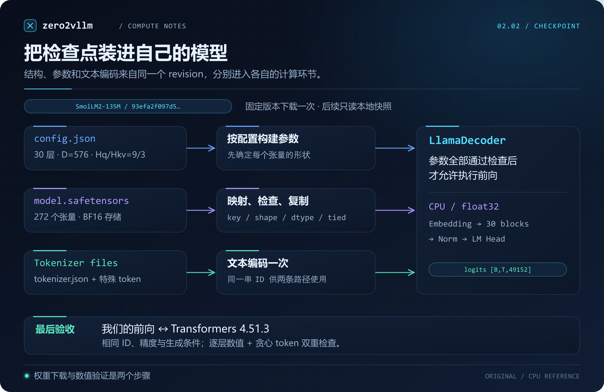
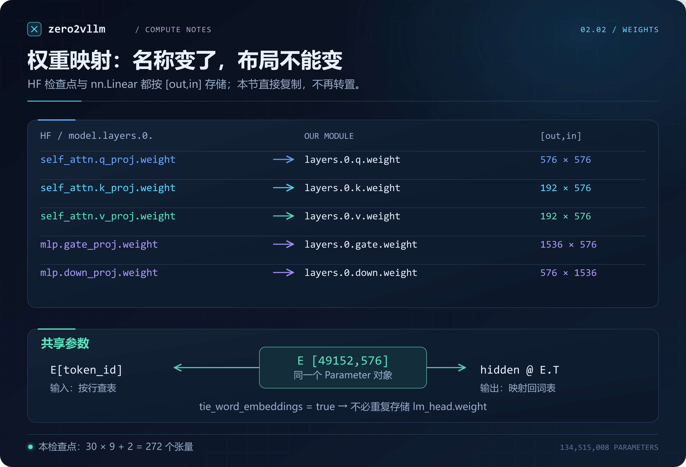
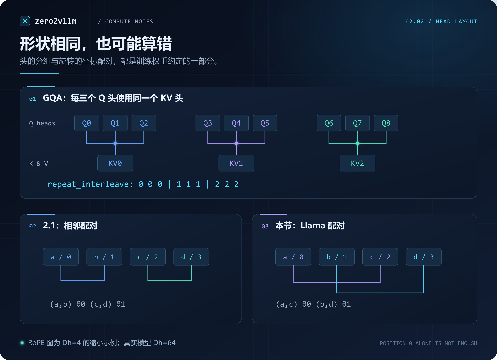
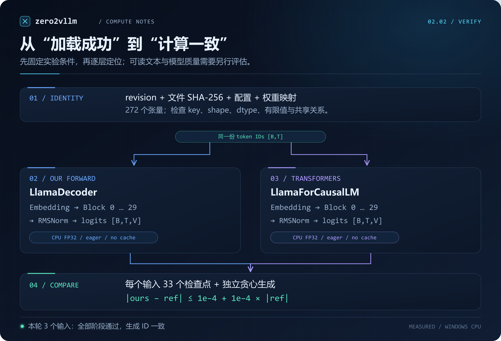

# 2.2 加载真实模型权重

[本篇目录](../README.md) · [上一节 2.1](../01-pytorch-model/README.md) · [实验与命令](lab.md) · [练习与答案](exercises.md) · [下一节 2.3](../03-request-and-cache-lifecycles/README.md)

2.1 的 Decoder 已经能执行前向和生成循环，但它的权重来自随机数。本节把训练好的权重装进我们自己写的模型，让它接收文字，并与 Transformers 的输出逐层比较。

先设想一种失败：所有权重都能复制，形状也完全正确，模型却生成了另一串 token。这时继续检查“文件有没有下载完”已经不够。矩阵的存储方向、RoPE 的配对方式、GQA 的头对应关系，都可能在不改变形状的情况下改变计算。

本节选用 **SmolLM2-135M 基础模型**。它使用 Llama 架构，规模允许在普通电脑的 CPU 上完成实验。我们实现配置解析、权重映射和前向计算；Tokenizer 使用模型自带文件，Transformers 只负责提供对照。A100/C500 的部署与性能仍在后续平台实验中分别验证。

## 学完后应能做到什么

- 从 `config.json` 推出 Q/K/V、MLP、Embedding 的权重形状。
- 读取单文件和分片 safetensors，检查漏权重、额外权重、形状、dtype 与共享关系。
- 解释 2.1 与这个真实模型在 RoPE、GQA、共享 Embedding 上的差别。
- 固定模型 revision、Tokenizer、计算精度和生成方式，保存可复查的对齐结果。
- 在生成不一致时，找到第一个开始偏离的中间层。

前置是 [2.1 的模型前向](../01-pytorch-model/README.md)。建议先顺着本文看一次加载过程，再运行[实验](lab.md)，最后做[形状与错误注入练习](exercises.md)。

## 1. 我们究竟在加载什么

一个可生成文字的模型至少需要三类信息：**结构配置、参数数值、文本与 token 的转换规则**。



*图 1：本节的数据流。下载只发生在显式使用 `--download` 时；后续推理读取同一个本地快照。图稿与绘制依据见 [assets/README.md](assets/README.md)。*

| 文件 | 本节从中取什么 | 它不负责什么 |
| --- | --- | --- |
| `config.json` | 层数、维度、头数、RoPE、归一化、权重共享开关 | 不包含训练后的参数值 |
| `model.safetensors` | 张量名称、shape、dtype 与数值 | 不定义模型的 Python 前向逻辑 |
| `model.safetensors.index.json` | 分片模型中，张量名称到文件的映射 | 不是 TP/PP 的切分方案；本模型实际使用单文件 |
| `tokenizer.json` 等 | 编码、解码、特殊 token；词表和 BPE 合并规则 | 不把中文模型能力“加到”权重里 |
| `generation_config.json` | 上游提供的生成默认值 | 不能替代本次对照实验显式设置的参数 |

完整清单在 [data/model.json](data/model.json)。其中 `README.md` 是上游模型说明，下载时一并保存，便于核对用途与许可。本课程只提交下载配方和结果，不提交模型权重。

### 1.1 revision 为什么要固定

`HuggingFaceTB/SmolLM2-135M` 是仓库名，`main` 是会变化的分支。本节固定完整 commit：

```text
93efa2f097d58c2a74874c7e644dbc9b0cee75a2
```

配置、权重和 Tokenizer 都从这个 revision 获取。如果只固定权重，却从最新分支读取 Tokenizer，两个人输入同一句文字就不一定得到同一串 ID。模型仓库 commit、Transformers 版本、本课程 commit 是三件不同的事，报告分别记录。[Hub v0.30.2 下载说明](https://huggingface.co/docs/huggingface_hub/v0.30.2/en/guides/download)

运行器还生成文件摘要清单 `zero2vllm-snapshot.json`。再次运行时逐个验证 SHA-256，防止快照中的文件被无意修改。这份清单是复现记录，不是外部机构对文件签发的证明。

## 2. 先从配置推出模型的形状

打开该 revision 的 [config.json](https://huggingface.co/HuggingFaceTB/SmolLM2-135M/blob/93efa2f097d58c2a74874c7e644dbc9b0cee75a2/config.json)，本节用到的关键值如下。

| 字段 | 值 | 怎样影响计算 |
| --- | --- | --- |
| `model_type` | `llama` | 选择本节实现的 Llama 子集 |
| `vocab_size` | 49152 | Embedding 行数与 logits 最后一维 |
| `hidden_size` | 576 | 隐藏向量宽度 D |
| `intermediate_size` | 1536 | SwiGLU 中间宽度 F |
| `num_hidden_layers` | 30 | 串行执行 30 个 Block |
| `num_attention_heads` | 9 | Q 有 9 个头 |
| `num_key_value_heads` | 3 | K/V 各有 3 个头 |
| `max_position_embeddings` | 8192 | 配置中的上下文上限；不等于本节已测试 8192 长度 |
| `rms_norm_eps` | 0.00001 | RMSNorm 分母中的稳定项 |
| `rope_theta` | 100000 | RoPE 频率底数 |
| `rope_interleaved` | false | 每个头的前后半区配对 |
| `tie_word_embeddings` | true | 输入 Embedding 和输出 LM Head 共享参数 |
| `torch_dtype` | bfloat16 | 本检查点存储精度提示；实际还要读张量 dtype |

所以每个头的维度是 `Dh = 576 / 9 = 64`，每组有 `9 / 3 = 3` 个 Q 头共享一个 K/V 头。

本节输入如果是五个 token，主要中间量为：

```text
token IDs      [1,5]
Embedding      [1,5,576]
Q 分头         [1,9,5,64]
K/V 分头       [1,3,5,64]
GQA 展开后 K/V [1,9,5,64]
Attention 分数 [1,9,5,5]
MLP gate / up  [1,5,1536]
logits         [1,5,49152]
```

配置检查实现在 [LlamaConfig.from_dict](../../../../zero2vllm/modeling/llama.py)。例如，Q 头数必须能被 K/V 头数整除；本实现不处理的 `rope_scaling`、量化检查点、滑动窗口和带偏置投影会直接报错。仅看到 `model_type=llama` 不足以认定任意模型都兼容。

## 3. safetensors 中存的是张量

检查权重时先看目录，不必马上构建整个模型：

```python
from safetensors import safe_open

with safe_open(".local/models/smollm2-135m/model.safetensors",
               framework="pt", device="cpu") as f:
    name = "model.layers.0.self_attn.k_proj.weight"
    view = f.get_slice(name)
    print(view.get_shape())  # [192, 576]
    print(view.get_dtype())  # BF16
```

`get_slice` 可以查询形状与 dtype，`get_tensor` 才取出相应张量供复制。safetensors 使用张量元数据和数据区描述内容；不会像通用 Python pickle 那样装载任意 Python 对象。**这不代表文件本身能证明模型结构匹配**，后面的名称、形状和数值检查仍要做。[safetensors 官方说明](https://huggingface.co/docs/safetensors/en/index)

### 3.1 单文件与分片

大模型常把权重分成多个 safetensors 文件，用索引的 `weight_map` 指定每个张量在哪个文件。本节加载器同时接受：

```text
单文件：model.safetensors

分片：  model.safetensors.index.json
        model-00001-of-00002.safetensors
        model-00002-of-00002.safetensors
```

这描述的是**磁盘文件组织**。在本节里，所有分片最终都装到同一个 CPU 模型；它不等于张量并行。

[checkpoint_files](../../../../zero2vllm/modeling/checkpoint.py) 会核对索引与各分片的实际张量名。某个分片不存在、索引指错文件、分片出现未登记张量，都会报错。单文件与索引同时存在也会报错，避免从混杂的目录中随意选一份。

当前 SmolLM2 快照只有一个权重文件；分片路径由离线随机小模型测试验证，不能把它描述成真实大模型分片实测。

## 4. 权重名称怎样映射到我们的模块

我们保持 2.1 的教学命名，例如 `layers.0.q.weight`。上游使用 `model.layers.0.self_attn.q_proj.weight`。**名称可以不同，但所指的运算必须相同。**



*图 2：第 0 层的映射示例。所有 Linear 均采用 `[out_features,in_features]` 存储；底部两条使用路径指向同一个参数。*

| 检查点名称（第 i 层省略前缀 `model.layers.i.`） | 教学模块 | shape |
| --- | --- | --- |
| `model.embed_tokens.weight` | `embedding.weight` | `[49152,576]` |
| `input_layernorm.weight` | `layers.i.norm1.weight` | `[576]` |
| `self_attn.q_proj.weight` | `layers.i.q.weight` | `[576,576]` |
| `self_attn.k_proj.weight` | `layers.i.k.weight` | `[192,576]` |
| `self_attn.v_proj.weight` | `layers.i.v.weight` | `[192,576]` |
| `self_attn.o_proj.weight` | `layers.i.o.weight` | `[576,576]` |
| `post_attention_layernorm.weight` | `layers.i.norm2.weight` | `[576]` |
| `mlp.gate_proj.weight` | `layers.i.gate.weight` | `[1536,576]` |
| `mlp.up_proj.weight` | `layers.i.up.weight` | `[1536,576]` |
| `mlp.down_proj.weight` | `layers.i.down.weight` | `[576,1536]` |
| `model.norm.weight` | `final_norm.weight` | `[576]` |
| `lm_head.weight`（本快照省略） | `head.weight` | 共享 `[49152,576]` |

映射由 [weight_map](../../../../zero2vllm/modeling/checkpoint.py) 显式生成。本模型每层有 9 个张量，共 `30 × 9 + 2 = 272` 个实际存储张量；共享的 LM Head 没有再存一份。

### 4.1 这次不要转置

2.1 的纯 Python 参考把矩阵写成 `[in,out]`，加载到 `nn.Linear` 前做了转置。真实 HF 检查点里的这些 Linear 权重已经是 `[out,in]`，应直接复制。

看一个能够手算的反例：

```text
X = [1,2]            W = [[1,2],
                          [3,4]]

Linear 正确计算 X @ W.T = [5,11]
误转置后计算   X @ W   = [7,10]
```

这是一个 2×2 方阵，两种加载方式的 shape 完全相同，因此 shape 检查无法发现错误。真实模型中的 Q 和 O 投影同样是方阵；数值对齐是必要的一步。

### 4.2 不能靠 strict=False 忽略问题

`load_state_dict(strict=False)` 可以允许缺失或额外的 key，但不意味着“模型已经正确装载”，也不会自动解决同名参数的尺寸不匹配。本节不依赖这个开关掩盖差异，而是在复制前计算：

```python
missing = expected_keys - stored_keys - allowed_tied_aliases
extra = stored_keys - expected_keys
```

只有配置明确要求共享时，缺少 `lm_head.weight` 才是允许的情况。其他缺失项都必须找到原因。复制前还检查 dtype 和有限值；整数打包权重、NaN 或 Inf 不能作为本节浮点参数直接装入。

## 5. 共享权重：少一个 key 不一定缺参数

Embedding 做 `E[token_id]`，LM Head 做 `hidden @ E.T`，二者可以使用同一个 `[V,D]` 参数：

```python
self.head.weight = self.embedding.weight
```

这行把两个模块的参数指向同一个对象。`copy_` 一份数值虽然能让初次前向相同，却会分配两份存储，也不会建立后续修改时的共享关系。

本节的规则是：

1. `tie_word_embeddings=true` 且检查点只存 Embedding：加载 Embedding，恢复别名关系。
2. 配置要求共享但两份参数都存在：检查它们转换为 float32 后逐元素相同，冲突就报错。
3. `tie_word_embeddings=false`：两份参数都必须存在，分别装载。

可以用参数数量核对是否意外重复保存：

```text
Embedding：49152 × 576                         = 28,311,552
每层：Q/O + K/V + 三个 MLP 矩阵 + 两个 Norm   =  3,540,096
30 层 + Embedding + final Norm                = 134,515,008
```

CPU float32 参数数据约 `134,515,008 × 4 = 538,060,032` 字节。实验还同时保留 Transformers 对照模型、激活与运行库，进程内存会高于这个数。它是参数存储估算，不是进程峰值测量。

## 6. 接上真实权重前，还要改两处计算

两节都写着“Attention + RoPE”，并不意味着权重可以直接互换。本节保留 [2.1 实现](../../../../zero2vllm/modeling/torch_decoder.py) 作为小规模数学入口，增加 [LlamaDecoder](../../../../zero2vllm/modeling/llama.py) 处理真实模型的布局；两者复用 RMSNorm。

### 6.1 GQA：三个 Q 头共用一个 K/V 头

本模型 `Hq=9`、`Hkv=3`。K 投影的输出宽度是 `3×64=192`，Q 投影则是 `9×64=576`。分头后，各 Q 头使用的 K/V 头如下：

```text
Q 头编号： 0 1 2 | 3 4 5 | 6 7 8
KV 编号： 0 0 0 | 1 1 1 | 2 2 2
```

教学实现用显式复制让矩阵乘法容易看懂：

```python
groups = num_attention_heads // num_key_value_heads
k = k.repeat_interleave(groups, dim=1)
v = v.repeat_interleave(groups, dim=1)
```

这里不能换成 `repeat(1,groups,1,1)`：后者得到 `0,1,2,0,1,2,0,1,2` 的排列，shape 一样，但头的关系错了。生产 Attention 算子可以直接按组索引 K/V，通常不需要像本节这样显式展开。这部分的性能与 KV 存储优化后面再做。

### 6.2 RoPE：相邻配对与前后半区配对

2.1 在 `Dh=4` 时配对 `(0,1)`、`(2,3)`。本节 Llama 布局配对 `(0,2)`、`(1,3)`。两种写法都能表示旋转，但**训练好的投影权重已经对应其中一种坐标排列**。



*图 3：两种不会改变总元素数的布局约束。GQA 使用本模型的 9:3 头数；RoPE 为便于手算缩小到 Dh=4，真实模型 Dh=64。*

对向量 `[a,b,c,d]`，Llama 的辅助变换是：

```text
rotate_half([a,b,c,d]) = [-c,-d,a,b]
```

位置为 p 时，两个角度为 `θ0=p`、`θ1=p/base^(2/4)`，结果是：

```text
[a cosθ0 - c sinθ0,
 b cosθ1 - d sinθ1,
 c cosθ0 + a sinθ0,
 d cosθ1 + b sinθ1]
```

实现里的 `split_half_rope` 将前后半区拼接处理，频率在后半区重复。两个头之间不发生混合；位置 0 的结果保持不变。只测试位置 0 会漏掉布局错误，所以示例还比较位置 1。

相邻配对通过坐标置换也能得到同样结果。四维示例先把输入改为 `[a,c,b,d]`，执行相邻配对，再换回原顺序即可。但只改旋转函数、不相应处理投影输出的坐标，就会算错。本节直接按检查点既有布局计算。

## 7. 文件精度、计算精度与加载内存

实际文件中的 272 个张量是 BF16，本节参数统一复制到 **CPU float32**：

```python
with torch.no_grad():
    parameter.copy_(tensor)  # 目标参数为 float32，复制时进行 dtype 转换
```

BF16 转 float32 保留原有值，不会找回训练或保存时已经舍去的精度。将官方参考模型也设为 float32，才能比较同一组实际权重值上的两条计算路径。

`LlamaDecoder` 先在 `meta` 设备定义参数形状，再用 `to_empty(device="cpu")` 分配存储。这些内存尚未初始化，所以模型用 `loaded=False` 阻止前向；全部权重通过检查后才允许运行。加载失败时不返回半成品模型。

加载器每次打开一个分片、取一个张量、复制到目标参数，不先构造完整的第二份 `state_dict`。文件映射、dtype 转换、有限值检查仍有开销；它不是“零内存加载”。如果检查点额外保存了共享 LM Head，本实现会暂存该张量用于冲突检查。

当前前向只接受 CPU float32。把张量迁移到 GPU，或把参数改成 BF16，不会自动获得已验证的 CUDA/MACA 路径。

## 8. Tokenizer 必须属于同一个快照

现在模型的词表不再是 2.1 的 16 个教学 ID。下面是本轮真实编码结果：

```text
"The capital of France is" -> [504,3575,282,4649,314]
"Once upon a time"         -> [6403,1980,253,655]
```

运行时只编码一次，将**同一个 token 张量**分别交给两条模型路径：

```python
tokens = tokenizer(prompt, add_special_tokens=False,
                   return_tensors="pt")["input_ids"]
```

本节使用基础模型做文本续写，不套聊天模板。BOS/EOS、是否自动添加特殊 token、是否拼接 system/user 标记，都会改变输入或停止行为，必须写进实验条件。

这里 BOS 与 EOS 的 ID 都是 0，但“在输入前加 0”和“预测到 0 就停止”仍是两个不同动作。生成循环只在**新预测的 token**等于 EOS 时停止。Tokenizer 没有配置 padding token；官方生成对照临时使用 EOS 作为 `pad_token_id`，每次只处理一条非空请求，同时显式传入全 1 的 attention mask。这个设置不表示教学模型已经实现变长 padding。

排查输出差异时先打印 `input_ids`。若它们已经不同，应先检查编码和模板，再检查算子。

## 9. 怎样证明这次加载正确

“能够生成一句话”只能说明程序运行到了输出。我们的验收分四层：



*图 4：本节实际检查路径。每个输入比较 Embedding、30 个 Block、最终 RMSNorm 和全部 logits，共 33 个数值检查点，再独立运行两套生成循环。*

### 9.1 先保证比较条件相同

本轮固定 Python 3.11.9、PyTorch 2.7.1+cpu、Transformers 4.51.3、safetensors 0.5.3。双方都使用 CPU float32、eager Attention、`eval()`、完整前缀重算；关闭 KV Cache、采样和 beam search。

Transformers 的模型从同一个本地目录独立构造和加载；我们的 `LlamaDecoder.forward` 不调用它的前向。参考路径通过 hook 记录中间结果，避免只比较最后一行。

### 9.2 比较全部位置与词表分数

每个阶段使用逐元素条件：

```text
abs(ours - reference) <= atol + rtol * abs(reference)
atol = 1e-4, rtol = 1e-4
```

先检查 shape 和有限值，再比较误差。logits 比较范围是 `[B,T,V]` 的所有元素，不仅是 top-1，也不仅是最后一个位置。报告中的 top-5 只是方便读者观察，不代替完整比较。

贪心 token 一样不代表所有 logits 一样；反过来，两个非常接近的最大分数也可能因为微小误差换序。因此本节同时要求中间值在容差内、生成 ID 完全相同。

### 9.3 本轮真实结果

完整环境、文件摘要、每层误差和 token ID 见 [results/README.md](results/README.md)。以下来自实际 CPU 运行：

| 输入 | 输入 token 数 | 33 个阶段的最大绝对误差 | 8 个生成 ID 对齐 |
| --- | --- | --- | --- |
| `The capital of France is` | 5 | 0.0 | 相同 |
| `Once upon a time` | 4 | 0.0 | 相同 |
| `1 + 1 =` | 5 | 0.0 | 相同 |

在当前机器、版本与输入上，两条路径结果恰好逐位一致。验收仍采用上面的容差，不要求其他 CPU 数学库、线程配置或未来 GPU 后端都产生零误差。

第二个输入续写为 `, there was a little girl named Lily`。第三个输入续写为 ` 1000000`，并没有正确完成算术。这也说明本节验证的是**加载与计算实现是否对齐**，模型的知识、推理和生成质量需要单独评估。不能把“不像正确答案”直接判断为加载器有错。

### 9.4 如果没有对齐，先找第一个偏离点

| 最早出错位置 | 优先检查 |
| --- | --- |
| Token ID | Tokenizer revision、空格、特殊 token、聊天模板 |
| Embedding | 词表行对应、加载精度、权重版本 |
| 第一个 Block | Q/K/V 权重、误转置、GQA 头顺序、RoPE 配对与底数、Norm eps |
| 某个中间 Block | 该层映射是否错位、是否误用上一层参数 |
| final Norm | 最终归一化是否遗漏或 eps 不同 |
| 只有 logits | LM Head、共享权重关系、输出矩阵方向 |
| 首步一致、后续生成不同 | 输入拼接、EOS、采样默认值、是否一侧使用了缓存 |

本节的离线测试包含一个方阵 Q 权重被故意转置的案例：加载检查可以通过，但数值对照必须识别差异。它用于证明对照有发现错误的能力。

## 10. 到 vLLM 中该看哪里

本节先固定 [vLLM v0.8.5 的 Llama 实现](https://github.com/vllm-project/vllm/blob/v0.8.5/vllm/model_executor/models/llama.py)作为阅读样本，关注 `LlamaModel.load_weights` 和 `LlamaForCausalLM.load_weights`；加载流程看同版本 [DefaultModelLoader](https://github.com/vllm-project/vllm/blob/v0.8.5/vllm/model_executor/model_loader/loader.py)。这是源码对照版本，不是本课程双平台的部署版本承诺。

从本节代码过渡到这些入口，可以带着三个问题读：

1. 检查点的独立 Q/K/V 怎样写入融合后的 QKV 参数？
2. `gate_proj` 与 `up_proj` 怎样进入合并后的 MLP 参数？
3. 权重加载方法怎样处理当前 TP rank 的分片，以及共享 LM Head？

本节只是“名称对应后复制整块张量”。正式引擎还可能在加载时做融合、切片和布局变换；量化权重还有 scales、打包格式及加载后处理。本节看到整数权重就拒绝，是因为尚未实现相应的计算与布局契约；这些内容在[量化篇](../../part-09-quantization/README.md)的 9.13 继续展开。

## 11. 本节边界与下一节接口

- **已验证**：固定 SmolLM2-135M 的 CPU float32 前向与贪心生成；随机小模型的 GQA/MHA、共享/独立 LM Head、单文件/分片加载及错误处理。
- **尚未实现**：变长 padding、增量 KV Cache、连续批处理、分页存储、量化加载及 GPU 优化。
- **平台状态**：A100 与 C500 均未在本节进行实机验证；CPU 模型实测不能代替设备支持结论。

2.3 将在这个可对齐的模型外组织请求状态、完成/取消和资源归属。当前模型权重可以供多个请求共用；输入 token、生成记录和未来的 KV Cache 属于具体请求。这条界线是下一节的起点。

## 参考资料

以下资料于 2026-09-17 核对；源码链接固定版本，动态文档不作为硬件兼容性承诺。

- [SmolLM2-135M 固定版本模型说明](https://huggingface.co/HuggingFaceTB/SmolLM2-135M/blob/93efa2f097d58c2a74874c7e644dbc9b0cee75a2/README.md)：模型用途、限制与 Apache-2.0 许可。
- [同版本 config.json](https://huggingface.co/HuggingFaceTB/SmolLM2-135M/blob/93efa2f097d58c2a74874c7e644dbc9b0cee75a2/config.json)：本文实际维度与开关。
- [Transformers v4.51.3：modeling_llama.py](https://github.com/huggingface/transformers/blob/v4.51.3/src/transformers/models/llama/modeling_llama.py)：`rotate_half`、`repeat_kv`、`LlamaAttention` 与 `LlamaForCausalLM`。
- [PyTorch 2.7：Linear](https://docs.pytorch.org/docs/2.7/generated/torch.nn.Linear.html)：权重形状与前向公式。
- [safetensors 官方文档](https://huggingface.co/docs/safetensors/en/index)：张量文件和读取接口。
- [Hub v0.30.2：下载与 revision](https://huggingface.co/docs/huggingface_hub/v0.30.2/en/guides/download)：快照和文件筛选。
- vLLM v0.8.5：[Llama 权重加载](https://github.com/vllm-project/vllm/blob/v0.8.5/vllm/model_executor/models/llama.py)、[模型加载入口](https://github.com/vllm-project/vllm/blob/v0.8.5/vllm/model_executor/model_loader/loader.py)。
