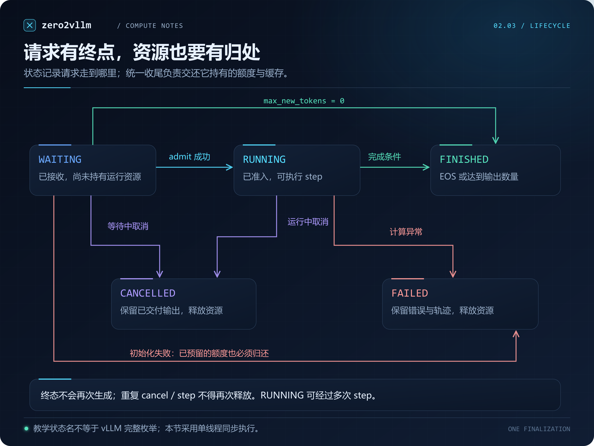
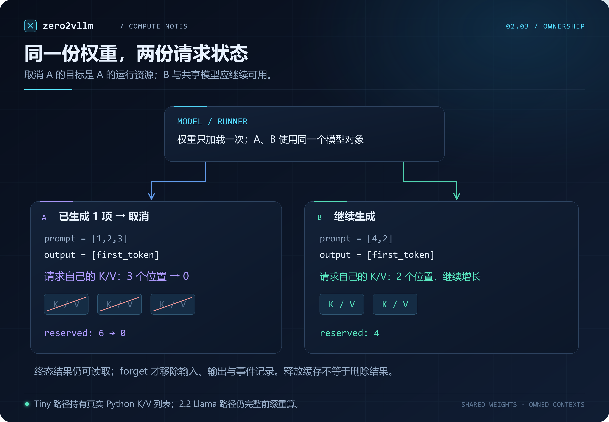
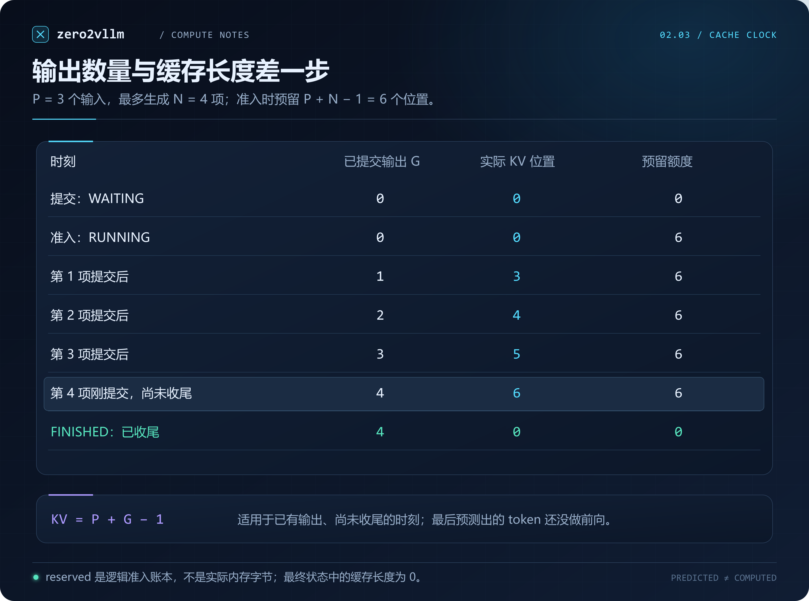
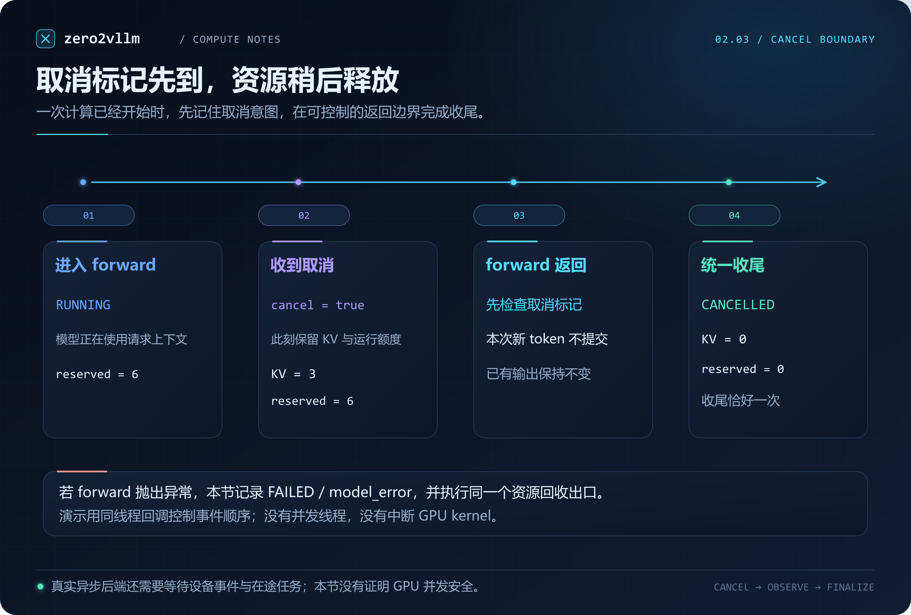

# 2.3 请求与缓存生命周期

[本篇目录](../README.md) · [上一节 2.2](../02-loading-real-model-weights/README.md) · [实验与命令](lab.md) · [练习与答案](exercises.md) · [下一节 2.4](../04-from-static-to-continuous-batching/README.md)

2.2 已经能把真实权重装进模型，输入一段文字，再逐步生成 token。那段生成循环默认一件事：调用者会一直等到循环结束。

现在换一个场景：A 刚生成两项，用户不想等了；B 还在等待可用资源。A 停止输出以后，它的 K/V 是否还占着空间？B 什么时候才能开始？如果 A 的模型计算已经开始，又应该在哪个时刻释放它的缓存？

这些问题需要在模型外增加一层**请求管理**。本节完成请求状态、运行资源归属和统一收尾。我们先用第一篇的小模型观察真实 K/V 列表，再把同一套管理代码接到 2.2 的 SmolLM2。所有实验都可以在 CPU 上完成。

## 学完后应能做到什么

- 区分“收到请求”“准许运行”“生成一项”“请求结束”四个动作。
- 画出正常完成、取消和异常的状态变化，并解释每条路径怎样释放资源。
- 算清输入长度、已输出数量、已缓存位置与预留额度之间的关系。
- 检查重复取消、部分计算失败、两条请求交错运行时的隔离性。
- 解释为什么释放请求缓存不等于删除模型，也不等于进程内存马上下降。

前置是 [1.3 KV Cache](../../part-01-inference/03-kv-cache/README.md)与 [2.2 权重加载](../02-loading-real-model-weights/README.md)。状态机部分只需 Python 标准库；真实模型扩展复用 2.2 的环境与快照。

## 1. 模型之外还缺少什么

模型前向回答的是“给定这些 token，下一项的分数是什么”。请求管理还要回答：

- 这段输入属于谁？已经返回了哪些 token？
- 它是否被取消？是否达到停止条件？
- 当前计算使用的缓存属于哪个请求？
- 结束后哪些数据可以释放，哪些结果还要留给调用者读取？

本节把代码分为两层：

| 层 | 负责的事情 | 实现 |
| --- | --- | --- |
| `LifecycleEngine` | 输入校验、状态、准入额度、停止条件、取消与收尾 | [lifecycle.py](../../../../zero2vllm/engine/lifecycle.py) |
| Runner | 用共享模型和当前请求的上下文计算下一项 | [runners.py](../../../../zero2vllm/engine/runners.py) |

Runner 每次只返回一个整数 token ID。Engine 决定是否将它写入输出、是否结束请求。这样，同一种取消规则可以用于不同的模型计算路径。

### 1.1 两条实验路径分别证明什么

| 路径 | 模型与权重 | 请求上下文中的缓存 | 对照方式 |
| --- | --- | --- | --- |
| `TinyCachedRunner` | 已有 `TinyAttentionLM`，固定随机种子 | **真实 K/V 数值列表**，每次计算实际读取并追加 | 与独立的完整前缀重算比较生成 ID |
| `LlamaFullPrefixRunner` | 2.2 的真实 SmolLM2-135M | **没有增量 KV**；每步重新计算完整前缀 | 与 2.2 的 `greedy_generate` 循环比较 |

因此，本节既有可检查的实际缓存回收，也有真实模型接入。不能把第二条路径说成“已经实现 SmolLM2 的增量缓存”。分页张量存储在 2.5 接入，连续批处理在 2.4 引入。

## 2. 一个请求从哪里开始，到哪里结束



*图 1：本节状态机。图中的名称属于教学实现；它没有包含抢占、恢复或异步设备执行。图稿来源与可编辑版本见 [assets/README.md](assets/README.md)。*

| 状态 | 含义 | 能否继续生成 | 运行资源 |
| --- | --- | --- | --- |
| `WAITING` | 输入已校验，等待准入 | 不能；先调用 `admit` | 无请求上下文，无预留额度 |
| `RUNNING` | 已准入，允许执行 `step` | 可以；每次最多提交一个 token | 持有独立上下文与预留额度 |
| `FINISHED` | 达到 EOS 或数量限制 | 不能 | 已回收 |
| `CANCELLED` | 已处理取消 | 不能 | 已回收 |
| `FAILED` | 初始化或模型计算失败 | 不能 | 已回收本实现持有的资源 |

正常请求沿 `WAITING → RUNNING → FINISHED` 前进。运行中的一次 `step` 如果尚未触发停止条件，仍然保持 `RUNNING`。

还需要处理两个容易漏掉的出口：

1. `max_new_tokens=0`：直接从 `WAITING` 进入 `FINISHED`，不创建缓存、不执行前向。
2. 准入时创建上下文失败：从 `WAITING` 进入 `FAILED`，归还刚预留的额度。

本节把结束原因与状态分开。例如 `FINISHED` 的原因可能是 `eos` 或 `length`；`FAILED` 的原因可能是 `initialization_error` 或 `model_error`。这样排查时不用从一个模糊的“已结束”猜测发生了什么。

### 2.1 终态意味着什么

终态有三个约束：不再生成、不再持有运行额度、不再持有活动缓存。重复 `cancel` 返回 `False`，重复 `step` 返回已有结果，二者都不会再次回收。

**终态不意味着结果对象被删除。** 已提交的输出、错误信息和事件记录保留，供调用者检查。调用 `forget` 才删除该请求的结果与历史；活动请求不能直接 `forget`，必须先结束或取消。

对本节同步实现，忘记结果后可以再次使用该 ID。实际异步服务应使用唯一请求 ID，或附带代次，避免迟到的取消信号误伤后来复用同一 ID 的请求。本节没有实现这种异步消息协议。

## 3. 把生成循环拆成几个明确动作

在仓库根目录，下面的程序可以直接运行：

```python
from zero2vllm.engine.lifecycle import LifecycleEngine, Status
from zero2vllm.engine.runners import TinyCachedRunner

with LifecycleEngine(TinyCachedRunner(), capacity_tokens=8) as engine:
    engine.submit("a", [1, 2, 3], max_new_tokens=4)
    if engine.admit("a"):
        while engine.view("a").status == Status.RUNNING:
            result = engine.step("a")
            print(result.status.value, result.output_ids)
    print(engine.used_tokens)  # 结束后为 0
```

`submit` 只接收请求，不自动执行。`admit` 尝试预留额度并创建上下文；暂时容纳不下时返回 `False`，请求仍为 `WAITING`。`step` 只推进指定的一条运行中请求。

这种拆分让实验可以在两次生成之间插入取消、读取状态或推进另一条请求。**谁先运行由调用者显式决定**，本节尚未实现自动挑选请求的调度策略。

### 3.1 提交时先检查不可恢复的错误

输入必须非空，token ID 必须在词表范围内，输出数量必须为非负整数。布尔值不能冒充整数 token。重复 ID、超过模型输入上下文、单条请求永远装不进总额度，都会在 `submit` 阶段报错。

校验失败不会留下半条请求，也不会占用额度。这里与“当前暂时没有足够额度”不同：后者进入等待，前者应立即告诉调用者修正参数。

`view` 返回冻结的数据快照，输出是 tuple；`events` 返回记录的副本。调用者修改观察结果，不应该修改引擎内部状态。提交时也复制输入，因此调用者后来修改原始 list 不会偷偷改变请求。

## 4. 运行额度为什么不是实际缓存长度

为了先把资源生命周期讲清楚，本节采用一个保守规则：准入时预留这条请求可能需要的最大输入位置数。

设输入长度为 P，最多生成 N 个新 token。当 N 大于 0 时：

```text
required_tokens = P + N - 1
```

第一步读取 P 个输入位置，得到第一个新 token；第二步才把这个新 token 送入模型。最后生成的那一项只需要返回，不必再做前向，因此少一个位置。当 N 为 0 时，预留额度为 0。

例如 P=3、N=4，预留 6 个位置。引擎账本保持：

```text
used_tokens = 所有活动请求 reserved_tokens 的和
available_tokens = capacity_tokens - used_tokens
0 <= used_tokens <= capacity_tokens
```

### 4.1 A 不退出，B 就还不能准入

总容量为 6，A、B 都需要 6：

| 操作 | A | B | 已用 / 可用 |
| --- | --- | --- | --- |
| 提交 A、B | WAITING | WAITING | 0 / 6 |
| 准入 A，尝试准入 B | RUNNING | WAITING | 6 / 0 |
| A 生成一项 | RUNNING | WAITING | 6 / 0 |
| 取消 A | CANCELLED | WAITING | 0 / 6 |
| 再次准入 B | CANCELLED | RUNNING | 6 / 0 |
| B 正常结束 | CANCELLED | FINISHED | 0 / 6 |

注意：归还额度不会自动运行 B。实验必须再次调用 `admit("b")`；自动重试与队列选择在 2.4 处理。

### 4.2 这个账本的能力边界

`capacity_tokens=6` 表示逻辑准入预算，不是 6 个物理分页块，也不是已经测量的可用内存。本节没有根据 RAM 或显存自动推算容量。

Tiny 路径的 K/V 列表按实际计算增长，逻辑额度只是它的上界。Llama 路径仍重算前缀，额度限制的是这条请求可能送入模型的最大长度，不代表已经分配了对应 KV 张量。

一次性预留较容易检查，但也较保守：一个请求可能很早就遇到 EOS，其余额度在这之前一直空占。正式引擎还会考虑逐步分配、抢占、调度预算和物理存储。这里先建立可验证的归属规则。

## 5. 权重属于模型，缓存属于请求



*图 2：两条请求的资源归属。图中的 K/V 是 Tiny 路径的实际列表；同一请求的输入与已提交结果在终态后仍可读取。*

`LifecycleEngine` 持有一个 Runner；Runner 持有一个模型。每个准入请求单独创建 `RequestContext`，Tiny 路径再为它创建一个新的 `KVCache`。

```text
Engine ── Runner ── Model weights（共享）
   ├── request A ── context A ── KV A
   └── request B ── context B ── KV B
```

A 与 B 即使输入完全相同，本节也不共享可变缓存。否则 A 的追加或清理可能修改 B 仍在使用的数据。前缀共享需要额外的引用计数、不可变前缀和写时处理，留到 2.6。

### 5.1 模型归属检查还不够

已有 `KVCache.owner` 用来检查缓存是否属于同一个模型实例。它不能单独证明缓存属于哪条请求：A、B 本来就使用同一个模型。

请求隔离依靠的是 Engine 保存的独立上下文与生命周期。测试让两条不同输入交错前进，再分别与完整前缀参考生成比较，避免只检查“对象地址不同”就认定数值正确。

### 5.2 收尾到底清除了什么

`RequestContext.close` 清空 Tiny 缓存的 keys 与 values 列表，撤销对该缓存的引用，并标记上下文已关闭。Engine 随后撤销请求对上下文的引用，归还预留额度，记录终态。

它不删除共享模型，不调用 `torch.cuda.empty_cache()`，也不承诺操作系统看到的进程内存立即减少。对象引用、Python/PyTorch 分配器中的保留内存，以及操作系统统计，是不同层面的事情。

这套上下文只管理本节的 CPU 对象。以后接入设备缓存、文件句柄或异步任务，需要为那些资源补充实际释放与同步规则，不能直接把当前 `close` 当作通用设备清理器。

## 6. 为什么刚输出四项，KV 只有六个位置



*图 3：Tiny 路径的缓存时序。第 4 个 token 刚提交时，事件记录里 KV 长度为 6；同一次 step 完成收尾后，公开状态中的 KV 长度已为 0。*

先看第一步：输入 `[1,2,3]` 计算出三组 K/V，然后从最后位置的 logits 选出 g1。此时 g1 还没作为输入参与计算，所以 K/V 里没有 g1。

第二步读取 g1，追加它的 K/V，选出 g2。以此类推，在已有 G 个输出、尚未收尾的时刻：

```text
cached_positions = P + G - 1    （G >= 1）
```

本节 P=3、N=4，四次提交后的缓存长度依次为 `3、4、5、6`，不会是 `4、5、6、7`。准入后尚未执行前向时是 0，不能把上述公式套在 G=0 上。

这是排查缓存偏移的重要检查点。若把最新预测 token 提前当作“已经计算”，下一步的位置编号与缓存读取范围就可能错一位。

终态已经清空缓存，`cached_positions` 返回 0；历史最大值单独保存在 `peak_cached_positions`。不要把终态中的 0 误读成“整个请求从未用过缓存”。

## 7. 取消的三个时刻

### 7.1 等待中取消

没有创建上下文，也没有占用运行额度。设置取消标记后直接收尾；不能为了“释放”而先分配一个缓存。

### 7.2 两次 step 之间取消

上一项已经提交，当前没有前向在使用缓存。立即清理上下文，保留已提交的输出，进入 `CANCELLED`。

例如 A 已经返回两项，取消不会把这两项从调用者手里收回。本节的 `output_ids` 仍保留这个前缀。

### 7.3 一次计算尚未返回时取消



*图 4：取消的处理边界。实验通过同线程回调精确控制事件顺序，没有创建并发线程，也没有中断 GPU kernel。*

顺序应当是：

```text
forward_started
  模型读取并追加 KV
  cancel_requested       ← 标记已经收到，但资源仍在使用
forward_returned
  发现取消，不提交这次新 token
finalized                ← 清空缓存，归还额度，进入 CANCELLED
```

只设置一个 `cancel_requested` 标记不会自动停止已经执行中的计算。先释放缓存、再等计算返回，可能让正在使用它的代码读到被清空或复用的数据。

因此 `cancel_requested=True` 与 `status=CANCELLED` 不是同一时刻。前者表达意图，后者表示本节的收尾已经完成。

本节 Engine 是单线程同步实现，普通调用者不能在 `step` 阻塞时从同一条执行流插入操作。实验用 Runner 内部回调模拟“计算中已收到取消”的事件顺序，验证资源没有提前回收。这不构成线程安全或 GPU 并发安全证明。真实异步后端还要等待任务完成、设备事件或其他明确的同步点。

## 8. 异常可能发生在缓存写入之后

不能假设模型计算是“要么完全成功，要么什么都没改”。Tiny Runner 可能已经向 K/V 列表追加数据，后续计算或调用代码才抛出异常。

实验特意在真实 K/V 追加后注入错误。期望结果是：

- `status=FAILED`，原因 `model_error`，保留错误类型与信息。
- 本次尚未提交的 token 不进入输出；之前提交的前缀仍可读取。
- 已部分写入的 K/V 一并清理。
- 请求额度归还一次，其他请求仍可继续。

所有结束路径都进入 `_finish`。这样不必分别在 EOS、长度、取消和异常分支复制一套清理代码。

### 8.1 两种信号同时出现时怎么办

本节明确采用以下顺序：

| 同时出现的条件 | 本节结果 |
| --- | --- |
| token 是 EOS，且刚好达到数量上限 | `FINISHED / eos` |
| 已收到取消，但本次 forward 正常返回 | `CANCELLED`，本次 token 不提交 |
| 已收到取消，且本次 forward 抛出异常 | `FAILED / model_error`，保留取消标记 |

最后一项让计算错误仍然可见，而不是被取消覆盖。这是本节的明确约定，不是所有推理框架必须采用的规则。

### 8.2 调用者退出也要收尾

推荐用 `with LifecycleEngine(...) as engine`。调用者代码抛异常或收到 `KeyboardInterrupt` 时，异常继续向外传播，上下文管理器会取消尚未结束的请求。

`close` 可以重复调用。关闭以后不能继续提交或推进请求，但仍可以读取已有结果。Engine 与结果全部不再需要时，应由调用者丢弃该对象；服务端长期保留已结束记录仍然会消耗内存。

## 9. 怎样验收生命周期实现

“最后没有报错”不足以证明正确。本节对每个实验同时检查：

1. 状态与结束原因是否正确。
2. 输出是否是参考生成的正确前缀；取消后的新 token 是否被丢弃。
3. 终态的活动缓存与预留额度是否为零。
4. 每条请求是否恰好出现一次 `finalized`。
5. 取消 A 后，B 的独立结果是否仍然正确。

[实验运行器](../../../../scripts/experiments/lesson0203.py)记录输入参数、状态快照、事件序号、缓存峰值、额度与每项断言。事件序号表达先后关系，不是毫秒时间戳，不能用它推算吞吐或延迟。

默认的 11 个案例覆盖正常完成、EOS、零输出、三种取消时刻、模型异常、初始化异常、等待后重试、交错隔离与关闭引擎。另有 [24 项测试](../../../../tests/integration/test_lifecycle.py)检查非法输入、重复调用、上下文边界、结果不可变、异常中断等行为。

真实 SmolLM2 扩展执行两组案例：取消 A 并让 B 完成；随后在同一份模型权重上建立新请求，检查它仍与 2.2 的生成循环一致。这个对照验证请求封装，2.2 中与 Transformers 的独立模型对齐记录仍保留在上一节，不重新冒充新的框架数值验收。实际记录见 [results/README.md](results/README.md)。

## 10. 到 vLLM 中看哪些入口

继续使用 vLLM **v0.8.5** 作为固定源码阅读样本，不把它当作双平台部署版本承诺。

| 文件与符号 | 带着什么问题读 |
| --- | --- |
| [v1/request.py：Request、RequestStatus](https://github.com/vllm-project/vllm/blob/v0.8.5/vllm/v1/request.py) | 一个请求保存哪些输入、输出与计算进度？哪些状态视为终态？ |
| [v1/core/sched/scheduler.py：add_request、finish_requests、_free_request](https://github.com/vllm-project/vllm/blob/v0.8.5/vllm/v1/core/sched/scheduler.py) | 请求怎样进入队列？外部取消如何进入统一释放路径？ |
| [v1/core/kv_cache_manager.py：free](https://github.com/vllm-project/vllm/blob/v0.8.5/vllm/v1/core/kv_cache_manager.py) | 请求结束时怎样解除块的占用？与前缀缓存的保留有什么区别？ |

不要机械地把我们的五个状态名逐项替换成上游枚举。上游还包含抢占等本节没有实现的状态；前缀缓存存在时，请求结束也不意味着把所有物理块内容清零。阅读时先找“谁持有资源、谁通知结束、谁最终释放”的关系，再进入具体调度细节。

## 11. 下一节增加什么

当前调用者显式写 `admit("a")`、`step("a")`、`step("b")`。2.4 将把“这一轮该推进谁、加入谁、移除谁”交给调度器，比较静态批处理与连续批处理。

这里留下的接口是：等待请求可尝试准入，运行请求可推进，终态可移出活跃集合，取消与错误共用收尾。后续调度优化不能破坏这些约束。

## 参考资料

以下公开源码于 2026-09-17 核对。图按本项目实现与实际事件重新绘制。

- [vLLM v0.8.5 请求对象与状态](https://github.com/vllm-project/vllm/blob/v0.8.5/vllm/v1/request.py)。
- [vLLM v0.8.5 调度器](https://github.com/vllm-project/vllm/blob/v0.8.5/vllm/v1/core/sched/scheduler.py)：请求接收、外部结束信号与统一释放。
- [vLLM v0.8.5 KVCacheManager](https://github.com/vllm-project/vllm/blob/v0.8.5/vllm/v1/core/kv_cache_manager.py)：请求块的释放路径。
- [Python 3.11：with 语句](https://docs.python.org/3.11/reference/compound_stmts.html#the-with-statement)：上下文管理器退出行为。
- [第一篇的完整/缓存 Attention 实现](../../../../zero2vllm/reference/attention.py)：本节实际 K/V 数值与独立重算参考。
