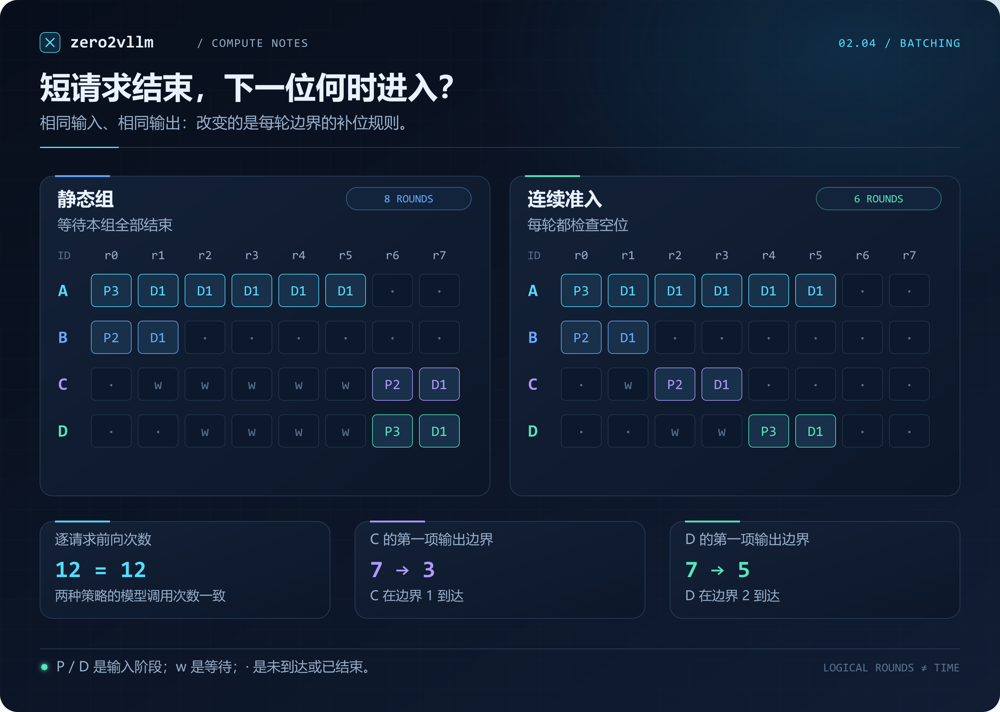
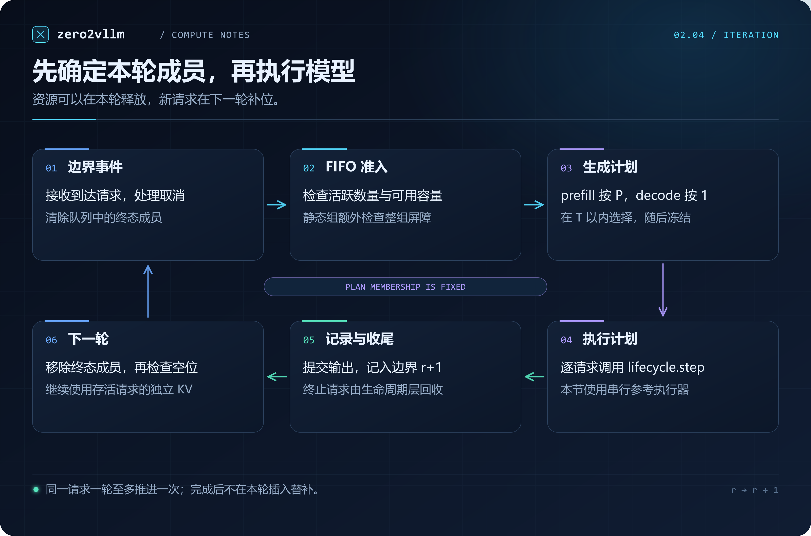
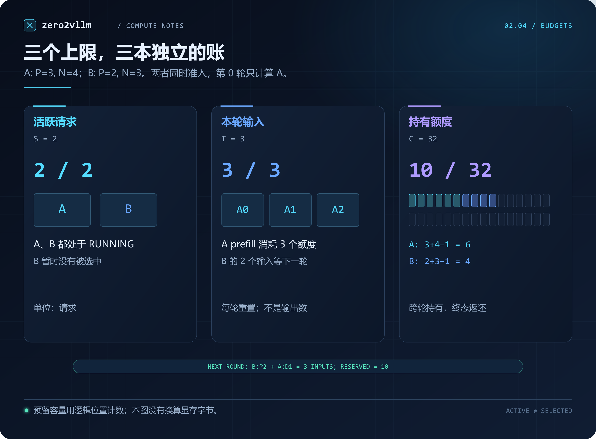
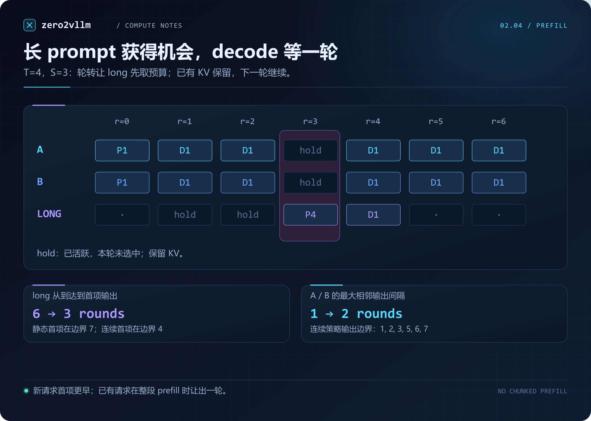

# 2.4 从静态批处理到连续批处理

[本篇目录](../README.md) · [全部课程](../../README.md) · [上一节 2.3](../03-request-and-cache-lifecycles/README.md) · [下一节 2.5](../05-paged-caching/README.md)

[动手实验](lab.md) · [练习与答案](exercises.md) · [CPU 实测记录](results/README.md)

上一节里，A 和 B 可以共用一个模型，各自保存 KV。A 结束或取消时，也能把资源交还。可是，每次调用谁的 `step()`，仍要由我们手写。这在两个请求时还算直观，换成不断到达、输出长度不一的请求，就需要一套持续执行的选择规则。

先考虑一个具体问题：一组请求中，A 要生成六个 token，B 只生成两个。B 已经结束，C 正在排队。**空出来的位置，是否一定要等 A 也结束才能使用？**

这一节从这个问题出发，把 2.3 的手动调用改成迭代调度器。读完后，你应该能够手算每轮的运行集合，解释一次等待发生在哪个环节，并核对调度前后各请求的输出是否一致。

本节只需 Python 3.11+ 标准库。实验复用 TinyAttentionLM，实际计算 Attention 并维护独立的 Python K/V 列表。调度器先生成执行计划，参考执行器再逐请求串行运行；这里尚未把不同长度的请求拼进一次张量前向。因此，本节给出调度行为和正确性记录，GPU 批执行与性能测量将在后续章节接上。

## 1. 一个 batch 可以在哪个边界改变

把多个输入送入模型时，通常会想到形状为 `[B, T]` 的 token 张量，`B` 是 batch size。对于自回归生成，一次前向只决定下一项输出；同一个请求还要回来计算很多次。于是除了“这次前向有几个输入”，还有“下次前向能换哪些请求”。

| 策略 | 一组请求开始后 | 短请求先结束时 | 下一组什么时候进入 |
| --- | --- | --- | --- |
| 静态组 `static` | 本组成员固定，不补入新成员 | 立即结束并释放资源，留下空位 | 本组所有成员都进入终态 |
| 连续准入 `continuous` | 每轮边界重新检查空位 | 立即结束并释放资源 | 下一轮边界即可补入等待请求 |

静态实验中，已完成的 B 不再调用模型，也不延迟保存它的结果；我们只保留“整组完成后再接下一组”的限制。这样，两种策略的差异集中在补位时机。某些固定形状实现还会为结束的行保留 padding 或屏蔽计算，那是执行层的额外成本，这个参考程序没有模拟它。

“先等几毫秒，把新请求凑齐”也不等于连续批处理。凑批窗口决定第一组何时出发；连续批处理关注生成过程中能否逐轮更换成员。本节收到请求后就按边界调度，没有额外的凑批超时。

Orca 论文把按模型迭代重新调度的思路称为 *iteration-level scheduling*。论文还讨论了执行算子时如何组织 batch；理解调度边界只是其中一层。[Orca，OSDI 2022](https://www.usenix.org/conference/osdi22/presentation/yu)

## 2. 先手算四个请求

固定输入见 [data/workloads.json](data/workloads.json) 的 `mixed_lengths`。大小写仅用于图中展示，代码使用小写请求 ID。

| 请求 | 到达边界 | Prompt 长度 P | 最多生成 N 项 | 预留额度 P + N − 1 |
| --- | --- | --- | --- | --- |
| A | 0 | 3 | 6 | 8 |
| B | 0 | 2 | 2 | 3 |
| C | 1 | 2 | 2 | 3 |
| D | 2 | 3 | 2 | 4 |

最多保留两个活跃请求，每轮最多处理八个输入 token，总预留容量为 32。这组实验不设置 EOS，输出长度由 N 决定。

约定 `r=0` 是第一轮：请求在边界 0 到达，本轮结果记在边界 1。`P3` 表示本次处理三个 prompt token，并得到第一项输出；`D1` 表示喂入上一项输出，得到下一项。它们都产生一项新输出，但输入工作量不同。



静态策略的前两轮都执行 A、B。边界 2 时 B 结束，C、D 已经到达，但是 A 所在的组还没有结束。于是第 2—5 轮只执行 A；边界 6 才能一起接收 C、D。

连续策略在边界 2 看到了 B 腾出的空位，让 C 与 A 一起执行。C 在边界 4 结束，D 再补进来。最后 A、D 都在边界 6 完成。

| 记录项 | 静态组 | 连续准入 |
| --- | --- | --- |
| 完成这组负载的逻辑轮数 | 8 | 6 |
| 实际逐请求前向次数 | 12 | 12 |
| 处理的输入 token 总数 | 18 | 18 |
| 提交的输出 token 总数 | 12 | 12 |
| C 的第一项输出所在边界 | 7 | 3 |
| D 的第一项输出所在边界 | 7 | 5 |

连续准入减少的是这组轨迹中的空位等待。两种方式执行了相同数量的参考前向，输出 ID 也逐请求一致。**8 轮和 6 轮不能换算成 GPU 加速比**：有的轮包含 prefill，有的只有 decode，实际耗时不相等；当前执行器还是串行的。

再把四个请求都改成相同到达时间、相同输出长度，在足够的预算下，两种策略可能给出一样的运行集合。连续准入提供了补位机会，负载中是否存在可补的空位，要看实际轨迹。

## 3. 等待队列、活跃队列、执行计划

上一节的状态继续使用，不增加“调度中”之类的状态：`WAITING` 尚未持有运行额度；`RUNNING` 已准入并持有独立上下文；`FINISHED / CANCELLED / FAILED` 是资源已经回收的终态。

调度器在这些状态之上维护两条队列，再生成每轮计划：

| 对象 | 实现中的位置 | 含义 |
| --- | --- | --- |
| 等待队列 | `_waiting` | 按提交顺序等待准入，同一到达边界按输入文件顺序排列 |
| 活跃队列 | `_active` | 已准入、尚未终止的请求，顺序决定本轮谁先分配计算额度 |
| 执行计划 | `tuple[WorkItem, ...]` | 本轮选中的请求、阶段和输入 token 数，生成后不再补位 |

`RUNNING` **不保证每一轮都被选中**。它说明请求持有运行资源，本轮是否执行还要检查计算额度。没选中的请求保留已有 KV，不清空、不重新 prefill。



一次 `tick()` 按如下顺序工作：

1. 移除队列中已经终止的成员。
2. 按策略决定能否补位。连续策略每轮都检查，静态策略等待整组结束。
3. 从等待队首尝试准入，直到活跃数量达到上限或队首装不下。
4. 遍历活跃请求，为能装进本轮计算预算的请求创建 `WorkItem`。
5. 冻结本轮计划，逐个调用已有的 `LifecycleEngine.step()`。
6. 记录输出边界与终态。结束的请求交还资源，下一轮重新检查空位。

为什么第 5 步不能边执行、边补入？假设只允许一个活跃请求，A 在本轮执行后结束。此时立即补入 B 并执行，图里一轮就计算了两个先后占用同一位置的请求，轮次含义被改变了。若修改 Python 循环顺序还会改变谁能赶上这一轮，实验也就难以比较。

本实现的终态回收仍发生在 `step()` 内；**资源已经释放**与**本轮计划已经固定**可以同时成立。C 会在下一轮看到空位。

## 4. 三种上限，各自管什么

“batch size 设大一点”不能回答所有问题。我们需要分别记三个数。

### 4.1 活跃请求数：最多保留几份运行上下文

`max_running` 限制活跃队列长度：

$$
|\mathcal{A}_r| \le S.
$$

一个已准入、尚未 prefill 的请求也占一个位置。这个位置是调度器的计数，没有绑定固定 GPU lane 或线程。

### 4.2 每轮输入 token：这一轮允许推进多少输入

对本节有增量缓存的运行器，请求 i 的下一步成本定义为：

$$
c_i(r)=\begin{cases}
P_i, & \text{尚未生成第一项输出，即整段 prefill},\\
1, & \text{之后的 decode}.
\end{cases}
$$

若本轮选中集合为 $\mathcal{B}_r$，则：

$$
\sum_{i\in\mathcal{B}_r} c_i(r) \le T.
$$

T 对应 `max_tokens_per_round`。它数的是**本次新送入模型的位置数**，不是本次产生几个输出，也不是 Attention 读取了几个历史 KV。即使 decode 每次只输入一个 token，它仍要访问越来越长的历史，耗时并不恒定。

### 4.3 预留容量：活跃请求持有多少额度

沿用 2.3 的保守准入约定，N 大于零时，每个请求一次性预留：

$$
R_i=P_i+N_i-1,\qquad \sum_{i\in\mathcal{A}_r}R_i\le C.
$$

最后预测出的 token 不再送回模型，因此少一个位置。零输出请求立即结束，预留为零。额度一直持有到终态，EOS 提前结束或取消会提前返还。



来看 `token_pressure`：A 的 P=3、N=4，B 的 P=2、N=3；S=2，T=3，C=32。

两者都能准入，总预留为 `6 + 4 = 10`。第 0 轮先选 A，prefill 已经用完三个输入额度，B 虽处于 RUNNING，KV 仍为空。第 1 轮先选 B，花两个额度做 prefill，还剩一个额度让 A decode。两轮计算预算各自重新从 3 开始，跨轮持有的预留仍为 10。

C 是逻辑位置账本，实际 GPU 内存还要考虑层数、KV 头数、head dimension、dtype、物理块粒度等因素。2.5 会继续连接块表与存储；这里不把 32 个额度解释成某个显存字节数。

## 5. 同样在等待，原因可能完全不同

轨迹把等待原因分别输出，否则一看到队列变长，很容易误以为是同一种瓶颈。

| 轨迹字段 | 所处环节 | 具体含义 |
| --- | --- | --- |
| `cohort_barrier` | 静态准入 | 本组还存在 RUNNING 成员，即使有空位也不能补入 |
| `max_running` | 准入 | 活跃请求数已经达到 S |
| `fifo_capacity` | 准入 | 等待队首需要的预留额度大于当前可用额度 |
| `skipped_budget` | 本轮选取 | 已经活跃，但完整下一步装不进本轮剩余 T |

### 5.1 队首阻塞：后面的短请求装得下，也可能不能进

在 `fifo_capacity` 中，总容量为 8。A 已预留 6，剩余 2；队首 B 需要 5，后面的 C 只需要 1。虽然 C 单独装得下，本节的 FIFO 准入会停在 B，不越过队首。

这叫队首阻塞，*head-of-line blocking*。实验保留严格 FIFO，是为了把可预测的顺序和代价放到一起看。如果改成“扫遍队列，谁能放下就先放谁”，可能更充分地使用额度，但不断到来的小请求也可能让 B 长期等不到连续空间。那时需要额外的公平性规则，不能只看一个更短的完成轮数。

`inspect_budgets.py` 中取消等待的 B 后，下一轮 C 就能进入；这个变化来自队首变化，不需要增大容量 C。

### 5.2 活跃请求也需要机会：轮转处理长 prefill

假设 A、B 已在 decode，T=4，新请求 L 的 prompt 恰好长四个 token。每轮若永远先选 A、B，只剩两个额度，L 的整段 prefill 就一直装不下。

本节每轮遍历后把活跃队首移到队尾。对于始终保持活跃的请求，它前面的成员会逐步移走；新准入请求追加到队尾，不插队。每个请求至多经过 `max_running` 轮就能轮到第一次选择预算。因为我们拒绝 P>T 的请求，它轮到队首时就一定能选中。这个保证只针对已准入的活跃请求，不消除等待队列的队首阻塞。



在 `long_prefill_turn` 的连续策略中，L 在边界 1 到达并准入；第 1、2 轮仍装不下，第 3 轮终于轮到队首，独自消耗四个输入额度。A、B 这一轮暂停，下轮继续从原来的 KV 推进。

| 记录项 | 静态组 | 连续准入 |
| --- | --- | --- |
| L 的第一项输出边界 | 7 | 4 |
| L 从到达到首项输出的轮数 | 6 | 3 |
| A、B 的最大相邻输出间隔 | 1 轮 | 2 轮 |
| A、B 的完成边界 | 6 | 7 |

新请求更早拿到首项输出，但已有请求多等了一轮。后面的 Chunked Prefill 会继续讨论：能否把长 prompt 拆成较小片段，避免一次占满 T？本节完整处理 prompt，遇到 P>T 会直接拒绝，并告诉你提高额度；它不会把永远无法执行的请求静默留在队列里。

## 6. 看实现：把策略放在生命周期之外

核心文件是 [scheduler.py](../../../../zero2vllm/engine/scheduler.py)，它复用 [lifecycle.py](../../../../zero2vllm/engine/lifecycle.py)。生命周期层仍负责状态、缓存归属、停止条件和回收；调度层负责队列、准入次序、每轮选取与逻辑时钟。

可以先读这个完整小例子，再运行 [walk_batches.py](examples/walk_batches.py)：

```python
from zero2vllm.engine.lifecycle import LifecycleEngine
from zero2vllm.engine.runners import TinyCachedRunner
from zero2vllm.engine.scheduler import BatchScheduler

with LifecycleEngine(TinyCachedRunner(), capacity_tokens=32) as engine:
    scheduler = BatchScheduler(
        engine, policy="continuous", max_running=2, max_tokens_per_round=8
    )
    scheduler.submit("a", [1, 2, 3], max_new_tokens=6)
    scheduler.submit("b", [4, 2], max_new_tokens=2)
    while scheduler.has_pending:
        trace = scheduler.tick()
        print(trace.round_index, trace.planned, trace.terminal)
    print(scheduler.records())
```

交给调度器的 engine 应是新建且专用的；之后通过调度器提交、取消和推进，通过 engine 读取 view/events。不要在外面额外 `admit()` 或 `step()`，否则队列和计时记录就失去共同的边界。上面的循环处理已经提交的请求；带未来到达事件的回放使用本节实验运行器，不能仅凭当前队列为空就提前退出。

`max_running` 只限制活跃集合，不限制等待队列或已完成结果的数量。本节输入有限，终态结果保留到实验结束；线上服务还需要排队上限、结果释放和背压。不要把这个有限负载回放器直接当作长期服务使用。

`WorkItem` 记录 `request_id / phase / input_tokens`，是不可修改的数据。`RoundTrace` 记录计划、实际执行成员、等待原因，以及执行前后的预留数。`running` 是本轮开始执行前的顺序快照；内部队列已经为下轮轮转，所以不要把两者误当作同一个可编辑列表。

停止与错误仍走 2.3 的出口：

- 生成 EOS、达到长度上限：当次 step 收尾，下一轮腾出调度位置。
- 边界取消：`scheduler.cancel(id)` 立即交还额度；接下来的 tick 可以补位。静态组若还有其他活跃成员，仍要等整组结束。
- 初始化上下文失败：记录 FAILED，预留回滚；准入循环可继续尝试下一个等待者。
- 某次前向失败：该请求回收，已冻结计划中的其他请求继续执行；下一轮补位。

调度器仍是单线程的。取消 API 在轮次之间调用；测试还保留了低层运行器回调取消另一个已选请求的情形，执行前会再次检查状态，跳过已经终止的成员。这个保护不等于已经实现线程安全或设备异步取消。

## 7. 调度集合怎样变成真正的张量 batch

现在的执行计划可能是：

```text
a: decode, 1 input token, existing KV length 4
c: prefill, 2 input tokens, existing KV length 0
```

这张计划已经足够让串行参考模型运行，但不能直接对两个输入做 `torch.stack()`：它们的输入长度和历史长度不同。要在同一次设备执行中处理它们，还需要一份明确的布局协议。

至少要补上这些信息：

1. 各请求本次输入的 token ID 与绝对位置。
2. 本次输入的长度和边界，例如打平后的长度前缀和。
3. 各请求可以访问的历史 KV 长度与位置映射。
4. Attention 的请求边界，保证 A 看不到 C 的 token。
5. 每个请求用哪一行 logits 采样，以及结果应该写回哪个上下文。

可以选择 padding，也可以使用打平的变长布局，选择取决于后端与算子契约。2.5 会先把缓存位置映射具体化，Attention 章节再展开算子布局与计算。以后替换执行器时，仍能用本节的参考轨迹和逐请求输出检验它。

2.2 的 `LlamaFullPrefixRunner` 每次重算完整前缀，下一步输入长度是 `P + 已生成长度`，不满足这里的 P-then-1 成本模型。本节调度器会拒绝这种运行器。要接真实权重，先实现并验证它的增量 KV 契约，再声明 `supports_cached_steps`；仅添加这个标志会把账算错。

## 8. 如何阅读实验结果

完整命令在[实验页](lab.md)。默认入口运行六种负载、每种两种策略，共十二次回放，每次都与独立的 `forward_full` 生成循环比较输出。

对于请求 i，记录到达边界 $a_i$、第一项输出边界 $f_i$、终态边界 $e_i$：

$$
\text{首项等待轮数}=f_i-a_i,\qquad
\text{完成等待轮数}=e_i-a_i.
$$

相邻两项输出边界的差就是 `inter_token_gaps_rounds`。C 在边界 1 到达，连续策略下输出在边界 3、4，因此首项等待为 2 轮，完成等待为 3 轮。零输出或首项输出前取消时，没有首项指标，JSON 中是 `null`，不能当作首项延迟零。

报告还给出 `selected_slot_fraction`：实际逐请求执行次数除以“记录轮数 × max_running”。主实验分别为 12/16 与 12/12。这个数方便核对图里的空位。`staggered_arrivals` 把没有请求的空轮也记录进去，因此它的值很低，原因是没有工作到达。它既不代表 GPU 利用率，也不包含每个输入长度和 KV 读取成本。

调度正确性至少同时检查：

- 每个请求的输出与单独运行一致；取消请求保留正确输出的前缀。
- 每轮活跃数、选中输入 token 数和预留容量都在上限内。
- 同一个请求一轮最多执行一次，首项与结束边界没有差一轮。
- EOS、取消、异常和初始化失败都有资源出口。
- 回放结束时所有已建上下文关闭，预留为零，每个请求只收尾一次。

只有“程序没有报错”不够。如果把 A、B 的 KV 不小心交换，程序可能继续产生整数；逐请求的独立参考对照才能发现这种错误。

## 9. 带着差异阅读 vLLM

源码阅读固定在 [vLLM v0.8.5 的 V1 scheduler.py](https://github.com/vllm-project/vllm/blob/v0.8.5/vllm/v1/core/sched/scheduler.py)，避免把后续版本行为混在本节实现里。先在 `schedule()` 中找四处：运行请求的选取、等待请求的准入、`num_scheduled_tokens` 的汇总，以及返回的 `SchedulerOutput`。你会看到运行集合与本轮选中集合并不必然相同。

这个版本先处理 running，再尝试 waiting；还包括分块推进、实际块分配和抢占路径。本节采用完整 prefill、轮转选择和一次性额度预留，目的是把约束拆开检查，并未复刻那套调度策略。读源码时，优先回答“在何处作决定、失败时怎么返回、下游需要什么信息”，再比较不同策略的行为。

本节还没有实现生产环境的优先级、抢占重算、Chunked Prefill、异步调度、DBO/TBO 或服务级指标。Part 6 会继续处理这些策略的组合；2.5 先解决更基础的问题：调度器同意推进的 token，具体要写进哪一块缓存。

## 10. 做完这一节

先运行主对照，再故意把 T 改小；检查 B 为什么已准入却还没 prefill。然后看队首阻塞和长 prompt 的两种等待，最后完成[八组练习](exercises.md)。验收时除了两行 PASS，还应该提交一段解释：**请求在等什么资源，什么时候终于获得执行机会，哪些已有请求为此多等了多久。**

### 公开参考资料

- [Orca，OSDI 2022](https://www.usenix.org/conference/osdi22/presentation/yu)：迭代级调度的论文入口。
- [vLLM V1 Scheduler，v0.8.5](https://github.com/vllm-project/vllm/blob/v0.8.5/vllm/v1/core/sched/scheduler.py)：具体调度和预算路径。
- [vLLM SchedulerOutput，v0.8.5](https://github.com/vllm-project/vllm/blob/v0.8.5/vllm/v1/core/sched/output.py)：调度层如何向执行层传递结果。

四张插图均为本课程原创；时间线来自本节固定输入与实际回放。图中的轮次没有时间单位；可编辑源文件和数据对应关系见[图稿说明](assets/README.md)。
