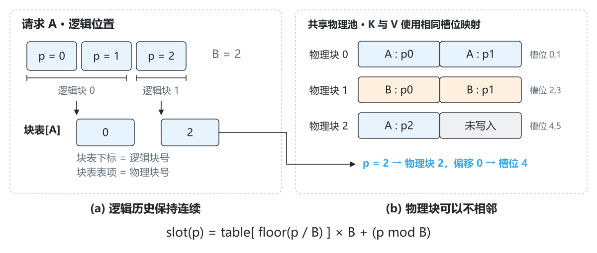
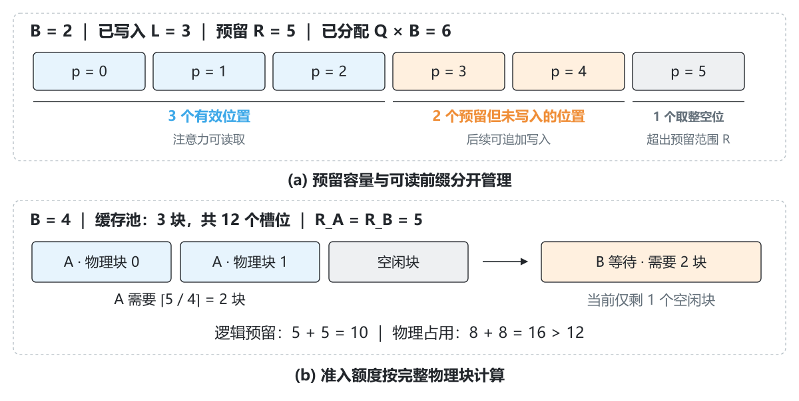
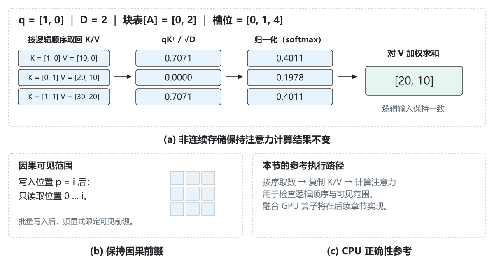
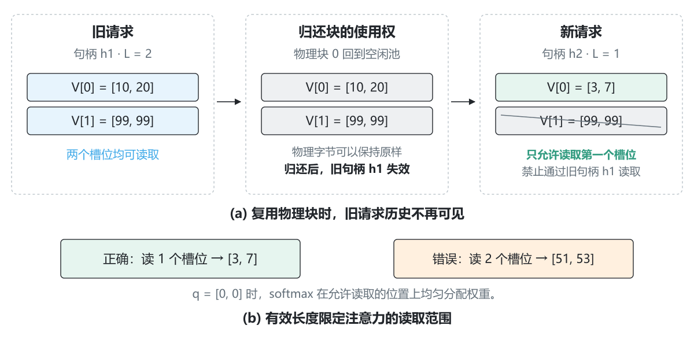

# 2.5 分页缓存：让不连续的块保存连续的历史

[本篇目录](../README.md) · [上一节 2.4](../04-from-static-to-continuous-batching/README.md) · [下一节 2.6](../06-prefix-caching/README.md)

[实验与命令](lab.md) · [练习与答案](exercises.md) · [实测记录](results/README.md) · [插图源文件](assets/README.md)

2.4 的调度器已经能决定这一轮运行谁、让谁继续等待。每个活跃请求也有独立的 KV 历史。但那时的缓存按请求保存在 Python 列表里：调度器记录了一笔容量额度，并没有把这笔额度落实成一个共享张量池里的地址。

本节把这两件事接起来。请求 A 的前三个 token 可以保存在物理 slot `0、1、4`；请求 B 可以占着中间的 `2、3`。我们需要保证 A 的 Attention 仍然读到自己的三项历史，顺序正确，而且不能读到 B 的数据。

做完本节，你应该能沿着一条路径解释代码：**逻辑位置 → 块表 → 物理 slot → K/V 写入 → 有效前缀读取 → 请求结束归还块。**

## 1. 本节实现什么

需要 2.1 的张量与 Attention 基础，以及 2.3—2.4 的请求状态、预留额度和调度边界。实验使用 CPU、PyTorch 2.7.1，普通电脑即可；不需要下载模型权重。

| 部分 | 本节的具体实现 |
| --- | --- |
| 分配器 | 复用第一篇的 `BlockPool`，维护空闲块与每个请求的块表 |
| 存储 | 共享 CPU K/V 张量，实际保存每个位置的向量 |
| 模型 | `TinyAttentionLM` 的单层参考模型，固定词表 16、宽度 8、最大上下文 32、seed=7 |
| Attention | 按逻辑顺序 gather K/V，再用 PyTorch 计算；支持存储层的 GQA 头映射 |
| 调度 | 接入 2.4 的连续准入；预留额度向整块取整 |
| 验证 | 11 个实验案例，逐项 logits 对照、碎片分配、取消、异常和块复用 |

这里的 `PagedTinyRunner` 保留参考模型的 Python 投影计算，把 K/V 存储和 Attention 换成 CPU 张量路径。它没有给 2.2 的真实 Llama 模型添加增量缓存，也不是 GPU PagedAttention 算子。这样可以先单独验证地址、数据和生命周期，避免一次改动模型计算与缓存布局后难以定位误差。

## 2. 为什么要有块表

假设每个请求都要一段足够大的连续缓存。预留太大，短请求会留下很多空位；按需扩展，又可能遇到后面的地址已经被其他请求占用。分页允许请求由几个固定大小的块组成，后续增长只需要找到足够数量的空闲块，不要求它们在物理池里相邻。

本节的“页”或“块”是缓存分配单位：一块容纳 `B` 个 token 位置的 K 和 V。它不是操作系统页，也不改变 token 的先后关系。

设 `B=2`。先给 A 分配物理块 0，给 B 分配物理块 1；A 再增长时拿到块 2。于是：

```text
A 的逻辑块：        0       1
A 的 block table： [0,      2]
A 的逻辑位置：      0, 1    2
A 的物理 slot：     0, 1    4
```



*图 1｜(a) 块表的下标是逻辑块号，表项是物理块号。(b) A 使用块 0、2，中间的块 1 属于 B。K 和 V 使用同一套映射，但保存在两个独立张量中。*

对于从 0 开始的逻辑位置 `p`：

$$
b_{logical}=\lfloor p/B\rfloor,\qquad offset=p\bmod B
$$

$$
b_{physical}=table[b_{logical}],\qquad slot=b_{physical}\cdot B+offset
$$

把 `p=2` 代入：逻辑块号是 1，块内偏移为 0；查 `table[1]` 得到物理块 2，所以 slot 是 4。**这里的 4 是存储地址，不是模型的位置编号。** 位置嵌入或 RoPE 仍然使用逻辑位置 2。把 slot 当作 position ID，会使同一段文本的计算结果随分配状态变化。

我们的分配器优先取编号最小的空闲块，这是为了让实验可复现。分页的正确性不依赖这一分配顺序。

## 3. 把“有地址”和“有数据”分开

一个请求至少需要三个数量：

| 符号 | 代码中的字段 | 含义 |
| --- | --- | --- |
| `L` | `written_positions` | 已经成功写入的连续前缀长度 |
| `R` | `reserved_positions` | 允许该请求使用的逻辑位置上限 |
| `Q` | `len(block_table)` | 已分配的物理块数量，等于 `ceil(R/B)` |

因此：

$$
0\le L\le R\le QB
$$

总共分配了 `QB` 个 slot，其中 `R-L` 个是为未来计算保留、但尚未写入的位置；`QB-R` 个是按块取整产生的尾部空位。



*图 2｜(a) `B=2、L=3、R=5` 时，6 个已分配 slot 中只有前 3 个可读。(b) 换成 `B=4`，两个各预留 5 个逻辑位置的请求需要 16 个物理 slot，不能同时进入只有 12 个 slot 的池。上下两图是两个独立例子。*

第一种空闲来自预留策略，第二种来自块粒度。只有尾部取整空位满足 `0 ≤ QB-R < B`。如果提前为最大生成长度预留，`R-L` 可以很大，因此不能说“分页以后每个请求总共最多浪费一个块”。

这些数量也决定 API 的边界：

- `locate` / `slot_mapping` 可以定位 `0 ≤ p < R` 的地址，供后续写入使用。
- `append` 只能从当前 `L` 开始写，写完后不能超过 `R`。
- `gather` 只能读取 `0 ≤ p < L`；地址已经分配不代表内容已经有效。
- 块尾超出 `R` 的位置不能擅自使用。需要先增长预留，即使物理块本身已经存在。

## 4. 共享张量怎样存 K 和 V

实现位于 [`zero2vllm/cache/paged.py`](../../../../zero2vllm/cache/paged.py)。一个 `PagedKVStore` 对应一层，K、V 各有一个张量：

```text
[num_blocks, block_size, kv_heads, head_dim]
```

例如 `3` 块、每块 `2` 个位置、`1` 个 KV 头、头维 `2`，每个张量的形状是 `[3, 2, 1, 2]`。前两维展平后就能用 slot 索引：

```python
flat_keys = keys.view(-1, kv_heads, head_dim)
# logical p=2 → physical slot=4
flat_keys[4]  # shape: [kv_heads, head_dim]
```

这是为教学选择的清楚布局。不同设备与 Attention 后端可以有不同的 K/V 布局和块大小约束，不能拿这段 `view` 推断生产后端的内存格式。

### 4.1 分配先成功，元数据才提交

`create()` 创建一个空句柄，此时 `L=R=0`，没有占用物理块。`reserve(handle, R)` 先让分配器检查空闲块是否足够，成功后再更新 `reserved_positions`。

如果从 2 个位置增长到 5 个位置，但池里放不下，操作抛出 `MemoryError`。原块表、原预留长度、已有 K/V 和空闲块数保持不变。读者可以在 `oom` 案例里对照操作前后的完整快照。

### 4.2 写 K、写 V，最后增加有效长度

`append` 接收 `[T, Hkv, D]` 的 K、V。它先检查形状、dtype、CPU 设备、有限值和预留边界，再将逻辑区间 `[L, L+T)` 映射成 slot：

```python
slots = slot_mapping(handle, range(L, L + T))
flat_keys.index_copy_(0, slots, new_keys)
flat_values.index_copy_(0, slots, new_values)
L = L + T  # 两次写入都成功后，才提交有效长度
```

如果底层复制中途失败，尚未提交的位置可能已经被部分改写，但它们仍然不在可读前缀里。这里保证的是**不会把半写入数据暴露为有效历史**，并不承诺把所有物理字节回滚。通过引擎运行时，异常会走 2.3 的统一收尾，关闭请求上下文并归还块。

本实现是同步、单线程 CPU 路径。GPU 异步执行时，主机“发出了写入命令”不等于设备已完成写入或读取；什么时候可以复用块还需要考虑执行流与事件，这留到设备章节。

## 5. Attention 如何读回连续历史

`gather(handle)` 生成有效位置 `0…L-1` 对应的 slot，然后从物理张量中取出副本。对于 A，索引是 `[0,1,4]`，返回的 K/V 顺序仍然是 `[p0,p1,p2]`。

使用下列小数据可以手算结果：

```text
q = [1, 0]
K = [[1, 0], [0, 1], [1, 1]]
V = [[10, 0], [20, 10], [30, 20]]
```

分数为 `[1/√2, 0, 1/√2]`，softmax 约为 `[0.401112, 0.197776, 0.401112]`，加权输出是 `[20,10]`。物理块是否相邻不进入这个公式；进入公式的是正确的逻辑 K/V。



*图 3｜(a) 先按 `[0,1,4]` 取回 K/V，再计算注意力。(b) 每个 query 仍只能看到自己的因果前缀。(c) 本节 gather 会产生临时副本，用于验证正确性；它没有实现直接遍历分页存储的融合 GPU 算子。*

### 5.1 Prefill 也不能看见未来

`PagedTinyRunner.forward_tokens` 每处理一个位置，就写入它的 K/V，然后计算该位置的 Attention。所以处理第 `i` 个位置时，缓存里只存在截止到它的有效前缀。

如果你改为一次写入整个 prompt，再计算每个 query，单凭 `L=prompt_length` 就不够了。早期 query 必须显式调用 `attention(..., upto=i+1)`，或者使用等价的因果 mask。**存储已写入和 query 可见是两种限制**：前者防止读垃圾，后者防止读未来。

### 5.2 KV 头数不一定等于 Q 头数

存储用的是 `Hkv`。当 `Hq/Hkv=g` 为整数时，本节参考 Attention 用 `repeat_interleave(g, dim=1)` 把每个 KV 头对应到连续的 `g` 个 Q 头。存储层的 GQA 测试用逐头计算作独立对照；用于完整生成的 Tiny 模型仍然只有一个头。

这里的重复是为了显式展示头映射，会产生临时数据；它不代表 GQA 算子一定要把整个 KV 历史复制 `g` 份。

## 6. 把物理块接到请求调度器

2.3 使用的逻辑预留仍然成立。prompt 长度为 `P`，最多输出 `N>0` 个 token 时：

$$
R=P+N-1
$$

最后一个输出不再送回模型，因此无需为它新增 KV。`N=0` 的请求直接完成，预留为 0。对于分页 runner，准入额度改为：

$$
reservation=\left\lceil\frac{R}{B}\right\rceil B
$$

例如 `P=3、N=3、B=4`，`R=5`，实际占两块，即 8 个 slot。两个这样的请求要 16 个 slot，即使逻辑长度总和只有 10。只按 `5+5≤12` 准入，会在真正分配时出错。

本节做了三处连接：

1. `PagedTinyRunner` 暴露块大小与池容量；一个池由一个引擎独占管理。
2. `LifecycleEngine.reservation_for()` 返回向整块取整的额度，准入后让上下文真正预留物理块。`required_tokens` 仍保留逻辑 `R`，用来检查模型上下文长度。
3. `BatchScheduler` 用取整后的额度判断队首能否进入。容量暂时不足的请求继续 `WAITING`，不会因为本可预见的资源不足变成 `FAILED`。

旧列表 runner 的分配单位仍为 1，原来的 2.3—2.4 行为不变。分页 runner 则要求显式指定的引擎容量与独占池容量相同，避免出现两套互相矛盾的总额度。

```python
from zero2vllm.engine.lifecycle import LifecycleEngine
from zero2vllm.engine.paged_runner import PagedTinyRunner

runner = PagedTinyRunner(num_blocks=3, block_size=4)
engine = LifecycleEngine(runner)  # 总容量自动取 12 个物理 slot
```

### 为什么此时仍按最大长度预留

直接操作 `PagedKVStore` 时，可以在增长时逐次 `reserve`，图 1 就这样制造了不相邻的块。但接入当前引擎时，我们沿用 2.3 的保守策略：准入时一次预留该请求的最大 KV 长度。

如果让所有请求先进入、每轮才申请下一块，池满时就可能出现“活跃请求都需要新块才能继续”的局面。要处理它，需要明确的抢占、重算、换出或调度回退策略。本节没有这些机制，不能只把预留改小，就声称实现了完整的按需分配引擎。分页决定如何组织地址；何时分配多少块，是另一层策略。

## 7. 请求结束之后，旧数据会怎样

`release(handle)` 把块归还空闲池，删除句柄元数据。它不会缩小预先创建的 K/V 张量，也不会把释放区域全部清零。



*图 4｜(a) 旧请求释放后，物理字节可以保留，但旧句柄失效。新请求写入一个位置后，只能读取它自己的一个位置。(b) `q=[0,0]` 时，如果错误地把旧尾部也纳入计算，输出会由 `[3,7]` 变成 `[51,53]`。*

为什么故意不清零？因为清零容易掩盖越界读取。第一次创建池时填入 NaN，复用时保留旧字节，可以让错误读范围更容易暴露。真正的正确性依赖三个条件：

- **归属正确**：块只属于当前存活的请求；本节不共享块。
- **句柄有效**：已释放、复制出的或来自另一池的句柄都会被拒绝；重复调用上下文 `close()` 则是安全的。
- **长度正确**：新句柄从 `L=0` 开始，只有自己成功写入的位置才可读。

如果业务需要清除物理数据，应另外实施擦除策略；逻辑隔离本身不等于物理擦除。本节也不把“归还缓存池的块”描述成“释放给操作系统的内存”。

结束、EOS、取消、模型异常都沿用统一回收路径。执行中触发取消时，要等正在运行的同步前向返回后再释放；否则同一个块可能在旧计算仍然使用时就交给新请求。对应测试检查块在执行期间仍被占用，返回后释放，且取消后的预测不再提交给用户。

## 8. 内存到底怎么算

若各层布局相同，`n_layers` 层、每层 `n_blocks` 个物理块，单个元素占 `s` 字节，则 K/V 张量载荷为：

$$
M_{pool}=2\cdot n_{layers}\cdot n_{blocks}\cdot B\cdot H_{kv}\cdot D\cdot s
$$

前面的 2 来自 K 和 V；GQA 用 `Hkv`，不是 `Hq`。本节一个 store 只有一层，`storage_bytes` 报告这两个张量的完整载荷，不包括模型参数、块表、Python 对象、gather 副本和 Attention 中间张量。

实验固定三个请求的预留长度 `[5,3,9]`、有效长度 `[3,2,7]`。总有效位置 12，总预留位置 17，尚未写入的预留位置始终为 5：

| `B` | 占用块数 | 已分配 slot | 尾部取整空位 | 已分配 K/V 载荷（字节） |
| --- | --- | --- | --- | --- |
| 1 | 17 | 17 | 0 | 2176 |
| 2 | 10 | 20 | 3 | 2560 |
| 4 | 6 | 24 | 7 | 3072 |
| 8 | 4 | 32 | 15 | 4096 |

这里是单层、`Hkv=1、D=8、float64`，每个位置的 K+V 共 128 字节。表中的“已分配载荷”只计算请求占用的块；报告另有 `whole_pool_payload_bytes`，表示包括空闲块在内的整个预分配张量。实验每种 B 都创建 32 块，因此池总容量也随 B 改变，不能把本表当作等容量性能测试。

小块减少取整空位，但增加块表长度；大块减少表项，却可能让短请求占用更多空间。真正的取舍还涉及设备访存、算子布局和调度开销。本节只验证空间账目，不据此推荐 GPU 块大小。

## 9. 读代码与复现实验

建议按以下顺序阅读：

| 文件 | 重点观察 |
| --- | --- |
| [`reference/blocks.py`](../../../../zero2vllm/reference/blocks.py) | 空闲块、增长检查、逻辑到物理的定位 |
| [`cache/paged.py`](../../../../zero2vllm/cache/paged.py) | `reserve → append → gather → release` 与两种长度 |
| [`engine/paged_runner.py`](../../../../zero2vllm/engine/paged_runner.py) | 逻辑位置嵌入、逐位置因果读取、decode 只输入上一次输出 |
| [`engine/lifecycle.py`](../../../../zero2vllm/engine/lifecycle.py) | 整块额度、初始化失败回滚、统一关闭上下文 |
| [`engine/scheduler.py`](../../../../zero2vllm/engine/scheduler.py) | 队首使用 `reservation_for` 判断准入 |
| [`lesson0205.py`](../../../../scripts/experiments/lesson0205.py) | 独立参考计算、逐轮块池快照、资源与输出断言 |

在仓库根目录运行：

```bash
python docs/chapters/part-02-engine/05-paged-caching/examples/walk_pages.py
python docs/chapters/part-02-engine/05-paged-caching/examples/paged_schedule.py
python -m scripts.experiments.lesson0205
```

默认 11 个案例全部通过。生成对照使用 prompt `[1,2,3,4,5]`，输出 `[14,12,3,8,13]`；两种块大小下，float64 最大 logits 误差约 `1.11e-16`，float32 约 `2.97e-8`。这些是本次 CPU 环境的记录，验收依赖阈值与逐项断言，不要求其他机器逐位相同。

完整参数、如何定位失败、26 项新增测试和逐轮输出解释见[实验页](lab.md)。不要只看最终 token 相同：argmax 相同也可能掩盖 logits 差异，块未归还还可能在多轮服务后才耗尽资源。

## 10. 与 vLLM 对照时看什么

建议带着本节的三个问题去读公开实现：谁维护块的归属？谁把块表准备成执行时需要的张量？Attention 后端怎样使用这些元数据访问 K/V？

- [PagedAttention 论文](https://arxiv.org/abs/2309.06180)讨论把 KV 存储分块并通过映射支持非连续存储。本节复现地址与结果之间的关系，论文中的共享与系统性能需要结合完整实现理解。
- 固定版本 [vLLM v0.8.5 `KVCacheManager`](https://github.com/vllm-project/vllm/blob/v0.8.5/vllm/v1/core/kv_cache_manager.py)：观察申请 slot 时如何检查所需块与空闲块，以及结束后怎样归还。它还处理前缀命中等情况，比本节的独占块模型复杂。
- 同版本 [`BlockTable`](https://github.com/vllm-project/vllm/blob/v0.8.5/vllm/v1/worker/block_table.py)：观察请求块表的维护与从 CPU 到设备的提交；这个对象管理的是地址元数据，不是 K/V 内容本身。

这里固定版本是为了让文件路径可复查，不表示它是最新实现。后续版本或平台分支的类名、布局和生命周期可能不同。

最后分清三个问题：分页解决历史放在哪里；前缀缓存决定能否复用别的请求已经计算过的历史；FlashAttention 一类算子优化 Attention 的执行与数据搬运。它们可以组合，但不能仅凭其中一个机制的存在推断另外两个已经实现。

本节仍然是一请求独占一组块。到 2.6，同一个完整前缀块会被多个请求引用，简单的 `release` 就不再足够。下一节将从这里引入匹配、引用计数和可复用边界。
