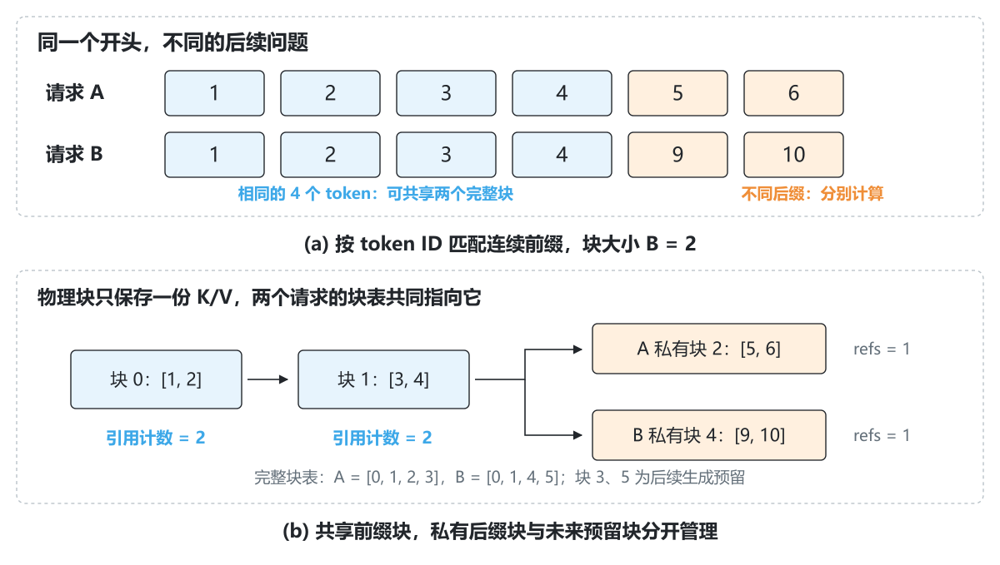
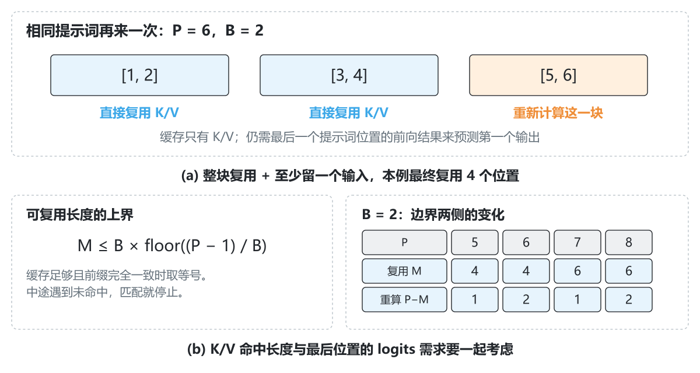
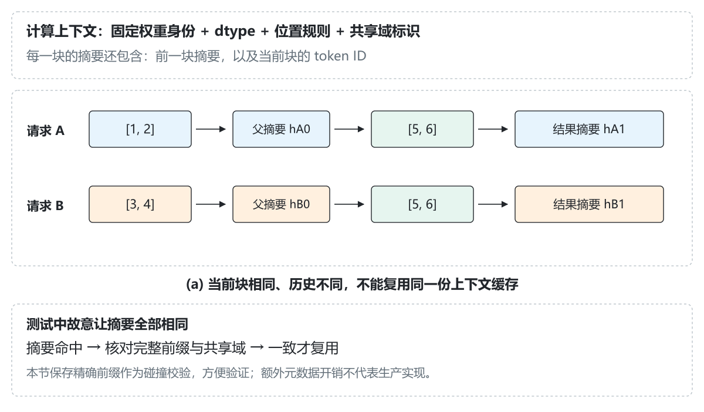
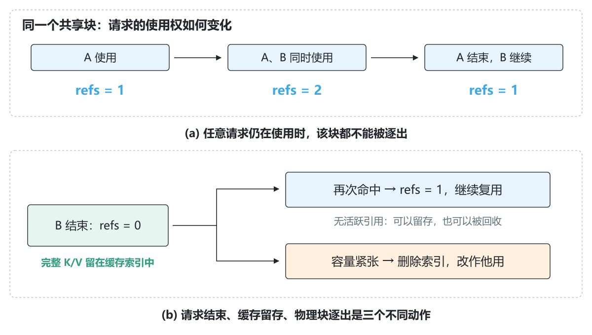
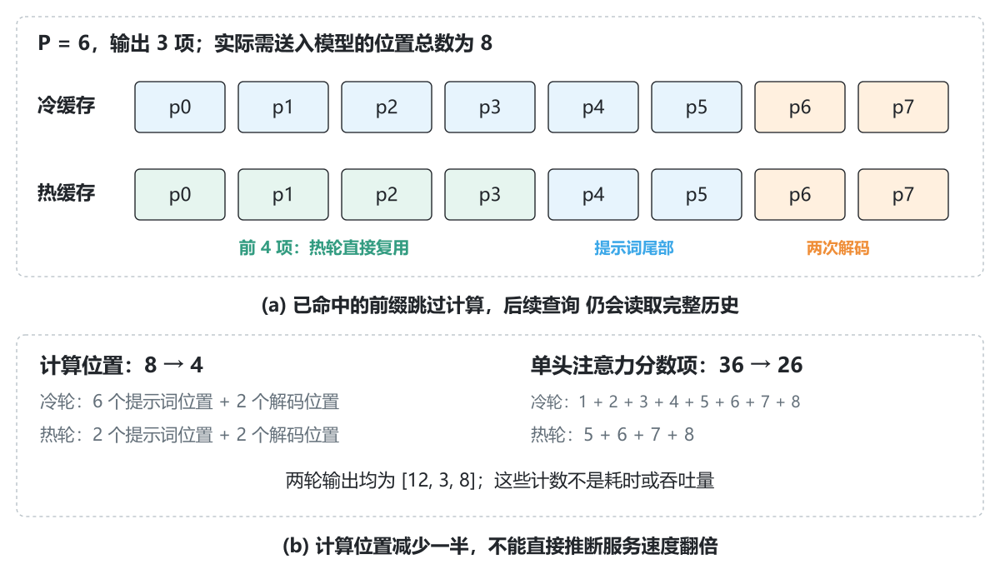

# 2.6 前缀缓存：相同的开头，能不能只算一次

[本篇目录](../README.md) · [上一节 2.5](../05-paged-caching/README.md) · [下一节 2.7](../07-http-and-streaming-output/README.md)

[实验与命令](lab.md) · [练习与答案](exercises.md) · [运行记录](results/README.md) · [中文插图](assets/README.md)

假设你在做一个文档问答服务。每个请求都带上相同的系统提示词和同一份长文档，最后才是用户的问题。模型回答第一道题时，已经计算过文档开头那些位置的 K/V。第二道题到来后，是否还要把相同开头完整算一遍？

**前缀缓存允许新请求复用此前已经计算好的、计算条件一致的前缀 K/V。** 新请求从第一个未命中的位置继续计算。它仍然回答自己的问题，也仍然生成自己的后续 token。

本节从两个 6-token 请求开始。我们先用纸笔推演，再把共享关系落实到实际 CPU 张量，最后检查取消、失败、缓存满了之后的行为。代码不下载模型权重，普通电脑即可完成。

## 阅读路线

| 你现在的目标 | 建议阅读 |
| --- | --- |
| 第一次接触前缀缓存 | 顺读第 1—5 节，再运行第一个短示例 |
| 想写出缓存管理代码 | 重点看第 6—10 节，跟踪块表、引用计数与失败边界 |
| 想接到推理引擎 | 看第 11 节的预算约定，运行调度与取消案例 |
| 想判断优化是否有效 | 看第 12—14 节，区分命中、计算量与实际延迟 |

前置是 1.3 的 KV Cache、2.3 的请求生命周期和 2.5 的分页张量。如果还不能解释“最后一个生成 token 为什么不用再计算 KV”，先回看 [2.5 第 6 节](../05-paged-caching/README.md#6-把物理块接到请求调度器)。

## 1. 先把三个容易混淆的缓存分开

### 1.1 单请求 KV Cache 保存了什么

在自回归生成中，每次增加一个位置，都要让当前 query 读取历史的 K 和 V。旧位置的 K/V 在后续 decode 中不必重复计算，所以把它们保存起来。

一个简化的注意力头可以写成：

$$
K_i=x_iW_K,\qquad V_i=x_iW_V
$$

$$
o_i=\operatorname{softmax}\left(\frac{q_iK_{0:i}^{T}}{\sqrt{D}}\right)V_{0:i}
$$

这里 `x_i` 是该层该位置的输入，`K_{0:i}` 表示从开头到当前位置的历史。多层 Transformer 中，后面层的 `x_i` 已经包含前面层汇总的上下文。因此，不能仅凭当前 token 相同，就认为所有层的 K/V 一样。

### 1.2 前缀缓存多做了哪一步

单请求 KV Cache 在同一个请求内部复用历史；前缀缓存把复用范围扩展到多个请求。它需要回答两个新问题：

1. 新请求的哪一段开头，与已有计算完全对应？
2. 如果两条请求都在读同一块 K/V，谁负责让它继续存活？

第一问需要前缀匹配与计算上下文标识；第二问需要共享所有权与引用计数。

### 1.3 它与答案缓存有什么区别

| 机制 | 缓存内容 | 后续请求还做什么 |
| --- | --- | --- |
| 单请求 KV Cache | 当前请求已有位置的 K/V | 计算新位置，读取历史 |
| 前缀缓存 / Prefix Cache | 可跨请求复用的前缀 K/V | 计算未命中后缀，再正常生成 |
| 答案缓存 | 已经返回过的完整结果 | 由业务决定是否直接返回旧结果 |

本节只实现前缀 K/V 复用。看到前缀命中，并不能直接把上一次的回答返回给另一个用户。

## 2. 从两段实际输入开始

先看一个文本层面的例子：

```text
请求 A = 固定系统指令 + 同一份产品手册 + “如何恢复出厂设置？”
请求 B = 固定系统指令 + 同一份产品手册 + “指示灯闪烁是什么意思？”
```

这是潜在的复用场景。真正送进模型的仍是完整输入经过模板处理、分词之后的 token ID。缓存匹配比较实际 ID，不按中文句子语义判断相似。

为了手算，实验不用真实文本与 Tokenizer，而是固定两个教学输入：

```text
A = [1, 2, 3, 4, 5, 6]
B = [1, 2, 3, 4, 9, 10]
块大小 B_size = 2
```

这里请求名 B 与块大小不是同一个变量。下文公式用 `B` 表示块大小；提到“请求 B”时会明确写出请求。

两条序列的前四个 ID 完全相同，形成两个完整块：`[1,2]` 和 `[3,4]`。后面的 `[5,6]` 与 `[9,10]` 分别计算。



*图 1｜(a) 两条输入的共同前缀有 4 个 token。(b) A 先完成首轮前向，B 再开始，二者可以指向相同的物理块 0、1；各自的后缀和未来预留块分开。方框中的数字是关联的 token ID，实际张量保存的是对应 K/V 向量。*

在 `share_and_release.py` 的这组输入中，实际块表为：

```text
A: [0, 1, 2, 3]
B: [0, 1, 4, 5]
```

如果二者完全独占，需要 8 个物理块。现在两个前缀块共享，实际只占 6 块。A 的逻辑第 0 块和 B 的逻辑第 0 块都指向物理块 0，**没有另外复制一份前缀 K/V 给 B**。不过，Attention 参考计算中的 gather 仍会产生临时副本，这与持久缓存是否共享是两回事。

也可以把块数换成字节。本例是一层、一个 KV 头、每头 8 个数，float64 每个数占 8 字节。每块存两份张量 K 和 V，因此载荷为：

```text
每块字节数 = 2（K 与 V）× 2（位置）× 1（KV 头）× 8（每头维度）× 8（字节）
           = 256 字节
完全独占：8 块 × 256 = 2048 字节
前缀共享：6 块 × 256 = 1536 字节
```

这里少占了 512 字节的活跃块空间，包含各请求为未来生成预留的部分。示例预先创建的 12 块张量池仍占 `12×256=3072` 字节载荷，不会因为共享就自动缩小；省下的块可以留给其他请求。Python 元数据和计算临时张量另计。

### 什么样的“相同”才算数

- 同义改写不等于相同 token ID。
- 空格、换行、聊天模板或特殊 token 的变化，都可能改变实际前缀。
- 只在中间出现相同段落，不构成从开头连续命中的前缀。
- 分别分词两个文本片段再拼起来，不一定等于对完整文本分词。应检查最终送入模型的 ID。

长系统指令、固定文档和多轮对话历史提供了复用机会，但是否命中要看最终输入和缓存当前还保留什么，不能仅凭业务名称判断。

## 3. 为什么相同前缀可以复用

对于相同模型、相同位置规则和相同输入前缀，因果模型在这些位置看到的历史相同。后面的用户问题还没有进入它们的可见范围，因此不会反过来改变前缀位置已经计算出的 K/V。

沿层看这个关系：第一层在相同输入上得到相同结果；下一层收到相同的前层结果；如此逐层递推，前缀对应的缓存可以复用。前提是影响这条计算路径的条件也一致。

本节使用单层 `TinyAttentionLM`：它的 K/V 投影依赖 token 和绝对位置，结构比多层模型更简单。缓存管理器仍按“整个前缀与计算条件一致”的契约实现，不利用这个小模型的特殊简化来放宽匹配。

**命中之后，后缀 query 仍需读取前缀的 K/V。** 省下的是为命中位置重新做前向的工作，不是把那段历史从注意力上下文里删掉。否则新问题会失去原文档的信息。

## 4. 第一条请求怎样为第二条请求留下缓存

以 `A=[1,2,3,4,5,6]`、最多输出 3 项为例。采用与 2.5 相同的最大输入长度预留：

$$
R=P+N-1=6+3-1=8
$$

`B=2` 时预留四块。第一次没有可复用数据，这叫**冷缓存运行**：

1. 分配块表 `[0,1,2,3]`，当前有效长度为 0。
2. 计算 ID 1、2 对应的位置，写入第一块；两项都有效后，这个完整块可以进入匹配索引。
3. 继续写入 `[3,4]`、`[5,6]`，前六个位置的 K/V 有效。
4. 用 prompt 最后位置的 logits 选择第一个输出，实验中得到 12。
5. 把 12 送回模型，得到第二个输出 3；再把 3 送回，得到第三个输出 8。
6. 请求结束。最后的 8 没有再送入模型，所以有效 KV 历史是 `[1,2,3,4,5,6,12,3]`，共 8 个位置。

请求结束后，活跃引用计数归零；四个完整块可以留在缓存索引里。此时没有请求使用它们，但将来可以命中，也可以在容量紧张时被逐出。

这里生成历史中的 `[12,3]` 也形成了完整块。缓存存的是已经实际计算过的输入位置，并不只认识“原始 prompt”这个业务标签。若后续输入从开头包含相同的完整历史，也可能复用相应块。

## 5. 相同输入再次到来，为什么没有全跳过

这是本节最需要动手推演的边界。

第二次仍输入 `[1,2,3,4,5,6]`。三块 prompt K/V 都在，为什么本节只复用前四个位置，而不是六个？

### 5.1 K/V 不包含最后一步 logits

为了预测第一个新 token，需要 prompt 最后一个位置的输出分布。缓存中只有各位置的 K/V，没有保存“整个 prompt 的最后 logits”。如果直接跳过全部 prompt，就没有本次生成循环所需的首项预测结果。

本实现通过重新计算至少一个 prompt 位置来得到它。又因为只复用完整块，命中长度需要是 B 的整数倍，所以：

$$
M\le B\left\lfloor\frac{P-1}{B}\right\rfloor
$$

`P=6、B=2` 时，上界是 4。前两块直接复用，最后一块 `[5,6]` 重新计算。先计算位置 4 时读取位置 0—4；再计算位置 5 时读取位置 0—5。随后就可以选择第一个输出。



*图 2｜缓存充足且前缀完全一致时，命中达到图中上界。P 是当前 prompt 长度；M 是实际跳过前向的完整前缀长度。若中途缺块，实际 M 会更小。*

| prompt 长度 P | B | 最多复用 M | 至少重算的 prompt 位置 |
| --- | --- | --- | --- |
| 1 | 2 | 0 | 1 |
| 4 | 2 | 2 | 2 |
| 5 | 2 | 4 | 1 |
| 6 | 2 | 4 | 2 |
| 8 | 4 | 4 | 4 |
| 9 | 4 | 8 | 1 |

这张表解释了“长度刚好整除块大小”时的落差。它是本节**仅保存 K/V、完整块复用、保留最后前向**三个选择共同产生的结果，不是所有缓存系统都必须遵守的数学限制。保存更多中间结果或支持不同粒度的复用，会改变实现取舍。

### 5.2 命中上界不等于保证命中

即使公式给出 M=4，也可能只命中 2 或 0：之前的块被逐出了、输入开头变了、共享域不同，都会使查找提前停止。

因此报告同时保存真实的 `hit_positions`，不能拿公式上界冒充测到的命中量。

## 6. 怎样为一块缓存取名字

我们希望查询“前四个 ID 是 `[1,2,3,4]` 的第二个块”，并定位到实际物理块。这需要一个从**计算内容身份**到**存储地址**的索引。

物理块号不能当内容身份：块 1 今天保存 A 的前缀，之后可能被重新分配给 C。内容身份必须与物理地址分开。

### 6.1 只用当前块 token 会出错

考虑：

```text
A = [1, 2] [5, 6] [7]
B = [3, 4] [5, 6] [9]
```

中间块都是 `[5,6]`，但前面的历史不同。在一般多层模型中，它们不一定有相同 K/V。只按 `(5,6)` 查表会把不同上下文混到一起。

本节使用链式摘要：

$$
h_j=\operatorname{SHA256}(\operatorname{encode}(namespace,h_{j-1},tokens_j))
$$

第一个块的父摘要为空；后面的块将前一个摘要纳入输入。`encode` 用固定的 JSON 序列化规则，避免把 `[1,23]` 和 `[12,3]` 都粗糙拼成字符串 `123`。



*图 3｜(a) 相同块 token 还要结合之前的历史。(b) 本节把摘要作为查找入口，并保存完整前缀与共享域做精确核对；故意构造摘要碰撞也不会错误复用。图中的 hA0/hB0 是解释用标签，不是实际哈希值。*

### 6.2 namespace 表示什么

`namespace` 可以理解成“这份 K/V 属于哪一种计算条件和共享范围”。本节 runner 从以下信息构造它：

- 固定 Tiny 模型的权重指纹；
- K/V 存储与计算 dtype；
- 固定的绝对位置计算规则版本；
- `cache_salt`，用于区分允许互相复用的共享域。

创建 runner 时还会复制一份模型权重，避免调用方随后修改原模型，导致旧 K/V 与新权重混用。若需要换权重，创建新 runner；本节不提供在线热更新权重。

真实模型还可能需要考虑 LoRA、图像或其他非文本输入、位置偏移和模型配置等身份信息。本节只处理从位置 0 开始的单层文本参考模型，不能仅凭 token ID 相同就跨任意配置共享。

`cache_salt` 是匹配条件，不是鉴权系统。不同域应使用不同标识；是否有权访问某个请求仍由服务层决定。

### 6.3 为什么还保留精确前缀

哈希把可变长输入变成固定长度摘要，但“摘要相同”不能作为绝对无碰撞的证明。本节在摘要桶中再核对 `(namespace, 完整前缀 token 元组)`。测试会故意把所有摘要设成同一个字符串，确认不同前缀仍不会命中。

这个做法便于学习，但保存每个块对应的完整前缀、反复构建摘要会有额外的时间和元数据开销。不能把本节实现的查找复杂度当成高性能引擎的实现结论。

## 7. 查找命中、占用块与发布新块

实现入口在 [`PrefixKVStore`](../../../../zero2vllm/cache/prefix.py)。建议先理解四个对象：

| 对象 | 主要信息 | 用途 |
| --- | --- | --- |
| 物理 K/V 张量 | `[块数, B, 1, D]`，K/V 各一份 | 真正保存数据，本节只有一个 KV 头、一层 |
| 每块元数据 `_Block` | 引用计数、摘要、精确身份、最后释放顺序 | 判断能否复用、能否回收 |
| 内容索引 `_index` | 摘要 → 候选物理块列表 | 查找已有完整前缀 |
| 请求记录 `_Request` | prompt、namespace、块表、预留长度、已写 token | 维持本请求的逻辑顺序与可见长度 |

### 7.1 acquire：先检查，再提交

新请求的流程是：

1. 从第一个完整块开始匹配，遇到第一个未命中就停止。
2. 计算总预留所需块数，减去已经匹配的块数，得到还要申请的新块数。
3. 从候选空间中排除命中块，检查其余未被活跃请求引用的块是否足够。
4. 容量足够后，增加命中块引用计数，再分配新块，并建立请求块表。
5. 请求的初始有效长度设为 M，只计算 `prompt[M:]`。

为什么第 3 步需要特别排除命中块？因为命中的块此刻可能引用计数为 0，它在形式上也是可回收空间。如果既把它算作“本次复用的块”，又把它算作“能分配给新后缀的空闲块”，就重复计算了容量。

本节在修改任何引用计数、索引和回收顺序之前完成容量检查。失败时抛出 `MemoryError`，请求没有半挂上去，命中块也不会被无故多引用一次。`oom-atomic` 案例同时比较失败前后的池快照与事件记录。

对应代码的查找部分很短：

```python
hit = []
for digest, signature in self._descriptors(prompt[:-1], namespace):
    found = self._find(digest, signature)
    if found is None:
        break
    hit.append(found)
```

逐行代入 `prompt=[1,2,3,4,5,6]、B=2`：

- `prompt[:-1]` 得到 `[1,2,3,4,5]`，仅用于限制查找范围，**没有把 ID 6 从模型输入中删掉**。
- `_descriptors` 只为完整块产生身份，所以这里查询 `[1,2]` 和整个 `[1,2,3,4]` 对应的两个块，不查询末尾单独的 `[5]`。
- `hit` 保存找到的物理块编号，例如 `[0,1]`；它的长度是块数，不是 token 数。
- 命中位置数为 `len(hit)×B=4`，runner 随后处理原始 `prompt[4:]`，即 `[5,6]`。

这里有两次切片、两种用途：`[:-1]` 决定哪些块允许查找，`[M:]` 决定实际还要执行哪些输入。把它们混为一谈，容易漏算最后一个位置。

### 7.2 append：内容完整后才发布

写入仍遵守 2.5 的边界：先验证 token、张量与预留长度，再写 K 和 V；两次写入都成功后，才推进有效前缀。只有完整块才进入前缀索引。

公开到索引的块保持只读。新请求借用它之后，从下一个私有位置继续写，不能覆盖共享块。

本节是单线程同步执行、单层 K/V。多层模型必须保证相关层的缓存都可用；异步设备执行还要保证数据实际就绪，不能把“主机已经安排这次写入”当作“其他请求已经可以安全读取”。

### 7.3 两条冷请求同时开始怎么办

如果 A、B 都先完成 acquire，而此时还没有发布任何块，二者都会冷启动并拥有私有空间。A 后来发布了某个完整前缀，也不会自动让已经开始计算的 B 改换块表。

本实现保留先发布的索引项；B 算出的相同完整块继续由 B 私有使用，不额外建立重复索引，B 结束后它就成为空白可分配块。这样不用在活跃请求中途替换块表。`duplicate-cold` 案例会检查这个行为。

因此，冷暖顺序需要真的发生：先让种子请求计算完成或发布目标块，再让后续请求匹配。仅仅同时发出相同请求，不保证它们已经能彼此复用。

## 8. 引用计数：谁还在用这块数据

引用计数 `refs` 是当前有多少个存活请求的块表指向该物理块。它不表示历史命中次数，也不是“这个块被缓存过几次”。

沿着图 1 的物理块 0 看：

| 事件 | refs | 这时能否覆盖它 |
| --- | --- | --- |
| A 使用 | 1 | 不能 |
| B 也命中 | 2 | 不能 |
| A 结束 | 1 | 不能，B 还在读 |
| B 结束 | 0 | 可留存，也可在需要空间时逐出 |
| C 又命中 | 1 | 重新被占用，不能覆盖 |



*图 4｜请求结束只撤销该请求的使用权。完整块在引用计数为 0 时仍可留存于索引；再次命中会重新增加引用。逐出才移除其内容身份，使物理空间能改存别的内容。*

`release(handle)` 遍历该请求的块表，逐块减引用。仍有引用的块不进入可回收状态。最后一个引用离开后，完整且已索引的块留作缓存；不完整尾部和未索引副本可直接作为空白空间。

旧句柄随请求记录删除而失效，即使物理字节尚未改写，也不能通过旧句柄继续读。上下文的 `close()` 则保持幂等，取消、异常和正常收尾可以统一调用。

## 9. 私有尾部、写时复制与块边界

假设 `B=4`，某块目前只有 `[1,2,3,_]`。如果直接把这个未满块交给两条请求共享，A 要往空位追加 4，B 要追加 9，就会发生写入冲突。

本节选择一个简单边界：**仅共享完整且只读的块，未满尾部由请求独占。** 所以当前代码不需要写时复制。

写时复制（Copy-on-Write，COW）是另一种可用策略：读取时共享；准备修改仍被其他请求引用的块时，先分配新块、复制已有有效内容，再更新自己的块表，最后向新块写入。只加引用计数不能自动解决写冲突，引用计数负责生存期，不负责决定写到哪里。

完整块策略会让不满一块的相同尾部重新计算。例如两条输入前 3 个位置相同、B=2，只能直接共享前 2 个位置；第 3 个位置与之后的内容属于私有部分。块大小因此同时影响取整空间和复用粒度。

## 10. 缓存满了：逐出哪些块

本节把所有物理块分为三类：

| 状态 | 条件 | 可否给新请求覆盖 |
| --- | --- | --- |
| 活跃块 | `refs > 0` | 不可以 |
| 闲置缓存块 | `refs == 0`，仍有内容索引 | 可以，但先移除索引 |
| 空白块 | `refs == 0`，没有内容索引 | 可以直接重新分配 |

三类数量之和必须等于池总块数。缓存留存不是块泄漏：需要观察有没有活跃引用无法归还，以及空闲缓存能否在压力下被回收。

### 10.1 本节的回收顺序

优先使用空白块；不够时，再在闲置缓存块中选择最早结束使用的块。这是本节按释放顺序实现的 LRU 策略：块重新被使用并最终释放后，会更新它的次序。

同一请求释放多块时，从尾部向前释放。这样它较靠后的块先成为候选，开头块在这次释放中更晚。这个约定用来维持可解释的顺序，不意味着它对所有负载都最优。

具体推演：池只有 3 块，先依次缓存 `[1,2]`、`[3,4]`、`[5,6]`，均已无活跃引用。新请求 `[1,2,7]` 需要两块：

1. 它命中物理块 0 的 `[1,2]`，先把这个命中从回收候选中排除。
2. 后缀需要一块新空间，因此逐出下一候选块 1 的 `[3,4]`。
3. 再来一个无共同前缀的短请求，只能逐出块 2；不能动仍被第一个请求引用的块 0、1。

`lru-and-protection` 会记录实际逐出顺序 `[1,2]`，并检查第一个请求仍能读回 `[1,2,7]`。

### 10.2 逐出必须同时更新索引

物理块 1 改存别的数据之前，旧摘要必须从索引移除。否则未来查询可能“命中旧名字”，却读到已经改写的新 K/V。

块表和索引中的物理编号看起来都只是整数，错误不会总是触发越界异常，有时只会悄悄改变模型输出。因此测试同时检查命中长度与实际数据，不只检查程序是否跑完。

### 10.3 reset 与更换计算条件

`store.reset()` 用于清空闲置索引，制造下一轮冷缓存。当前只要仍有持有块的请求，就拒绝重置，避免使活跃句柄失效。reset 不缩小预分配张量，也不擦除所有旧字节。

清空缓存与换权重是两件事。本节更换权重、dtype 或位置规则时创建新 runner；旧缓存池不跨新模型复用。对于共享域变化，namespace 不同即不能命中。

## 11. 怎样接回现有请求引擎

新增 [`PrefixTinyRunner`](../../../../zero2vllm/engine/prefix_runner.py)，继续提供 `new_context → reserve → advance → close`，所以可以交给已有 `LifecycleEngine` 和 `BatchScheduler`。

这里有一个必须明说的教学取舍：**调度器仍按请求完整最大长度收费，不把共享收益提前换成更多准入名额。**

### 11.1 准入时记录额度，首次前向才绑定块

`new_context()` 尚未知道 prompt，因此 `reserve(R)` 先记录最大长度。第一次 `advance(prompt, ...)` 知道实际输入后，才查找前缀、增加引用、分配私有块。

现有调度器仍为每个活跃请求收取 `ceil(R/B)×B` 的保守额度，prefill 预算也仍按完整 P 计算。共享减少了实际物理占用和本次实际计算，但当前计划不会因此多接入一条请求。

在池由这个引擎独占、没有旁路请求占块的前提下：

$$
active\_unique\_blocks\cdot B\le engine.used\_tokens
$$

2.5 的独占分页案例经常满足等号；本节共享或尚未绑定物理块时可以严格小于。**不能继续用“额度必须等于唯一物理占用”检查共享缓存。**

要进一步使用共享收益扩大并发，需要让调度器在准入时感知命中与物理增量、保护本轮命中块，并与执行预算一起协调。这是后续调度优化的内容。

### 11.2 取消和异常之后保留什么

正常结束、EOS、取消、模型异常，都通过上下文 close 撤销活跃引用。已经完整写入且计算身份正确的 KV 可以继续留存；尚未写完整的私有尾部不成为可复用前缀。

实验会在有效 K/V 写入完成后主动抛异常，检查失败请求的引用归零、同伴不受影响，并验证这些已经完成的前缀可以由后续请求复用。这不表示任意中断的多层计算都可发布缓存：本节只对已经完成的单层 K/V 作这个承诺。

### 11.3 同一轮中的先后顺序

当前调度计划仍逐请求串行执行，A 的前向完成后才调用 B。因此 B 可能命中 A 刚发布的块。真正合并成一个设备 batch 时，数据就绪与批次计划的关系不同，不能把这里的串行顺序直接当作 GPU 批处理的保证。

## 12. 到底少算了多少

默认同 prompt 对照的条件是 `P=6、N=3、B=2`。两轮输出均为 `[12,3,8]`，但实际计算不同：

| 指标 | 冷轮 | 热轮 |
| --- | --- | --- |
| 前缀命中位置 M | 0 | 4 |
| 本次计算的 prompt 位置 | 6 | 2 |
| decode 输入位置 | 2 | 2 |
| 合计计算位置 | 8 | 4 |
| 单头 Attention 分数项 | 36 | 26 |



*图 5｜热轮跳过前四个位置的前向，但位置 4 之后的 query 仍然读取完整历史。图中 p0—p7 是逻辑位置，不是输出 token ID。每个方框表示一个输入位置，不表示固定耗时。*

计算位置数可以手算：

$$
W_{cold}=P+N-1,\qquad W_{warm}=P-M+N-1
$$

注意力分数项也不同。冷轮每个位置依次看见 1、2、…、8 项，合计 36；热轮只计算位置 4、5、6、7 的 query，但它们仍分别读取 5、6、7、8 项，合计 26。

所以“计算位置少一半”并不等于“所有计算量少一半”，更不等于“服务速度翻倍”。哈希、元数据维护、张量复制、设备同步、排队和执行后端都会影响实际时间。本节只记录这些可核对的逻辑计算计数，没有计时加速声明。

## 13. 怎样判断实验是真的命中

只看第二次跑得快，不能证明前缀复用成功；文件缓存、库初始化或设备预热也可能改变时间。我们的验收同时看四类证据：

1. **匹配证据**：`hit_positions` 符合具体 token 前缀与块边界。
2. **存储证据**：两个活跃请求的块表确实指向相同物理块，引用计数正确。
3. **计算证据**：runner 实际执行的 `projected_positions` 与 `attention_pairs` 改变。
4. **结果证据**：逐项 logits 与独立完整重算对齐，最终输出一致，结束后活跃引用归零。

默认 12 个案例已经保存[实测记录](results/README.md)。float64 的最大 logits 误差约 `1.67e-16`，float32 约 `1.97e-8`，分别小于 `1e-12` 和 `1e-6`。这些是本次 CPU 环境结果，其他环境按阈值验收，不要求最后一位一致。

运行顺序：

```bash
python docs/chapters/part-02-engine/06-prefix-caching/examples/walk_prefix.py
python docs/chapters/part-02-engine/06-prefix-caching/examples/share_and_release.py
python -m scripts.experiments.lesson0206
```

详细环境、命令输出逐行解释、改参任务、异常排查见[实验页](lab.md)。正文中的数值都是固定教学输入；真实文本长度和性能应另行测量。

## 14. 上手排查与工程边界

### 为什么共享了大量文字却几乎不命中

先检查实际 ID 从哪个位置开始不同，再检查块大小、namespace 和缓存是否已经被回收。把动态时间、随机 ID 放在输入最前面，会让后续相同内容也无法构成共同前缀；是否调整模板要以任务语义正确为前提。

### 命中率高为什么总体提升不明显

前缀命中主要减少相同开头的重复计算。如果输出很长，decode 仍然要继续执行；如果不同请求争抢空间，已经留存的缓存可能很快被逐出。一个命中率数字无法说明全部端到端行为。

定义指标时明确分母。本节例子的 prompt token 命中比例是 `4/6`；如果用“允许查找的两个完整块”作分母，块命中比例又是 `2/2`。两者都可以记录，但不能混为一个没有定义的百分比。

### 哪些请求不能只复用 K/V 就满足返回要求

如果调用方还要每个 prompt 位置的 logits、logprob 或隐藏状态，而缓存只存 K/V，跳过的计算不会自动产生那些返回值。需要额外存储、补算或禁用相应复用路径。本节只做贪心生成，不提供 prompt logprob、beam search 或多模态缓存。

### 当前实现到哪里为止

| 已实现并验证 | 留到后续平台与调度章节 |
| --- | --- |
| 单层、单头、CPU 的实际共享 K/V | 真实多层模型的共享 KV 接入 |
| 完整块匹配、精确碰撞校验、引用计数 | 更高效的元数据结构与哈希更新 |
| 私有尾部、闲置块 LRU、reset | 部分块 COW、抢占、换出和跨实例缓存 |
| 现有同步生命周期与保守调度连接 | 共享感知准入、张量 batch、异步执行 |
| 两种 dtype 的输出对照 | A100 / 沐曦 C500 的算子与服务性能 |

## 15. 对照公开实现与继续学习

下面固定 vLLM v0.8.5，便于复查具体符号；本节不是该版本的逐行复刻。先掌握自己的可运行小例子，再读完整工程：

- [APC 功能说明](https://docs.vllm.ai/en/v0.8.5/features/automatic_prefix_caching.html)：了解复用共同 prompt 的使用场景与优化范围。
- [V1 Prefix Caching 设计](https://docs.vllm.ai/en/v0.8.5/design/v1/prefix_caching.html)：对照父摘要、完整块、块引用和逐出机制。本节的精确前缀副本与重复块处理是教学选择，不应当作其内部数据结构。
- [`KVCacheManager.get_computed_blocks / allocate_slots / free`](https://github.com/vllm-project/vllm/blob/v0.8.5/vllm/v1/core/kv_cache_manager.py)：重点看完整命中时重新计算末块、分配时排除待复用空闲块，以及倒序归还。
- [`BlockPool`](https://github.com/vllm-project/vllm/blob/v0.8.5/vllm/v1/core/block_pool.py)：看索引、空闲队列与物理块的关系；比较自己的逐出顺序与它的实现。
- [PagedAttention 论文](https://arxiv.org/abs/2309.06180)：把本节共享所有权放回分页存储的整体背景中理解。

做完[十二组练习](exercises.md)后，应能解释：相同前缀为什么能省计算、为什么还需要末尾前向、引用计数为 0 为什么不必立刻删除、以及缓存逐出如何避免读错内容。

下一节 2.7 会把这个同步引擎接到 HTTP 与流式输出：输出产生后怎样逐项交给客户端，客户端断开后怎样把取消传回引擎。缓存的所有权和收尾边界会继续派上用场。
