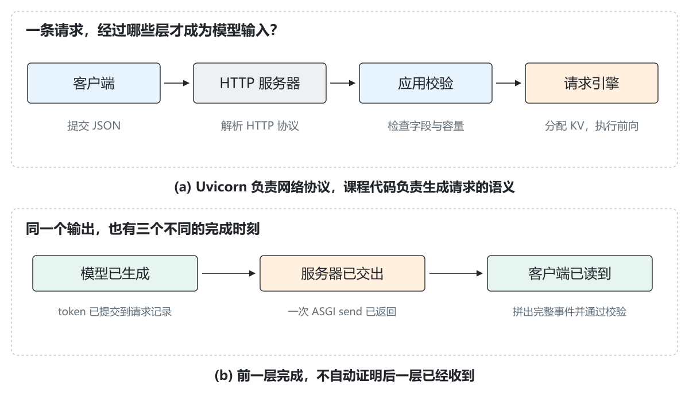
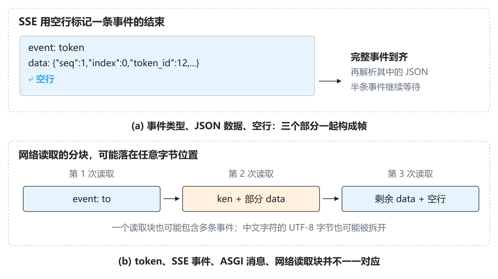
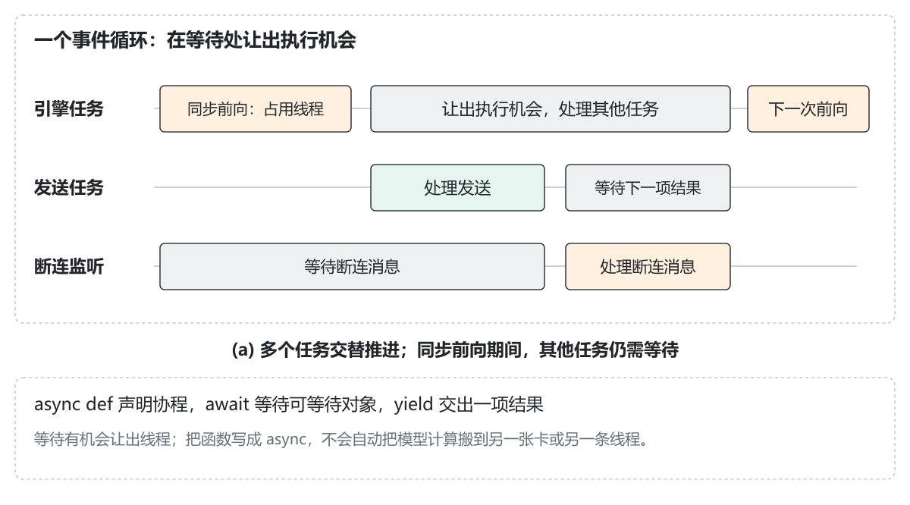
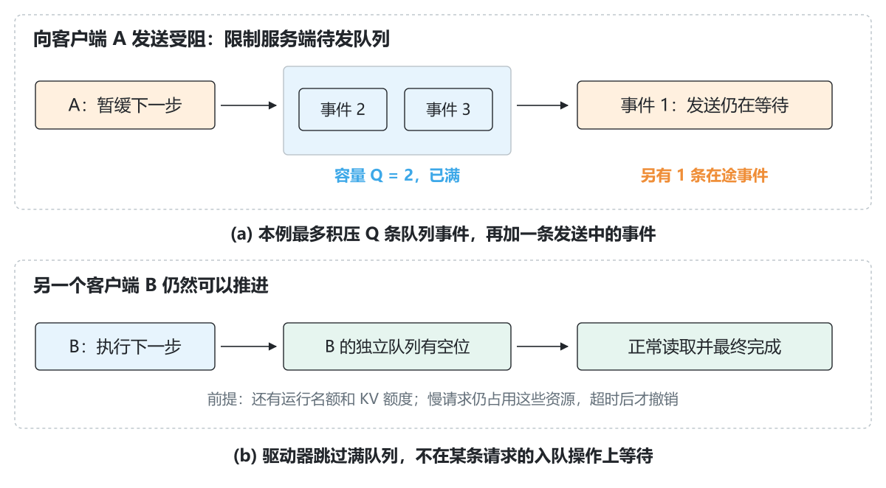
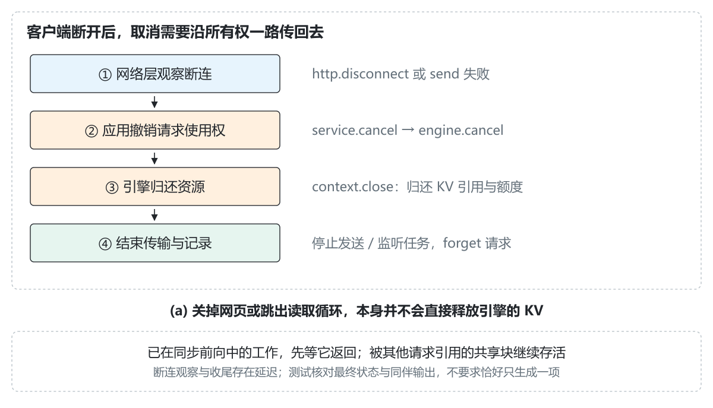
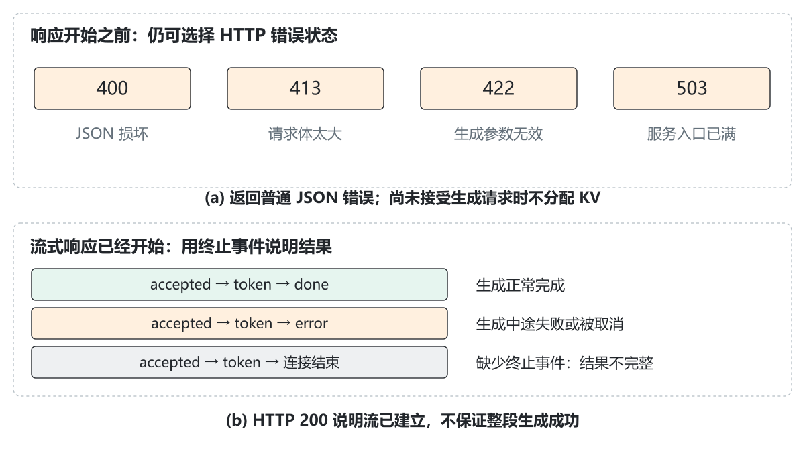

# 2.7 HTTP 与流式输出：把生成循环交给客户端

[本篇目录](../README.md) · [上一节 2.6](../06-prefix-caching/README.md) · [下一节 3.1](../../part-03-vllm/01-a-request-s-journey-through-vllm/README.md)

[实验与命令](lab.md) · [练习与答案](exercises.md) · [运行记录](results/README.md) · [中文插图](assets/README.md)

前几节的引擎已经可以接收请求、逐步生成、管理 KV，以及复用其他请求的完整前缀。不过，它的调用方仍然是同一个 Python 程序。现在我们希望从另一个终端发起请求，并在模型还没生成完时，先看到已经产生的输出。

这一步会引入几个此前没有的问题：客户端读得慢怎么办？客户端只看了一个 token 就关闭连接，引擎还会继续生成吗？已经返回 HTTP 200，模型第二步才失败，又该怎样告诉客户端？

**本节把已有 `LifecycleEngine` 接到一个可以实际运行的本机 HTTP 服务。** 我们从请求和响应的基础格式讲起，再逐步实现异步输出、有界队列、断连取消和错误收尾。默认路径只需要 CPU、Python 和 Uvicorn；模型仍使用便于检查的小型参考实现，不下载权重。

## 阅读路线

| 你的起点 | 建议顺序 |
| --- | --- |
| 没写过 HTTP 服务 | 先读 1—5 节，理解请求、响应、事件和字节，再运行实验页的双终端示例 |
| 会同步 Python，不熟悉 `async` | 重点读第 6 节，先跑 `walk_events.py`，再看服务驱动器 |
| 想理解服务为什么会卡住 | 看 8—12 节：队列、终态、取消和超时，运行受控背压案例 |
| 想对照 vLLM 工程 | 先核对 13—16 节的代码与边界，再沿公开源码入口阅读 |

前置是 2.3 的请求状态与回收。默认后端用真实的 Python K/V 列表；选用前缀后端时接入 2.6 的 CPU 张量共享池。不会 HTTP 或异步编程也可以跟着完成。

## 1. 先明确我们要提供什么

启动服务后，客户端向 http://127.0.0.1:8000/generate 提交：

```json
{"prompt_ids": [1, 2, 3, 4, 5, 6], "max_new_tokens": 3}
```

服务逐步返回：接受请求、生成 ID 12、生成 ID 3、生成 ID 8、正常完成。这个输出与 2.6 的固定输入一致。

这里先用数字 ID，因为我们希望集中观察请求和资源的变化。它不是自然语言聊天服务：没有 Tokenizer，也没有把 ID 解码成文本。词表大小为 16，有效输入 ID 为 0—15；模型最大输入上下文为 32。模型参数用于参考计算，没有训练成语言模型。

你最终会得到三种可以独立观察的东西：

1. **引擎结果**：实际生成了哪些 token，KV 与额度是否归还。
2. **传输事件**：接受、逐项输出、完成或错误，顺序是否正确。
3. **客户端结果**：读到了哪些完整事件，有没有得到明确终态。



*图 1｜(a) HTTP 服务器解析网络协议，应用解释生成参数，引擎执行模型。(b) 模型产生输出、服务器完成一次发送、客户端读到输出，是不同层的观察点。箭头表示逻辑依赖，不表示固定耗时。*

为什么要分开？假设模型已经算出 12，应用也已调用发送，但此时客户端断网。模型记录里可以有 12，客户端却可能没有收到它。仅凭生成成功或发送函数返回，不能证明用户已经看见输出。

## 2. HTTP 请求的基础结构

### 2.1 URL、方法、请求头和请求体

把示例地址拆开看：

| 部分 | 本节值 | 含义 |
| --- | --- | --- |
| 协议 | http | 用 HTTP 传递请求和响应 |
| 主机 | 127.0.0.1 | 当前电脑的本机回环地址 |
| 端口 | 8000 | 这个服务监听的端口；同一地址端口不能被两个服务同时占用 |
| 路径 | `/generate` | 应用提供的生成入口 |

本节使用 **POST**，因为客户端要提交生成参数。请求头 `Content-Type: application/json` 表示请求体使用 JSON。请求头描述这段内容，请求体才包含真正的输入。

为了阅读方便，可以把请求想象成下面这样；字节长度和具体网络格式由客户端库填写：

```http
POST /generate HTTP/1.1
Host: 127.0.0.1:8000
Content-Type: application/json
Accept: text/event-stream

{"prompt_ids":[1,2,3,4,5,6],"max_new_tokens":3}
```

请求头之后的空行分隔头部和请求体。`Accept` 表示客户端希望接收的响应类型；本节成功的 `/generate` 响应固定采用事件流，不实现多种响应格式协商。

### 2.2 响应头只开始一次

服务接受这个请求后，开始一个 HTTP 响应：

```http
HTTP/1.1 200 OK
Content-Type: text/event-stream; charset=utf-8
Cache-Control: no-cache
```

随后陆续发送响应体。**并不是每生成一个 token，就建立一份新的 HTTP 响应。** 这里是一条请求对应一段持续到结束的响应体。

HTTP 200 表示应用已开始成功类型的响应，但模型可能尚未生成第一项，也可能在后续执行中失败。因此，客户端还需要读取流中的终止事件。

### 2.3 为什么不手写 TCP 和 HTTP 解析器

TCP 连接、HTTP 请求行、请求头、传输编码和连接管理交给 Uvicorn。我们编写的是 ASGI 应用，把精力放在生成参数、请求所有权和流式结果上。

本节代码没有自己设置 `Transfer-Encoding`，也不为未知长度的生成响应填写 `Content-Length`。传输层的编码由 HTTP 服务器处理。后面看到的 ASGI 消息是 Python 对象，不是直接发给客户端的文本。

## 3. 流式输出究竟改变了什么

普通结果返回通常是：先执行完整生成，得到 [12,3,8]，再一次性发送。流式返回则是：12 产生后先发送，后面再发送 3 和 8。

它改变了**结果交付的时机**，并没有改变自回归依赖：生成 3 仍需要把此前的 12 送回模型。前缀缓存、采样、终止条件也仍由引擎负责。

还要区分下面四个单位：

| 单位 | 谁定义它 | 本节的例子 |
| --- | --- | --- |
| 模型 token | 模型词表与生成过程 | ID 12 |
| 应用事件 | 服务的输出协议 | 一条 token 事件 |
| ASGI 消息 | 应用与 HTTP 服务器之间的接口 | 一次 `http.response.body` |
| 网络读取块 | 网络栈和客户端读取行为 | 本次 `read1` 读到的若干字节 |

本节选择“一条 token 事件携带一个新 ID”，这是应用协议的选择。网络可以把几次发送合并成一次读取，也可以把一条事件拆成很多次读取。

真实模型中，一个 token 也不一定对应一个汉字；它可能是一部分词、空白、字节片段或特殊符号。后续文本服务需要正确的增量解码，不能对每个 token 单独解码后就假设一定可以直接拼接。本节先传整数 ID，使这些层次容易检查。

## 4. SSE：给持续到来的数据划清边界

SSE（Server-Sent Events）提供一种以文本行组织事件的格式，响应类型是 text/event-stream。我们在 data 字段里放 JSON。

### 4.1 一条事件长什么样

```text
event: token
data: {"request_id":"demo","seq":1,"index":0,"token_id":12}

```

最后有一个空行，它表示这条事件结束。上面的 demo 是说明用的请求 ID，实际服务由服务器生成随机 ID。

- event：事件的种类。
- data：该事件的数据；SSE 本身不要求它必须是 JSON，本节选择 JSON。
- `request_id`：这些事件属于哪个请求。
- `seq`：这个请求内的事件序号，从 0 开始。
- `index`：输出 token 的位置，从 0 开始；只出现在 token 事件中。
- `token_id`：本次新增的 ID，不是此前所有输出的列表。

为什么同时有 `seq` 和 `index`？因为 `accepted` 和 `done` 也占事件序号，但它们不产生 token。

### 4.2 一次完整生成的协议

| 事件 | `seq` | 关键内容 |
| --- | --- | --- |
| `accepted` | 0 | 请求 ID、输出队列容量 |
| token | 1 | `index`=0, `token_id`=12 |
| token | 2 | `index`=1, `token_id`=3 |
| token | 3 | `index`=2, `token_id`=8 |
| `done` | 4 | `status`=`finished`, `reason`=length, `output_tokens`=3 |

`accepted` 表示请求进入服务管理，不表示已经获得 KV 或完成 `prefill`。输出上限为 0 时只有 `accepted` → `done`；首项命中 EOS 时可以是 `accepted` → token → `done`，该 EOS ID 在本节输出计数中。

异常终态使用 `error`，带 `status`、`reason` 和已经提交的输出数量。每条正常传完的流只有一个终止事件，之后不再发 token。

### 4.3 心跳不是模型输出

等待期间应用可能发送：

```text
: ping

```

以冒号开头的是注释。我们的客户端忽略它，它不占 `seq`，不增加输出 token 数。心跳可以让一些中间环节观察到连接仍有数据，但不能保证所有代理永不超时，也不能证明模型仍在取得进展。



*图 2｜空行定义应用事件边界，网络读取边界不参与这个定义。客户端必须先拼出完整帧，才能解释 JSON。示意中的省略号用于节省版面，不是可以直接提交的 JSON。*

本节采用 POST 加流式响应，并用 Python 客户端读取。浏览器原生 `EventSource` 通常以 GET 建立连接，不能直接把这里的 JSON POST 原样交给它；网页接入时可以用支持流读取的 `fetch`，具体前端封装留给服务章节。

## 5. 客户端为什么不能读一块就解析一块

假设服务发出了一条完整事件，客户端可能依次读到：

```text
第一次：event: to
第二次：ken\ndata: {"request_id":...
第三次：..."token_id":12}\n\n
```

对第二次读到的字节直接做 `json.loads` 会失败，因为它既不是独立 JSON，也还没有收全。中文字符的 UTF-8 编码还可能被拆到不同读取块中，不能随意把每块单独解码再丢弃错误字节。

[SSEDecoder](../../../../zero2vllm/serving/protocol.py)采用以下顺序：

1. 把新字节追加到暂存区。
2. 有完整换行时取出一行，再严格解码 UTF-8。
3. 收集 event 与 data；遇到空行才提交完整事件。
4. 将该事件的 data 解析为 JSON。
5. 同文件中的 `StreamValidator` 核对请求 ID、事件顺序、token 位置和终态数量。

这个课程客户端支持本服务使用的 LF，也支持 CRLF；没有实现完整浏览器事件流规范中的所有兼容规则，例如单独 CR 换行、重连和 `Last-Event-ID`。

### 5.1 连接结束不等于生成完成

客户端还检查两层完整性：

- 字节是否恰好停在完整事件边界；半条 JSON 或缺少最终空行都不能提交。
- 最后是否收到了 `done` 或 `error`；即使此前每条 token 事件都完整，缺少终态也属于不完整结果。

`done.output_tokens` 必须等于实际收到的 token 事件数。仅仅收到一个 HTTP 200，或看到 `socket` 关闭，都不能替代这项检查。

### 5.2 为什么使用 read1，而不是先 read 到结束

客户端要随着数据到达及时处理。示例使用 `response.read1(4096)` 读取当前一批可用字节，再交给拼帧器。若改成把完整响应体全部读完才开始解析，就会在应用层重新变成“等全部生成完才显示”。

命令行的 `curl -N` 用于关闭 curl 的输出缓冲。它不会关闭其他所有层的缓冲，也不让模型生成更快。反向代理还可能有自己的响应缓冲；本节直接连接本机服务，未部署代理。

## 6. 补齐 async、await、yield 和 async for

### 6.1 普通函数调用会一直占着当前位置

同步写法可以理解为：调用一个函数，直到它返回，当前调用者才继续下一行。如果模型前向计算比较长，同一线程里的其他工作也要等它返回。

### 6.2 async def 声明可暂停的协程

`async def` 定义协程函数。调用它得到协程对象，需要 `await`、`asyncio.run` 或调度为任务后才会运行。它不是“自动启动一条后台线程”的语法。

`await` 的含义是等待一个可等待对象。在对象尚未准备好时，当前任务可以暂停，把执行机会交给事件循环中的其他任务。如果对象已经就绪，`await` 也可能立即继续；不能把每个 `await` 都当成必然切换。

```python
event = await service.next_event(job)
```

当队列里已有事件，这行很快返回；队列为空、请求又没有结束时，它等待“有新结果”的通知。等待期间，网络监听或其他请求可以运行。

### 6.3 yield 交出一项结果，async for 逐项等待

把等待结果写成异步生成器，就可以每次交出一条事件：

```python
async def request_events(service, payload):
    job = service.open(payload)
    try:
        while True:
            event = await service.next_event(job)
            yield event
            if event['event'] in ('done', 'error'):
                return
    finally:
        service.detach(job, 'example_consumer_closed')
```

`async for` 每轮向生成器要下一项，并允许这次等待暂停。它不会一次性把所有结果变成列表。完整示例在 [walk_events.py](examples/walk_events.py)。

### 6.4 提前 break，为什么还要 aclosing

调用方只想看一个 token 时，会跳出循环。但“调用方不再取下一项”和“生成器立即执行 `finally`”不能随意画等号。示例明确使用：

```python
async with aclosing(request_events(service, payload)) as stream:
    async for event in stream:
        if event['event'] == 'token':
            break
```

退出 `async with` 会关闭这个异步生成器，使其中的 `finally` 及时归还请求所有权。HTTP 版本则由 ASGI 应用自己的 `finally` 负责，无需依赖垃圾回收来碰巧触发清理。

### 6.5 本节的异步仍有明确边界



*图 3｜多个任务在同一个事件循环中交替推进。等待时可以处理其他任务，同步前向期间仍占用这个线程。图形表示任务阶段，不用于测量执行时间。*

本节的 Tiny 前向是同步函数。把外层服务写成 `async`，不会使这个前向自动并行，也不能在任意矩阵运算中间安全释放它正在使用的缓存。

代码在推进请求之间显式 `await` `asyncio.sleep(0)`，允许其他已就绪任务获得执行机会。它不是性能优化公式，也不代表 GPU 批次。真正的大模型服务通常需要把较重的引擎工作与网络事件循环更充分地分离，后面读 vLLM 的 AsyncLLM 与 EngineCore 时会看到这种分工。

## 7. ASGI 应用怎样与 HTTP 服务器对接

[StreamingApp](../../../../zero2vllm/serving/app.py)是一个可异步调用的对象：

```python
await app(scope, receive, send)
```

| 参数 | 可以怎样理解 | 本节使用 |
| --- | --- | --- |
| `scope` | 这次连接/请求的描述 | 方法、路径、请求头、协议类型 |
| `receive` | 等待 HTTP 服务器交来一个事件 | 请求体片段，或 `http.disconnect` |
| `send` | 把一个应用响应事件交给 HTTP 服务器 | 响应开始、响应体片段、响应结束 |

### 7.1 请求体也可能分多次到达

`receive()` 得到 `http.request`，其中 `body` 是本次片段，`more_body`=True 表示后面还有内容。应用累计字节并检查上限，直到最后一片到达，再解析 JSON。

本节最多读取 8192 字节，并限制总读取时间为 5 秒。限制在 UTF-8 JSON 解码前执行，避免把“字符串长度”和“网络字节数”混为一谈。只允许 JSON 类型和规定字段，损坏 JSON、非法 ID 和永远放不进引擎的请求都在流开始前拒绝。

### 7.2 开始、继续、结束响应

应用先发一次 `http.response.start`，包含状态和响应头。之后多次发送 `http.response.body`，把 `more_body` 设为 True；最后发一个 `more_body`=False 的结束消息。

SSE 的 `done` 是我们约定的**业务终态**，`more_body`=False 是 ASGI 的**响应体结束**。客户端需要前者来解释生成结果，HTTP 服务器需要后者来完成这份响应。

ASGI 允许服务器在首个响应体之前缓冲开始消息。本节在应用层把发送 `response.start` 作为协议状态边界，不再尝试发送第二份状态码。实际接收时间仍由服务器与网络决定。

### 7.3 启动和关闭也有生命周期

Uvicorn 的 `lifespan` 启动事件创建一个服务驱动任务，关闭事件终止它并收回未结束请求。默认只启动一个进程，避免误以为多个 HTTP `worker` 会自动共享同一份 Python 模型或 KV 池。

## 8. 输出队列与引擎怎样协作

### 8.1 一个请求对应一份输出通道

[StreamJob](../../../../zero2vllm/serving/service.py)包含请求 ID、有界 `asyncio.Queue`、结果就绪通知、单独的终态槽和少量观察计数。队列里放的是待发送事件，K/V 仍由原来的请求上下文持有。

两种存储不能混为一谈：队列里有 2 条 token 事件，不表示模型只保存 2 个位置的 KV；模型可能还持有整个 prompt 和生成历史。

### 8.2 驱动器只在队列有空位时推进

一次推进大致如下：

```text
检查截止时间和持续满队列
→ 为就绪等待请求尝试准入
→ 跳过已结束或队列已满的请求
→ engine.step：执行一次真实前向
→ 有新输出则放入该请求队列
→ 若引擎终止，记录单独的终态事件
→ 让出执行机会
```

这不是让每个 HTTP 请求各自开线程操作同一个 `engine`。提交、准入、前向、取消与归档都在同一个事件循环里，真正的同步前向由一个驱动任务负责；引擎状态修改之间没有跨线程竞争。

本节没有直接改造 2.4 的 `BatchScheduler`。2.4 用于比较固定预算下的静态组与连续准入；本节新增一个更小的“输出就绪驱动器”，让读者看清满队列如何影响执行资格。它按就绪等待请求的进入顺序尝试准入，容量不足时停止本轮后续准入，每轮对可执行请求至多推进一步；不提供 2.4 的每轮 token 预算接口。

### 8.3 三个数量限制分别管什么

| 设置 | 默认值 | 约束对象 |
| --- | --- | --- |
| `max_requests` | 8 | 尚未关闭的生成流，包括等待、运行，以及生成已结束但传输未收尾的流 |
| `max_running` | 2 | 引擎中的运行请求数量 |
| `queue_size` | 2 | 每条流的待发事件数 |
| KV 额度 | 默认 Tiny 为 64 个位置 | 引擎为运行请求预留的最大输入长度 |

前两个限制和队列上限互不替代。队列再小，也不能无限接受新流；请求数有限，也不能给每条请求无限缓存输出。KV 预留仍使用前几节的 R=P+max(0,N−1)，零输出请求无需分配运行缓存。

## 9. 背压：客户端慢时，让上游知道

背压可以理解成：下游来不及接收，上游相应减慢或停止生产。否则速度差会不断转成积压。

假设输出生产速度为每秒 100 项，消费速度为每秒 20 项。如果没有上限，理想化估算下一秒就会多积压 80 项。这里的数字仅用于解释队列增长，不是模型测速结果。

### 9.1 为什么不在全局驱动器里 await queue.put

如果全局驱动器正在 `await` A.queue.put(token)，A 的队列又一直满，它就可能停在 A 上，没机会处理 B。给每个请求一条队列还不够，还必须正确决定哪里允许等待。

本节检查 `queue.full()` 后暂缓 A，继续处理其他可运行请求；写入时使用 `put_nowait`。检查与同步前向、写入之间没有让其他生产者抢这个队列的位置，因为只有这个驱动器生成 token 事件。



*图 4｜受控案例把 A 的第一次 token 发送停住。该事件已离开队列，所以还能看到两个排队事件。驱动器此后不再为 A 前向，但仍可推进 B。*

### 9.2 容量为 2，为什么能已经生成 3 项

输出队列的容量不包含发送协程已经取走、正在等待 `send` 的那条事件：

```text
模型已经提交：事件 1、2、3
发送中的事件：事件 1
待发队列：    事件 2、3  ← 已满，容量为 2
下一步前向：  暂缓
```

所以本例可有 Q+1 条未完成发送的输出事件，另外还有一个独立终态槽。不要把应用队列上限误读成操作系统发送缓冲区的上限，也不要认为读客户端变慢后，服务器会毫无延迟地立刻观察到。

### 9.3 慢请求仍然占着 KV

暂缓前向只是不再产生新输出，已经准入的请求仍持有 KV 和运行名额。如果所有运行名额都被慢消费者占满，其他请求仍要等。这里没有实现把慢请求换出或抢占重计算；持续拥塞达到阈值后会取消它，归还额度。

因此“一个慢客户端不把全局入队操作堵死”不等于“无论多少慢客户端，其他请求都毫无影响”。实验为同伴保留足够名额和容量，验证的是这个明确条件下的隔离行为。

## 10. 终态不能被满队列卡住

假设队列已经满了，此时模型失败。若把 `error` 也用阻塞式 put 塞进去，清理逻辑可能被自己要清理的慢客户端卡住。

本实现让终态事件放在 `job.terminal`，与普通事件队列分开：

1. 先由引擎完成状态切换和 KV 回收。
2. 记录一个不可重复替换的终态。
3. 若连接还可用，先发送此前已提交的队列事件，再发送终态。

这样即使队列仍满，资源回收也能完成。取消请求不自动撤回已经提交的输出；客户端可能先看到部分结果，再看到 `error`。

如果连接已经断开，终态可能根本无法送达。服务端仍必须结束请求；不能为了“保证对方读到取消通知”而永久保留 KV。

## 11. 客户端断开，取消怎样传回引擎

### 11.1 两条任务，一起观察传输

ASGI 应用为一条流保留两条任务：

- 发送任务：等待结果，发送 SSE 事件。
- 断连监听任务：等待 `http.disconnect`。

谁先结束，应用就进入统一收尾；发送也可能先抛连接错误，不能假定总是先收到 `disconnect` 消息。asyncio.wait(..., FIRST_COMPLETED) 负责等待这个竞争结果。

### 11.2 finally 里清理哪些所有权



*图 5｜网络事件只是触发条件；真正归还资源的是应用到引擎的取消与关闭链路。共享池只撤销该请求的引用，不清空其他请求仍在使用的块。*

应用的 `finally` 会：

1. 请求取消仍未终止的生成。
2. 让上下文关闭，归还 KV 与运行额度。
3. 请求停止未完成的发送、监听任务。
4. 保存一份有界历史记录，从 `engine` 中 `forget` 该请求，并清空该流的待发队列。
5. 等待两个子任务结束，避免留着没人管理的后台协程。

取消、传输关闭和上下文收尾都允许重复到达，不能因此把同一份额度减两次。已自然完成的请求不会因为较晚观察到断连而改写为“模型取消”；报告会分别保留引擎终态和传输结束原因。

### 11.3 只读一个 token，服务器会不会多算几个

可能会。客户端关闭、网络观察断连、事件循环处理取消之间有时间差；发送缓冲区里也可能已有更多内容。一个同步前向还可能正在执行。

所以实验不要求服务器恰好只执行一步，而是检查：长请求在到达最大输出之前被取消、额度最终归零、同伴输出仍正确。我们给演示增加少量 `step_delay`，方便观察；它是人为节奏控制，不是网络延迟或设备吞吐实测。

## 12. 超时与错误：发生在哪个边界

### 12.1 四种超时分别计什么

| 超时 | 默认 | 从什么位置观察 | 行为 |
| --- | --- | --- | --- |
| 请求体读取 | 5 秒 | 从开始接收 JSON 到请求体完整 | 流未开始时返回 408 |
| 请求截止时间 | 30 秒 | 从进入服务管理开始，包含排队 | 取消未终止生成，原因 `deadline_exceeded` |
| 持续满队列 | 5 秒 | 应用输出队列一直满、未被消费 | 取消未终止生成，原因 `slow_consumer` |
| 单次发送等待 | 5 秒 | 一次 ASGI `send` 尚未返回 | 停止该流，原因 `send_timeout` |

`request_timeout` 不从第一个 token 才开始，也不是每生成一个 token 就重新续期。`slow_timeout` 在消费一个队列事件后重置计时，它表示持续拥塞。生成已经结束后的传输仍受发送超时约束。

这些是事件循环能获得执行机会时处理的期限。同步计算长时间占用线程时，取消和超时检查也要等到返回，不能把配置 30 秒理解成可以在第 30.000 秒强行中断 GPU 运算。

### 12.2 响应前与响应后的错误处理不同



*图 6｜一份响应不能在已经开始之后随意重新写另一份状态码。流内的错误事件与网络截断都需要由客户端继续判断。*

| 场景 | 本节返回 |
| --- | --- |
| JSON 损坏、非法 UTF-8、NaN 等非标准 JSON 常量 | HTTP 400 + JSON 错误 |
| 请求体超过字节上限 | HTTP 413 |
| `Content-Type` 不是 JSON | HTTP 415 |
| 空 prompt、非法 token ID、布尔值冒充整数、超上下文或不可满足的预留 | HTTP 422 |
| 开放流数量已经达到入口上限 | HTTP 503，并带 `Retry-After: 1` |
| `/generate` 使用了不支持的方法 | HTTP 405，并说明允许 POST |
| 已开始流后，模型前向失败 | 保持原响应，发送 `error` 终态 |
| 连接断开，无法再发送错误 | 服务端清理；客户端把缺少终态视为不完整 |

输出 ID 越界等 runner 错误也由生命周期引擎处理，不把 Python 堆栈或内部异常原文直接放入流中。服务器本地诊断记录保留错误信息，客户端拿到稳定的原因代码。

`Retry-After` 是重试建议，不保证一秒后必定有容量。本节客户端不自动重试生成请求，也没有断点续传；直接重发可能创建一条全新的生成，应由调用方明确决定。

## 13. 跟着文件把完整链路走一遍

| 顺序 | 实现入口 | 在这里观察什么 |
| --- | --- | --- |
| 1 | [server.py](../../../../zero2vllm/serving/server.py) | 一次创建模型、服务和应用；本机、单进程监听 |
| 2 | [app.py](../../../../zero2vllm/serving/app.py) 的 _body | 请求分片、字节限制、JSON 校验 |
| 3 | [service.py](../../../../zero2vllm/serving/service.py) 的 open | 创建请求 ID，提交 `engine`，建立独立输出队列 |
| 4 | _drive | 检查超时，按就绪状态准入和推进，遇满队列暂缓 |
| 5 | LifecycleEngine.step | 实际前向、输出提交、自然终止或异常回收 |
| 6 | next_event 与 app._stream | 先取普通事件，再取终态；编码并等待发送 |
| 7 | app 的 `finally` | 取消、关闭子任务、`detach` 与 `forget` |
| 8 | [client.py](../../../../zero2vllm/serving/client.py) | 增量读取、拼帧、序号核对和不完整结果检查 |

### 13.1 默认后端为什么不需要 PyTorch

默认 `TinyCachedRunner` 使用此前已经验证的 Python 数值模型和真实 K/V 列表。这里的“真实”指前向确实读取和更新缓存，输出不是为了演示流式而编造的固定字符串。

```bash
python -m zero2vllm.serving.server --step-delay 0.05
```

### 13.2 怎样接回 2.6 的前缀共享

```bash
python -m zero2vllm.serving.server --backend prefix --step-delay 0.05
```

这条路径需要此前的 CPU PyTorch 环境。它用 32 个物理块、块大小 2，共 64 个 slot，与默认 Tiny 的逻辑额度可对照。相同 prompt 连续请求时，第二次匹配两个完整块；默认输出仍为 [12,3,8]。

HTTP 协议无需变化，因为它面向请求和增量结果，缓存布局留在 runner 后面。共享准入仍按完整最大长度保守收费，未把物理共享收益换成更多 HTTP 并发名额。

## 14. 如何验证，不把“屏幕在刷新”当作正确性

本节提供 14 个默认案例，再加 1 个可选 CPU 前缀后端案例。详细命令见[实验页](lab.md)，逐项数据见[实测记录](results/README.md)。

验证分成三层：

1. **真实本机 HTTP**：真正启动 Uvicorn、绑定随机本机端口，用客户端连接；检查正常输出、两个客户端、非法输入、提前断连和前缀后端。
2. **受控 ASGI / 服务边界**：刻意让 `send` 不返回，检查队列上限、同伴推进、发送超时和取消。这一层精确制造问题，不声称测出了真实网速。
3. **字节与事件协议**：按每次 1、2、7 字节等粒度拆开事件，包括中文 UTF-8；检查拼帧、序号和截断。

为什么背压不只靠“让客户端 sleep 一会儿”验证？因为本节输出很小，网络栈可能已经接收全部内容，客户端暂时不读并不一定马上阻塞服务器发送。受控 `send` 才能确定性地把执行停在需要检查的边界。

验收至少同时检查输出与完整重算一致、事件没有串到别的请求、队列未超过上限、终态数量正确、KV/额度归零、同伴未被误取消。队列里有空位只是一个状态，不是已经测得服务吞吐更高的证据。

## 15. 当前边界与真实服务还差什么

| 本节已实现 | 后续工程继续补充 |
| --- | --- |
| 本机单进程 HTTP、JSON 请求、SSE 增量输出 | 文本 Tokenizer、聊天模板与完整模型服务协议 |
| 单事件循环、真实参考前向、有界输出队列 | 引擎工作进程、张量 batch、GPU 异步执行 |
| 断连、任务取消、期限、慢消费者和发送异常回收 | 代理部署、跨进程取消、抢占与换出 |
| 请求 ID、事件顺序、终态与截断校验 | 有持久状态的重连、幂等重试与结果恢复 |
| 默认 Tiny 和 CPU 前缀缓存后端 | A100 / 沐曦 C500 的实际服务性能 |

默认只监听 127.0.0.1，本节按本机教学服务组织，没有实现认证、多租户授权或生产部署配置，也不宣称兼容 OpenAI 接口。

有界输出队列约束的是这一层的待发事件。Python 对象、网络缓冲区和教学调试历史仍各有开销；服务历史最多保留 32 条，2.6 前缀池的详细调试事件还需要在长期服务时关闭或截断，不能把本节当成已经完成全部内存治理的服务器。

## 16. 公开资料与下一篇的衔接

- [Python 3.11 协程、任务与取消](https://docs.python.org/3.11/library/asyncio-task.html)：对照等待、任务和取消后的 `finally`。
- [Python 3.11 asyncio 队列](https://docs.python.org/3.11/library/asyncio-queue.html)：理解 `maxsize`、阻塞入队与非阻塞操作；本节选择暂缓生产来避免全局等待。
- [ASGI HTTP 规范](https://asgi.readthedocs.io/en/stable/specs/www.html)：对照请求分片、响应开始/响应体以及断连信号。
- [ASGI lifespan 规范](https://asgi.readthedocs.io/en/stable/specs/lifespan.html)：对照服务启动和资源收尾。
- [WHATWG SSE 格式](https://html.spec.whatwg.org/multipage/server-sent-events.html)：查阅行、空行、注释与浏览器事件流规则；本节客户端只实现明确标出的子集。
- [Uvicorn 0.35.0](https://pypi.org/project/uvicorn/0.35.0/)：本节固定的 HTTP 服务器版本。
- [vLLM v0.8.5 AsyncLLM](https://github.com/vllm-project/vllm/blob/v0.8.5/vllm/v1/engine/async_llm.py)：开始对照请求提交、异步输出与 abort；本节的单循环驱动器没有复刻它的进程通信结构。

完成[练习](exercises.md)后，应该能画出一条请求从进入服务到资源释放的完整路径，并能解释：为什么流已返回 200 仍可能失败，为什么满队列会影响调度，以及为什么取消必须最终到达缓存的所有者。

至此，第二篇的七节已经连成可以运行的教学链路：模型、权重、请求生命周期、调度、分页、前缀共享与 HTTP 输出。真实权重路径目前仍以完整前缀参考执行为主，默认 HTTP 路径使用 Tiny；两者没有被包装成已经验证的完整生产引擎。

下一篇从 [3.1 一个请求在 vLLM 中的旅程](../../part-03-vllm/01-a-request-s-journey-through-vllm/README.md)开始，把这些已经动手检查过的概念对应到真实框架中的入口、异步客户端、引擎核心、调度器与模型执行。
