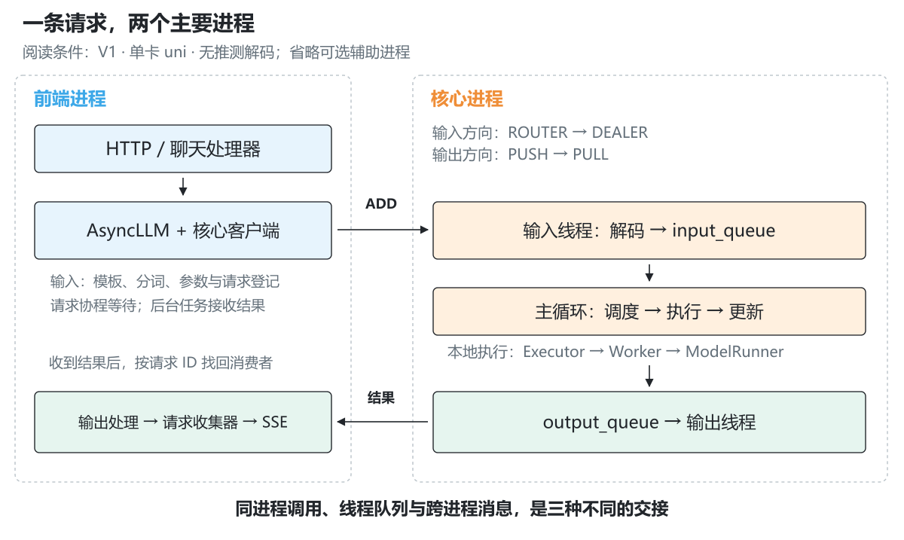
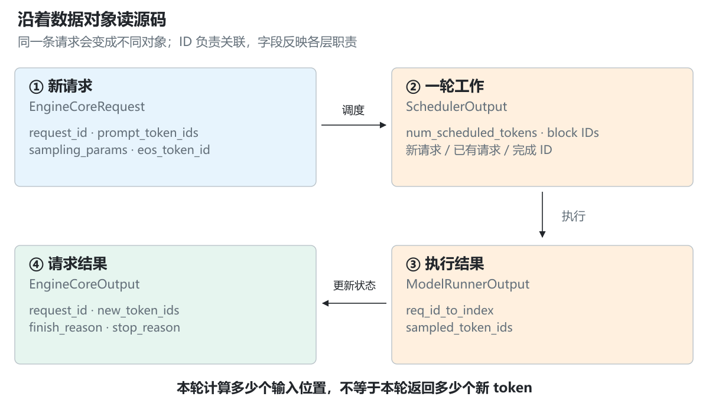
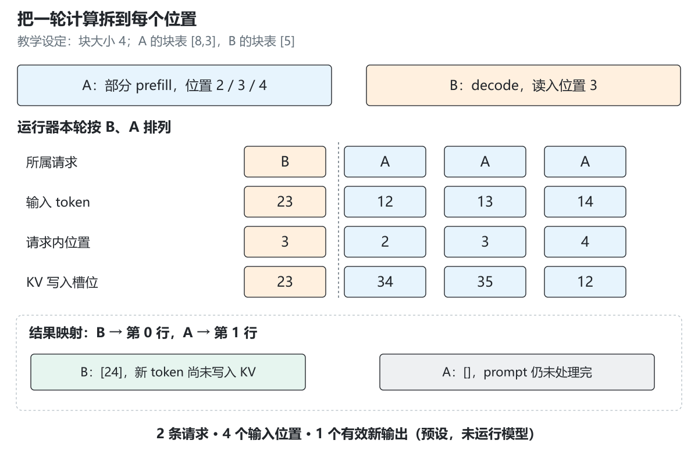
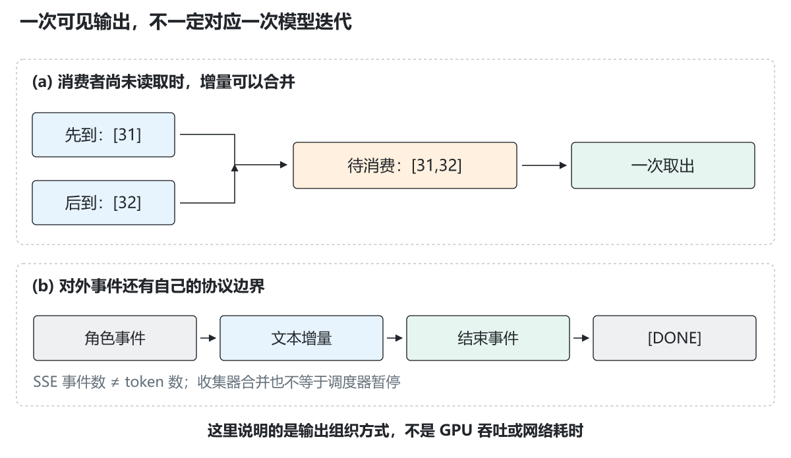
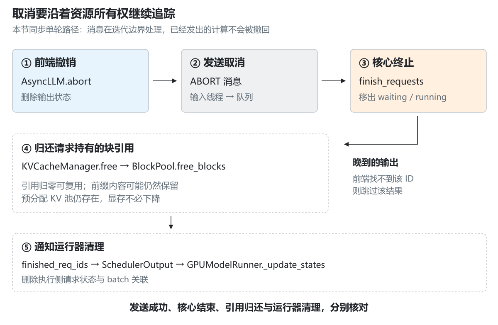

# 3.1 vLLM 中一次请求的旅程

[本篇目录](../README.md) · [上一节 2.7](../../part-02-engine/07-http-and-streaming-output/README.md) · [下一节 3.2](../02-scheduling-and-kv-management-in-vllm/README.md)

[源码实验与命令](lab.md) · [练习与答案](exercises.md) · [源码定位表](source-map.md) · [核验记录](results/README.md) · [中文插图](assets/README.md)

在第二篇，我们已经让一个教学引擎接收请求、保存 K/V、逐步生成，并通过 HTTP 返回结果。现在打开 vLLM 源码，你会看到 `AsyncLLM`、`EngineCoreClient`、`EngineCore`、`Executor`、`Worker`、`ModelRunner`。它们都和“执行请求”有关，为什么还要分成这么多层？

先带着一个具体问题读：**用户提交“请解释 KV Cache”后，这条请求现在存在哪里，下一步由谁推进，生成的结果怎样找到原来的客户端？** 如果客户端提前关闭，再顺着同一个请求 ID 追踪清理过程。

本节的产出是一张能对照源码的请求路径图，以及一份你亲自核对的阅读记录。这里开始学习真实框架的组织方式；GPU 性能实验在后面的平台与优化章节开展。

## 阅读路线与版本

| 读者 | 第一遍 | 第二遍 |
| --- | --- | --- |
| 刚完成第二篇 | 先读 1—5 节，再运行双请求示例 | 读返回与取消，完成练习 1—8 |
| 熟悉部署，第一次读源码 | 先看进程图和 `EngineCore.step` | 检查消息结构、具体实现类与释放路径 |

前置：2.3 的请求生命周期、2.5 的块映射，以及 2.7 的异步生成器和 SSE。基础实验只需 Python 3.11+ 与普通 CPU，首次下载源码需要网络。建议分两次完成；学习时长尚未通过试学测量。

**本节固定 vLLM v0.8.5，提交 `ba41cc90e8ef7f236347b2f1599eec2cbb9e1f0d`。** 它是用于连续阅读的历史版本，与 2.7 的源码衔接一致，不代表当前最新版或两平台推荐部署版本。[官方版本](https://github.com/vllm-project/vllm/releases/tag/v0.8.5) · [固定源码](https://github.com/vllm-project/vllm/tree/ba41cc90e8ef7f236347b2f1599eec2cbb9e1f0d)

本节选择的路径是：**V1、在线聊天接口、文本生成、`n=1`、TP/PP/DP 均为 1、`uni` 执行器、无推测解码与 KV 传输**。这是一组源码阅读条件。A100/C500 的进程、后端和设备执行尚未实测；尤其不能据此认定某个 MACA 分支具有相同目录和行为。

## 1. 请求、迭代、进程和任务

**请求**是一次生成工作，有自己的输入、采样条件、已生成结果和结束原因。一条请求可能需要执行很多轮。

**迭代**是引擎的一轮推进：选择本轮工作，执行模型，更新各请求状态。一次迭代可以处理多个请求；一个长 prompt 也可以跨多次迭代处理。

**进程**有独立的 Python 内存空间。把对象内容交给另一进程，通常要借助通信，把所需内容编码成消息。变量名相同不表示它们是同一个对象。

**线程和异步任务**运行在进程内部。线程可以负责阻塞式收发；异步任务通过 `await` 在等待期间交还事件循环。创建 `asyncio.Task` 不等于新建进程，也不意味着同步计算自动变为非阻塞。

给阅读笔记加四列：请求 ID、当前对象、所在进程、下一次交接。先填这四列，比记住几十个类名更有帮助。



*图 1｜前端进程处理协议、输入与输出；核心进程推进调度和模型执行。虚线框表示进程，核心中的输入/输出线程与主循环通过队列交接。图只展示选定的推理主路径，省略分词器等可选辅助进程。*

在这个版本里，`AsyncLLM.__init__` 按 DP 配置直接选择 `AsyncMPClient` 或 `DPAsyncMPClient`。我们取前者。`EngineCoreClient` 提供接口与其他客户端形态，但不能因为看到了它的 `make_client` 工厂，就把工厂画成这条路径必经的调用。

另一个容易看错的地方是单卡执行器：V1 的 `UniProcExecutor` 在 `vllm/v1/executor/abstract.py` 定义，并继承 `vllm/executor/uniproc_executor.py` 中的实现。其 `collective_rpc` 使用 `run_method` 调用本地 Worker 包装器。**方法名中有 RPC，也不证明这里跨了进程。** 多进程执行器是另一个分支。

对应源码：[AsyncLLM 初始化](https://github.com/vllm-project/vllm/blob/ba41cc90e8ef7f236347b2f1599eec2cbb9e1f0d/vllm/v1/engine/async_llm.py)、[执行器选择与继承](https://github.com/vllm-project/vllm/blob/ba41cc90e8ef7f236347b2f1599eec2cbb9e1f0d/vllm/v1/executor/abstract.py)、[本地执行调用](https://github.com/vllm-project/vllm/blob/ba41cc90e8ef7f236347b2f1599eec2cbb9e1f0d/vllm/executor/uniproc_executor.py#L49)。

## 2. 第一段：HTTP 请求怎样变成引擎请求

### 2.1 从熟悉的 JSON 开始

下面只是用于阅读接口的输入示意，`course-model` 是示例服务名，不要求此时启动模型：

```json
{"model":"course-model","messages":[{"role":"user","content":"请解释 KV Cache"}],"stream":true,"n":1,"temperature":0,"max_tokens":3}
```

首先定位 `vllm/entrypoints/openai/api_server.py` 的 `create_chat_completion`。它找到聊天处理器并调用 `OpenAIServingChat.create_chat_completion`；处理器可能返回错误、完整响应或异步输出生成器。流式分支由 `StreamingResponse` 承接。

路由本身不做 Transformer 前向。它解决的是“这是什么接口、交给哪个服务对象、怎样包装 HTTP 响应”。

### 2.2 messages 不会直接变成 GPU 输入

聊天处理器检查模型与请求条件，经 `_preprocess_chat` 处理会话、聊天模板和分词，得到引擎使用的 prompt。随后生成 `SamplingParams`，调用 `self.engine_client.generate(...)`。

两点需要停下来想清楚：

1. 同一句自然语言在不同聊天模板下可能形成不同 token 序列。因此 prompt 长度包含模板带来的内容，不能用中文字数直接代替。
2. 对于异步生成器，调用 `generate(...)` 得到的是可迭代对象；真正迭代时才推进函数体。代码里“创建 generator”和“请求已经提交到核心”是两个不同位置。

进入 `AsyncLLM.add_request` 后，`Processor.process_inputs` 继续做输入与采样条件校验、预处理，构造 `EngineCoreRequest`。在线聊天路径通常已经提供 token IDs；不能据此认定每条路径都会在这里重复分词。

### 2.3 同一个 ID，用来关联不同层的状态

聊天服务为请求构造 `chatcmpl-...` 形式的 ID，并将其交给引擎。取一个方便阅读的记号 `R`：

| 层 | 这个 ID 关联什么 |
| --- | --- |
| 服务层 | HTTP 请求与聊天响应 |
| 输出处理器 | 反分词状态、输出收集器、结束状态 |
| 核心调度器 | 等待/运行请求、已计算长度与缓存块 |
| 模型运行器 | 请求对应的执行状态、当前 batch 位置 |

ID 是关联键，不是 GPU 地址，也不保证它永远等于某个 batch 行号。batch 可以重排，必须通过映射找结果。

当 `n>1` 时，这个版本的 `AsyncLLM.add_request` 还会创建父请求，并通过 `ParentRequest.get_child_info` 生成子请求 ID，例如 `0_R`、`1_R`。这是后续扩展；本节先用 `n=1` 保持一条路径。

源码入口：[聊天处理器](https://github.com/vllm-project/vllm/blob/ba41cc90e8ef7f236347b2f1599eec2cbb9e1f0d/vllm/entrypoints/openai/serving_chat.py#L121)、[Processor](https://github.com/vllm-project/vllm/blob/ba41cc90e8ef7f236347b2f1599eec2cbb9e1f0d/vllm/v1/engine/processor.py#L195)、[请求登记](https://github.com/vllm-project/vllm/blob/ba41cc90e8ef7f236347b2f1599eec2cbb9e1f0d/vllm/v1/engine/async_llm.py#L197)。

## 3. 第二段：请求怎样跨过进程边界

### 3.1 为什么先登记输出，再发送请求

`AsyncLLM._add_request` 先调用输出处理器的 `add_request`，再调用核心客户端的 `add_request_async`。

前者让前端知道“ID 为 R 的输出应该交给谁”；后者让核心开始处理 R。这个顺序可以理解成：先准备好回信地址，再寄出工作单。若结果回来时前端没有对应状态，就无法正常路由。

前端的 `RequestState` 与核心的 `Request` 是两个对象：它们用同一个 ID 协作，分别保存自己负责的状态。不要寻找一个从 HTTP 一路共享到 GPU 的万能请求对象。

### 3.2 消息传了什么

`AsyncMPClient.add_request_async` 把请求包装为 **ADD 类型 + 编码后的 EngineCoreRequest**。发送时还带有目标引擎的身份，用于路由。

普通文本请求的核心信息包括 `request_id`、`prompt_token_ids`、`sampling_params`、`eos_token_id`、到达时间等。模型权重已经在初始化阶段加载；每次请求不需要把整套权重随消息再发一遍。



*图 2｜EngineCoreRequest 描述一条新请求；SchedulerOutput 描述一轮工作；ModelRunnerOutput 包含按执行 batch 组织的结果；EngineCoreOutput 把新 token 与请求 ID 关联。图只列本节需要的字段。*

这里的传输采用 ZMQ：输入方向是前端 ROUTER → 核心 DEALER；输出方向是核心 PUSH → 前端 PULL。它们是两条消息方向，不是一次 HTTP 请求阻塞等待一条 ZMQ 回复的简单 REQ/REP 模型。握手和引擎状态通信还有其他细节，第一次先追数据流。

### 3.3 收到消息，不等于输入线程立刻执行模型

核心进程中，`process_input_socket` 在线程里接收消息、解码，再放入 `input_queue`。主循环读取队列，通过 `_handle_client_request` 分派：ADD 进入 `add_request`，ABORT 进入 `abort_requests`。

`EngineCore.add_request` 把消息转换为核心 `Request`，交给 `Scheduler.add_request`。调度器把它登记在请求表与等待队列中。至此，请求已经进入核心，但还不一定得到本轮执行额度。

**收发线程负责交接，核心主循环负责推进状态。** 这样读后面的取消过程，就不会误以为网络线程可以随时修改正在执行的调度状态。

源码入口：[消息类型与结构](https://github.com/vllm-project/vllm/blob/ba41cc90e8ef7f236347b2f1599eec2cbb9e1f0d/vllm/v1/engine/__init__.py)、[客户端发送](https://github.com/vllm-project/vllm/blob/ba41cc90e8ef7f236347b2f1599eec2cbb9e1f0d/vllm/v1/engine/core_client.py#L719)、[核心输入线程](https://github.com/vllm-project/vllm/blob/ba41cc90e8ef7f236347b2f1599eec2cbb9e1f0d/vllm/v1/engine/core.py#L496)。

## 4. 一轮执行：调度、模型、反馈

### 4.1 先读最短的主干

打开 `EngineCore.step`，找到三个连续动作：

1. `self.scheduler.schedule()`：决定本轮工作。
2. `self.model_executor.execute_model(...)`：执行这份工作。
3. `self.scheduler.update_from_output(...)`：用模型结果更新请求。

这里的简短主干是第一遍阅读的中心。调度器内部为什么选中 A、为什么暂缓 B，留到 3.2；runner 怎样构建具体 Attention 元数据，留到 3.3。本节先确认各层交换的对象。

这个版本也有 `step_with_batch_queue` 等路径。本节采用单卡 `uni`、无推测解码的简单推进条件，不把所有分支叠在同一张调用图里。

### 4.2 SchedulerOutput 不是“本轮生成的 token”

它携带的是执行计划，例如：

| 字段 | 本节怎样理解 |
| --- | --- |
| `scheduled_new_reqs` | 第一次交给执行侧的请求信息 |
| `scheduled_cached_reqs` | 执行侧已认识的请求，本轮需要更新的内容 |
| `num_scheduled_tokens` | 每条请求本轮安排计算多少个输入位置 |
| `total_num_scheduled_tokens` | 这些数量之和 |
| `finished_req_ids` | 需要通知执行侧清理的已完成请求 |

`scheduled_cached_reqs` 中的 cached 指执行侧保留了请求状态，**不能直接读成前缀缓存命中**。第一次出现与已有请求的区别，也解释了为什么不必每轮重复发送全部 prompt 信息。

### 4.3 Executor、Worker、ModelRunner 分别做什么

| 组件 | 本节追踪的问题 |
| --- | --- |
| Executor | 通过哪种执行方式把工作交给 worker？ |
| Worker | 由哪个设备侧实例接收任务、调用运行器？ |
| ModelRunner | 怎样更新请求状态、准备输入、执行模型并采样？ |

在选定路径中，`Worker.execute_model` 调用 `self.model_runner.execute_model`。`GPUModelRunner.execute_model` 先更新状态，再准备输入，执行模型、计算 logits、采样，最后组织 `ModelRunnerOutput`。

因此“调度器执行模型”和“调度器选择执行什么”要分清。调度器给出 token 额度和缓存决策；运行器把决策变成模型真正能使用的张量。

源码入口：[核心一步](https://github.com/vllm-project/vllm/blob/ba41cc90e8ef7f236347b2f1599eec2cbb9e1f0d/vllm/v1/engine/core.py#L192)、[SchedulerOutput](https://github.com/vllm-project/vllm/blob/ba41cc90e8ef7f236347b2f1599eec2cbb9e1f0d/vllm/v1/core/sched/output.py)、[运行器执行](https://github.com/vllm-project/vllm/blob/ba41cc90e8ef7f236347b2f1599eec2cbb9e1f0d/vllm/v1/worker/gpu_model_runner.py#L1003)。

## 5. 手算一轮：两个请求、四个输入位置、一个新输出

下面是为讲清字段而设定的数据，不是 vLLM 实测输出。假设本轮决定如下：

| 请求 | 已知 token IDs | 已计算位置数 | 本轮计算数 | 所处阶段 |
| --- | --- | --- | --- | --- |
| A | `[10,11,12,13,14,15]` | 2 | 3 | 长 prompt 的部分 prefill |
| B | `[20,21,22,23]` | 3 | 1 | 读入最新 token 的 decode |

A 本轮读取位置 2、3、4，即 IDs `[12,13,14]`；计算完成后处理到位置 4，但 prompt 的位置 5 还没处理，因此这轮不给 A 对外输出。

B 本轮读入位置 3 的 ID `23`。为演示路由，假设这次采样得到 `24`。B 已计算长度从 3 变为 4；新输出 24 还没有在本轮作为输入计算自己的 KV。

若运行器使用 **B、A** 的执行顺序，紧凑输入可以理解为：

```text
input_ids        = [23, 12, 13, 14]
positions        = [ 3,  2,  3,  4]
请求片段边界      = [ 0,  1,  4]
req_id_to_index   = {"B": 0, "A": 1}
sampled_token_ids = [[24], []]
```

这里的片段边界是用于解释的累计长度表示；runner 的具体元数据字段由实现和注意力后端决定。`positions` 属于各自请求，不是 `[0,1,2,3]` 这样的 batch 下标。



*图 3｜本轮有 2 条请求、4 个实际输入位置、1 个有效新输出。执行顺序可以与请求登记顺序不同，结果通过 ID 映射还原。图中 token 选择未运行模型。*

再加上 2.5 学过的块映射：设块大小为 4，A 的逻辑块表是 `[8,3]`，B 是 `[5]`。位置 p 对应：

```text
逻辑块号 = p // 4
块内偏移 = p % 4
物理槽位 = block_table[逻辑块号] * 4 + 块内偏移
```

于是上面执行顺序中的槽位是 `[23,34,35,12]`。这描述新 KV 写入的位置；读取历史还需要块表、序列长度和注意力元数据，不能只靠写入槽位列表完成。

运行下面的短示例，查看两种请求排列是否都能得到相同的按 ID 归属的结果：

```bash
python docs/chapters/part-03-vllm/01-a-request-s-journey-through-vllm/examples/walk_iteration.py
```

实际 runner 可能为了图执行填充输入，因此设备张量长度未必刚好等于这里的 4。另外，这个版本的实现可能为部分 prefill 计算候选再丢弃；“没有有效对外输出”不等于完全没经过采样相关代码。

## 6. 第三段：模型结果怎样回到客户端

### 6.1 先从 batch 结果回到请求

`ModelRunnerOutput` 带有 `req_id_to_index` 和 `sampled_token_ids` 等信息。`Scheduler.update_from_output` 先按请求 ID 找到结果位置，再追加 token、检查结束条件，形成按请求组织的 `EngineCoreOutput`。

若运行顺序是 B、A，但你仍按 A、B 的登记顺序分配结果，B 的 24 就会交给 A。这也是上一节示例中一定要保留映射的原因。

### 6.2 输出有两次不同的交接

核心把结果放到 `output_queue`，输出线程序列化后通过 ZMQ 发送。前端的后台任务接收消息，放入核心结果队列；`AsyncLLM` 的输出处理任务再调用 `OutputProcessor.process_outputs`。

输出处理器用 ID 找到前端状态，反分词、整理结果，将其交给这条请求的 `RequestOutputCollector`。请求自己的 `generate` 协程等待收集器，拿到结果后 `yield` 给聊天服务，最后由服务层包装为 SSE。

把它分成两次交接：

1. **核心结果到前端**：可能同时带回多条请求的计算结果。
2. **前端到每个消费者**：按 ID 分发，恢复对应请求的输出流。

### 6.3 收集器不等同于第二篇的有界队列

这个版本的 `RequestOutputCollector` 保存待取出的输出，并通过 `asyncio.Event` 唤醒消费者。生产侧先到、消费侧还没取时，它会调用 `RequestOutput.add` 合并结果；DELTA 模式下追加增量。



*图 4｜两次内部增量可能合并为一次可见输出；SSE 还可能先发角色信息或最后发结束信息。传输分块、SSE 事件、文本片段与 token 的边界分别由不同层决定。*

假设先后得到 ID 31 和 32，消费者暂未读取，那么一次取出可能包含 `[31,32]`。再加上反分词的文本边界，一次 SSE 内容变化不能简单换算成“模型刚完成一次 decode”。

第二篇使用有界队列来演示慢消费者暂缓执行。**不能直接把那套背压机制当作这里已经实现的行为**：收集器合并可以减少待处理对象数量，但仍可能保留更多文本和 token，也不自动暂停 GPU 调度。

源码入口：[核心反馈](https://github.com/vllm-project/vllm/blob/ba41cc90e8ef7f236347b2f1599eec2cbb9e1f0d/vllm/v1/core/sched/scheduler.py#L625)、[输出处理](https://github.com/vllm-project/vllm/blob/ba41cc90e8ef7f236347b2f1599eec2cbb9e1f0d/vllm/v1/engine/output_processor.py#L293)、[收集器](https://github.com/vllm-project/vllm/blob/ba41cc90e8ef7f236347b2f1599eec2cbb9e1f0d/vllm/v1/engine/output_processor.py#L20)。

## 7. “结束”在哪一层发现

停止不是只写一个 `if finished` 就结束了。先问哪层掌握判断所需的信息。

| 结束条件 | 这个版本的重要检查位置 | 后续交接 |
| --- | --- | --- |
| 达到长度、EOS、指定 stop token ID | 核心侧 `check_stop` | 更新状态、释放请求资源，结果携带结束原因 |
| 匹配文本 stop string | 前端增量反分词与输出处理 | 前端停止后，将 ID 加入 `reqs_to_abort` 通知核心 |
| 客户端取消 | 请求协程收到取消异常 | `AsyncLLM.abort` 清理前端并发送 ABORT |

为什么字符串停止需要前端参与？核心侧主要处理 token IDs，前端反分词后才能结合跨 token 的文本判断字符串。于是可能出现：前端已经判断应结束，而核心暂时仍认为请求可运行。

`AsyncLLM` 的输出处理任务会把 `reqs_to_abort` 交给 `abort_requests_async`，使两个进程最终达成一致。对用户而言可以是正常的 stop string 结束；内部却用了 ABORT 消息来通知核心停止继续计算。**内部控制消息和面向用户的结束原因不是同一套语义。**

`check_stop` 里各条件还有判断顺序。做源码阅读时要记录顺序，而不是只记录“支持这些条件”；多个条件同时成立时，这会影响最终原因。

源码入口：[核心 stop 检查](https://github.com/vllm-project/vllm/blob/ba41cc90e8ef7f236347b2f1599eec2cbb9e1f0d/vllm/v1/core/sched/utils.py)、[输出处理后台任务](https://github.com/vllm-project/vllm/blob/ba41cc90e8ef7f236347b2f1599eec2cbb9e1f0d/vllm/v1/engine/async_llm.py#L353)。

## 8. 第四段：客户端离开后，谁回收资源

### 8.1 从取消异常继续追，别停在 HTTP 层

服务层在等待或流式发送期间处理断连。这个版本的 `with_cancellation` 包装器关注处理函数阶段；返回流式响应之后，交由响应层处理断连。实际触发时机还与 ASGI 服务栈有关，本节用源码检查其取消处理路径，不声称测得 GPU 断连延迟。

在 `AsyncLLM.generate` 中，取消异常会进入 `self.abort(request_id)`，随后异常继续向上传播。`AsyncLLM.abort` 做两件事：

1. 从前端输出处理器撤销对应请求状态，得到需要结束的 ID 列表。
2. 通过核心客户端发送 ABORT。

前端撤销状态后，晚到的核心输出可能仍在通信通道中。`OutputProcessor.process_outputs` 查不到该 ID 的状态时会跳过它，因此无需把晚到结果送回已离开的消费者。

### 8.2 发出 ABORT，不等于核心已经释放

`abort_requests_async` 等待的是发送过程，这条路径没有通过它返回一个“全部缓存已释放”的确认。

核心输入线程先接到 ABORT，再放入输入队列。`EngineCoreProc.run_busy_loop` 在迭代边界处理消息，进入 `EngineCore.abort_requests`，随后调用 `Scheduler.finish_requests`。

对本节的同步单轮路径，如果当前正在执行模型，取消消息不会把已经发出的 GPU kernel 从中间撤销。它影响后续状态推进与资源回收；这也解释了为什么取消后日志中可能还有一轮已经在途的结果。



*图 5｜前端撤销、消息送达、核心处理、块引用归还、runner 状态清理发生在不同位置。箭头表示控制交接，不表示各阶段同时完成，也不表示测量到的耗时。*

### 8.3 “释放缓存”至少有三种不同含义

`Scheduler.finish_requests` 从 waiting/running 集合移除请求并设置终态，再调用 `_free_request`。继续向下追：

```text
Scheduler._free_request
  → KVCacheManager.free
    → BlockPool.free_blocks
```

这里归还请求持有的块引用。`free_blocks` 递减引用计数，普通块在引用归零后进入可复用队列。开启前缀缓存时，某块仍可能保留可命中的内容和缓存索引，直到以后被逐出或复用。

所以要区分：

- **请求不再持有块**：该请求对块的所有权已经释放。
- **块可供其他请求使用**：还要看其他引用和块池状态。
- **设备内存归还给驱动**：不是每条请求结束都要做的事；预分配的 KV 池通常仍存在。

因此，看显存数字是否下降，不能单独判断请求有没有清理干净。

与此同时，调度器把 ID 记入 `finished_req_ids`。后续 `SchedulerOutput` 将其交给 runner，由 `_update_states` 删除执行侧的请求状态和 batch 关联。即使本轮没有新的输入 token，runner 也先更新状态，再检查是否需要执行模型。

读者最终应能分别指出：**前端输出状态、调度器请求、缓存块引用、运行器状态**由谁清理。

源码入口：[前端取消](https://github.com/vllm-project/vllm/blob/ba41cc90e8ef7f236347b2f1599eec2cbb9e1f0d/vllm/v1/engine/async_llm.py#L404)、[调度器终态](https://github.com/vllm-project/vllm/blob/ba41cc90e8ef7f236347b2f1599eec2cbb9e1f0d/vllm/v1/core/sched/scheduler.py#L762)、[归还引用](https://github.com/vllm-project/vllm/blob/ba41cc90e8ef7f236347b2f1599eec2cbb9e1f0d/vllm/v1/core/block_pool.py#L227)、[runner 清理](https://github.com/vllm-project/vllm/blob/ba41cc90e8ef7f236347b2f1599eec2cbb9e1f0d/vllm/v1/worker/gpu_model_runner.py#L285)。

## 9. 把第二篇的代码映射回来

下面是职责对照，不能据此认定两个实现的接口、调度策略或执行方式相同。

| 第二篇已有内容 | 本节的真实组件 | 主要差异 |
| --- | --- | --- |
| HTTP 应用与 `StreamService` | API 路由、聊天服务、`AsyncLLM` | 加入聊天模板与反分词，核心通过进程通信独立推进 |
| `LifecycleEngine` 的请求登记与状态 | `OutputProcessor`、核心 `Request`、`Scheduler` | 状态分布在不同所有者，而非单一请求记录 |
| 逐轮预算与调度 | `SchedulerOutput` | 还需携带新请求/已有请求差异及完成通知 |
| CPU 分页缓存与前缀共享 | `KVCacheManager`、`BlockPool`、runner 的 KV 存储 | 逻辑分配、设备张量与后端元数据需要配合 |
| 每请求输出通道 | `RequestOutputCollector` | 输出合并策略不同，不能直接沿用教学背压结论 |
| 取消后的统一回收 | 前端撤销 + ABORT + 核心/runner 清理 | 跨边界后需要处理延迟、晚到结果和不同阶段的完成 |

阅读这种对照时，最重要的是说明“同一问题到了真实框架中由哪几层共同解决”。

## 10. 实验：把图上的每个关键点定位到源码

在仓库根目录执行：

```bash
python -m scripts.experiments.lesson0301 --fetch
python -m scripts.experiments.lesson0301 --focus cancel
```

第一条显式下载固定提交的 25 个文件；下载内容只保存在忽略目录。第二条默认离线运行，终端只展示取消路径，仍核对完整清单。

工具会用文件摘要检查版本，再用 Python 语法树定位 38 个函数和 4 个结构的字段，并生成 `summary.json` 与带源码链接的 `source-map.md`。它不导入 vLLM，不加载模型，也不会通过扫描源码就宣称 GPU 运行成功。

源码中的调用表达式也不是完整调用图：`run_method` 的动态分派、条件分支、消息传输和函数继承，都还需要你按本文解释连接起来。完整命令、参数、失败案例和输出阅读顺序见[实验页](lab.md)。

## 11. 学完后怎样自查

先完成[12 组练习](exercises.md)，再合上正文解释下面五件事：

1. `AsyncLLM` 与 `EngineCore` 分别持有什么请求状态？
2. 输入消息到达核心后，为什么还需要等待调度？
3. 两条请求本轮计算四个位置，为什么可能只返回一个新 token？
4. 为什么一次 SSE 事件不等于一次模型迭代？
5. 客户端取消后，怎样追到块引用与 runner 状态的回收？

完成实验后保留一张自己标注的路径图，附版本、具体入口、消息字段与清理位置。只保存 `passed=true` 还不足以证明理解了这些交接。

接下来进入 [3.2 调度与 KV 管理](../02-scheduling-and-kv-management-in-vllm/README.md)，把本节的 `schedule()` 展开：谁能进入本轮、分配失败后怎么办、已有缓存怎样影响决策。

## 公开参考资料

- [vLLM v0.8.5 固定源码](https://github.com/vllm-project/vllm/tree/ba41cc90e8ef7f236347b2f1599eec2cbb9e1f0d)：本节事实依据，逐项定位见[源码表](source-map.md)。
- [Python 3.11 AST](https://docs.python.org/3.11/library/ast.html)：理解源码实验如何检查语法结构。
- [Python 3.11 asyncio task](https://docs.python.org/3.11/library/asyncio-task.html)：协程、任务与取消。
- [ZeroMQ socket API](https://libzmq.readthedocs.io/en/latest/zmq_socket.html)：ROUTER/DEALER 与 PUSH/PULL 的语义；实际连接方向按本节固定源码核对。

插图与双请求数据为本课程原创。上游源码保持 Apache-2.0 许可；下载器保留上游 LICENSE，本仓库不重新授权上游代码。
