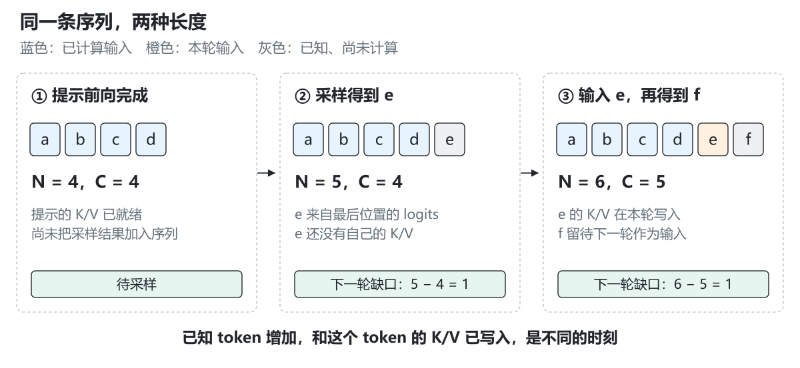
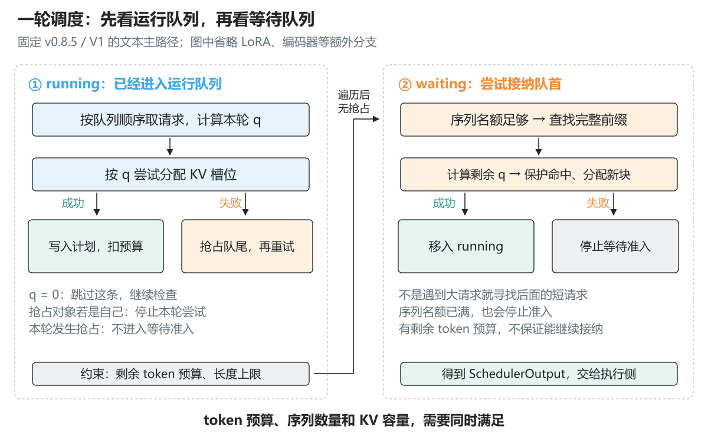
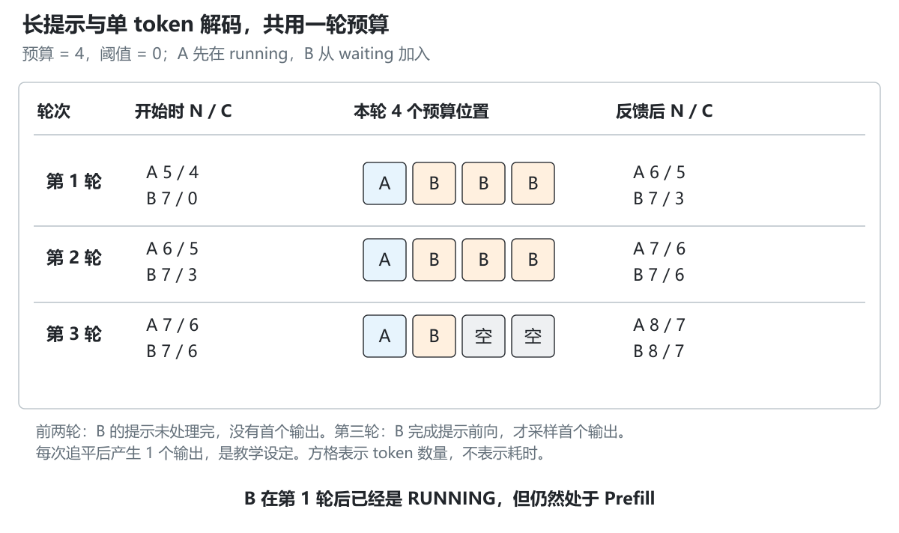
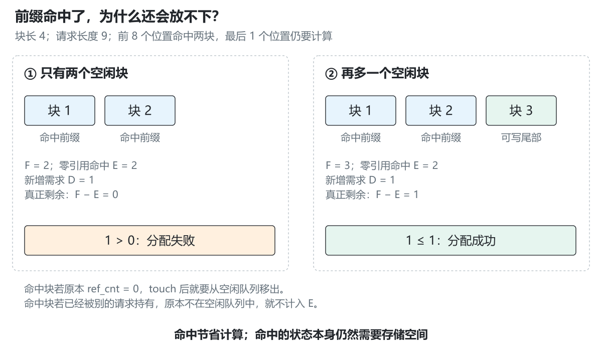
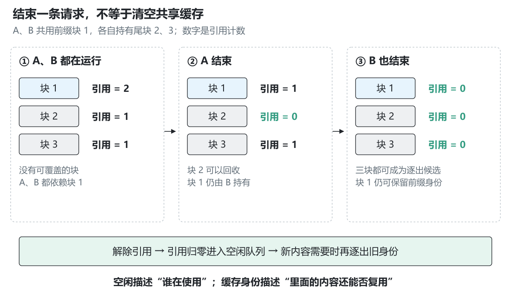
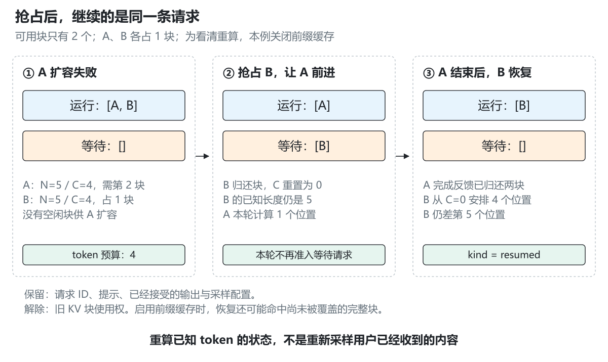

# 3.2 vLLM 调度与 KV 管理

[本篇目录](../README.md) · [全部课程](../../README.md) · [上一节 3.1](../01-a-request-s-journey-through-vllm/README.md) · [下一节 3.3](../03-model-execution-and-attention-backends/README.md)

上一节，我们跟着一条请求走过前端、EngineCore、模型执行和结果返回。现在把镜头停在 `EngineCore.step()` 中的 `scheduler.schedule()`：**这一轮到底让谁计算多少个 token，计算产生的 K/V 又放在哪里？**

想象两条请求同时到达：A 已经开始生成，每轮只需处理上一次生成的一个 token；B 刚提交了一段长提示。如果直接让 B 一次算完，A 的下一次输出可能要等很久。如果总让 A 优先，B 又什么时候才能开始？即使算力还有余量，缓存有没有足够的位置容纳它们？这些问题共同决定一轮执行计划。

本节沿用 **vLLM v0.8.5 / V1**，固定提交 `ba41cc90e8ef7f236347b2f1599eec2cbb9e1f0d`。它是和前文一致的历史阅读快照。后来的实现以及 MACA 适配分支，需要在对应版本重新核对。

> **已完成：**正文、6 张中文原创图、10 个标准库计数案例、固定源码核验、实验步骤与练习答案。计数程序不导入 vLLM，不计算模型输出，也不测量 GPU 性能。A100/C500 的设备执行留待实机实验。

## 阅读准备

- 前置：[2.4 迭代调度](../../part-02-engine/04-from-static-to-continuous-batching/README.md)、[2.5 分页缓存](../../part-02-engine/05-paged-caching/README.md)、[2.6 前缀缓存](../../part-02-engine/06-prefix-caching/README.md)。如果对请求计数不熟，先读下面的第 1—4 节。
- 设备：普通 CPU，Python 3.11+。基础实验不需要第三方依赖、模型权重或联网；首次下载官方源码时需要网络。
- 阅读条件：单卡、文本、完整注意力、同步的一轮执行与反馈；先关闭推测解码、LoRA、多模态与外部 KV 传输。正文会指出这些简化条件影响哪些结论。
- 建议分两次学习：第一次理解计数、手算与调度；第二次对照缓存源码、运行实验并完成练习。源码与练习比一次读完更重要。

| 学习材料 | 用法 |
| --- | --- |
| 本页第 1—4 节 | 理解 token 缺口、三种预算和混合调度 |
| 本页第 5—9 节 | 理解块分配、前缀共享、抢占与执行反馈 |
| [实验操作](lab.md) | 从默认输出开始，逐次改变预算和容量 |
| [练习与参考答案](exercises.md) | 独立手算后展开答案，共 14 组 |
| [源码定位表](source-map.md) | 6 个文件、11 个函数和 SchedulerOutput 的固定位置 |
| [实际运行记录](results/README.md) | 检查数字、验证范围与复现信息 |

## 1. 先分清“知道 token”和“算过 token”

### 1.1 为什么解码时会差一个

设提示已经分成 4 个 token：`[a, b, c, d]`。模型处理完这 4 个输入，用最后一行 logits 采样得到 `e`。

此时，系统**知道**的序列是 `[a, b, c, d, e]`，共 5 个 token；但模型只对 `[a, b, c, d]` 做过前向，缓存也只覆盖这 4 个位置。`e` 刚从 logits 中选出来，还没有作为输入进入模型，因此没有它自己的 K/V。

下一轮输入 `e`，生成 `f`，于是已知长度变成 6，已计算长度变成 5。通常的逐 token 解码就这样持续保留一个待计算位置。这也是“生成一个 token”和“给这个 token 写好 KV Cache”不能混为一谈的原因。



*图 1：新输出先进入已知序列，下一轮作为输入时才产生自己的 K/V。图中假设每次完成前向后采样一个 token。*

### 1.2 对应到 Request 的字段

| 记号 | 源码字段 | 本节含义 |
| --- | --- | --- |
| P | `num_prompt_tokens` | 最初输入的提示长度，生成过程中保持不变 |
| N | `num_tokens` | 提示 token 加上已经接受的输出 token 的总数 |
| C | `num_computed_tokens` | 调度器记录的已计算进度；提交下一轮后也会提前推进，见第 9 节 |
| S | `len(spec_token_ids)` | 草稿 token 数，本节主路径设为 0 |
| N + S | `num_tokens_with_spec` | 运行队列用来判断本轮待处理数量的目标长度 |
| q | `num_scheduled_tokens[request_id]` | 这轮交给该请求的计算数量 |

在一轮执行完成、反馈也处理完的边界，本节可以先用下面的式子理解：

```text
待计算数量 = N − C                 （本节 S = 0）
本轮数量 q ≤ 待计算数量
```

新请求的 `N=P，C=0`，缺口是一整段提示；分块预填充中的请求满足 `0<C<P`，缺口是提示剩余部分；普通解码通常满足 `N=C+1`，缺口为 1。**同一个减法，可以描述不同阶段。** 源码 `schedule()` 开头的注释正是在解释这个统一视角。

抢占后也要使用 N，不能只使用 P。例如提示 4 个 token、已经生成 3 个输出，N 就是 7；重建状态时需要恢复这 7 个已知 token 对应的进度，而不只是最初的 4 个提示。用户已经收到的输出不应该重新采样一次。

### 1.3 一个容易误读的状态名

`RUNNING` 表示请求已经进入运行队列，不表示它已经完成 Prefill，也不表示这轮一定分到工作。长提示处理了第一个分块后，就可以留在 `running` 中继续预填充。

所以，源码里的“先调度 RUNNING”不能直接翻译为“先调度全部 Decode”。队列身份和模型所处的计算阶段是两个维度。

## 2. 调度器同时管着哪些预算

先把三本账摆在一起，再看循环。

| 约束 | 单位 | 它限制什么 | 它不直接表示什么 |
| --- | --- | --- | --- |
| `max_num_batched_tokens` | token / 本轮 | 一次调度累计安排多少个输入位置 | 用户最多生成多少个 token |
| `max_num_seqs` | 请求 / 序列 | 运行队列最多容纳多少条请求 | 这一轮处理多少个 token |
| KV 块池容量 | 块 | 能否给历史状态和这轮的新位置提供槽位 | 这一轮 GPU 有多少计算余量 |

此外还有单请求长度上限 `max_model_len`，以及长预填充阈值 `long_prefill_token_threshold`。本节把阈值记为 T：T 为 0 时不额外截断；T 为正数时，本轮单条请求的数量还会受到这个阈值限制。不要把 T 和整轮的 token 预算混淆。

以无推测、无编码器输入的运行请求为例，阅读用简式为：

```text
q = min(N − C, 剩余 token 预算, max_model_len − C)
若 T > 0，再令 q = min(q, T)
```

该式还没有回答能否分配 KV。调度器先算出希望安排的 q，再尝试分配相应槽位。**q 算得出来，不意味着缓存放得下。**

例如预算为 8、运行队列上限为 1，当前请求只需要计算 1 个 token。即使算完它以后还剩 7 个 token 预算，新的等待请求仍可能因为运行队列已满而不能加入。反过来，即使队列还有位置，也可能因为一个空闲 KV 块都没有而无法推进。

这些参数是在计算吞吐、等待时间和状态容量之间做选择。调大 token 预算可能让长提示更快推进，也可能加长单轮执行时间；它不会凭空增加 KV 块，更不能直接保证 TPOT 改善。性能结论需要固定负载后的设备测量。

## 3. 一轮 schedule() 怎样走



*图 2：图只展开本节的文本主路径。新请求可能因为 token 预算、序列数量或者缓存容量而停在等待队列。*

### 3.1 先遍历运行队列

按该版本列表中的顺序取出请求，计算 q，尝试 `KVCacheManager.allocate_slots()`。

- q 为 0：跳过当前请求，继续检查后面的请求。在完整实现中，这可能与流水线执行或编码器预算有关。
- 分配成功：把请求及 q 写入本轮计划，扣掉 token 预算。
- 分配失败：从运行队列尾部选择牺牲请求，释放其 KV 引用，将其标为 `PREEMPTED` 并放回等待队首，然后重试。第 8 节会展开这个过程。

这是所选快照的具体控制流。看到配置或注释中的 FCFS，也仍需检查 `continue`、`break` 和抢占分支；不能推断所有请求在所有条件下都严格先来先服务。

### 3.2 本轮没有抢占，才尝试接纳等待请求

运行队列遍历后，源码先检查这轮有没有发生抢占。如果发生了抢占，这一轮跳过新的等待准入。

否则，取 `waiting[0]`：

1. 检查运行队列是否达到 `max_num_seqs`。
2. 查找可复用的完整前缀，得到命中块和已有计算长度。
3. 计算剩余 token 数，按阈值和剩余 token 预算截断。
4. 尝试保护命中块并分配新块。
5. 成功后，才从 waiting 移入 running，填写本轮输出对象。

**等待队首分配失败时，这个普通主路径会 `break`。** 它不会继续搜索后面有没有更短、恰好放得下的请求。这就是队首阻塞：队列前面的请求挡住了后面的请求。

假设块长为 4，只有 1 个可用块，token 预算为 8。队首请求需要安排 8 个 token，即 2 个块；第二条请求只需 1 个 token，即 1 个块。此时第二条其实放得下，但本轮结果仍为空。后来版本或其他调度策略可能不同，本节只解释这里的分支。

完整源码还会临时跳过某些约束未满足的请求，例如结构化输出的状态机尚未就绪、LoRA 数量约束等。它们和“普通请求因为 KV 分配失败而停止准入”是不同分支，不要合并成一句“放不下都跳过”。

### 3.3 本轮计划中有什么

`SchedulerOutput` 主要说明：哪些是首次加入的请求，哪些是已有/恢复的请求，每条安排了多少个 token，有哪些块表信息，以及哪些请求已经结束。

在该版本中，第一次运行与抢占恢复传给执行侧的块信息，需要与普通运行请求的“新增块”区分。运行请求通常只追加新块；恢复请求需要重建执行侧的相应状态，不能继续使用被释放的旧块表。

它还是一个**执行计划**。真正把计划变成 `input_ids`、`positions`、`slot_mapping` 和注意力元数据，是下一节 3.3 要追踪的工作。

## 4. 手算：一个 Decode 和一个长 Prefill 如何共用三轮

设块长 B=4，整轮 token 预算为 4，阈值 T=0，序列上限和块数都足够：

- A 已经运行：N=5，C=4，本轮差 1 个 token。
- B 是新请求：P=N=7，C=0，差 7 个 token。
- 教学假设：每次请求追平已知序列后，执行反馈提供 1 个新输出；提示未算完时不产生用户可见输出。



*图 3：A 每轮用掉 1 个预算，B 使用剩余部分。颜色表示这轮输入位置的数量，不表示耗时比例。*

### 第 1 轮

A 先安排 1 个：预算从 4 降为 3。B 可以安排 `min(7,3)=3` 个提示位置。执行完成后：

- A：C 从 4 变为 5；假设采样得到新输出，N 从 5 变为 6。
- B：C 从 0 变为 3；提示还没处理完，N 仍然是 7。

B 此时已经在 RUNNING 队列中，但仍在做 Prefill。

### 第 2 轮

A 的新缺口仍为 `6−5=1`；B 的缺口为 `7−3=4`。同样安排 A=1、B=3。反馈后 A 为 N=7/C=6，B 为 N=7/C=6。

### 第 3 轮

A 缺 1，B 也只缺最后 1 个提示位置。安排 A=1、B=1，还剩 2 个 token 预算。B 在这一轮完成提示前向，才有可用于首个输出的最后位置 logits。反馈后 A 为 N=8/C=7，B 为 N=8/C=7。

| 轮次 | A：开始 N/C | B：开始 N/C | 本轮 A/B | 反馈后 A：N/C | 反馈后 B：N/C | 剩余预算 |
| --- | --- | --- | --- | --- | --- | --- |
| 1 | 5/4 | 7/0 | 1/3 | 6/5 | 7/3 | 0 |
| 2 | 6/5 | 7/3 | 1/3 | 7/6 | 7/6 | 0 |
| 3 | 7/6 | 7/6 | 1/1 | 8/7 | 8/7 | 2 |

这里每轮都先处理 A，是因为它在运行队列中的位置。代码并没有先把所有请求分成 Decode 和 Prefill 两个组再执行这张表。

**分块预填充为什么仍然正确？** B 的第二块提示输入带着更大的位置编号，读取前面已经计算好的 K/V，并保持因果可见性。它不会把每块当作新的独立句子，也不会重置位置编号。2.5 的分页地址和 2.6 的有效前缀边界，是理解这里的基础。

还有一个实验：把预算改成 8，但阈值设为 2。第一轮是 A=1、B=2，还剩 5；一次遍历不会为了填满预算而立即给 B 再安排一块。预算没有用完，不一定表示计算错误。

## 5. KVCacheManager 和 BlockPool 分别记什么账

### 5.1 三层职责

| 层次 | 管理的对象 | 本节关注点 |
| --- | --- | --- |
| Scheduler | 请求、队列、token 数与执行计划 | 谁先执行、这轮执行多少、何时抢占 |
| KVCacheManager | 某个请求对应哪些块，以及计算长度如何覆盖槽位 | 需要几个块、命中了哪些前缀块、还要分配几个 |
| BlockPool | 物理块编号、引用计数、空闲队列与缓存索引 | 哪些块能复用，哪些块还能被覆盖，怎样归还 |

这些 Python 对象主要管理元数据。真正的 K/V 张量存储由执行侧建立并由注意力代码读写。`free(request)` 一般意味着归还池内块的使用权，不等于每次调用都把整块 GPU 显存退还给驱动。

块编号可理解为预先准备好的存储页地址；请求的块表说明逻辑第几块映射到哪个物理编号。各请求不必拥有连续的物理编号。

### 5.2 先算总共需要多少块

暂时关闭前缀缓存和推测槽位。若请求此前处理了 C 个位置，本轮又安排 q 个，则需要：

```text
总块数 R = ceil((C + q) / B)
新增块数 D = R − 请求已经持有的块数
```

`ceil` 是向上取整。B=4，C=3，q=1：共 4 个位置，仍然只需要 1 个块，D=0。C=4，q=1：共 5 个位置，需要 2 个块；如果原来持有 1 个块，现在 D=1。

因此，Decode 每轮虽然只处理一个 token，**并非每轮都分配一个新块**。只有跨过块边界，或其他机制要求额外槽位时，才需要扩容。

新分配的块里也可能留有尚未写入的槽位。块容量、已安排位置和已完成计算的有效长度是三件不同的事。不能因为块表已经增长，就让 Attention 读取整个新块。

### 5.3 空闲队列里为什么还会有缓存

一块同时有两类信息：

- `ref_cnt`：当前多少条请求持有它。
- 前缀身份：这块是否仍保存可用于前缀命中的内容。

`ref_cnt=0` 只表示当前没有请求持有它。它仍可以保留有效缓存，并留在空闲队列中等待两种机会：新请求命中它，或者新分配需要覆盖它。

这两个用途是竞争关系。同一个块不能在这一轮既被保护为命中前缀，又被当作新空间覆盖。

另外，所选 `BlockPool` 会保留编号 0 作为 `null_block`。因此，本节账本配置 `num_blocks=3` 时，可分配给请求的是编号 1、2，共 **2 块**。看实验数字时先扣掉这一块，避免容量差一块。

## 6. 前缀命中：计算省了多少，块又占了多少

### 6.1 命中的是完整且连续的前缀

`get_computed_blocks()` 先计算请求的块哈希，再交给相应缓存管理实现寻找最长命中前缀。这里的块身份不能只看“本块的几个 token”：还与前面的上下文有关。相同的一小段文字出现在不同前文后面，其 K/V 不一定相同。

本节不重新实现哈希或设备缓存，而是在独立账本案例中明确给出“编号 1、2 已经被确认是匹配前缀”。这样可以集中验证**命中之后**的容量计算。哈希隔离和真实 K/V 数值对照，见 2.6；不同注意力类型的专门规则不套用本节简式。

只命中完整块时，命中长度是块长的整数倍。部分尾块通常不会像完整块一样直接作为公共前缀共享。

### 6.2 全部提示看似都命中，为什么还需要计算

KV Cache 保存的是历史 K/V，不是这个新请求最后位置的完整 logits。要产生下一个 token，主路径仍需计算末尾输入。在所选版本中，如果提示长度刚好整除块长，`get_computed_blocks()` 会暂时移除最后一个块哈希，查找后再恢复，从而留出最后一整块重算。

以 B=4、缓存中已有足够完整前缀为例：

| 已知输入长度 N | 普通完整块最多命中 | 本次实际复用 | 仍需计算 | 原因 |
| --- | --- | --- | --- | --- |
| 7 | 4 | 4 | 3 | 最后的 3 个位置属于不完整尾块 |
| 8 | 8 | 4 | 4 | 对齐块边界，最后整块留给重算 |
| 9 | 8 | 8 | 1 | 前 8 个位置复用，最后 1 个位置计算 logits |

在本节限定条件下，若已有连续命中的完整块数为 M，可以用下式手算：

```text
复用 token 数 = min(M, floor((N − 1) / B)) × B
```

这不是所有 vLLM 版本和后端通用的缓存公式。所选源码中，请求 `prompt_logprobs` 会跳过前缀复用；EAGLE 路径还可能进一步放弃最后一个命中块，以获取草稿头所需的 hidden states。阅读时要把这些分支保留在脑中。

### 6.3 命中也可能分配失败



*图 4：两个命中块都在空闲队列中时，一旦被新请求引用，就都要移出空闲队列。它们不能再给第 9 个位置腾出空间。*

假设 B=4，新请求长度 9，前 8 个位置命中编号 1、2。请求还要计算最后一个位置，因此总共需要 3 个块，其中 2 个来自前缀命中、1 个需要新分配。

如果当前空闲队列恰好只有 `[1,2]`，它看起来有 2 个空闲块。但两个都必须保留给本次前缀，真正能拿来写尾部的块是 0 个。请求仍然无法准入。

把 `allocate_slots()` 中的计数整理如下：

```text
C_old = 请求已记录的计算长度
H     = 本次新命中的完整块数
O     = 请求此前持有的块数
L     = 额外 lookahead 槽位数（本节为 0）

R = ceil((C_old + H×B + q + L) / B)
D = R − O − H
F = 空闲队列长度
E = 新命中块中 ref_cnt 为 0 的块数

能否分配：D ≤ F − E
```

在本节主路径中，等待新请求通常 C_old=0、O=0，运行请求通常 H=0。把它们放在同一个公式里，是为了看清源码为何需要同时扣掉“已有块”和“新命中块”。

上述例子 D=1、F=2、E=2，所以 `1 ≤ 0` 不成立。如果再多出编号 3，F=3，就有 `1 ≤ 1`，可以分配。

如果命中块已经被另一条运行请求持有，`ref_cnt>0`，它原本就不在空闲队列中，因此不计入 E。本次复用增加引用即可，不能再从 F 中多扣一次。

### 6.4 顺序为什么重要

分配流程先检查容量，再 `touch()` 命中块，把零引用命中块从空闲队列移走并增加引用，最后申请真正的新块。否则，新块分配可能先取走一个刚刚命中的块，把它覆盖掉。

本节完整注意力账本在容量不足时不改变状态。但不要把“失败绝无任何副作用”推广到所有上游分支：实际 `allocate_slots()` 在容量判断前，会调用专门管理器清理注意力已经跳过的块，例如滑动窗口外的块。那是主动释放无用状态，和失败后错误地留下半份新分配不同。

## 7. 引用归零、保留缓存与逐出



*图 5：A 结束只解除 A 的引用；B 仍然依赖的共享前缀不能被覆盖。最后一个引用消失后，缓存身份还可以继续保留。*

假设 A、B 共用前缀块 1，同时各自持有尾块 2、3：

| 时刻 | 块 1 引用 | 块 2 引用 | 块 3 引用 | 可覆盖的块 |
| --- | --- | --- | --- | --- |
| A、B 都在运行 | 2 | 1 | 1 | 无 |
| A 结束 | 1 | 0 | 1 | 块 2 |
| B 也结束 | 0 | 0 | 0 | 块 1、2、3 |

块 1 最后归零后，仍可带着原来的前缀哈希留在空闲队列。未来若有相同前缀，请求可以再次命中它；若新内容需要存储位置，`get_new_blocks()` 取走该块时，会清除旧缓存身份，再把它交给新请求使用。这一步才是这里的**逐出**。

请分别使用这三个词：

- **解除引用**：某条请求不再使用该块。
- **进入空闲队列**：该块当前没有持有者，可以成为逐出候选。
- **逐出缓存身份**：旧内容不再作为前缀命中返回，随后可以被新内容覆盖。

开启前缀缓存时，`KVCacheManager.free()` 会逆序释放请求块，使尾部块更早进入逐出队列；这样短前缀有机会保留得更久。不要据此断言整套系统执行了任意意义上的“全局最优 LRU”。顺序、引用和候选队列都需要看实际实现。

## 8. 块不够时：抢占与重算

### 8.1 先看一个最小例子

B=4，块池总数为 3，扣除 null 块后只有 2 个可用块。运行队列为 `[A,B]`：

- A：N=5/C=4，已经持有 1 个块。
- B：N=5/C=4，也持有 1 个块。
- 本轮 token 预算为 4，前缀缓存关闭。

A 需要处理第 5 个位置，要新增第 2 个块。但空闲块为 0。调度器从运行队尾取出 B，释放 B 的块，标记 B 为 `PREEMPTED`，令 B 的 C=0，并放到等待队首。A 重试后可以获得刚释放的块，安排 1 个 token。

这一轮虽然还剩 3 个 token 预算，但因为发生了抢占，不再接纳等待请求。B 不会在同一轮被刚释放又立刻接回。



*图 6：为突出重算，例子关闭前缀缓存。A 的完成反馈是实验中明确设定的输入；不是模型预测。*

假设 A 在本轮反馈中结束，两个块归还。下一轮 B 恢复：它仍然知道原来的 5 个 token，但 C=0。预算为 4，先重算前 4 个位置；还差的第 5 个位置要后续处理。它不是接着旧块表从 C=4 往下走。

### 8.2 哪些信息保留，哪些信息丢弃

| 信息 | 重算式抢占后的处理 |
| --- | --- |
| 请求 ID、提示 token、已接受的输出 token、采样配置 | 保留，仍然是原来的请求 |
| 请求的 KV 块使用权 | 解除，可供其他请求分配 |
| `num_computed_tokens` | 在这个分支重置为 0 |
| 请求状态与队列 | PREEMPTED，进入等待队首 |
| 用户已经看见的输出 | 不应撤回或重新采样成另一段内容 |

如果前缀缓存开启，归还的完整块可能尚未被覆盖；B 恢复时还会查找前缀，可能重新命中其中一部分。因此，**C 被重置为 0，不等于以后必然从头物理重算所有位置**。本节关闭前缀缓存的案例，才会明确展示完整重建进度。

### 8.3 如果连自己都必须被抢占

只剩 A 一条运行请求，持有 1 个块；可用总容量也只有 1 块，但它要进入第 5 个位置，需要 2 块。此时从队尾取出的就是 A 自己。该分支停止本轮尝试，不能在同一轮无限地释放自己、再尝试分配自己。

这种请求后续可能仍无法完成。抢占只是调度手段，不会增加物理容量。要考虑更合适的负载、长度与内存配置；仅靠调大 token 预算解决不了这个例子。

高抢占率也不自动等于高吞吐：一部分计算可能变成重算，队列中的请求可能更久得不到结果。判断改动是否有效，需要同时看端到端时间、重算量、延迟分位数和负载条件。这里的计数回放不产生速度结论。

## 9. 调度返回之后，还要等执行反馈

在所选源码中，`schedule()` 构造完 `SchedulerOutput` 后，就会把对应请求的 `num_computed_tokens` 加上本轮安排量。这样下一次调度可以看到已经推进的工作。

因此，调试时在 **schedule 刚返回** 的瞬间看到 C 增大，不能证明 GPU 已经完成前向。那是调度器已登记的进度；实际模型执行及反馈还在后面。源码也说明推测 token 被拒绝时，需要在 `update_from_output()` 修正计数。

本节教学程序保留这两个可观察边界：

```text
before                 本轮调度前
  ↓ step()
after_schedule         已分配槽位，计算计数已登记；没有模型结果
  ↓ complete(教师设定的输出数量、结束请求)
after_feedback         输出加入已知长度；结束请求归还块
```

真实执行反馈不是这个教学字典。`Scheduler.update_from_output()` 通过请求 ID 对应的结果索引取得采样 token，追加到请求历史，检查停止条件，再形成 EngineCore 输出。预填充还未完成时，该请求可以有本轮计算工作，却没有用户可见的新输出。

最终完成时，`_free_request()` 除了解除 KV 引用，还清理块哈希等请求状态，并登记 `finished_req_ids`，让执行侧在后续处理清理信息。抢占只做为了恢复而需要的处理，不是把请求当成正常完成后从系统删除。

本节的 `CountScheduler.complete()` 会拒绝给部分 Prefill 填入一个虚构输出，也会拒绝把结果归给本轮没有执行的请求。这只能验证教学账本的协议，不能替代真实模型正确性或设备异步行为的验证。

## 10. 把第二篇的实现放到合适的位置

| 已学内容 | 这里的对应物 | 需要保留的差异 |
| --- | --- | --- |
| 2.3 的请求生命周期 | `Request`、waiting/running、完成清理 | vLLM 还有抢占、结构化输出等状态 |
| 2.4 的迭代调度 | `Scheduler.schedule()` | 准入、预算、优先顺序与抢占策略不能默认相同 |
| 2.5 的块表与有效前缀 | `KVCacheManager` 和执行侧块表 | 正式实现还有专门注意力管理器、null 块与不同缓存布局 |
| 2.6 的完整前缀共享 | 命中块、引用与空闲队列 | 本节固定版本的尾块重算和查找例外需单独核对 |
| 3.1 的请求到返回路径 | `SchedulerOutput` 与执行反馈 | 本节只把其中的调度与缓存部分展开 |

新计数模型放在 [`zero2vllm/reference/scheduling.py`](../../../../zero2vllm/reference/scheduling.py)，没有替换第二篇已经能跑真实 CPU 模型的引擎。它只处理数量、队列和块编号；不实现 KV 张量、哈希链、采样、滑动窗口、推测解码、LoRA、外部 KV、性能估计或多卡调度。

单卡上的 chunked prefill 是把一条提示按迭代拆成计算块；它不等于 TP/CP/PCP/DCP 等多卡切分。后者还涉及张量或上下文放在哪张设备以及怎样通信，会在对应章节展开。

## 11. 现在动手

从仓库根目录开始：

```bash
python -m scripts.experiments.lesson0302
python docs/chapters/part-03-vllm/02-scheduling-and-kv-management-in-vllm/examples/walk_schedule.py
python -m unittest tests.reference.test_scheduling -v
```

第一条运行 10 个离线案例，第二条打印第 4 节的逐轮账本，第三条检查输入边界、共享引用、容量守恒、抢占和反馈约束。每一步的预期输出、可修改参数、源码下载及错误排查见[实验页](lab.md)。

完成之后，应能自己回答：

1. 为什么 B 进入 RUNNING 之后仍可能没有首个输出？
2. 为什么命中了 8 个 token，也可能没有足够空间计算第 9 个？
3. 为什么 A 结束时不能直接释放 B 也在使用的前缀？
4. 为什么 C 已经增加了，却还不能断言 GPU 算完了？
5. 为什么抢占后需要保留已知输出，而不是重新生成它们？

## 12. 参考资料与下一节

以下链接均为可公开访问的官方源码，固定到本节提交；细分位置见[源码定位表](source-map.md)。

- [Scheduler](https://github.com/vllm-project/vllm/blob/ba41cc90e8ef7f236347b2f1599eec2cbb9e1f0d/vllm/v1/core/sched/scheduler.py)：队列遍历、token 预算、抢占和执行反馈。
- [KVCacheManager](https://github.com/vllm-project/vllm/blob/ba41cc90e8ef7f236347b2f1599eec2cbb9e1f0d/vllm/v1/core/kv_cache_manager.py)：完整前缀、槽位分配、命中块容量扣减和请求释放。
- [BlockPool](https://github.com/vllm-project/vllm/blob/ba41cc90e8ef7f236347b2f1599eec2cbb9e1f0d/vllm/v1/core/block_pool.py)：null 块、引用计数、空闲队列和缓存逐出。
- [Request](https://github.com/vllm-project/vllm/blob/ba41cc90e8ef7f236347b2f1599eec2cbb9e1f0d/vllm/v1/request.py)：提示、输出、计算进度和状态。
- [SchedulerOutput](https://github.com/vllm-project/vllm/blob/ba41cc90e8ef7f236347b2f1599eec2cbb9e1f0d/vllm/v1/core/sched/output.py)：调度计划交给执行侧的字段。

下一节 [3.3 模型执行与注意力后端](../03-model-execution-and-attention-backends/README.md)接过这份计划，追踪多个请求如何变成张量，以及一次 Attention 怎样找到正确的 KV 位置。
