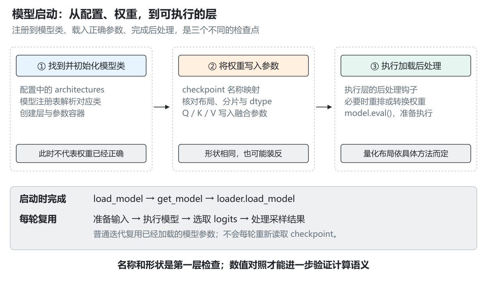
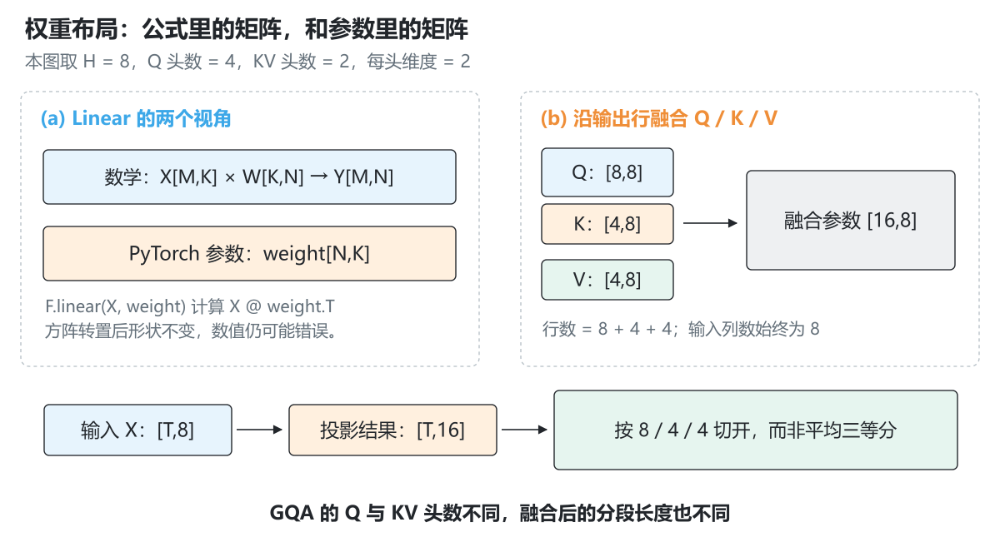
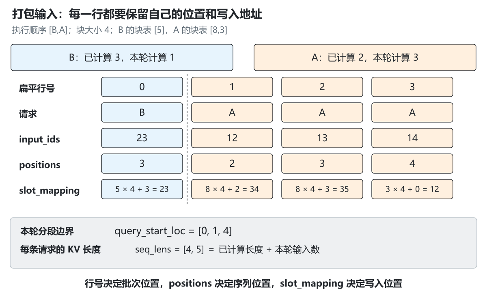
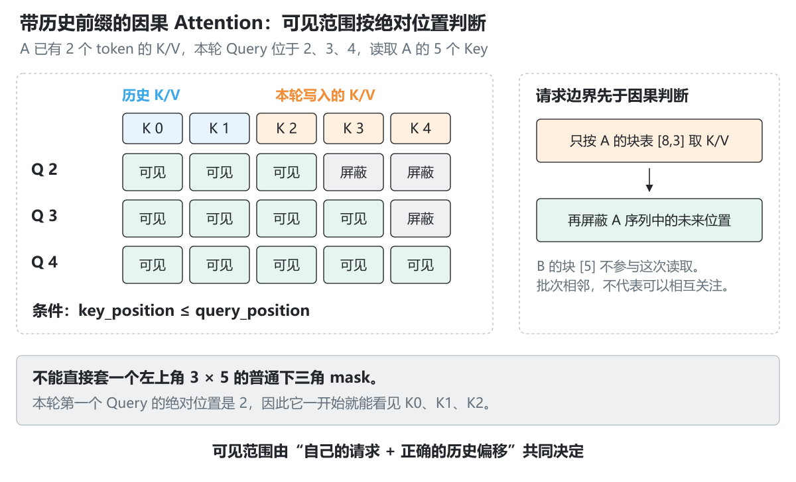
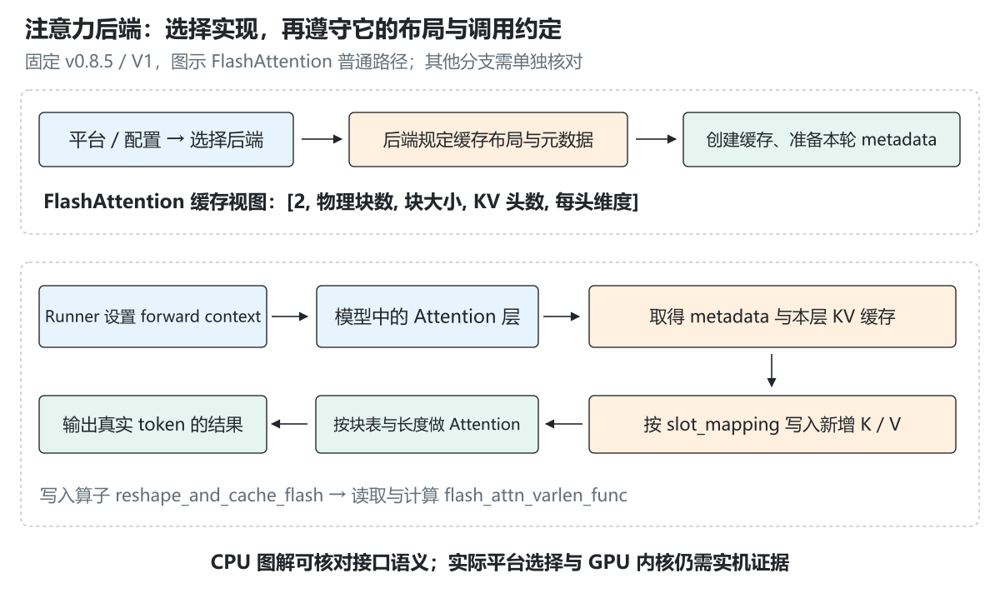
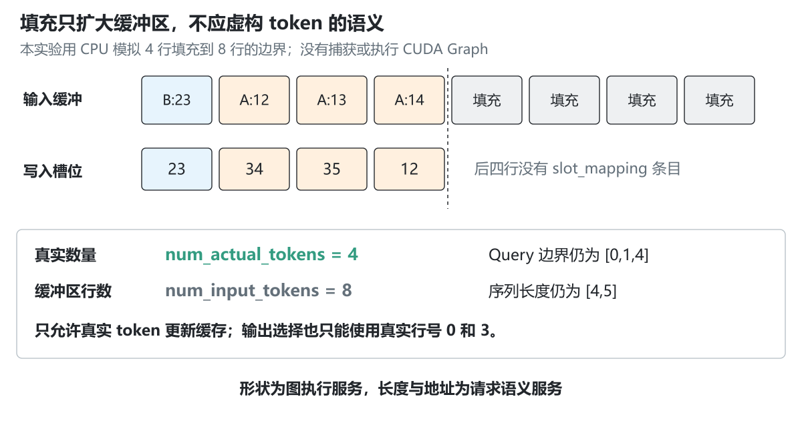
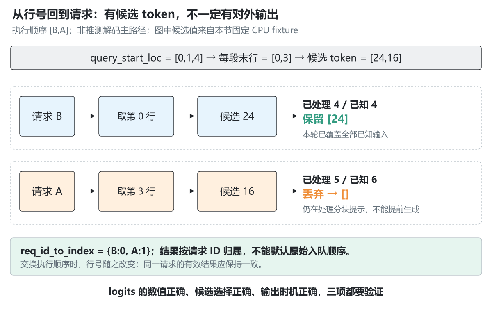

# 3.3 模型执行与注意力后端

[本篇目录](../README.md) · [全部课程](../../README.md) · [上一节 3.2](../02-scheduling-and-kv-management-in-vllm/README.md) · [下一节 3.4](../04-v1-and-modelrunner-evolution/README.md)

上一节，调度器决定了“这轮让 A 计算 3 个 token，让 B 计算 1 个 token，并给它们这些 KV 块”。但 GPU 不认识请求 ID，也不会直接执行一个 `SchedulerOutput`。执行侧还必须把计划翻译成张量，找到每个输入的位置和缓存地址，再把结果交回正确的请求。

这节围绕两个问题展开：**模型开始服务前，是怎样建立并装入权重的？每一轮执行时，调度计划又怎样到达具体的 Attention 和 Linear？**

我们继续固定 **vLLM v0.8.5 / V1**，提交 `ba41cc90e8ef7f236347b2f1599eec2cbb9e1f0d`。源码主线选择单卡、文本、Llama 类模型、未量化权重、完整注意力与普通解码；Attention 深入到这个版本的 V1 FlashAttention 实现。这里的分支和文件名不能直接当作其他版本或 MACA 适配分支的结论。

> **本节已提供：**正文、7 张中文原创图、输入打包与真实 CPU 张量实验、27 个固定源码函数定位、操作命令和练习答案。CPU 实验使用自建的单层 Attention 数值夹具，不是预训练 Llama，也没有运行 vLLM、FlashAttention GPU 内核或 A100/C500 实测。

## 阅读准备

- 前置：[2.1 模型基础](../../part-02-engine/01-pytorch-model/README.md)、[2.2 权重加载](../../part-02-engine/02-loading-real-model-weights/README.md)、[2.5 分页缓存](../../part-02-engine/05-paged-caching/README.md)、3.1—3.2。
- 只读源码和手算打包：Python 3.11+，标准库即可。
- 数值实验：CPU PyTorch，版本与安装命令见[实验页](lab.md)。没有 GPU 也能完成本节基础内容。
- 建议顺序：先看第 4—6 节的双请求例子，再回看加载与权重，最后跟进后端和输出。符号遇到不熟的，可以从下表查起。

| 符号 | 含义 | 本节小例子 |
| --- | --- | --- |
| R | 本轮有计算任务的请求数 | 2 |
| T | 本轮实际输入 token 总数 | 4 |
| Cᵢ / qᵢ | 第 i 条请求本轮开始前的计算长度 / 本轮安排量 | A 为 2/3，B 为 3/1 |
| H | 隐状态宽度 | 8 |
| Hq / Hkv | Query 头数 / KV 头数 | 4 / 2 |
| D | 每个注意力头的维度 | 2 |
| B | KV 块长；不要与名为 B 的请求混淆 | 4 |
| V | 词表大小 | 32 |

小尺寸只用于手算和 CPU 实验。**本节的块长 4、头维度 2 不满足所选 GPU FlashAttention 后端的尺寸要求**；不能把这份夹具参数直接拿去启动该后端。

[源码定位表](source-map.md) · [实验操作](lab.md) · [16 组练习与答案](exercises.md) · [实际记录](results/README.md)

## 1. 先把启动时和每轮执行分开

### 1.1 启动阶段准备长期存在的对象

模型类、参数、执行后端和缓存存储，不是每收到一个请求就重新加载一次。启动时要解析配置，找到模型实现，建立模块，写入权重，完成必要后处理，并根据设备与后端建立执行资源。模型加载、内存评估与缓存初始化的具体先后关系，仍要沿 Worker 启动代码阅读。

运行时，Runner 重复使用这些对象，更新变化的请求状态，准备本轮输入，执行前向，然后处理输出。

| 层次 | 主要责任 | 不要混淆 |
| --- | --- | --- |
| Executor | 组织 Worker 执行，具体方式由执行器决定 | 不直接等于模型结构 |
| Worker | 设备初始化、执行入口及资源管理 | 不负责决定所有请求的调度优先级 |
| ModelRunner | 模型加载、本轮状态与张量准备、执行和采样结果整理 | 调度器的 token 数还需要它翻译 |
| 模型模块 | Embedding、层结构、投影、Attention、MLP 等 | 能找到类名不代表权重已完整加载 |
| Attention 后端 | 元数据、KV 布局和执行实现 | 不只是一个内核函数名称 |

### 1.2 三段加载过程



*图 1：左到右是逻辑上的三个阶段。某个阶段成功不能代替后续阶段的检查。*

所选代码中，`GPUModelRunner.load_model()` 调用 `get_model()`，后者通过加载配置选择 loader。普通加载路径进入 `DefaultModelLoader.load_model()`：

1. `_initialize_model()`：解析模型架构并创建模块。
2. `model.load_weights(...)`：把加载器提供的参数写入模型。
3. `_process_weights_after_loading(...)`：完成权重后处理，再返回 eval 模式下的模型。

“初始化模型”可以只建立空参数及其布局；“加载 checkpoint”才把已有训练权重写进去。不能看到参数 shape 正确就认为内容正确，也不能把 `eval()` 当作“权重已经验证”的证据。`eval()` 主要改变模块的训练/推理行为，不负责证明参数来源。

## 2. 配置里的模型名，怎样找到实现

### 2.1 架构解析不是根据目录名猜类名

模型配置中的 `architectures` 可以提供模型架构名称。`get_model_architecture()` 经由 `ModelRegistry.resolve_model_cls()` 查找合适的实现。注册表把架构名称映射到实际模块与类；还可能涉及兼容处理或其他实现路径。

以本节选择的 Llama 实现为例，最终模型应具有前向、权重加载、logits 计算等接口。文件夹叫“某某模型”，并不能保证它就能由这个类正确解释；模型配置、参数命名和架构语义必须对应。

需要区分三种成功：

- **解析成功**：找到了一个可以实例化的模型类。
- **加载成功**：参数名、形状、分片或融合映射与所选实现相符。
- **数值正确**：实际前向与可信参考在约定容差内一致。

第二篇 2.2 的逐层对齐，就是在补第三种证据。注册表没有报错并不能替代它。

### 2.2 加载器与模型各自知道什么

加载器知道怎样寻找权重文件、按格式读出 `(name, tensor)`；模型知道这些参数怎样对应到自身模块。模型级加载再把具体参数交给参数绑定的 `weight_loader`，处理需要的融合区域或分片。

所以，checkpoint 中的 `q_proj.weight` 未必对应运行模型里一个同名、单独存在的参数。它可能和 `k_proj.weight`、`v_proj.weight` 一起装入一个 `qkv_proj`。

## 3. 权重布局：从 [K,N] 到融合 QKV

### 3.1 数学矩阵和 Linear 的存储方向

先暂时离开模型，用一个小矩阵说明方向。

数学记法：输入 X 的 shape 是 `[M,K]`，权重 W 的 shape 是 `[K,N]`，输出 `Y=XW` 的 shape 是 `[M,N]`。

PyTorch `F.linear(X, weight)` 接收的普通权重通常是 `[N,K]`，计算等价于 `X @ weight.T`。这里的 K 是输入特征数，N 是输出特征数；它们与注意力里的 Key/Value 没有直接关系。

```text
X = [[1,2,3],       W数学 = [[1,0],       W存储 = [[1,0,1],
     [4,5,6]]                [0,1],                [0,1,1]]
                             [1,1]]

X @ W数学 = F.linear(X, W存储) = [[4,5], [10,11]]
```

**不是把所有 checkpoint 都转置一次。** 如果文件里原本就是 Linear 的 `[out,in]`，加载时就应按对应契约写入。是否转置、重排或打包，取决于参数的真实格式和使用它的算子。

方阵更容易掩盖错误：`[8,8]` 转置后 shape 不变，但内容一般变了。只比较形状，不比较数值，可能让错误权重进入服务。

### 3.2 为什么 Q、K、V 可以融合一次投影

单卡 TP=1，设 H=8、Hq=4、Hkv=2、D=2：

| 参数 | 普通存储形状 | 输出形状 |
| --- | --- | --- |
| Wq | `[Hq×D,H] = [8,8]` | `[T,8]` |
| Wk | `[Hkv×D,H] = [4,8]` | `[T,4]` |
| Wv | `[Hkv×D,H] = [4,8]` | `[T,4]` |

把三份普通权重沿输出维，也就是第 0 维依次拼起来：

```text
Wqkv = cat([Wq, Wk, Wv], dim=0)       # [16,8]
QKV  = F.linear(X, Wqkv)              # [T,16]
Q, K, V = split(QKV, [8,4,4], dim=-1)
```



*图 2：普通 TP=1 浮点权重按输出行拼接；融合后的结果仍要按准确的 Q/K/V 宽度拆开。*

GQA 下 Q 的头数与 KV 头数不同，不能默认把 QKV 输出平均分成三份。所选 Llama 实现中，`LlamaAttention.forward()` 用 `q_size、kv_size、kv_size` 分割输出。

融合投影允许一次算出三组结果，但实际收益还取决于尺寸、实现、设备和运行方式。本节只验证数值一致，不根据矩阵调用次数推断加速比例。

### 3.3 正式加载与教学拼接之间的区别

`LlamaModel.load_weights()` 有一张映射表，把 q/k/v 参数名映射到 `qkv_proj`，同时传入 `shard_id`。`QKVParallelLinear.weight_loader()` 根据这个标识找到目标区域，必要时还处理 TP 切片、复制和特殊格式。

本节只实现未量化、TP=1、普通 `[out,in]` 的拼接。量化权重可能有打包轴、分组 scale、zero point、额外排列和专用 loader，不能把上面的 `cat()` 直接套过去。

加载后的 `process_weights_after_loading()` 也不是装饰步骤：具体方法可能重打包、量化、调整存储或建立内核所需状态。对我们后续的量化算子课来说，需要逐项说清“文件里的布局”“运行时参数布局”“内核实际读取布局”，并验证每次转换。这里先把接口位置找到，具体算子放到量化章节展开。

### 3.4 Linear 最后调用到哪里

在本节未量化路径中，可以沿以下入口追踪：

```text
ColumnParallelLinear.forward
  → self.quant_method.apply
  → UnquantizedLinearMethod.apply
  → dispatch_unquantized_gemm()
```

所选源码的 `dispatch_unquantized_gemm()` 对非 ROCm 路径返回 `torch.nn.functional.linear`。再往下会由 PyTorch 和设备库选择具体计算实现；**不能仅凭这一行静态源码报告某个固定 CUDA kernel 名称**。量化路径则可能调用完全不同的算子，方法名中的 `quant_method` 也不表示当前一定启用了量化。

## 4. Runner 需要同时维护请求状态和执行排列

### 4.1 请求身份不能用 batch 下标代替

`GPUModelRunner._update_states()` 维护两类东西：

- `self.requests`：按请求 ID 保存的状态，包括 token 历史、已计算长度、块编号等。
- `InputBatch`：本轮执行所需的批次排列和持续复用的 CPU/GPU 缓冲。

请求本轮没被调度，可以从批次中移除，却仍保留请求状态，等待以后恢复。真正结束时，才做相应清理。新请求加入、旧请求结束或批次空位压紧，都可能改变某个请求所在的行号。

`InputBatch.condense()` 会填补空位。部分后端还可以通过 `reorder_batch()` 调整排列；**本节所选 FlashAttention builder 的这个方法直接返回 False**，不能说每个后端每轮都在重排。

即使没有后端主动重排，也仍应使用本轮 `req_id_to_index`。请求 A 从第 0 行变到第 1 行，并没有变成请求 B。

### 4.2 为什么不能读取调度器已经推进的 C

3.2 讲过，调度器可以在返回计划前，把自己的实时 C 提前加上本轮安排量。执行侧需要的是这轮输入的**起点**，即调度消息中携带的本轮开始前的计算长度。

例如 A 原来 C=2，计划计算 3 个位置，本轮应读取位置 2、3、4。如果误用已推进的 C=5，再加 3，就会读到 5、6、7，既漏算原本的工作，也可能超出已知序列。下面的例子里，C 都指执行侧这轮收到的旧进度。

## 5. 把两个请求打包成一条 token 流

### 5.1 沿用 3.1 的输入，但这次把运算做出来

| 请求 | 已知 token IDs | C | 本轮 q | 块表 |
| --- | --- | --- | --- | --- |
| A | `[10,11,12,13,14,15]` | 2 | 3 | `[8,3]` |
| B | `[20,21,22,23]` | 3 | 1 | `[5]` |

设本轮执行排列为 `[B,A]`，块长为 4。A 仍在分块 Prefill：这轮只处理 12、13、14，最后的 15 尚未安排。B 只差位置 3 的 token 23，处理完就追平已知序列。

请先记住：本例是为了复用 3.1 源码阅读时的数字而独立构造的一轮输入，不是 3.2 三轮调度表的下一轮。



*图 3：扁平数组的第几行、请求内的第几个位置、缓存里的第几个槽位，分别回答不同的问题。*

### 5.2 input_ids：取出真正要计算的 token

B 取 `token_ids[3:4]`，A 取 `token_ids[2:5]`，按照执行顺序拼接：

```text
input_ids = [23, 12, 13, 14]
所属请求  = [ B,  A,  A,  A]
```

T=4，是本轮输入位置数量；R=2，是请求数量。原来两条完整已知序列的总长度为 10，但这一轮不用把全部历史重新送进投影层。历史 K/V 已经在缓存中。

### 5.3 positions：每条请求自己的位置

```text
positions = [3, 2, 3, 4]
```

它不是 `[0,1,2,3]`，也不是每个新块从 0 重新计数。A 的新块接在已计算前缀之后，因此起点是 2。RoPE 等位置计算需要这一语义；如果错用了扁平 batch 行号，代码可能照样运行，但模型看到的相对位置已经变了。

### 5.4 slot_mapping：这些新 K/V 应写到哪里

对任意请求内的位置 p：

```text
逻辑块号 = p // B
块内偏移 = p % B
物理块号 = block_table[逻辑块号]
slot     = 物理块号 × B + 块内偏移
```

| 输入行 | 请求/位置 | 逻辑块号 | 物理块号 | 偏移 | slot |
| --- | --- | --- | --- | --- | --- |
| 0 | B / 3 | 0 | 5 | 3 | 23 |
| 1 | A / 2 | 0 | 8 | 2 | 34 |
| 2 | A / 3 | 0 | 8 | 3 | 35 |
| 3 | A / 4 | 1 | 3 | 0 | 12 |

所以 `slot_mapping=[23,34,35,12]`。从 35 跳到 12 没有问题：逻辑上连续的两个块，在物理存储中可以不连续。

这里的 slot 编号用于表达“哪个块的哪个 token 槽位”，不是一个字节偏移；真实访问还要带上层、K/V、KV head、head dimension 和 dtype 对应的布局信息。

### 5.5 query_start_loc：把边界编码成累计长度

B 有 1 个 Query，A 有 3 个 Query，因此：

```text
本轮各段长度      = [1,3]
query_start_loc   = [0,1,4]
B 的 Query 行区间 = [0,1)
A 的 Query 行区间 = [1,4)
```

方括号左闭右开：`[1,4)` 包含第 1、2、3 行。累计边界数组总长为 R+1，最后一个元素等于实际 token 总数 T。

`seq_lens` 表达的是各请求在本轮计算后的有效 KV 总长度：

```text
seq_lens = [3+1, 2+3] = [4,5]
```

因此 Query 长度 `[1,3]` 和 KV 长度 `[4,5]` 不同。Decode 本轮只有一个 Query，也仍然要访问此前的历史 KV。

## 6. 一层 Attention 的张量怎样走

### 6.1 从输入到 Q/K/V

以数值夹具为例，T=4：

| 步骤 | 张量形状 | 解释 |
| --- | --- | --- |
| Embedding | `[4,8]` | 每个输入 token 变成宽度 8 的向量 |
| 融合 QKV 投影 | `[4,16]` | 同时得到 Q 的 8 维、K/V 各 4 维 |
| Q reshape | `[4,4,2]` | 4 个 token、4 个 Query heads、每头 2 维 |
| K/V reshape | 各 `[4,2,2]` | KV 只存 2 个 heads |
| RoPE | 形状保持 | 使用 `[3,2,3,4]`，旋转 Q 和 K |
| Attention 输出 | `[4,4,2]` | 每个 Query head 得到自己的结果 |
| 合并头、输出投影 | `[4,8]` | 回到隐状态宽度 |

真实 Llama 层还有归一化、残差与 MLP 等结构。这里的数值夹具只保留 Embedding、Attention、输出投影、一个残差和词表头，便于定位索引错误；它没有资格代表完整预训练模型的质量。

### 6.2 GQA 共享的是 KV head，不是跨请求的内容

本例 Hq/Hkv=2。Query heads 0、1 使用 KV head 0；Query heads 2、3 使用 KV head 1。

```text
Query head      0   1   2   3
使用的 KV head  0   0   1   1
```

生产内核可以直接索引对应的 KV head，不一定要把缓存复制成 4 个 heads。我们的分页计算按组索引，独立 dense 参考则使用重复展开，两者进行数值对齐。

这里的共享只指一条请求内部多组 Query 使用较少的 KV heads。前缀缓存中不同请求共享物理块，是另一种共享机制；本节夹具明确禁止不同请求的块表重叠，避免把两个问题混在一起。

### 6.3 新 K/V 已全部写入，为什么还要因果掩码

本轮 A 的位置 2、3、4 的 K/V 都可能先写入缓存，再统一计算 Attention。但位置 2 的 Query 只能读取位置 0、1、2，不能因为位置 4 已写入，就提前看见它。



*图 4：掩码依据请求内绝对位置。A 的 3 个新 Query 对应位置 2、3、4，面对的 Key 总长是 5。*

A 这一段的可见矩阵如下，1 表示可读：

```text
                Key 位置 0  1  2  3  4
Query 位置 2             1  1  1  0  0
Query 位置 3             1  1  1  1  0
Query 位置 4             1  1  1  1  1
```

如果只根据“本块 Query 是第 0、1、2 行”做左上角三角形，第一行就只能读 Key 0，错误地丢掉历史与当前位置。需要保留 C 带来的偏移。

另一方面，把整个扁平输入当成一条序列做 Attention，也会把 B 的内容暴露给 A。分段边界和块表共同维持请求隔离。实验会分别改变“同请求的未来 token”和“另一条请求的全部历史”，确认不该受影响的行保持不变。

## 7. 注意力元数据：少一个字段，含义就可能改变

`FlashAttentionMetadataBuilder.build()` 将本轮准备好的信息组装成后端使用的结构。可以把它看作 Attention 执行时的说明书。

| 字段 | 作用 | 常见错误 |
| --- | --- | --- |
| `num_actual_tokens` | 真正有任务的 token 数 | 把补齐缓冲当成真实工作 |
| `query_start_loc` | 每条请求本轮 Query 的起止边界 | 把各段长度直接当累计边界 |
| `seq_lens` | 各请求可参与本轮计算的 KV 长度 | 只填写本轮 q，丢掉历史 |
| `block_table` | 每条请求的逻辑块到物理块的映射 | 按错误 batch 行取块表 |
| `slot_mapping` | 本轮 K/V 的写入位置 | 用 token ID 当地址，或重复使用同一写槽 |
| `max_query_len` / `max_seq_len` | 这批请求中对应长度的最大值 | 把总长度和最大长度互换 |

主例中 `max_query_len=3`，`max_seq_len=5`。它们都不是 T=4。

`slot_mapping` 主要解决本轮新 K/V **写在哪里**；`block_table + seq_lens + 因果规则` 解决每条 Query **读哪些历史内容**。一个写入数组不能独自表达完整读取规则。

源码里 `set_forward_context(attn_metadata, ...)` 在本轮前向期间保存这些信息。模型层可以只调用 `self.attn(q,k,v)`，由 Attention 包装层获取上下文中的 metadata、对应层的 KV 存储和实现对象。没有在每个模型函数签名里显式出现，不代表元数据不参与执行。

## 8. 从 Attention 包装层到实际算子入口



*图 5：后端承担布局、元数据和具体执行。图中底部是所选源码的算子入口；实际设备内核与耗时仍需运行观察。*

### 8.1 一个后端提供的不只是 forward

以本节 FlashAttention 后端为例，它提供实现类、元数据 builder，以及 KV Cache 的形状约定。`GPUModelRunner.initialize_kv_cache()` 根据后端给出的 shape 创建存储，并绑定到模型的 Attention 层。

所选后端的布局为：

```text
[2, num_blocks, block_size, num_kv_heads, head_size]
 ↑
 K / V
```

这是**这个后端**的约定，不是所有 vLLM Attention 后端的通用布局。这里的形状通常对应某个层的存储；整个模型还有多个层的缓存组织。换后端时，不能只换一个函数名，却沿用不匹配的 KV 存储解释。

该版本的 `get_kv_cache_shape()` 要求 block size 是 16 的倍数，支持的 head size 也有明确列表。正文采用 B=4、D=2 只是让计算过程能放进一张表；我们的 CPU 夹具接受它们，不意味着 GPU 后端接受。

### 8.2 普通 FlashAttention 路径先写，再读

`LlamaAttention.forward()` 先做 QKV 投影和 RoPE，然后进入 `Attention.forward()`。根据包装方式，可能直接调用 `self.impl.forward()`，也可能经过 `unified_attention_with_output` 这一自定义算子包装，再取出具体实现。

在本节非 cascade、非局部注意力的 `FlashAttentionImpl.forward()` 中，重点看两个入口：

1. `torch.ops._C_cache_ops.reshape_and_cache_flash(...)`：依据 `slot_mapping` 把新 K/V 写进对应缓存槽。
2. `flash_attn_varlen_func(...)`：读取分页 KV，结合 Query 边界、各请求长度、块表和 `causal=True` 计算输出。

第一个名字里的 `flash` 不表示它本身完成了整个 Attention；这里应先辨认“缓存写入”和“注意力计算”是两个任务。所选路径的第二个调用接收的 K/V 是缓存张量，不只是本轮新投影出来的那一小段 K/V。

FlashAttention 和分页缓存也不是互斥概念：前者关心注意力计算怎样组织，后者关心历史 K/V 怎样存放和寻址。这个后端把它们连接起来。

### 8.3 静态入口与运行证据的区别

找到 Python 调用可以回答“这条路径可能调用什么”，但还不能证明当前环境成功载入了对应扩展、走到这一分支，或用了某个特定的设备内核。编译、图捕获、dtype、设备库版本都会影响最后的执行形态。

因此本节的源码表写到 **算子入口**；以后设备实验需要补充实际平台、版本、后端选择日志、运行成功记录及必要的性能追踪，不能把源码类名当作实机证据。

## 9. 后端是怎样选出来的：CUDA 与 MACA 要分别验收

`get_attn_backend()` 把 head size、dtype、KV dtype、block size、是否 V1、是否 MLA 等条件传给选择逻辑。普通主路径还会检查全局强制设置和环境变量，之后交给 `current_platform.get_attn_backend_cls(...)`。

注意，这些条件不一定都在同一层一次性验证：有的决定平台分支，有的在后端初始化或形状检查时才报错。环境变量写了一个名字，不代表运行已经成功采用它。

在所选 CUDA V1、非 MLA 分支中，源码可选择显式指定的 FlashInfer 或 Triton 路径；满足对应设备能力条件时也会返回 V1 FlashAttention 路径。后续还要满足该实现和构建环境的要求。我们固定一条路径讲解，并没有声称它覆盖了当前所有 vLLM 后端。

| 实验层次 | NVIDIA A100 路径 | 沐曦 C500 路径 |
| --- | --- | --- |
| 本节已完成 | 同一套 CPU 输入契约、张量参考与固定源码阅读 | 同一套 CPU 输入契约与张量参考 |
| 设备准备 | 固定 CUDA/PyTorch/vLLM/扩展版本 | 固定官方 MACA 软件栈及对应 vLLM 适配版本 |
| 需要记录 | 实际平台、后端类、支持的 dtype/块长/头维度、运行结果 | 实际平台、适配源码、后端类及同样的输入/输出条件 |
| 数值验收 | 与可信参考比较 logits 或中间张量 | 在对应支持的精度与容差下做同样的比较 |

C500 不能因为拥有类似 API 就被视为 CUDA 后端已经验证。跨平台首先统一数学语义与输入契约，再核对各自的布局、算子和支持条件。性能比较还必须说明模型、负载、精度与计时边界。

## 10. 有效 token 数和补齐后的缓冲长度

某些执行模式为了复用预先准备的形状，会把 T 补到更大的缓冲长度。例如本轮 T=4，执行缓冲补到 8。多出来的行不是新请求，也不是用户多生成了 4 个 token。



*图 6：为了说明边界，实验把缓冲从 4 行补到 8 行。它没有捕获或回放 CUDA Graph，也不测量图模式收益。*

所选 Runner 分别记录实际调度量和 `num_input_tokens`。模型前向可以使用补齐后的输入，但后端必须正确排除无效工作。例如所选 FlashAttention 的缓存写入算子依据未补齐的 `slot_mapping` 长度处理真实 token；注意力计算使用 `num_actual_tokens` 范围，最后 Runner 也裁回实际隐状态范围。

我们在 CPU 实验里让额外 4 行真的经过 Embedding 和投影，但不给它们 KV 写地址，并把其内容改成另一个合法 token。预期：4 个真实位置的 logits 不变、写入集合不变、未使用的物理位置仍然是 NaN。这样比只在报告里写一句“忽略 padding”更容易发现边界错误。

补齐的输入值还必须满足所经过算子的基本索引要求。比如 Embedding 会查词表，就不能随便把 padding token ID 填成词表之外的整数。占位 token 的取值和它是否产生真实请求结果，是两件事。

## 11. 从隐藏状态到候选，再回到请求

### 11.1 一轮多个输入，不等于要返回同样多的 token

本例模型产生 T=4 个位置的隐藏状态。普通非推测路径中，Runner 用：

```text
logits_indices = query_start_loc[1:] − 1
               = [1,4] − 1
               = [0,3]
```

取出 B 这一段的最后一行，以及 A 这一段的最后一行，再计算用于采样的 logits。真实模型通常先选出所需隐藏状态再过词表头，以避免为所有输入位置计算同样的采样 logits。为了更细地做数值对齐，本节 CPU 夹具保留全部 4 行词表输出，再选择两行；这处实现顺序不同，正文中的形状表已分别说明。

T 是本轮输入数量；普通路径的候选行数可以是 R；真正保留并返回的输出数量又可能小于 R。三者不要画成同一个数字。

### 11.2 A 还有一个提示 token 没处理，候选怎么办



*图 7：同一批次里两条请求都可能形成候选行，但部分 Prefill 的候选要被丢弃。图示数值来自本节默认 float64 夹具的实际计算。*

固定快照的 `_prepare_inputs()` 为各段准备最后行索引；`execute_model()` 在普通采样后发现 `seq_len < req_state.num_tokens` 的请求属于部分 Prefill，就清空其候选列表。对某些带独立随机生成器的路径，源码还会回退生成器状态，避免这个被丢弃的候选无意中消耗后续采样序列。

本节用 greedy argmax，完全不实现随机状态回退；但保留“先形成候选，再按进度过滤”的可见边界。

默认 float64、固定种子的数值夹具实际得到：

```text
执行顺序          [B, A]
候选 token IDs    [24, 16]
返回给请求        {B: [24], A: []}
```

这里的 24、16 是小型随机参数夹具算出的词表下标，不是自然语言回答。3.1 的 24 是当时手工设定的示意输出；本节记录来自新程序的真实计算，二者证据来源不同。

`ModelRunnerOutput` 带有请求 ID 和行映射，调度器应按它对应结果。不能拿“请求最初登记顺序 `[A,B]`”直接套到“本轮执行顺序 `[B,A]`”，否则就会把输出还错请求。

### 11.3 为什么正确性不能只比最终 token

两个不同的 logits 向量可能具有相同的最大值位置，因此最终 token 一样，不能证明计算相同。反过来，极其接近的前两名在浮点误差下交换顺序，也需要先检查误差量级，而不是立即断言索引错误。

本节首先对齐每个请求、每个有效输入位置的完整 logits，再检查输出归属和候选过滤。默认 float64 数值记录中最大绝对误差约为 `2.22e-16`，判定容差为 `1e-11`；float32 使用独立记录和 `2e-5` 容差，不把某台 CPU 的末位误差写成所有环境必须完全一致的输出。

## 12. 本节代码怎样帮助你定位问题

| 文件 | 职责 |
| --- | --- |
| [reference/execution.py](../../../../zero2vllm/reference/execution.py) | 纯标准库输入打包、边界校验、结果归属与部分 Prefill 过滤 |
| [modeling/packed_attention.py](../../../../zero2vllm/modeling/packed_attention.py) | CPU 单层 Attention 夹具、普通 QKV 融合、RoPE、GQA、物理 KV 张量和独立 dense 对照 |
| [lesson0303.py](../../../../scripts/experiments/lesson0303.py) | 实验组织、JSON 记录和可选固定源码核验 |
| [输入数据](data/requests.json) | 本页 A/B 的 token、旧进度、安排量与块表 |

每次夹具实验都会重新建立此前 C 个位置的 KV，再执行这一轮；它不是一个跨轮持久化服务，也没有重新实现调度器。这样可以把错误集中在“这一份计划怎样变成正确计算”，不会与上一节的准入策略混在一起。

后续接入更多执行优化时，建议按这个顺序排查：

1. 先看请求 ID、执行排列和各段边界是否一致。
2. 再看 positions、块表与写入地址，确认历史没有越界或串请求。
3. 核对 Q/K/V 形状、权重方向、GQA 分组与因果可见性。
4. 最后检查 dtype、具体后端、图模式和算子实现，并做数值对照。

即使是在做量化加速，前面这些契约也应先成立。否则量化误差、布局错误和缓存索引错误会混成同一份异常输出，很难判断问题出在哪一层。

## 13. 动手入口与验收

从仓库根目录运行：

```bash
python -m scripts.experiments.lesson0303 --mode metadata
python -m scripts.experiments.lesson0303
python -m unittest tests.reference.test_execution tests.modeling.test_packed_attention -v
```

第一条不需要 PyTorch；第二条完成 12 个打包与张量案例；第三条覆盖 30 项新增检查。安装、float32 对照、源码准备、可调短示例、输出字段和故障排查见[实验页](lab.md)。

完成这节，应能不看答案写出本例的五组关键数组，并解释：为什么位置编号会倒退、物理 slot 会跳跃；为什么已经写入未来 K/V，过去 Query 仍不能读取；为什么 4 个实际输入、2 个候选，最终只留下 1 个新输出。

## 14. 公开参考资料与下一节

以下均固定到同一份官方提交。源码文件和具体函数行号可在[定位表](source-map.md)逐项打开。

- [GPUModelRunner](https://github.com/vllm-project/vllm/blob/ba41cc90e8ef7f236347b2f1599eec2cbb9e1f0d/vllm/v1/worker/gpu_model_runner.py)：加载、本轮状态、输入准备、模型前向与输出处理。
- [模型加载器](https://github.com/vllm-project/vllm/blob/ba41cc90e8ef7f236347b2f1599eec2cbb9e1f0d/vllm/model_executor/model_loader/loader.py)、[注册表](https://github.com/vllm-project/vllm/blob/ba41cc90e8ef7f236347b2f1599eec2cbb9e1f0d/vllm/model_executor/models/registry.py)：类解析、权重加载和后处理。
- [Llama 实现](https://github.com/vllm-project/vllm/blob/ba41cc90e8ef7f236347b2f1599eec2cbb9e1f0d/vllm/model_executor/models/llama.py)、[Linear 实现](https://github.com/vllm-project/vllm/blob/ba41cc90e8ef7f236347b2f1599eec2cbb9e1f0d/vllm/model_executor/layers/linear.py)、[GEMM 分派](https://github.com/vllm-project/vllm/blob/ba41cc90e8ef7f236347b2f1599eec2cbb9e1f0d/vllm/model_executor/layers/utils.py)：融合映射、前向与未量化算子入口。
- [Attention 包装层](https://github.com/vllm-project/vllm/blob/ba41cc90e8ef7f236347b2f1599eec2cbb9e1f0d/vllm/attention/layer.py)、[后端选择](https://github.com/vllm-project/vllm/blob/ba41cc90e8ef7f236347b2f1599eec2cbb9e1f0d/vllm/attention/selector.py)、[CUDA 平台分支](https://github.com/vllm-project/vllm/blob/ba41cc90e8ef7f236347b2f1599eec2cbb9e1f0d/vllm/platforms/cuda.py)：模型接口怎样到达实际后端。
- [V1 FlashAttention 后端](https://github.com/vllm-project/vllm/blob/ba41cc90e8ef7f236347b2f1599eec2cbb9e1f0d/vllm/v1/attention/backends/flash_attn.py)：布局约束、元数据、KV 写入与变长 Attention 调用。

下一节 [3.4 V1 与 ModelRunner 演进](../04-v1-and-modelrunner-evolution/README.md)会在这些具体契约的基础上比较执行架构，避免只根据名字相似就把不同时期的实现拼在一起。
