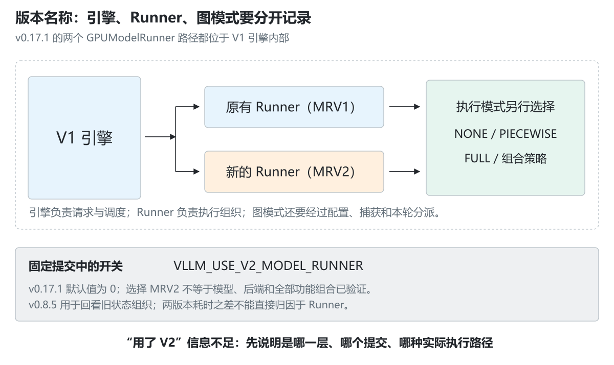
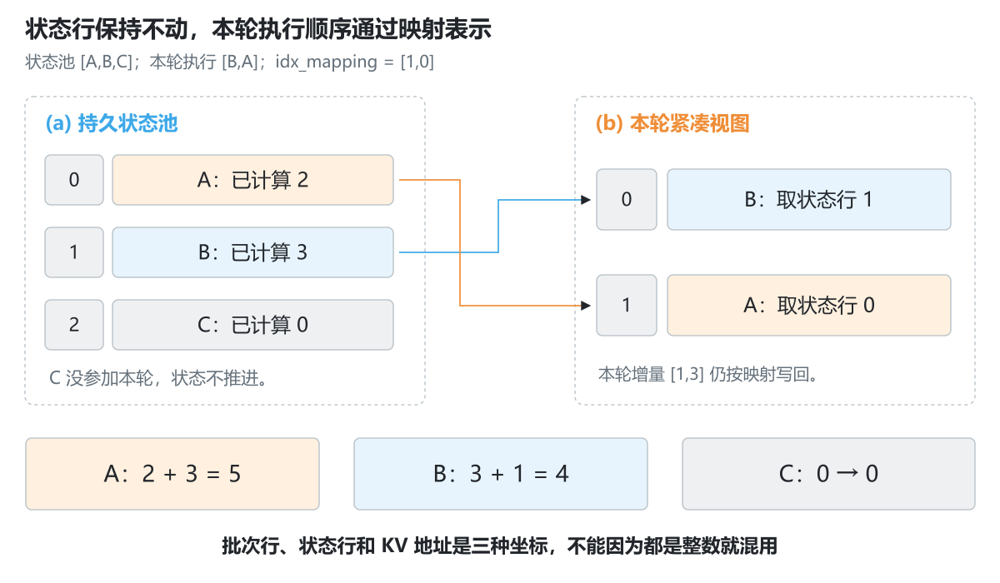
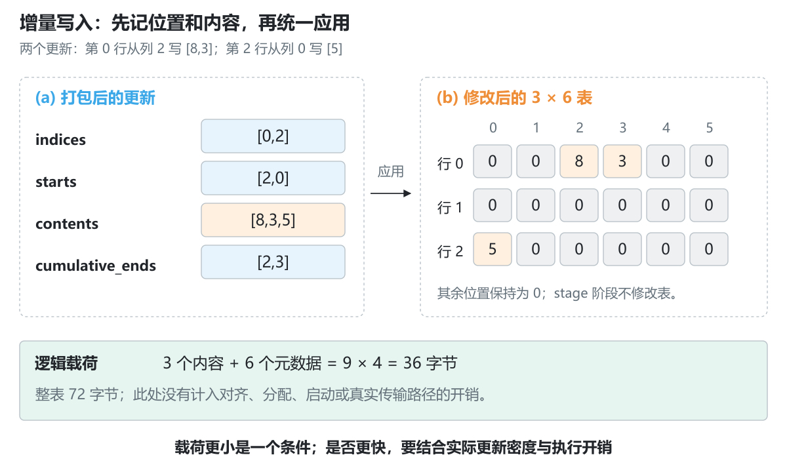
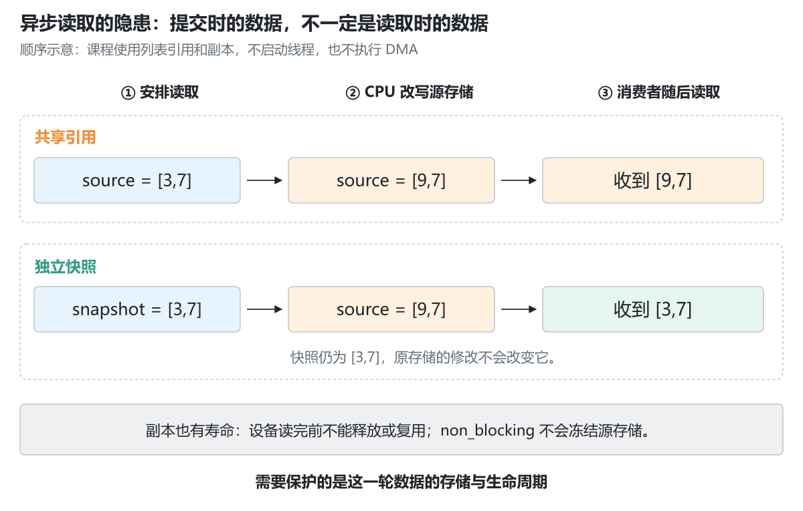
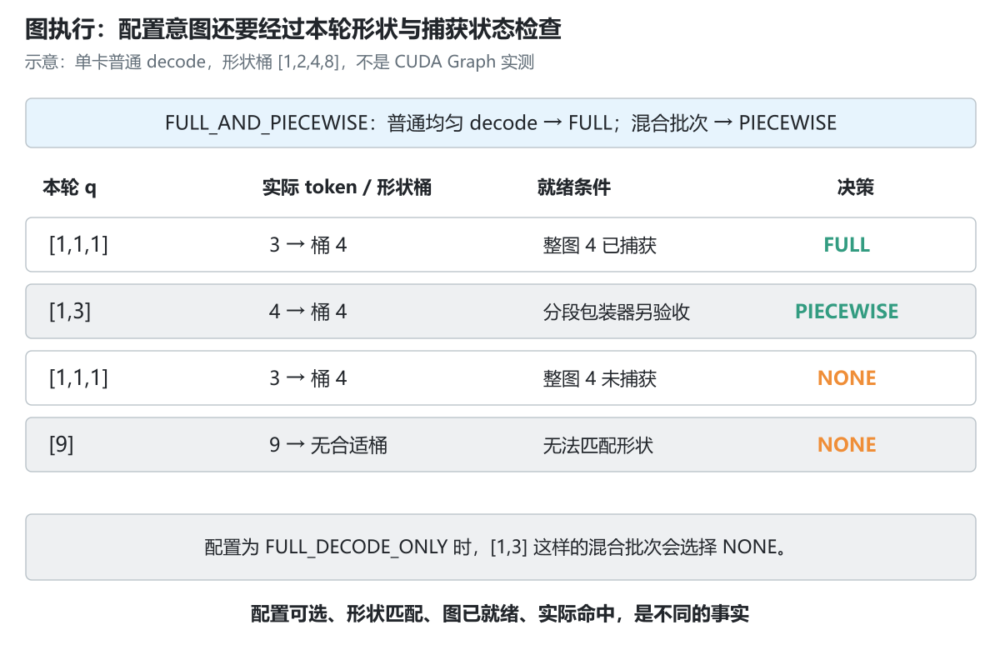
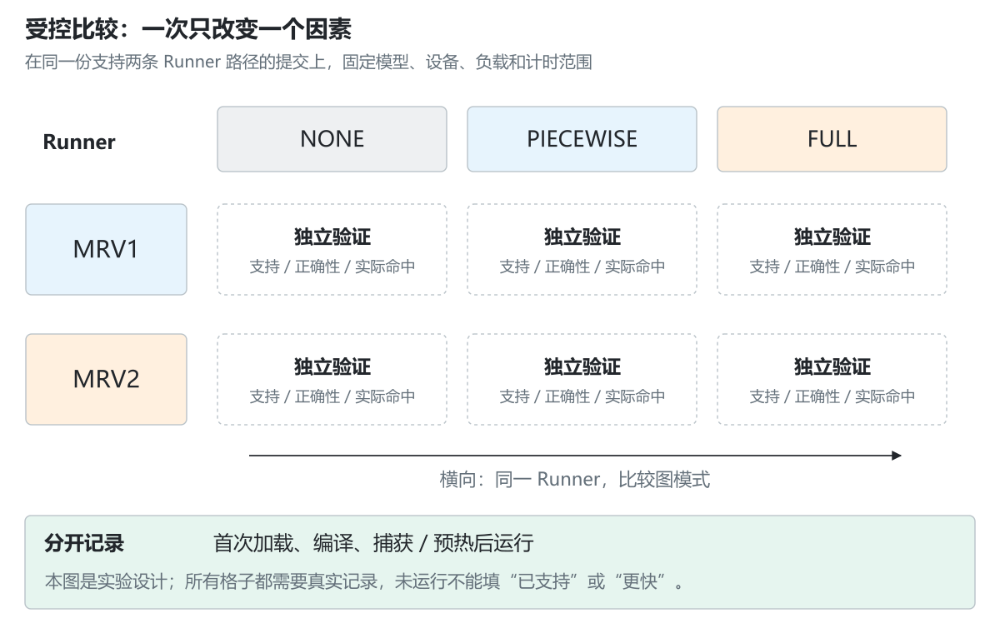

# 3.4 V1 与 ModelRunner 演进

[本篇目录](../README.md) · [全部课程](../../README.md) · [上一节 3.3](../03-model-execution-and-attention-backends/README.md) · [下一节 3.5](../05-resolving-configuration-and-capabilities/README.md)

3.3 里，我们把一份调度计划变成了 `input_ids`、位置、KV 地址和候选输出。即使 GPU 前向已经很快，执行侧仍要在每一轮整理这些信息：请求走了要清理，新请求来了要填数据，顺序变了要同步修改索引。模型越小、单轮工作越短，这些准备工作的影响越容易显现。

这一节讨论的就是：**怎样组织状态和执行流程，才能减少重复整理，同时保持请求身份、长度和输出的正确性？**

先让三个请求进出一个小状态池，观察每一轮的状态变化。看懂这个例子后，再阅读 MRV2 的状态管理、增量写入、GPU 元数据与图执行代码。

## 阅读与实验入口

- 前置：3.1—3.3；需要理解请求 ID、批次行、`positions`、KV 块表，以及已知长度和已计算长度的区别。
- 环境：Python 3.11+，实验全部使用标准库，不要求 PyTorch 或 GPU。
- 配套：[实验步骤](lab.md) · [14 组练习](exercises.md) · [固定源码定位](source-map.md) · [实际记录](results/README.md)。
- 本节有 6 张中文原创图、10 个 CPU 案例。案例验证状态和数学语义；没有运行上游 runner、异步 DMA、UVA、Triton 或 CUDA Graph。

## 1. 先分清三个版本名

### 1.1 引擎架构和 runner 实现不是同一个维度

“vLLM V1”说的是引擎架构这一层：请求怎样进入引擎核心，调度和执行怎样交换信息，状态怎样向前推进。

“ModelRunner V2”，常缩写为 MRV2，说的是执行侧的一次重构：请求状态怎样存、输入怎样准备、采样怎样组织、图怎样捕获和重放。它位于 V1 引擎内部，不意味着又出现一个名叫“vLLM V2”的引擎。

为了避免术语混淆，本文用 **MRV1** 指对照版本里原有的 GPUModelRunner 路径，用 **MRV2** 指新的 `worker/gpu/` 路径。不要据此给历史代码补上它当时没有声明过的功能。



*图 1：三个维度需要分别记录，不能用一个“V2 已开启”概括整个执行环境。*

### 1.2 本节固定两份源码

| 阅读对象 | 固定版本与提交 | 用途 |
| --- | --- | --- |
| 前三节的基线 | v0.8.5；`ba41cc90e8ef7f236347b2f1599eec2cbb9e1f0d` | 回看 `_update_states`、`InputBatch.condense` 和原有输入准备 |
| MRV2 对照 | v0.17.1；`95c0f928cdeeaa21c4906e73cee6a156e1b3b995` | 查验 V1 Worker 的 runner 选择、稳定状态、增量写入与图管理 |

这是一组教学对照，不是“最新版本推荐”。也不能直接把两个版本的性能差当成 MRV2 收益：版本之间还有许多其他变化。

v0.17.1 的 `Worker` 读取 `VLLM_USE_V2_MODEL_RUNNER`，并在设备初始化中选择：

```text
未选择 MRV2：vllm/v1/worker/gpu_model_runner.py
选择 MRV2：  vllm/v1/worker/gpu/model_runner.py
```

注意两者都位于 `v1`。该固定版本中，这个环境变量的默认值为 0；以后版本的默认值需要重新核验。仅设置变量也不代表某个设备、模型和全部功能组合已运行成功。

## 2. 为什么持久状态和执行排列需要分开

### 2.1 从每轮重建，到保留大部分状态

假设有 128 条活跃请求，每条都有 token 历史、块表、采样参数和已计算长度。下一轮通常只有少量请求结束或加入。如果每轮都把所有信息从 Python 对象重新拼成张量，会反复做大量已经做过的工作。

持久化 batch 的出发点很自然：保留大部分数据，只更新变化的部分。

但接着出现一个问题：**长期状态的排列，是否必须与这一轮模型输入的排列完全相同？**

如果要求相同，某条请求离开形成空洞，或者后端需要不同顺序，就可能同时搬动 token 表、块表、温度、随机种子等多组状态。少搬一组，就可能把 A 的 logits 配上 B 的采样参数。

### 2.2 回看 v0.8.5 的做法

3.3 已经读过两类对象：

- `self.requests` 按请求 ID 保留 `CachedRequestState`。
- `InputBatch` 保留批次缓冲与对应索引。

请求暂时没被调度时，可以从 batch 中移除，但继续保留请求级状态；batch 有空位时，`condense()` 把后面的有效行搬过来。这样实现了连续缓冲，却需要同时维护两处相关信息。

不要把“旧实现有状态整理”理解成“每轮都复制完整状态”，也不要说“所有后端每轮都主动重排”。需要看这一轮实际发生了哪些增删，以及所选后端是否要求调整排列。

### 2.3 MRV2 的稳定槽位

在选定 MRV2 源码里，`RequestState` 为驻留执行侧的请求分配槽位。一个请求在这段驻留期间保持自己的行号；本轮不执行它，不需要仅为了压紧当前 batch 而搬动它。

当前 step 另外形成一份紧凑的逻辑排列，通过 `idx_mapping` 访问状态池：

```text
batch_idx → req_state_idx → 请求状态
```

这里的状态槽位不是 3.3 的 KV slot：

| 名称 | 指向什么 |
| --- | --- |
| batch_idx | 本轮执行列表中的第几条请求 |
| req_state_idx | 持久请求状态表中的第几行 |
| KV slot | 某个物理 KV 块里的某个 token 位置 |

它们都可能是整数，但不能互换。

## 3. 三个请求，把映射走一遍

### 3.1 状态不动，执行顺序改变

我们构造一个有 3 行的状态池：

| 状态行 | 请求 | token 历史 | 已计算长度 C |
| --- | --- | --- | --- |
| 0 | A | `[10,11,12,13,14]` | 2 |
| 1 | B | `[20,21,22,23]` | 3 |
| 2 | C | `[30,31]` | 0 |

这一轮执行 `[B,A]`，分别处理 1 和 3 个位置。于是：

```text
req_ids      = [B,A]
idx_mapping  = [1,0]
本轮安排量   = [1,3]
```

模型需要的视图是 B 在前、A 在后，但状态池仍然是 `[A,B,C]`。更新完成后，应有 `A.C=5、B.C=4、C.C=0`。C 没有参与这一轮，不应被意外推进。



*图 2：gather 按映射取状态，反馈也要按相同归属更新。改变执行顺序不要求移动所有持久数据。*

固定 v0.17.1 的 `prepare_inputs()` 按每条请求的调度 token 数排序，再构造状态索引。这个具体实现比“后端可以决定顺序”的设计描述更明确；不要把它扩大成所有版本、所有 runner 的排序规则。相同调度量的先后关系，也应按实际代码与输入顺序解释。

### 3.2 Gather 和 scatter 是什么

这两个词很常见，但这里的意思很简单：

- **gather（收集）**：按照 `[1,0]` 从状态池第 1、0 行取数据，形成当前输入。
- **scatter（分发）**：把当前第 0、1 条请求的结果，分别更新回状态池第 1、0 行。

如果把结果直接写回第 0、1 行，计算本身即使正确，也会更新错请求。测试必须把“换序后按 ID 的结果不变”作为约束，而不是只检查数组长度。

## 4. 稳定槽位不等于永远不变

### 4.1 请求结束与槽位复用

B 结束后，状态行 1 可以交给新请求 D。此时旧的 `[B,A]` 执行记录如果晚到，不能再把第一个结果写入行 1；那里已经不是 B。

本节 `StablePool` 给每次槽位分配附加一个 generation，用于拒绝过期视图。**这是教学代码额外增加的检查，不是说上游 `RequestState` 有同名字段。** 它的作用是把“槽位号相同、拥有者已经变化”这个错误直观暴露出来。

真正的异步系统还要保证流顺序、输出生命周期和释放时机。仅增加一个整数标记不能代替完整并发设计。

### 4.2 抢占后的恢复

选定 MRV2 的 `finish_requests()` 会把完成请求和抢占请求一起从执行侧状态中移除。恢复时重新加入状态。因此“稳定”应理解为这一段驻留生命周期内稳定，不能承诺抢占前后槽位不变。

但执行侧移除状态不等于用户请求在引擎里终止。调度器仍可能保留请求历史并安排恢复。恢复输入也可能包含已经生成过的 token，不能把“再次 Prefill”误写成“只重新处理原始 prompt”。

源代码区分：

- `prompt_len`：原始提示长度。
- `prefill_len`：这次交给 runner 重建前向状态的输入长度。
- `total_len`：提示与生成历史构成的总长度。

恢复时 `prefill_len` 可以大于 `prompt_len`。这对 prompt logprobs、频率惩罚和位置处理都有影响。

本节演示 A 从行 0 移除、其他请求占用旧行后，再带完整历史加入行 2，并显式以 C=0 开始重算。它只展示状态契约，没有实际执行 KV 重计算。

## 5. StagedWriteTensor：把零散修改打包

### 5.1 为什么不总是复制完整表

有时一张大块表只有两行新增几个 block ID。把整个表再传一次，数据量可能远大于真正改动的部分；逐个元素发起设备操作，又可能产生许多小调用。

增量写入在这两者之间：先记录改动的位置和内容，再统一应用。

我们用一个 3×6 的 int32 零表，安排：

```text
第 0 行，从列 2 写 [8,3]
第 2 行，从列 0 写 [5]
```

打包后：

```text
indices         = [0,2]
starts          = [2,0]
contents        = [8,3,5]
cumulative_ends = [2,3]
```

第一段取 `contents[0:2]`，第二段取 `contents[2:3]`。累计结束位置让不同长度的修改可以共用连续内容数组。



*图 3：stage 只记改动，apply 才修改目标表。索引、起点和累计长度也需要存储。*

### 5.2 别漏算元数据，也别把字节数当加速比

完整表有 `3×6×4=72` 字节。示例的内容数组为 12 字节；两次修改各需 3 个 int32 元数据，共 24 字节。合计逻辑载荷 36 字节。

这里的 36/72 是**本教学格式的载荷账本**。上游选定实现中，部分索引数组通过 UVA 缓冲提供，内容数组另行传输，还存在缓冲管理、同步依赖和 kernel 开销。不能据此声称“实际传输必定减半”或“速度提高两倍”。修改密集时，增量格式也可能得不偿失。

### 5.3 同一位置被写两次怎么办

如果两段并行写入重叠，不能自然认为“后提交的一段覆盖前一段”。Python 列表顺序不自动变成 GPU program 的执行顺序。

课程 `StagedTable` 直接拒绝同一批 pending writes 的重叠目标。这个限制让实验契约明确；上游调用者则需要保证自己的写入集合与执行次序满足实现要求。不要自行补出一个未被源码保证的覆盖规则。

## 6. 异步拷贝为什么会出现“读到了下一轮”

### 6.1 non_blocking 不会冻结源数据

设 CPU 缓冲是 `[3,7]`。程序提交一次异步读取后，CPU 很快把第 0 项改成 9，为下一轮准备。若此前读取还没有完成，它可能看见 `[9,7]`，而不是提交时期待的 `[3,7]`。

这里的问题是源存储的所有权和寿命，不是数字 3 或 9 算错了。API 返回，并不等于源缓冲已经可以随意复用。



*图 4：上下两条路径只改变“待读取的数据是否拥有独立存储”。课程通过列表引用模拟这一先后关系，不创建线程或真实 DMA。*

### 6.2 独立副本解决了哪一部分

这里的 pinned 指页锁定的主机内存：这部分内存受到固定，驱动可以据此安排相应的设备传输。它仍占用主机内存，并不是显存，也不是无成本的缓存。

选定源码的 `async_copy_to_gpu()` 通过 `pin_memory()` 建立独立的临时副本，再把它复制到 GPU，并显式断言临时对象不是原对象。CPU 后续修改长期状态时，不再直接改到这次读取所使用的那份存储。这个断言也限定了辅助函数的使用条件；不能假定传入任意已经 pinned 的张量都还会得到新副本。

这不意味着整个执行链从此不需要任何同步。临时副本仍需在设备读取完成前存活；循环复用缓冲池，也必须与实际并发深度匹配。UVA 让设备能通过统一地址访问相应的 host 存储，但不会让访问延迟、互连带宽和存储寿命约束消失。

本节把共享引用与副本两个结果都打印出来：前者收到 `[9,7]`，后者收到 `[3,7]`。这是人为安排顺序的反例，不是测得某台机器上必然发生的竞态概率。

## 7. GPU 元数据准备：挪过去的是什么工作

`positions` 和 `seq_lens` 不只是“很小的整数数组”。它们依赖每条请求的进度、这一轮的 q，以及当前排列。若 GPU 已经知道上一轮接受了多少 token，而 CPU 必须等待它返回才能再计算下一轮元数据，就可能产生等待。

MRV2 将部分按请求索引、组合 token、计算位置和长度的工作放入 GPU kernel；计算依赖仍然存在，但可以在适当的流顺序中由设备继续处理。

例如请求状态槽 `[2,0]` 中的已计算长度分别为 `[7,4]`，本轮 q 为 `[1,3]`：

```text
query_start_loc = [0,1,4]
positions       = [7,4,5,6]
seq_lens        = [8,7]
```

数学契约与 3.3 一致，改变的是在哪里准备、怎样取到最新状态。

也不能说“MRV2 全部元数据都在 GPU 上算”。本节固定的 `prepare_inputs()` 仍在 CPU 使用排序、NumPy 和累计和准备部分数据，再通过拷贝与 kernel 调用完成后续工作。追踪真实代码时，应分别标明 CPU 计算、拷贝、设备读取和设备计算。

## 8. 采样：先分清状态映射，再看数学优化

### 8.1 一条请求可能对应多行 logits

普通生成常见一条请求对应一行候选 logits；推测路径中，一条请求可能对应多行验证位置。采样参数仍属于请求，不能按展开后行号直接去状态池拿参数。

设两条请求对应状态行 `[2,0]`，需要 `[1,3]` 行 logits，则：

```text
expanded_idx_mapping = [2,0,0,0]
expanded_local_pos   = [0,0,1,2]
```

后面三行属于同一条请求，却对应不同局部位置。温度、seed、惩罚参数和位置相关随机状态需要一起解释。本节仅展开这些索引，不实现推测接受/拒绝算法。

### 8.2 Gumbel-max 的核心等价关系

对有限 logits z，取每个候选独立的 `u∈(0,1)`，构造 `g=-log(-log(u))`。Gumbel-max 使用 `argmax(z+g)` 抽取分类样本。

为什么可以避免显式生成 softmax 概率？因为：

```text
log softmax(zᵢ) = zᵢ − logsumexp(z)
```

右侧最后一项对同一行所有候选相同，所以固定同一组噪声时，给 `z` 或 `log softmax(z)` 加噪声，argmax 相同。温度、top-k/top-p、惩罚等处理改变输入分布时，需要先遵守各自的处理语义，不能直接跳过。

课程用固定 uniforms 检查这条代数等价。它没有复刻 Triton RNG，不保证与上游逐 token 一致，也不把一次相等当作完整随机分布检验。greedy 则是单独的取最大值语义，不能随意加 Gumbel 噪声。

### 8.3 只返回 top-k logprobs，不等于只用 top-k 归一化

设要返回前两个 token 的 logprob。可以先从 logits 确定前两个下标，再只保留它们的输出值，但 `logsumexp` 仍必须按目标完整分布计算。

如果只用这两个 logits 重新做 softmax，就把“报告原分布的前两项”变成了“截断到两项并重新归一化”，结果不同。报告出来的前两项概率之和可以小于 1，并没有错误。

本节代码用稳定的减最大值公式计算完整归一化项，再保留所选项；这展示数值语义，没有验证上游 kernel 的访存、吞吐和峰值显存。

## 9. 图模式：配置、捕获和本轮命中要分别看

### 9.1 eager、分段图与整图

- **eager / NONE**：本轮不选择该 CUDA Graph 路径。
- **PIECEWISE**：以分段方式组织图执行，部分边界之外的工作仍单独处理。
- **FULL**：按已捕获的整图重放对应前向区域。

“整图”不是把 tokenizer、网络请求、调度器、所有采样逻辑都变成一张图。捕获范围由实现明确界定。

选定 v0.17.1 的 `CudaGraphManager.capture_graph()` 已有 `_capture_piecewise_graph` 和 `_capture_full_graph` 两条分支。因此不能仅因为设计文档强调显式整图管理，就写成“MRV2 只支持整图”。实际模型、后端和组合限制仍需继续核对；例如本节固定 runner 的 `capture_model()` 对 PP 给出跳过捕获的分支。

### 9.2 配了 FULL，也可能回到 NONE

设允许的形状桶为 `[1,2,4,8]`，本轮 3 个真实 token 可以映射到 4 行缓冲。但如果 4 行整图还没有捕获，选定实现会回退，不能把“存在合适的桶”视为“存在可重放的图”。

本轮超过最大桶，同样不能命中该集合。使用 `FULL_AND_PIECEWISE` 时，均匀 Decode 可以选择 FULL，混合 batch 则可以选择 PIECEWISE。



*图 5：先看实际 batch 和形状桶，再看相应图的就绪状态。示意程序只返回决策，没有捕获或重放图。*

| 配置 / 本轮 Query 数 | 已捕获整图 | 教学决策 |
| --- | --- | --- |
| FULL_AND_PIECEWISE / `[1,1,1]` | `{4}` | FULL，桶 4 |
| FULL_AND_PIECEWISE / `[1,3]` | `{4}` | PIECEWISE，桶 4 |
| FULL / `[1,1,1]` | 空 | NONE：尚未捕获 |
| FULL / `[9]` | `{8}` | NONE：超出桶集合 |
| FULL_DECODE_ONLY / `[1,3]` | `{4}` | NONE：混合 batch 不走整图 |

课程只模拟单卡、普通 Decode 的分派含义；没有覆盖推测长度、DP 同步、LoRA、PP、后端校验和分段 wrapper 的捕获状态。

## 10. 怎样比较 runner，才不会把别的变化算进去

直接比较 v0.8.5 与 v0.17.1 的耗时，会混入模型实现、内核、编译和调度变化。要研究 MRV2 的贡献，应在**同一份支持两条路径的提交**上做对照。



*图 6：每格都需要独立确认可运行、数值正确和实际命中。空白格不能靠相邻结果推断。*

先固定模型、输入序列、并发、精度、输出长度、设备和软件栈，再一次改变一个因素：

1. 同一 runner，改变图模式，确认实际执行模式与捕获形状。
2. 相同图模式，改变 runner，核对输入、采样和输出语义。
3. 将首次加载/编译/捕获与预热后的运行分开计时。
4. 记录主机准备、同步、前向和输出处理各自的边界，避免把不同范围的数字放在同一列。

某个组合不支持时，记录“不支持及对应证据”；还没有运行时，记录“未验证”。两者不是同一个结论。A100 与 C500 也必须在各自软件栈里建立证据，不能沿用对方的勾选结果。

## 11. 本节动手与代码分工

```bash
python -m scripts.experiments.lesson0304
python docs/chapters/part-03-vllm/04-v1-and-modelrunner-evolution/examples/walk_state.py --case mapping
python docs/chapters/part-03-vllm/04-v1-and-modelrunner-evolution/examples/inspect_graphs.py --query-lengths 1 1 1 --captured 4
```

- [runner_state.py](../../../../zero2vllm/reference/runner_state.py)：稳定状态池、增量表、拷贝所有权反例、采样数学与图模式决策。
- [实验入口](../../../../scripts/experiments/lesson0304.py)：10 个固定案例与可选源码检查。
- [状态与数学测试](../../../../tests/reference/test_runner_state.py)：22 项检查，含随机不重叠写入对照、过期反馈、整批校验和数值不变量。

教学状态池选择最低空行，源码使用自己的空闲列表；generation 是额外教学保护；图模式函数也是经过限定的规则示例。把差异写出来，才能知道哪些结论可以迁移、哪些实现不能直接替换上游。

## 12. 阅读收获与公开来源

这一节结束时，至少应能解释：请求暂时未调度为何不必搬动长期状态；抢占恢复后槽位为何可能变化；`non_blocking=True` 为什么不能允许随意修改源缓冲；为什么一条请求可能对应多行采样状态；配置了图模式为何仍可能不命中。

公开参考全部固定到对应提交，详见[源码定位表](source-map.md)：

- [v0.8.5 GPUModelRunner](https://github.com/vllm-project/vllm/blob/ba41cc90e8ef7f236347b2f1599eec2cbb9e1f0d/vllm/v1/worker/gpu_model_runner.py)：前面课程的执行基线。
- [v0.17.1 MRV2 Runner](https://github.com/vllm-project/vllm/blob/95c0f928cdeeaa21c4906e73cee6a156e1b3b995/vllm/v1/worker/gpu/model_runner.py)、[请求状态](https://github.com/vllm-project/vllm/blob/95c0f928cdeeaa21c4906e73cee6a156e1b3b995/vllm/v1/worker/gpu/states.py)：执行顺序与驻留状态。
- [缓冲工具](https://github.com/vllm-project/vllm/blob/95c0f928cdeeaa21c4906e73cee6a156e1b3b995/vllm/v1/worker/gpu/buffer_utils.py)、[输入准备](https://github.com/vllm-project/vllm/blob/95c0f928cdeeaa21c4906e73cee6a156e1b3b995/vllm/v1/worker/gpu/input_batch.py)：副本、增量写入和元数据计算。
- [采样器](https://github.com/vllm-project/vllm/blob/95c0f928cdeeaa21c4906e73cee6a156e1b3b995/vllm/v1/worker/gpu/sample/sampler.py)、[图管理](https://github.com/vllm-project/vllm/blob/95c0f928cdeeaa21c4906e73cee6a156e1b3b995/vllm/v1/worker/gpu/cudagraph_utils.py)：展开索引、输出与捕获分派。
- [MRV2 设计说明](https://github.com/vllm-project/vllm/blob/95c0f928cdeeaa21c4906e73cee6a156e1b3b995/docs/design/model_runner_v2.md)：用于理解动机；具体能力以同提交实现与运行证据为准。

下一节 [3.5 配置与能力的解析流程](../05-resolving-configuration-and-capabilities/README.md)继续回答：既然有多个 runner、后端和执行模式，用户输入的一组参数究竟怎样变成最终运行配置？
