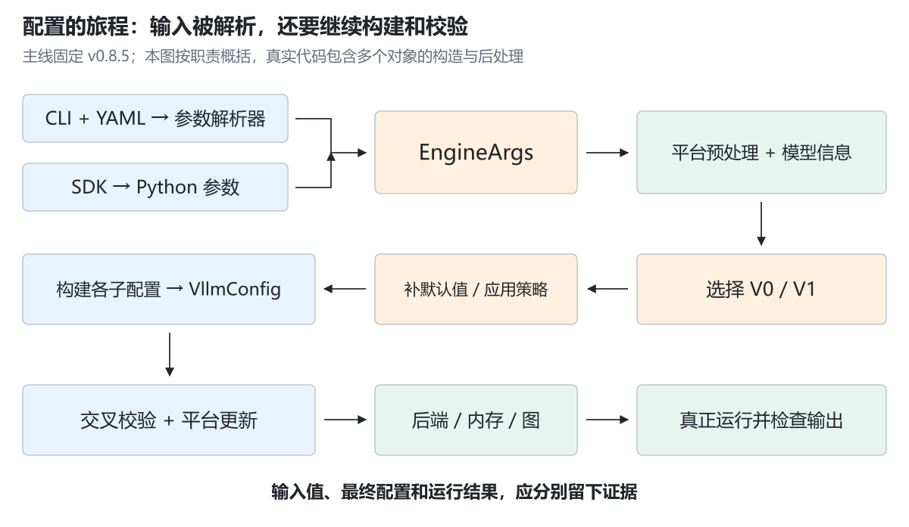
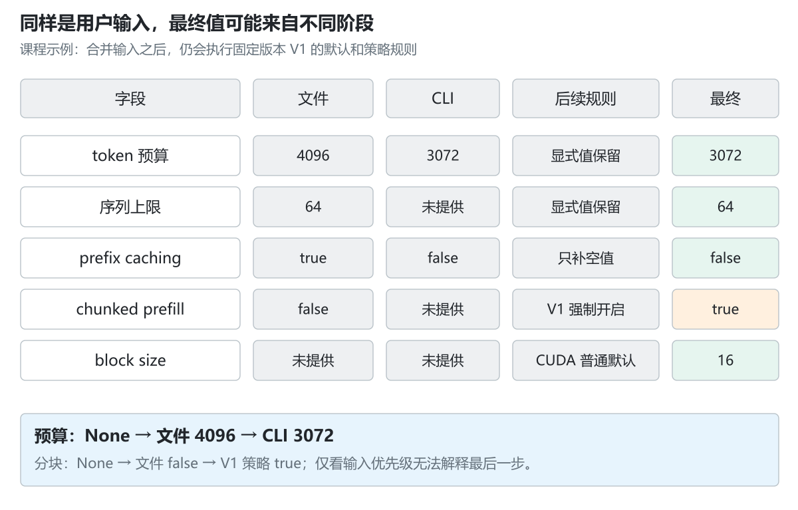
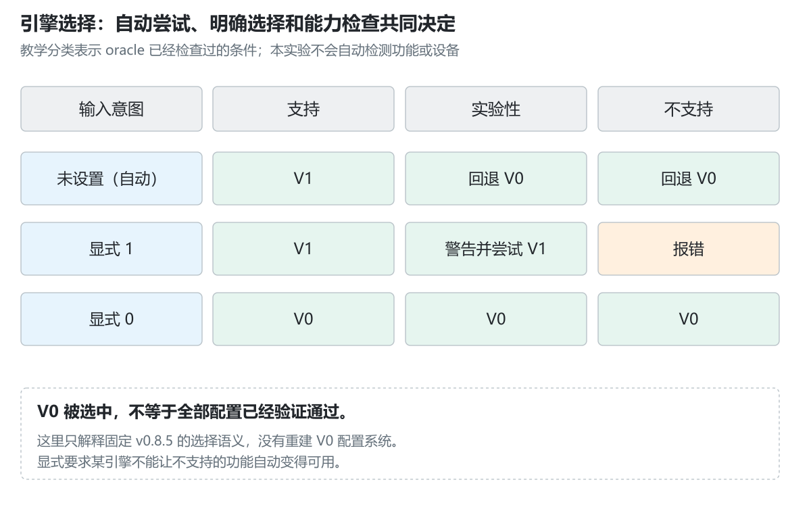
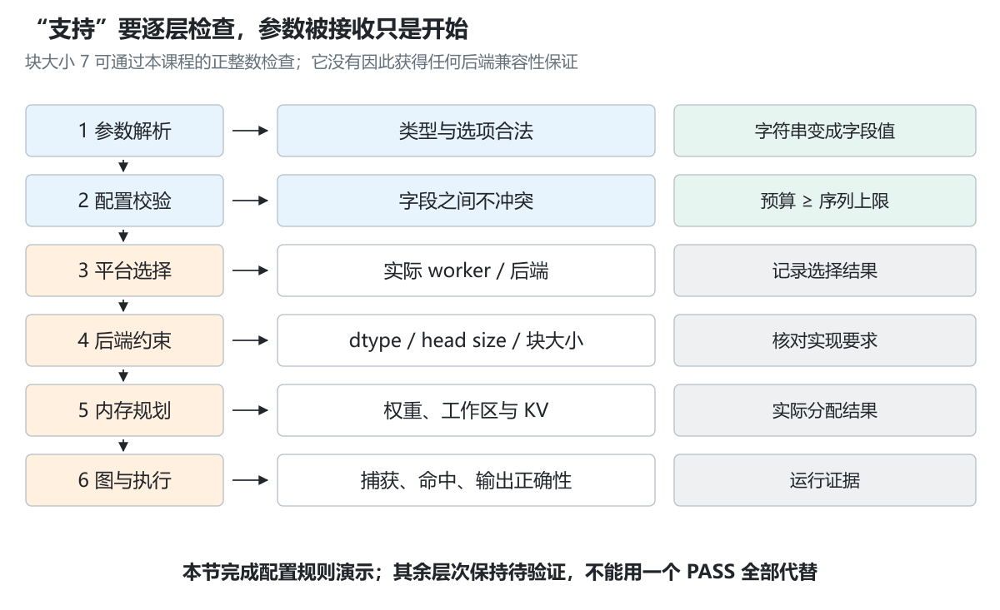
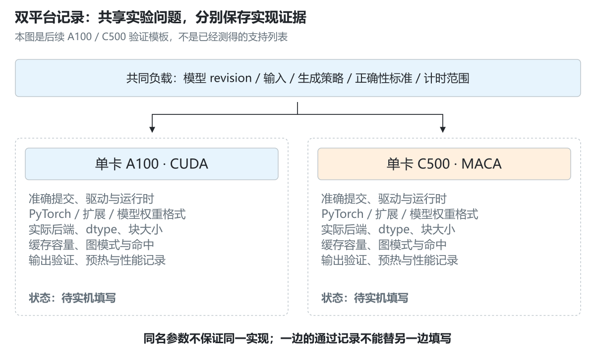

# 3.5 配置与能力的解析流程

[本篇目录](../README.md) · [全部课程](../../README.md) · [上一节 3.4](../04-v1-and-modelrunner-evolution/README.md) · [下一节 4.1](../../part-04-backends/01-the-cuda-path-and-a100-baseline/README.md)

> 主线固定为 **vLLM v0.8.5 / `ba41cc90e8ef7f236347b2f1599eec2cbb9e1f0d`**，承接 3.1—3.3。本节完成配置解析的源码阅读与 CPU 实验。实验重建一小部分规则，没有导入 vLLM、下载模型或检测 GPU；A100 与 C500 的实际运行配置留到平台章节验证。

一次启动命令里可能只有几个参数，最终的引擎却需要知道：模型允许多长的上下文、每轮能安排多少 token、最多多少条序列、缓存块多大、使用哪个 worker，以及哪些图执行路径可以尝试。

这些值并不都来自命令行。它们在不同阶段被读取、补齐、改写和检查。因此，“我已经传了这个参数”与“引擎最终采用这个值”之间，还隔着一条需要追踪的路径。

本节围绕一个具体问题展开：**配置文件写了 4096，命令行写了 3072，最后为什么有的字段保留用户值，有的字段却被引擎改写？**

## 学习目标与阅读方式

读完后应能：

- 区分参数的输入值、解析值、最终配置和运行时结果。
- 沿 `FlexibleArgumentParser → EngineArgs → VllmConfig` 找到配置的生产者。
- 解释 `None` 与 `False` 的区别，以及历史 V1 对分块 prefill 的强制规则。
- 分清模型长度、单轮 token 预算和序列数上限。
- 判断“参数被接收”“后端支持”“实际成功运行”分别需要什么证据。

先读正文中的手算例子，再运行 [实验手册](lab.md)。[源码路线图](source-map.md) 给出固定提交的函数链接；[14 组练习及答案](exercises.md) 用来检查理解。[实际记录](results/README.md) 保存 CPU 结果与静态源码检查。

前置知识是 3.1 的启动路径、3.2 的调度预算、3.3 的后端约定和 3.4 的图模式。实验只需要 Python 3.11+ 标准库。

## 1. 先分清四种“配置”

假设配置文件写入 `max-num-batched-tokens: 4096`，命令行指定 `--max-num-batched-tokens 3072`。

| 所处阶段 | 你能看到什么 | 此时还不能证明什么 |
|---|---|---|
| 输入 | YAML 文件、CLI 字符串、SDK 参数、环境变量 | 字符串是否已转成正确类型 |
| 参数解析后 | `EngineArgs.max_num_batched_tokens = 3072` | 其他字段是否补齐、引擎选择是否完成 |
| 构建配置后 | 模型、调度、缓存、并行、编译等配置对象 | 权重能否加载、缓存能否分配、后端能否执行 |
| 运行时 | 选中的后端、实际缓存块数、图捕获与执行结果 | 其他模型、版本和平台也有同样结果 |

读日志时先确认它输出的是哪一层。启动前打印的输入参数，不能替代后端初始化完成后的记录。



可以把过程想象成填一张表：用户先填写自己关心的几项，模型配置补充模型信息，引擎补充运行策略，平台再补充实现要求。最后，真正执行这张表上的计划，才会暴露运行时限制。

## 2. CLI、配置文件和 SDK 从哪里汇合

### 2.1 命令行入口先处理字符串

固定版本的 `FlexibleArgumentParser` 负责解析参数。带有 `--config` 时，它读取 **YAML** 配置，把配置项转换成参数序列，再交给参数解析器。

下面只是上游输入形式的说明，不是本节的 CPU 实验命令：

```yaml
# 示例 vLLM YAML；具体参数仍需对照所安装版本的帮助信息。
max-num-batched-tokens: 4096
max-num-seqs: 64
enable-prefix-caching: true
```

```text
vllm serve <可用模型> --config <配置文件.yaml> --max-num-batched-tokens 3072
```

解析器把配置文件转换出的参数放在显式 CLI 参数之前。对这里展示的普通单值参数，后面的 CLI 值覆盖前面的文件值，于是得到 3072。

`serve` 的模型位置参数还有专门处理，不能把整个命令都当作普通字典。布尔参数也受具体 argparse action 影响：有的接受显式布尔值，有的以参数是否出现表达状态。不要凭经验给每个选项拼一个 `--no-...`。

### 2.2 EngineArgs 是参数进入引擎的汇合点

`EngineArgs.from_cli_args` 从解析后的命名空间取出引擎需要的字段，再构建 `EngineArgs`。可以先把它理解为“收集启动意图的容器”。

Python SDK 的 `LLM(...)` 则将参数传给 `EngineArgs`，不必绕过一遍 CLI。调用 SDK 不意味着它会自动读取某个 CLI YAML 文件。

```text
CLI：字符串 / YAML → 参数解析器 → EngineArgs
SDK：Python 参数              → EngineArgs
```

本节的 [explain_config.py](examples/explain_config.py) **读取课程自己的 JSON 文件**，目的是把字段变更过程打印出来。它不是上游 CLI 的替代品，也没有实现 vLLM 的 YAML 解析器。

## 3. 一条字段变更记录，比一句“优先级”更有用

本节演示输入为：

```json
{
  "max-num-batched-tokens": 4096,
  "max-num-seqs": 64,
  "enable-prefix-caching": true,
  "enable-chunked-prefill": false,
  "enforce-eager": null
}
```

再额外传入两个课程 CLI 选项：token 预算 3072，prefix cache 为 false。模型长度上限取一个**人为提供的夹具值** 4096，设备容量输入取 40 GiB。



| 字段 | 文件值 | CLI 值 | 最终值 | 最后一次赋值的原因 |
|---|---|---|---|---|
| `max_num_batched_tokens` | 4096 | 3072 | 3072 | CLI 覆盖文件 |
| `max_num_seqs` | 64 | 未提供 | 64 | 保留文件值 |
| `enable_prefix_caching` | true | false | false | 显式关闭，不补默认 true |
| `enable_chunked_prefill` | false | 未提供 | true | 固定版本 V1 强制打开 |
| `max_model_len` | 未提供 | 未提供 | 4096 | 课程模型配置夹具 |
| `enforce_eager` | null | 未提供 | false | 模型配置默认值 |
| `block_size` | 未提供 | 未提供 | 16 | 固定版本 CUDA 普通路径默认值 |

因此，“CLI > 配置文件 > 默认值”只描述**输入合并**，不能概括最终配置的全部规则。`enable_chunked_prefill` 的后续改写就是反例。

教学解析器为每次赋值保存 `field`（字段）、`before / after`（前后值）和 `phase`（赋值阶段与原因）。它能回答“最后是多少”以及“为什么变成这个值”。实际排障也应保留这两类信息。

## 4. None 与 False：没有选择，和明确关闭

Python 中，`None` 常用于表达“尚未指定，由后续规则决定”；`False` 表达“用户明确关闭”。二者在条件判断中都是假值，但含义不同。

固定版本的 V1 prefix caching 默认规则相当于：

```python
if enable_prefix_caching is None:
    enable_prefix_caching = True
```

只补齐 `None`，保留显式 `False`。如果错误地写成：

```python
if not enable_prefix_caching:
    enable_prefix_caching = True
```

用户的关闭意图就会被覆盖。这是编写配置系统时很常见的错误。

但不能据此推断“所有显式 false 都会保留”。固定 v0.8.5 的 `_set_default_args_v1` 无条件执行 `self.enable_chunked_prefill = True`。这个分支是引擎策略，不是仅在空值时补默认值。

阅读源码时，要区分：

1. **补默认值**：只有尚未指定时才填入。
2. **策略改写**：根据选中的引擎或模式重设字段。
3. **校验拒绝**：发现无法满足的组合，抛出错误。

一个名为“设置默认参数”的函数，也需要逐句阅读，不能仅凭函数名判断行为。

## 5. 先决定使用哪个引擎，再谈这个引擎的默认值

3.4 区分了 V0/V1 引擎和 MRV1/MRV2 runner。本节沿 **v0.8.5** 的引擎选择路径阅读，不把 v0.17.1 的 MRV2 开关混进来。

`EngineArgs.create_engine_config` 准备平台与模型配置，再根据环境意图、模型及功能等条件决定引擎。这个决定并非单看一个字符串。



课程将上游已经检查过的条件简化为三种输入：支持、实验性、不支持。它们不是本实验自动检测的硬件能力。

| `VLLM_USE_V1` 意图 | 功能分类 | 固定源码分支的含义 |
|---|---|---|
| 未设置 | 支持 | 自动选择 V1 |
| 未设置 | 实验性 | 自动回退 V0 |
| 未设置 | 不支持 | 自动回退 V0 |
| `1` | 实验性 | 警告后按用户意图尝试 V1 |
| `1` | 不支持 | 报错，不能满足显式 V1 意图 |
| `0` | 任一分类 | 明确选择 V0 路径；其他配置仍须校验 |

源码 `_warn_or_fallback` 与 `_raise_or_fallback` 分别处理实验性和不支持情形。真实 oracle 会逐项检查多个条件，不能用这个压缩后的教学分类代替完整 oracle。

课程 `engine_choice` 只接受未设置、`0`、`1`，并用 `ValueError` 统一演示失败；上游不支持分支可能使用 `NotImplementedError`。课程没有重建 V0 的整套默认值解析。

### 环境变量不是随时生效的遥控器

上游 `envs` 提供环境变量读取逻辑，但不同变量被读取、缓存或写回的时间不必相同。这个版本在自动选择引擎后，还可能将结果写入进程环境。

应记录**进程启动时的环境变量、引擎选择日志和最终配置**。在 Python 对象构建后修改 `os.environ`，不能假定现有引擎会切换实现，也不能用上一进程的设置推断下一进程实际收到的值。

## 6. 为什么不同入口下默认值不同

固定 v0.8.5 的 V1 默认规则参考使用场景和平台报告的设备总显存。下表是这一历史源码分支的默认值，不是跨版本调优建议：

| 平台报告的设备总显存 | 场景 | 默认 `max_num_batched_tokens` | 默认 `max_num_seqs` |
|---|---|---:|---:|
| 小于 70 GiB | 在线服务 | 2048 | 256 |
| 小于 70 GiB | 离线 `LLM` | 8192 | 256 |
| 至少 70 GiB | 在线服务 | 8192 | 1024 |
| 至少 70 GiB | 离线 `LLM` | 16384 | 1024 |

只有字段为 `None` 时才填入这些值。用户明确提供的 3072 和 64 不会被这张默认值表覆盖。

注意四点：

- 分支按**报告的容量**判断，不按字符串是否包含“A100”判断。不同容量型号、可见设备形态或检测结果可能落入不同分支。
- 表中的 70 使用 GiB；不要拿十进制 GB 数字直接替换。
- 查询设备总显存失败时，该函数使用 0 走保守分支；这不代表机器真的有 0 内存，也不代表 CPU 可以直接执行 GPU 模型。
- `--memory-gib 80` 只给实验输入一个假设条件，既不查询也不证明本机有 80 GiB GPU。

服务与离线场景可能对并发、吞吐和交互延迟有不同侧重。先理解“默认策略与场景有关”，调优仍须用相同模型和负载测量，不能仅凭数字大小断言更快。

直接查看 `SchedulerConfig` 字段定义看到的默认值，也不一定是正常 `EngineArgs` 路径最终传入的值。**声明处、构建处和后处理处都要看。**

## 7. 三个长度上限各自约束什么


### 7.1 max_model_len：一条请求的上下文长度边界

它约束一条序列可使用的上下文范围。真实值与模型配置有关，还可能涉及位置编码、滑动窗口或覆盖规则。本节只给定简单上限 4096，不实现 RoPE 扩展与覆盖逻辑。

### 7.2 max_num_batched_tokens：一次迭代计算多少个 token

这是调度侧的单轮 token 预算。一个请求需要 prefill 4096 个 token，分块 prefill 可以分多轮计算，所以预算 512 并不必然与模型长度 4096 冲突。

这里的 512 是本轮处理的 token 数，不是所有请求历史 KV 长度之和，也不是最终输出长度。

### 7.3 max_num_seqs：同时安排多少条序列的上限

在这里的普通解码语境中，每条参与本轮解码的序列通常需要至少一个 token 的计算名额。因此固定版本要求 token 预算至少不小于这个序列上限。

本节提取两个交叉校验：

```text
始终要求：max_num_batched_tokens ≥ max_num_seqs
不使用分块 prefill 时还要求：max_num_batched_tokens ≥ max_model_len
```

| token 预算 | 序列上限 | 模型长度 | 是否分块 | 这两个检查的结果 |
|---:|---:|---:|---|---|
| 512 | 16 | 4096 | 是 | 通过 |
| 512 | 16 | 4096 | 否 | 长提示无法一次容纳，拒绝 |
| 8 | 16 | 4096 | 是 | token 预算小于序列上限，拒绝 |

第二行通过独立的 `verify_scheduler` 演示。不要给本节 V1 resolver 传 false 来重现它：前面已说明，该版本 V1 会将分块标记改成 true。

通过这些检查也不等于显存足够。缓存容量还取决于层数、KV 头数、head size、dtype、权重占用与运行时内存规划，需要下一层证据。

## 8. VllmConfig 把子配置放到一起检查

可以把 `VllmConfig` 理解为模型、缓存、并行、调度、设备、加载、编译等子配置的集合。各个子配置有自己的职责，它们之间也有约束。

例如，某项设置单独看合法，与另一项组合却可能不合法。模型配置需要结合并行配置检查，缓存配置也要结合其他条件检查。量化方式另有解析和兼容性要求。

固定版本 `VllmConfig.__post_init__` 进行交叉处理，并在适用条件下设置编译与 CUDA Graph 配置，再调用平台的 `check_and_update_config`。真实过程含多个对象的构造和后处理，并非一张表只经过一次赋值。

本节 resolver 为便于阅读，把相关步骤压缩为可观察的顺序；没有实例化上游 dataclass，也不能作为上游全功能配置校验器。

### enforce_eager 只说明执行意图

固定 v0.8.5 在适用的 V1、非 eager 分支中配置编译和图执行。`enforce_eager=True` 是显式要求 eager 路径的输入。

但 `enforce_eager=False` 不能翻译成“这一次已经用了 CUDA Graph”。还要经过配置适配、捕获、运行时形状与调度等条件。3.4 的图模式实验正是为了分开这些层次。

所以本实验输出：

- true：`graph_intent = disabled`。
- false：`graph_intent = eligible_for_configuration_not_proven_active`。

第二个值保留“尚未证明启用”的含义。CPU 上打印配置字段，不能成为 GPU 图捕获成功的记录。

## 9. 平台默认值之后，还有后端与运行时检查

固定 v0.8.5 的 CUDA 普通路径，在块大小尚未指定时补为 16。MLA 等特定路径有额外规则，本节没有模拟。这个数值不能直接作为 C500/MACA 已验证的默认值。



教学解析器允许输入正整数块大小 7，并保留它。**这不表示 7 能用于所选 FlashAttention 实现。** 我们只做配置层的部分检查，把后端尺寸限制留为待检查项，以便区分职责。

完整排查应逐层回答：

1. 参数能否解析成正确类型？
2. 子配置与交叉约束是否满足？
3. 平台实际选择什么 worker 和后端？
4. 后端是否接受 head size、dtype、块大小与模型结构？
5. 权重、工作区与 KV 缓存能否分配？
6. 使用图执行时，是否捕获成功，本轮是否满足执行条件？
7. 输出数值与请求语义是否正确？

`runtime_checks_pending` 保存尚未完成的事项。能列出缺少哪一层证据，比把所有结果合并成一个“支持”布尔值更有帮助。

## 10. A100 与 C500：建立两份可对照的记录

调度概念和字段追踪方法可用于两个平台，但平台实现、软件版本和支持范围需要分别核对。



之后做平台实验时，先固定共同条件，再分别记录解析结果：

| 共同条件 | 各平台分别记录 |
|---|---|
| 模型标识、revision、权重格式 | vLLM 或适配仓库的准确提交 |
| tokenizer、输入数据、生成参数 | 驱动、运行时、PyTorch 与扩展版本 |
| dtype 意图、上下文长度、请求负载 | 实际 dtype、后端、块大小与工作区 |
| 正确性标准、预热与计时范围 | 缓存容量、图模式、捕获与执行结果 |

同名 CLI 参数在不同版本或适配仓库中可能走不同实现；同一组最终数字也不代表同一个算子。平台章节会用真实记录补齐这里的待验证项。

本节 resolver 拒绝 `platform='maca'`，仅表示课程没有用 CUDA 规则冒充 MACA 规则，不是在判断真实适配的支持情况。

### 配置 hash 也不是完整的实验记录

框架中的配置 hash 往往服务于特定用途，例如识别影响计算图的配置。它是否包含某个字段，需要阅读对应实现。

复现实验还需要代码版本、模型 revision、输入数据、环境和输出记录。不能只保存一个配置 hash 就认为信息齐全。本课程的 `course_source` 标记教学代码与数据快照，也不代替 GPU 环境记录。

## 11. 运行实验并读懂输出

从仓库根目录执行：

```bash
python -m scripts.experiments.lesson0305
python docs/chapters/part-03-vllm/05-resolving-configuration-and-capabilities/examples/explain_config.py --max-num-batched-tokens 3072 --prefix false
```

第一条运行 12 个案例。第二条输出完整手算例子，重点观察 `values`、`origins` 与 `trace`。

按 [实验手册](lab.md) 比较四种容量/场景默认值、显式引擎意图及预期失败路径。代码在 [config_resolution.py](../../../../zero2vllm/reference/config_resolution.py)，18 项针对性测试在 [test_config_resolution.py](../../../../tests/reference/test_config_resolution.py)。

源码检查读取固定提交的 8 个文件和 17 个函数，检查文件摘要、函数边界及选定调用。它不运行上游代码，也不证明全部语义都被自动验证。

## 12. 本篇收束：从请求路径回到启动配置

第三篇形成一条闭合的阅读路线：

- **3.1**：请求经过哪些组件，结果怎样返回。
- **3.2**：怎样安排本轮计算、管理和回收 KV。
- **3.3**：怎样把调度决定转换成张量、后端调用与候选结果。
- **3.4**：不同 runner 怎样组织状态、输入准备和图执行。
- **3.5**：这些组件的配置从哪里来，哪些条件仍待运行时验证。

接下来进入第四篇，分别建立 A100/CUDA 与 C500/MACA 平台记录。遇到不符合预期的参数，就从“输入 → 默认/策略 → 平台 → 后端 → 运行时”逐层定位。

## 参考资料

以下是公开的固定版本源码。它们证明历史行为，不表示所有版本行为相同。

- [参数解析器与配置文件处理](https://github.com/vllm-project/vllm/blob/ba41cc90e8ef7f236347b2f1599eec2cbb9e1f0d/vllm/utils.py)：`FlexibleArgumentParser`。
- [EngineArgs 与 V0/V1 决策](https://github.com/vllm-project/vllm/blob/ba41cc90e8ef7f236347b2f1599eec2cbb9e1f0d/vllm/engine/arg_utils.py)：配置构建、默认值与回退规则。
- [配置对象及交叉校验](https://github.com/vllm-project/vllm/blob/ba41cc90e8ef7f236347b2f1599eec2cbb9e1f0d/vllm/config.py)：`ModelConfig`、`SchedulerConfig`、`VllmConfig`。
- [CUDA 平台处理](https://github.com/vllm-project/vllm/blob/ba41cc90e8ef7f236347b2f1599eec2cbb9e1f0d/vllm/platforms/cuda.py)：worker 与平台配置。
- [环境变量入口](https://github.com/vllm-project/vllm/blob/ba41cc90e8ef7f236347b2f1599eec2cbb9e1f0d/vllm/envs.py)：变量读取与 V1 状态设置。
- [Python LLM 入口](https://github.com/vllm-project/vllm/blob/ba41cc90e8ef7f236347b2f1599eec2cbb9e1f0d/vllm/entrypoints/llm.py) 与 [serve 入口](https://github.com/vllm-project/vllm/blob/ba41cc90e8ef7f236347b2f1599eec2cbb9e1f0d/vllm/entrypoints/cli/serve.py)：不同输入如何进入引擎。
