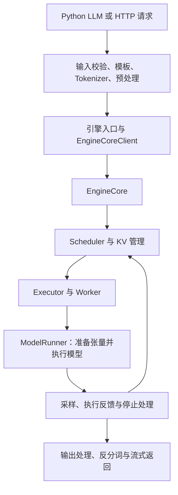

# 从一次请求读懂 vLLM：请求、状态与张量

对应 3.1—3.5、14.1、16.1。前置：Prefill/Decode、基本 Transformer 前向。状态：**3.1—3.5 已提供固定源码阅读、调度/KV、执行张量、Runner 状态与配置解析实验及静态核验；本导读覆盖的其他专题及 A100/C500 实测继续建设**。

学习后应能回答：请求现在在哪里，谁决定下一步工作，GPU 实际收到什么？从 [3.1 完整课程](01-a-request-s-journey-through-vllm/README.md)开始，先沿固定源码追踪一条请求，再读 [3.2 调度与 KV 管理](02-scheduling-and-kv-management-in-vllm/README.md)的逐轮账本，最后在 [3.3 模型执行](03-model-execution-and-attention-backends/README.md)中核对输入、地址、数值与输出。再读 [3.4 Runner 演进](04-v1-and-modelrunner-evolution/README.md)与 [3.5 配置解析](05-resolving-configuration-and-capabilities/README.md)，把状态组织、图模式和字段来源连接起来。

## 1. 先建立三条线

用“请解释 KV Cache”这样一个短请求开始。文本先成为 token；调度器安排这些 token 的计算；模型执行产生候选结果；输出处理把结果交还给请求方。



这是 V1 的职责示意。同步 `LLM` 与异步服务入口不同，组件能否同进程运行也受配置影响。实际进程、消息通道和对象类型要在选定版本中补到图上。[官方架构入口](https://docs.vllm.ai/en/latest/design/arch_overview/)

| 追踪线 | 重点记录 | 常见误读 |
| --- | --- | --- |
| 请求 | request ID、提交/完成/取消、输出归属 | 一次流式事件就是一个 token |
| 状态 | 已计算 token、已生成 token、块引用、等待条件 | 在 waiting 中就绝对不持有任何缓存资源 |
| 张量 | shape、dtype、位置、设备、布局和真实 kernel | 调度器输出已是可直接送入 GPU 的模型输入 |

## 2. 一次调度怎样变成计算

假设请求 A 尚有 6 个 prompt token 未计算，B 正在 decode。教学例子给本轮 4 个 token 的预算：让 B 推进 1 个、A 计算 3 个。

调度输出需要表达“谁推进多少、哪些块可用、哪些请求新增或结束”。runner 再根据已有状态，把本轮输入组织成连续张量，建立每段数据与请求的对应关系。示意中的 4 是本轮 token 数，2 是请求数。

对照读取这些信息，**不要依赖示意中的固定执行顺序**：

| 数据 | 需要解释的含义 |
| --- | --- |
| `input_ids` | 哪些 token 本轮真正进入模型 |
| `positions` | 每个 token 在自身序列中的位置，不是全局 batch 下标 |
| `block_table` | 每个请求的逻辑块映射到哪些物理块 |
| `slot_mapping` | 本轮 token 的 KV 应写入哪个物理位置 |
| Attention metadata | 变长、已计算长度、KV 布局等后端执行条件 |
| 请求到 batch 行的映射 | 行重排后输出如何回到原请求 |

A 只完成了部分 prefill，此时通常没有对外输出；B 可以产生新 token。刚采样出的 token 还需在后续计算中形成自己的 KV，因此“输出长度”与“已经写入 KV 的长度”不能直接等同。

## 3. Executor、Worker、ModelRunner 的分工

Executor 管理如何组织 worker 执行；Worker 负责设备侧初始化和执行入口；ModelRunner 组织模型加载、输入准备、forward 及相关执行状态。多进程执行需要传递决策和结果，GPU Tensor 也不等于每轮都通过普通 Python 消息复制。

源码阅读从小到大：先在单卡配置定位实际类，再看 executor 选择、worker 初始化和执行调用；随后扩展到多进程和通信组。不要用多卡 RPC 的所有细节作为第一次单卡实验的前置条件。

在所选 vLLM checkout 中搜索下面的入口，再核对运行时实例；目录可能随版本移动：

```text
vllm/v1/engine/           引擎与客户端
vllm/v1/core/sched/      调度决策与输出结构
vllm/v1/worker/          Worker 与模型执行
vllm/model_executor/    模型、层、加载与量化
```

## 4. 加载模型有四个不同问题

1. **解析配置与识别架构**：模型任务、架构类、dtype、量化配置及平台能力是否匹配？
2. **构造模块和参数容器**：每层有哪些参数，按什么 shape、分片和布局预留？
3. **装入 checkpoint**：文件中的名称和形状怎样映射到运行时参数？TP、合并 QKV 或专家权重如何切分？
4. **加载后处理与首轮执行**：是否重排量化权重、准备 workspace、编译、捕获图？这些开销不能都算作文件读取。

练习表至少记录：原始键、运行时参数、加载前后 shape/dtype/layout、切分轴、转换发生一次还是每轮。量化详细链路见[量化策略与算子](../part-09-quantization/guide.md)。

## 5. V1 与 MRV2：把状态稳定性和执行顺序拆开

“vLLM V1”是引擎架构代际；“ModelRunner V2”是执行侧的演进。MRV2 设计关注持久请求状态与执行排列的分离、减少同步、分阶段写入、设备侧元数据和采样、显式图管理。设计文档还列出了未完成与待验证内容，不能将目标直接写为任意模型/后端已支持。[MRV2 设计](https://docs.vllm.ai/en/latest/design/model_runner_v2/)

用三个请求想象这种分离：A 完成、D 加入、B/C 为了执行被重新排列。如果状态位置稳定，只更新映射和改变的条目，就有机会减少整张 block table 搬移；代价是必须正确维护“状态槽位→执行位置→输出请求”的关系。

工程练习：在同一个版本中分别控制 runner 和图执行，构造 `MRV1/eager`、`MRV1/graph`、`MRV2/eager`、`MRV2/graph` 四个候选格子。只测试该版本实际提供的组合，其余写明原因。两次同时换 runner 和图模式的结果无法单独归因给 MRV2。

## 6. 流式输出、停止与取消也是引擎的一部分

请求 ID 必须贯穿输出队列。SSE chunk 可能是角色、内容片段、多个 token 或结束事件；第一个网络包不必是首个有效内容。

取消练习要追到资源回收：客户端断开后，请求何时被标记结束？正在执行的工作怎样处理？块什么时候可复用？有异步传输时，结束请求与立即复用内存之间可能还有依赖。

## 7. 两类读者的验收

**学生**：画一轮两请求的图，标出请求数、token 数、各自位置和块；解释部分 prefill 没有输出及 SSE chunk 不等于 token。

**工程师**：固定版本和启动配置，在断点或日志中保存实际类、消息结构、输入形状、后端选择；补齐完成、取消、加载失败三条路径。A100/C500 分别核对，保留原始日志。

没有 GPU 时，本篇可交付源码阅读表；不可填写设备执行成功。继续阅读[调度与缓存](../part-05-kv-cache/guide.md)和[实验规范](../../engineering/experiments.md)。
