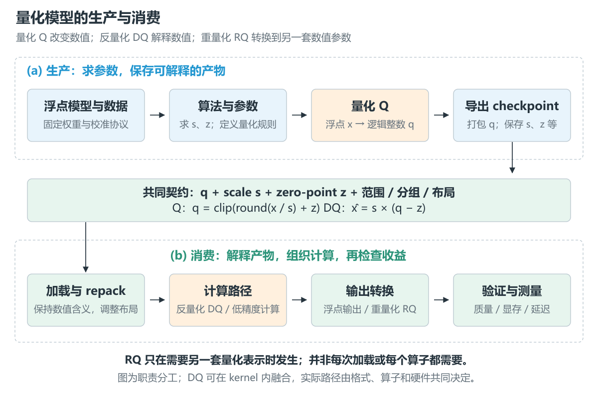
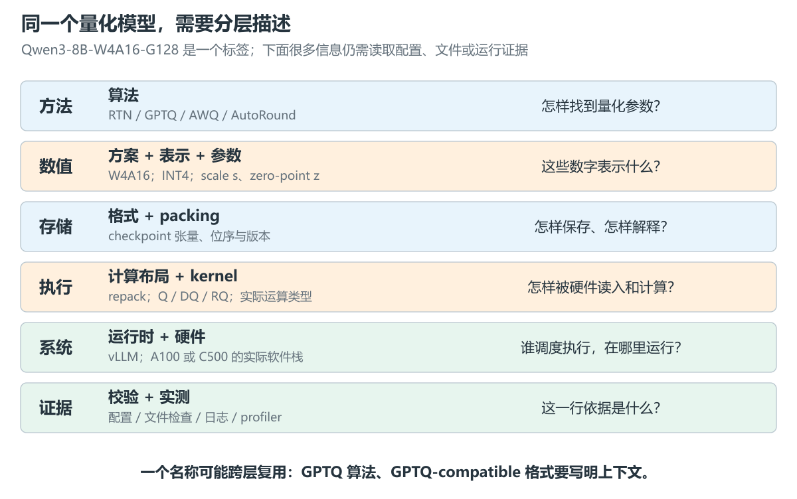
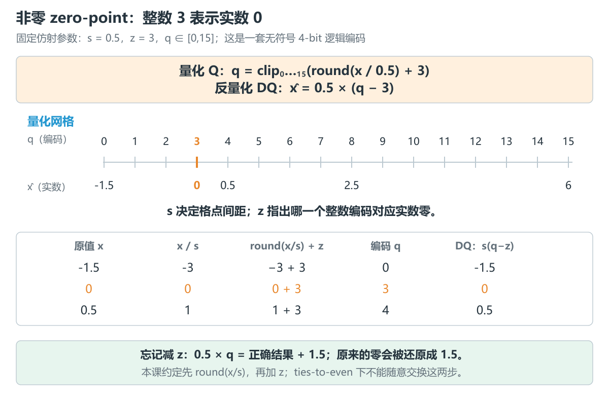
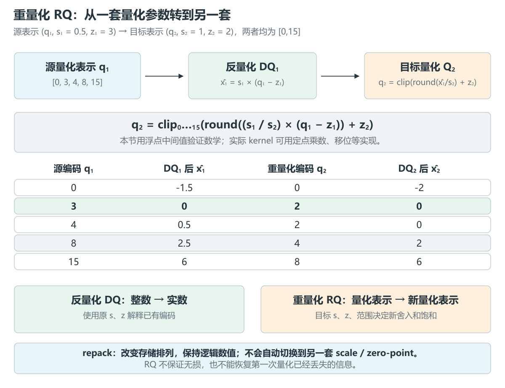
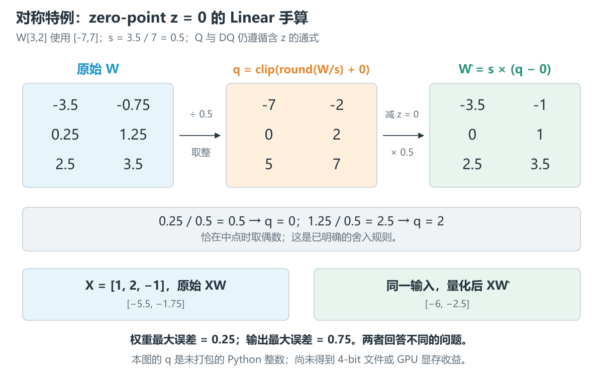
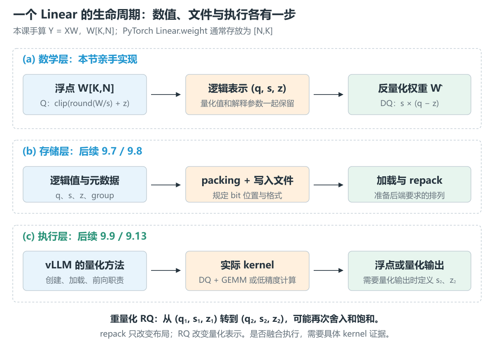

# 9.1 量化系统全景与术语分层

[本篇目录](../README.md) · [实验手册](lab.md) · [练习与答案](exercises.md) · [源码定位](source-map.md) · [下一节 9.2](../02-numerical-representations-and-tensor-contracts/README.md)

> 本节交付：CPU 数值实验、模型 Passport 和固定版本源码阅读。A100、C500 与真实量化模型尚未实测。建议按“概念 → 手算 → 运行 → 源码”阅读，已有经验的读者可直接做练习检查边界。

## 1. 本节为什么存在：拿到 W4A16 模型以后

假设有人给你一个名为 `Qwen3-8B-W4A16-G128` 的模型，让你放进 vLLM。你大概知道它想表达“权重 4 bit、激活 16 bit、每组 128 个元素”。但接下来马上会遇到更具体的问题：这 4 bit 怎样解释？128 个元素沿哪条轴分组？文件里的整数怎样还原成权重？加载以后究竟调用哪个算子？

模型名字回答不了这些问题。即使两个文件都标着 W4A16，量化参数、位排列和加载方式也可能不同。只把某个 `quantization` 字符串改成另一个名字，并不能让它们互相兼容。

这一篇要逐步追完一条真实路径：怎样求量化参数，怎样保存，怎样加载和执行，最后怎样证明质量与速度。本节先建立共同的描述方式，并亲手处理几个数字。后面读到 `qweight`、`qzeros` 或 repack 时，就能判断自己正在看哪一层。



图中的 Q 是量化，DQ 是反量化，RQ 是重量化。三者是数值操作；保存文件、调整排列和选择后端是另外的工作。图表示职责，不能当成所有框架都遵循的固定调用顺序。

## 2. 本节需要解决的问题

读完后，应能用自己的话回答：

1. 算法、方案、数值表示、参数、格式、布局、kernel 和 runtime 分别描述什么？
2. `scale` 和 `zero-point` 如何共同决定一个整数所代表的实数？
3. 量化、反量化、重量化和 repack 分别改了什么？
4. 权重误差为什么不等于 Linear 输出误差？
5. 为什么看到 INT4 或 Marlin 这样的名字，还不能确定存储大小和执行指令？
6. 哪些字段可以根据配置填写，哪些必须等到检查文件或运行后才能填写？

贯穿案例是 `Qwen3-8B-W4A16-G128`，但本节不下载它。我们使用一个只有六个权重的 Linear，把每个步骤算清楚。

## 3. 前置知识与张量方向

需要知道矩阵乘法的行列对应，以及整数、浮点数和张量 shape 的含义。可回看 [2.1 最小 PyTorch 模型](../../part-02-engine/01-pytorch-model/README.md)；源码部分衔接 [3.3 模型执行](../../part-03-vllm/03-model-execution-and-attention-backends/README.md)。CPU 实验只依赖 Python 标准库。

统一约定：

$$
X\in\mathbb{R}^{M\times K},\qquad W\in\mathbb{R}^{K\times N},\qquad Y=XW.
$$

`M` 是输入行数，`K` 是输入特征数，`N` 是输出特征数。此处没有 bias。一个样本的一行输入，要与权重的每一列做点积。

注意：PyTorch `nn.Linear.weight` 存为 `[N,K]`，前向用 `X @ weight.T`。本课的数学 `W[K,N]` 与这个存放方向互为转置。实际分析 checkpoint 时必须先声明方向，不能只写一个方阵尺寸。[PyTorch Linear 文档](https://docs.pytorch.org/docs/2.7/generated/torch.nn.Linear.html)

## 4. 核心概念：一个名字只能回答一部分问题

### 4.1 从优化方法到运行系统



| 层次 | 描述的对象 | 本节例子 | 不能由此直接推出 |
| --- | --- | --- | --- |
| Algorithm，算法 | 怎样优化量化误差、求参数或变换权重 | RTN；后续的 GPTQ、AWQ、AutoRound | 文件中每个 bit 的排列 |
| Scheme，方案 | 哪些对象采用什么精度、粒度和静态/动态策略 | W4A16、按组量化 | W4 一定是有符号 INT4 |
| Representation，数值表示 | 编码规则和可表示的值 | signed INT4、unsigned INT4、某一种 FP8 | 乘法和累加也用该类型 |
| Parameters，量化参数 | 把编码解释成数值所需的参数 | scale、zero-point、分组轴 | 参数在文件中一定叫 `scales/qzeros` |
| Checkpoint format，格式 | 张量、名称、元数据及其解释协议 | 某个版本的 GPTQ-compatible 格式 | 某个特定算法一定参与过生产 |
| Packing layout，打包布局 | 逻辑值放在哪些字节和 bit 中 | 两个 4-bit 编码装入一个 byte | kernel 直接按这个顺序读取 |
| Compute layout，执行布局 | 运行时为算子准备的排列 | 加载后重排成分块布局 | 重排会自动降低量化误差 |
| Kernel，算子实现 | 怎样读取、解码、乘加并写回 | 一个融合解码与 GEMM 的实现 | 整个服务一定更快 |
| Runtime，运行时 | 加载模型、组织层执行和请求调度 | vLLM | 每个版本选择同一个 kernel |
| Hardware，硬件 | 支持的指令、存储和执行资源 | A100、C500 | 相同位宽对应相同计算路径 |

一个名称可以跨层出现。写“GPTQ 算法”时讨论的是参数如何求；写“GPTQ-compatible checkpoint”时讨论的是文件能否被某种 loader 解释。两处不能省略上下文。

格式与容器也要分开。`.safetensors` 告诉你怎样存取张量，但还需要知道里面哪一个张量是权重编码、scale 放在哪条轴、是否存在 zero-point。打开文件并得到若干数组，只完成了读取，还没有完成解释。

### 4.2 为什么不能把整数 q 单独称为量化模型

设两个模型都保存整数 `q=4`：

- 第一套参数是 `s=0.5, z=3`，代表 `0.5×(4−3)=0.5`。
- 第二套参数是 `s=1, z=2`，代表 `1×(4−2)=2`。

整数相同，解释出的数值不同。因此本课始终把 `(q,s,z)` 放在一起；实际模型还要加上粒度、分组映射、张量方向和编码规则。

`scale` 决定量化网格相邻格点的距离，`zero-point` 指出哪个整数编码对应实数零。`zero-point` 不是“最小权重”，也不是“总该设置为零的占位参数”。

### 4.3 Q、DQ、RQ 与 repack

| 操作 | 输入 → 输出 | 需要知道什么 | 可能产生新的数值损失吗 |
| --- | --- | --- | --- |
| 量化 Q | 原始实数 → 量化编码 | scale、zero-point、范围、舍入规则 | 舍入、裁剪会产生损失 |
| 反量化 DQ | 编码和参数 → 近似实数 | 原来的 scale 和 zero-point | 理想数学上只是解释；实现还可能有浮点舍入 |
| 重量化 RQ | 一套量化表示 → 另一套量化表示 | 源和目标两套参数、目标范围 | 可能再次舍入、饱和 |
| repack | 一种存储排列 → 另一种存储排列 | 两种布局的索引/位映射 | 纯布局变换应保持逻辑数值 |

反量化得到的是**已有编码所代表的近似值**，不能恢复第一次量化丢失的细节。重量化也不是“再把原模型跑一遍量化算法”：它接收已有量化表示，本节讨论的是从一个量化网格转换到另一个网格。

## 5. 数学推导：从一个数字走到一层 Linear

### 5.1 明确这节使用的仿射整数约定

给定正数 scale $s$、整数 zero-point $z$ 和整数范围 $[q_{\min},q_{\max}]$，定义：

$$
q=Q_{s,z}(x)=\operatorname{clip}_{[q_{\min},q_{\max}]}\left(\operatorname{round}_{\mathrm{even}}(x/s)+z\right),
$$

$$
\hat{x}=DQ_{s,z}(q)=s(q-z).
$$

`round_even` 表示取最近整数；距离相同取偶数。`clip` 把超出范围的编码压到端点。例如范围是 `[0,15]`，`−2` 变成 `0`，`17` 变成 `15`。本课要求 $z$ 在编码范围内，所以 $Q(0)=z$ 且 $DQ(z)=0$。

这是本节的整数仿射约定；真实后端必须核对其舍入和饱和定义。可对照 ONNX 算子版本 21 的整数 [QuantizeLinear](https://onnx.ai/onnx/operators/onnx__QuantizeLinear.html#quantizelinear-21) 与 [DequantizeLinear](https://onnx.ai/onnx/operators/onnx__DequantizeLinear.html#dequantizelinear-21)。本节没有实现 ONNX 算子，也不能将整数公式直接套到所有 FP8/FP4 表示上。

**括号不能随意挪动。** 取 `x=0.25,s=0.5,z=3`：

```text
本课约定：round(0.25/0.5) + 3 = round(0.5) + 3 = 0 + 3 = 3
改动顺序：round(0.25/0.5 + 3) = round(3.5) = 4
```

在非中点处容易看不出差别，但这个边界会改变编码。这也是数值契约必须写到“舍入顺序”的原因。

### 5.2 非零 zero-point：无符号编码也能表示负数

选一套便于手算的固定参数：`s=0.5,z=3,q∈[0,15]`。它对应的实数端点是：

$$
[s(0-z),s(15-z)]=[-1.5,6].
$$

这里**人为固定参数**，用于解释含义，并未运行 MinMax 或其他校准算法来求它们。



手算三个位置：

- `x=−1.5`：先除以 `0.5` 得 `−3`，加上 `3` 得编码 `0`；反量化 `0.5×(0−3)=−1.5`。
- `x=0`：编码是 `3`；反量化先减 `3`，所以还原为零。
- `x=0.5`：编码是 `4`；反量化 `0.5×(4−3)=0.5`。

如果读取时忘了减 zero-point，结果变成 $sq=s(q-z)+sz$。这里每个值都偏大 `1.5`，连原来的零也变成 `1.5`。这种固定偏移是解释参数的错误，不能归因于“4 bit 精度不够”。

### 5.3 重量化：两套参数同时出现

已有表示 $(q_1,s_1,z_1)$，现在希望换为目标 $(q_2,s_2,z_2)$。先写最直接的参考路径：

$$
\hat{x}_1=s_1(q_1-z_1),\qquad q_2=Q_{s_2,z_2}(\hat{x}_1).
$$

代入得到：

$$
q_2=\operatorname{clip}_{[q_{\min,2},q_{\max,2}]}\left(\operatorname{round}_{\mathrm{even}}\left(\frac{s_1}{s_2}(q_1-z_1)\right)+z_2\right).
$$

先减**源** zero-point，按 scale 比例换单位，再加**目标** zero-point，最后使用**目标**范围饱和。只修改 `scale` 元数据，却不相应转换编码，并不是这条计算。



图中 `q1=4` 代表 `0.5`。目标 `s2=1,z2=2` 下，`round(0.5)+2=2`，还原变成 `0`。原先可精确表示的 `0.5`，在新网格上产生了误差。

重量化不要求位宽变化：本例源和目标都是 4-bit 逻辑范围，只是网格不同。若目标改为 `[0,3]`，还要处理饱和。例如原先代表 `6` 的 `q1=15`，目标未饱和编码为 `8`，饱和成 `3`，反量化只剩 `1`。

还有一个反例：原值 `x=0.625`，第一次量化得到 `q1=4`、反量化为 `0.5`，再重量化得到 `q2=2`；若直接用目标参数量化原值，得到 `round(0.625)+2=3`。因此一般不能把 $Q_2(DQ_1(Q_1(x)))$ 写成 $Q_2(x)$。

本节代码用浮点中间值验证这条数学路径。整数推理实现可以用定点乘数、移位等近似 scale 比例，还要明确其舍入与溢出边界；相关实现思路可阅读 [gemmlowp 的量化说明](https://github.com/google/gemmlowp/blob/master/doc/quantization.md)。这些整数 kernel 不属于本节实测。

**为什么会在低精度 GEMM 的末尾遇到重量化？** 先假定输入与权重各共享一组参数，没有 bias，也暂不考虑整数溢出。输入和权重的近似值为 $s_X(q_X-z_X)$、$s_W(q_W-z_W)$，于是可先计算整数和：

$$
A_{mn}=\sum_k(q_{X,mk}-z_X)(q_{W,kn}-z_W),\qquad \hat Y_{mn}=s_Xs_W A_{mn}.
$$

累加结果 $A$ 对应的 scale 是 $s_Xs_W$、zero-point 是 0。若下一层要求输出使用 $(s_Y,z_Y)$，则需要：

$$
q_{Y,mn}=\operatorname{clip}\left(\operatorname{round}_{\mathrm{even}}\left(\frac{s_Xs_W}{s_Y}A_{mn}\right)+z_Y\right).
$$

这也是从源数值单位转换到目标单位的 RQ；若只需要浮点输出，则可以计算 $s_Xs_WA$。这段是理解算子输出处理的数学预览，不是本节 Linear 的实现：本节 Linear 仍用浮点乘加。按通道/组 scale、bias、累加位宽和融合实现留到 9.10 逐项验证。

### 5.4 对称特例：把六个权重放到同一网格

现在让 `z=0`，使用窄对称范围 `[-7,7]`。有符号 4-bit 编码可表示 `[-8,7]`，而本节量化器主动不使用 `−8`，使正负端点对称。**编码能力与量化器实际取值范围是两件事。**

取：

$$
W=\begin{bmatrix}-3.5&-0.75\\0.25&1.25\\2.5&3.5\end{bmatrix},\qquad X=\begin{bmatrix}1&2&-1\end{bmatrix}.
$$

整个矩阵共享一个 scale，即 per-tensor。令 $s=\max|W|/7=0.5$，则：

$$
q=\begin{bmatrix}-7&-2\\0&2\\5&7\end{bmatrix},\qquad
\hat W=s(q-0)=\begin{bmatrix}-3.5&-1\\0&1\\2.5&3.5\end{bmatrix}.
$$



以第二列为例，`−0.75/0.5=−1.5` 取偶数 `−2`，`1.25/0.5=2.5` 取偶数 `2`，`3.5/0.5=7` 不变。反量化后是 `[-1,1,3.5]`。

原始输出和量化输出分别为：

$$
Y=XW=\begin{bmatrix}-5.5&-1.75\end{bmatrix},\qquad
\hat Y=X\hat W=\begin{bmatrix}-6&-2.5\end{bmatrix}.
$$

例如原始第二列：`1×(−0.75)+2×1.25−1×3.5=−1.75`；量化后变成 `1×(−1)+2×1−1×3.5=−2.5`。

### 5.5 三种误差不能混在一起

本例权重最大绝对误差为 `0.25`，权重 MSE 为 `0.03125`，输出最大绝对误差为 `0.75`。后一项受输入影响：

$$
\Delta Y=X(\hat W-W),\qquad |\Delta Y_{mn}|\leq\sum_k|X_{mk}|\,|\Delta W_{kn}|.
$$

最近邻舍入在**没有裁剪**、按这里的理想数学规则计算时，单值误差不超过 $s/2$。但输出是多个误差乘以输入后相加，不能也直接套用 $s/2$。

如果固定 `s=0.5,z=0,[-7,7]`，却输入 `4`，反量化只能到 `3.5`，误差 `0.5` 已经超过 `s/2=0.25`。这是饱和误差。本节参考程序另外计入浮点计算容差，不把极小的算术误差当作理论不成立。

接下来还要区分：

1. **实现正确性**：程序是否遵循约定的 Q/DQ/RQ？例如有没有漏减 `z`。
2. **量化质量**：正确实现后，与原始模型相比损失多少？本节只有小张量误差。
3. **执行收益**：是否更省内存、更快？本节没有 packed buffer 和 GPU 测量，不能回答。

## 6. 中文图解：把数学对象放回工程路径



同一个 Linear 会有几种形态：浮点 `W`、逻辑整数和参数 `(q,s,z)`、打包后的文件张量、运行时计算布局。它们相互关联，但不是同一个数组换了几个名字。

沿图阅读时，逐个问：

- 数值层：这一步是否改变了所代表的权重？Q 与 RQ 可能产生新的误差；DQ 解释已有编码。
- 存储层：值在什么位置？纯 packing/repack 应保留逻辑含义，不能靠重排修复已经丢失的精度。
- 执行层：乘法读到什么类型？DQ 是显式生成浮点权重，还是融合在 kernel 中？输出是否还需要重量化？

“先 DQ 再 GEMM”是一种易于验证的参考路径，不要求实际 kernel 一定生成完整的浮点权重张量。反过来，低精度输入也不能证明累加器使用同样低的位宽。后续 9.9、9.10 会分别核对 weight-only 与低精度 GEMM。

六张图的可编辑 SVG、PNG 和对应数值来源见 [插图说明](assets/README.md)。

## 7. 最小 CPU 实现与模型 Passport

### 7.1 先运行两个小例子

在仓库根目录、已选择 Python 3.11+ 环境后运行：

```bash
python docs/chapters/part-09-quantization/01-quantization-system-overview/examples/walk_affine.py
python docs/chapters/part-09-quantization/01-quantization-system-overview/examples/walk_qdq.py
python -m scripts.experiments.lesson0901
```

第一条逐值打印非零 zero-point 的 Q/DQ/RQ；第二条打印六个权重的中间过程；第三条运行 17 个案例并生成两份 Passport。安装、输出路径和预期结果见 [实验手册](lab.md)。

Q/DQ 的最小核心就是：

```python
# 已校验：x 有限，s > 0，z 是范围内的整数。
q = max(qmin, min(qmax, round(x / s) + z))
x_hat = s * (q - z)
```

可运行实现位于 [quantization_overview.py](../../../../zero2vllm/reference/quantization_overview.py)。它还检查矩阵形状、输入类型和范围。为避免极小 scale 让除法结果溢出，编码函数会先在整数端点所对应的归一化范围上截断，数值含义与上述约定一致。

**实际 dtype 必须说清楚。** 输入先显式转换为 FP32 数值；后续 scale、DQ、乘法和累加使用 Python float64。整数结果保存在 Python 列表中，没有压缩到 4 bit。`0.1` 转为 FP32 后会变为 `0.10000000149011612`，程序会把这个事实保留下来。重量化的 DQ 中间值继续使用 float64，不额外转回 FP32。

全零对称张量的 `amax=0`，不能令 `scale=0` 再做除法。教学实现约定此时 `scale=1`，编码和反量化结果仍全为零。此约定属于课程参考实现，不代表所有框架。

### 7.2 给配置和观察分别留位置

[QuantizedModelPassport](../../../../zero2vllm/quantization/passport.py) 是一份可序列化的实验记录，包含来源、数值、执行和验证四组字段。一个字段可以有以下状态：

| 状态 | 含义 | 示例 |
| --- | --- | --- |
| `unknown` | 尚无足够信息 | 只看到模型名时的实际 kernel |
| `declared` | 配置或计划声明 | 计划使用 group size 128 |
| `verified` | 已观察且提供证据位置 | 本次 CPU 输出中的整数值和误差 |
| `not_applicable` | 当前实验没有此对象，需写原因 | 没有 KV 状态的单层 Linear |

例如，下面只记录计划：

```python
from zero2vllm.quantization import QuantizedModelPassport

passport = QuantizedModelPassport("my-w4-plan", "尚未加载模型的配置计划")
passport.record("numerical", "group_size", status="declared", expected=128)
# execution.actual_kernel 仍是 unknown。
record = passport.to_dict()
```

若使用 `verified`，必须同时填写 `observed` 和 `evidence`。程序校验的是字段结构和证据引用是否提供，**不能自动证明日志真实、引用正确或 GPU 确实执行过**；这些仍需读者核查。

本节生成两份记录：`cpu-passport.json` 对应上述对称 Linear，`qwen-plan-passport.json` 对应课程目标。后者只声明模型标签、权重/激活位宽、组大小和预期 runtime；格式、算法、分组轴和实际 kernel 保持未知。非零 zero-point 与重量化案例单独记录在 `summary.json` 的 `affine` 中，不能误套用对称 Linear 的 Passport。

## 8. 真实框架对应：不要从类名猜执行路径

### 8.1 生产端：算法选择与导出格式分开

AutoRound 的固定版本 README 在导出选项中列出 `auto_gptq`、`auto_awq` 等格式名称。阅读时至少记两行：采用什么算法，以及导出到什么格式；格式名字本身不能替代算法生产记录。[固定 README](https://github.com/intel/auto-round/blob/2b5a3c5506a27838d63b1a8d82be5d8b5f7d61cc/README.md)

这只是公开文档的核对，不表示本课已测试任意 scheme 和 export format 的组合。真实生产实验安排在 9.6。

### 8.2 消费端：固定 vLLM 源码切片

本节沿用第三篇的 vLLM v0.8.5，固定提交 `ba41cc90e8ef7f236347b2f1599eec2cbb9e1f0d`。使用它理解职责，不把它当作当前功能清单或 Qwen3-8B 的部署保证。

| 阶段 | 阅读位置 | 这一步回答什么 |
| --- | --- | --- |
| 层初始化 | `LinearBase.__init__` | 配置为这一层提供哪个 quant_method？ |
| 创建参数 | `ReplicatedLinear.__init__` → `create_weights` | 需要准备哪些张量？ |
| 后端选择示例 | `GPTQMarlinLinearMethod.create_weights` | 根据层参数选择哪个执行实现？ |
| 加载后处理 | `process_weights_after_loading` | 已加载的权重怎样交给后端准备？ |
| 前向 | `ReplicatedLinear.forward` → `quant_method.apply` | 本次输入交给谁处理？ |

`ReplicatedLinear` 用作最小接口示例，不代表真实 Qwen 中所有 Linear 都是这个类。完整 loader、分片和模型路径留到 9.13。

一个值得停下来看的细节：该版本的 `GPTQMarlinLinearMethod.create_weights()` 调用 `choose_mp_linear_kernel()`，把选中的实现保存为 `self.kernel`；加载后处理和 `apply()` 再委托给它。因此方法名带有 Marlin，仍不足以单独证明实际执行 kernel。应继续读取选择结果，结合运行日志和 profiler 核对。[固定源码](https://github.com/vllm-project/vllm/blob/ba41cc90e8ef7f236347b2f1599eec2cbb9e1f0d/vllm/model_executor/layers/quantization/gptq_marlin.py#L210)

可选静态检查覆盖 4 个文件、9 个函数，检查文件摘要和选定调用；它不导入 vLLM，也不执行 GPU。定位表与检查命令见 [源码阅读页](source-map.md) 和 [实验手册](lab.md)。

## 9. GPU / Runtime 实验：本节先建立记录

CPU 已足够完成本节的全部数值练习。A100 和 C500 在这一节只需要各自建立环境记录：设备、驱动、CUDA/MACA、框架版本，以及准备使用的 vLLM 或平台适配版本。

```bash
python scripts/environment/collect.py --output .local/runs/part-09-quantization/01-system-overview/environment.json
```

这个工具收集 Python 环境和可发现工具等信息；不能把“发现某个可执行文件”视为该 GPU 路径已工作。真实卡型、驱动状态和运行结果要另外核查。A100 与 C500 的记录分别保存，不互相借用证据。

| 范围 | 本节状态 | 下一步 |
| --- | --- | --- |
| CPU Q/DQ/RQ 与 Passport | 已运行，结果公开 | 9.2 扩展表示、粒度与数值契约 |
| 固定 vLLM 文本 | 已静态核对 | 9.13 结合加载和执行记录 |
| A100 / C500 | 未实测 | 固定各自软件栈后逐路径验收 |
| Qwen3-8B 模型质量与服务性能 | 未运行 | 先完成生产、格式与算子实验 |

## 10. 常见误区与可运行反例

| 误区 | 本节怎样检查 |
| --- | --- |
| zero-point 只是可省略的偏置 | `z=3` 被遗漏后，所有 DQ 值偏移 `1.5` |
| 反量化恢复原始值 | `0.25` 在对称例中还原为 `0` |
| 重量化等于直接量化原始浮点数 | `0.625` 的两条路径得到编码 `2` 与 `3` |
| repack 就是重量化 | 前者改变排列；后者引入目标参数和新的舍入/饱和 |
| INT4 结果列表已经节省 4 倍显存 | 本课使用 Python int 列表，没有 packed buffer |
| W4A16 已指定全部执行 dtype | 位宽标签没有给出乘法、累加和输出类型 |
| 权重误差小于 `s/2`，输出也一样 | 本例权重误差 `0.25`，输出误差 `0.75` |
| 看到类名就能填写 actual_kernel | 固定源码仍会选择内部执行后端 |

## 11. 工程边界

这套实现服务于概念核对：小矩阵、固定规则、明确误差。拒绝空/不规则矩阵、非有限数、布尔输入、非法 scale 和不合法的编码/zero-point。FP32 转换导致溢出或非零输入下溢为零时，程序也明确拒绝，不静默替换。

目前没有按组量化、实际 INT4 存储、checkpoint loader、整数乘法 kernel、定点重量化或模型推理。对称 Linear 采用 per-tensor，并非 G128；仿射例的参数是人为固定的，不是算法优化结果。

图和公式中的仿射 `(q,s,z)` 用来解释本节整数路径。浮点低精度、codebook 等表示需要自己的解码规则，不能因同为 4 bit 就当成同一个契约。9.2 会继续展开。

## 12. 练习

[练习与答案](exercises.md) 提供 14 组问题：术语分类、非零 zero-point、舍入顺序、重量化、饱和、Linear 手算、存储估算、Passport 和源码判断。先独立写下中间值，再运行代码核对；不要只看最后一个 `passed=true`。

## 13. 实验产物

| 产物 | 入口 |
| --- | --- |
| 固定权重与预期输出 | [linear.json](data/linear.json) |
| 含 zero-point 的 Q/DQ/RQ 输入 | [affine.json](data/affine.json) |
| 20 个术语分类练习 | [terms.json](data/terms.json) |
| 数值实现与 Passport | [参考实现](../../../../zero2vllm/reference/quantization_overview.py)、[Passport](../../../../zero2vllm/quantization/passport.py) |
| 一次运行全部实验 | [lesson0901.py](../../../../scripts/experiments/lesson0901.py) |
| 逐步示例 | [Q/DQ/RQ](examples/walk_affine.py)、[Linear](examples/walk_qdq.py)、[读取 Passport](examples/inspect_passport.py) |
| 已运行结果与范围 | [结果说明](results/README.md) |

## 14. 完成标准

- 能给 20 个术语按上下文分类，并说明名称跨层时需要补充什么。
- 能手算非零 zero-point 的 Q/DQ 和两套参数间的 RQ，解释和 repack 的区别。
- 能复现 17 个 CPU 案例，分清边界输入、故意错误的解码和量化误差。
- 能生成并读回两份 Passport，让未知事实继续保持未知。
- 能在固定源码中找到量化方法和执行后端之间的衔接。

公开运行证据见 [results](results/README.md)，课程与测试检查见 [9.1 质量记录](../../../../reports/quality/lesson-9.1-delivery/README.md)。这些完成标准对应 CPU 和源码阅读，不包括 GPU 或完整 Qwen 实测。

## 15. 源码与论文入口

- [公开源码定位表](source-map.md)：固定版本的 vLLM 九个阅读点及 AutoRound 导出文档。
- [ONNX QuantizeLinear](https://onnx.ai/onnx/operators/onnx__QuantizeLinear.html#quantizelinear-21)、[DequantizeLinear](https://onnx.ai/onnx/operators/onnx__DequantizeLinear.html#dequantizelinear-21)：对照整数 Q/DQ 的参数和数值约定。
- [gemmlowp quantization](https://github.com/google/gemmlowp/blob/master/doc/quantization.md)：整数计算与输出缩放的公开实现背景。
- [GPTQ](https://arxiv.org/abs/2210.17323)、[AWQ](https://arxiv.org/abs/2306.00978)：后续 9.4 的算法阅读入口，本节不提前展开其优化推导。

**回到贯穿问题：`Qwen3-8B-W4A16-G128`，现在多知道了什么？** 它给出一部分配置意图；要执行和比较，仍须补齐数值规则、格式和实际执行证据。下一节先把数值表示与张量契约补全。
