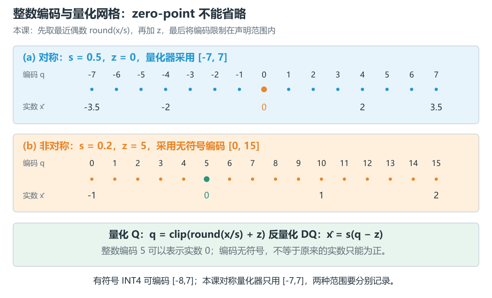
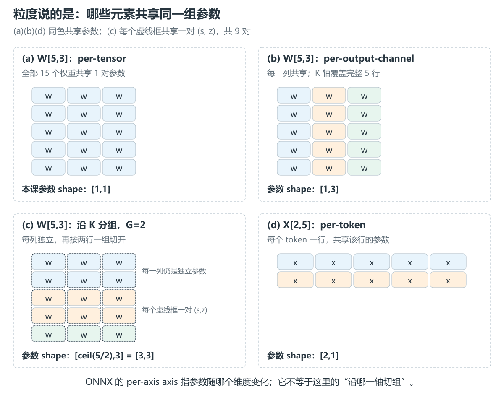
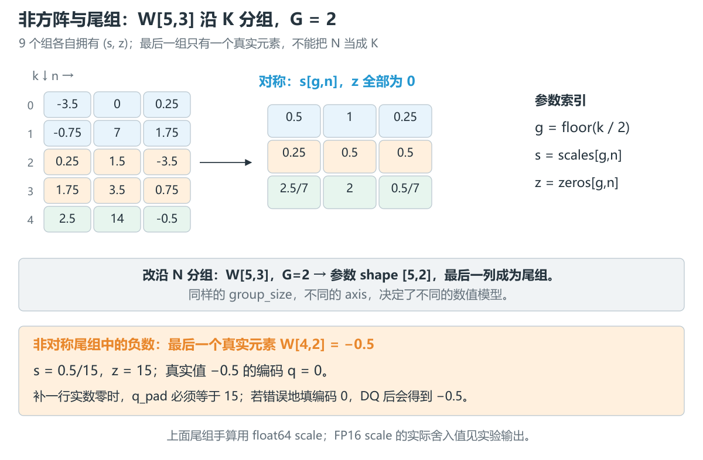
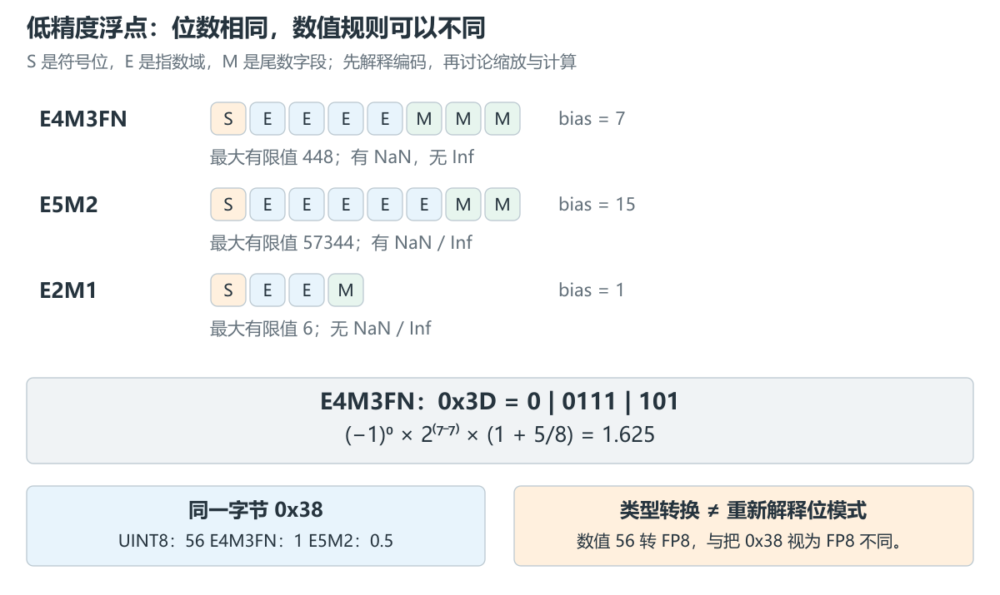
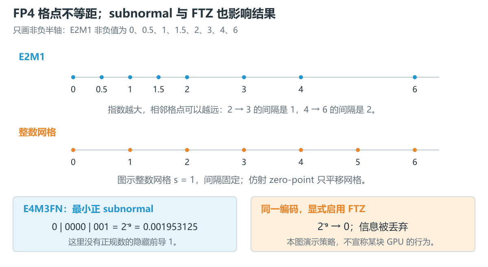
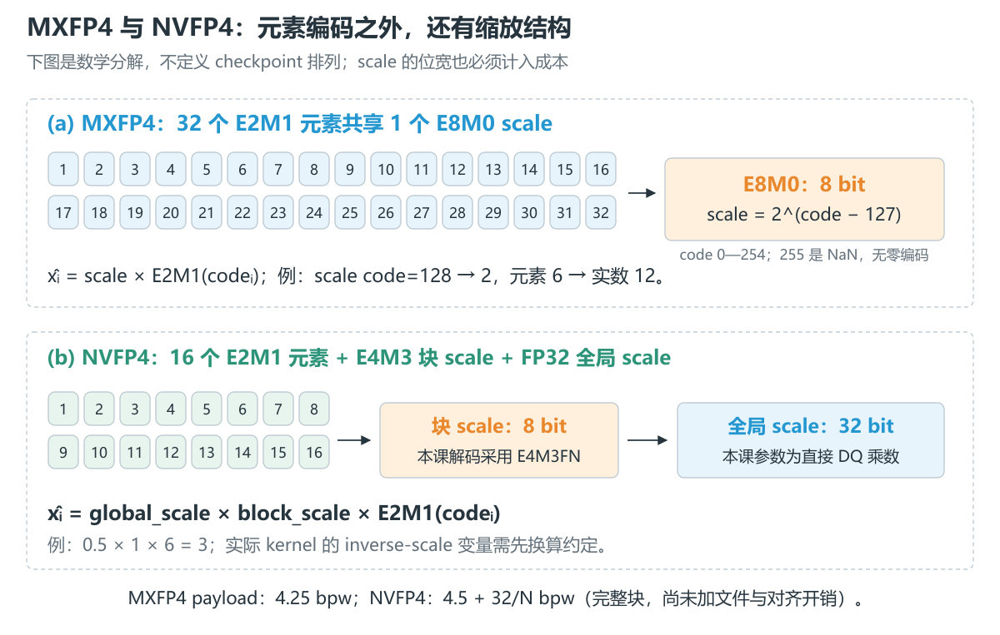
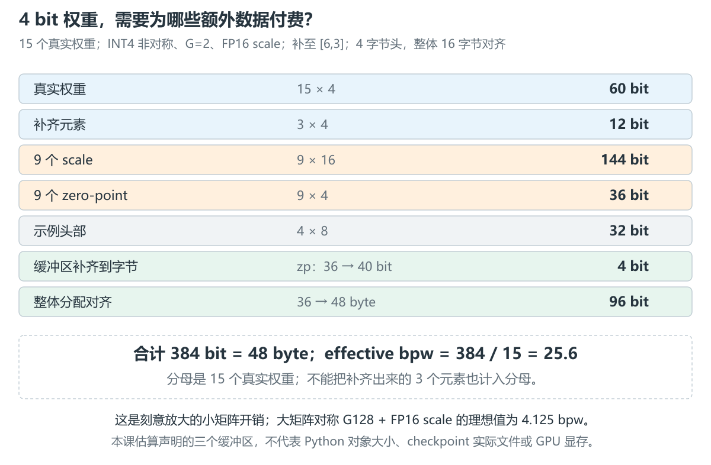

# 9.2 数值表示、量化公式与张量契约

[本篇目录](../README.md) · [总设计](../design.md) · [上一节 9.1](../01-quantization-system-overview/README.md) · [下一节 9.3](../03-calibration-observers-and-error-measurement/README.md)

> **已交付：CPU 数值课程。** 本节提供分组整数 Q/DQ、低精度浮点编码解码、存储开销计算、7 张中文图、20 个固定案例和含答案练习。默认只需 Python 标准库；可选 PyTorch 检查只做 CPU 位模式对照。真实模型、A100/C500 算子和性能在后续分别验收。

建议分三次学：先完成整数 Q/DQ 与非方阵手算，再看浮点表示，最后运行边界实验并核对存储报告。公式较多时，先把每个符号代进小矩阵，不必一次记住所有格式。

## 1. 本节为什么存在

上一节已经把算法、格式和 kernel 分开了。这一节继续追问：如果把一个“INT4 权重”交给你，你能把它还原成正确的矩阵吗？

仅知道 4 bit 不够。编码 `5` 可能表示整数 5，也可能在 `s=0.2,z=5` 的仿射量化中表示实数 0。即使拿到了 scale，若把按输入维分组误解为按输出维分组，程序仍能运行，输出却会改变。

因此，本节把**张量契约**理解为：生产者与消费者对 shape、编码、参数索引、舍入、padding 的共同约定。它先回答“这些数据表示什么”，到 9.7、9.8 再继续约定“这些数据如何保存和排列”。

我们的第一块权重不是方阵：

$$
X\in\mathbb R^{2\times5},\quad W\in\mathbb R^{5\times3},\quad Y=XW\in\mathbb R^{2\times3}.
$$

取 `group_size=2`。输入维 5 不能整除 2，最后一组只有一个真实元素。这个例子会把轴、尾组和补零问题一起暴露出来。

## 2. 本节需要解决的问题

1. 有符号 INT4 的范围是 `[-8,7]`，为什么代码却可能只使用 `[-7,7]`？
2. 怎样从一组浮点值求 scale 和 zero-point？常数、全零组怎样处理？
3. `per-channel`、`per-group`、`per-token` 分别让哪些元素共享参数？
4. FP8 的 E4M3FN 与 E5M2、FP4 的 E2M1 怎样解释一个位模式？
5. MXFP4、NVFP4 除了元素编码，还包含什么缩放参数？
6. 为什么 4-bit 权重的实际平均位数可能超过 4？应该把哪些开销算进去？

学完应能给 `[K,N]` 权重写出完整的 Q/DQ 索引表达式，并识别一个量化结果到底是“数学正确”“文件正确”还是“硬件已经执行”。

## 3. 前置知识

- 先读 [9.1](../01-quantization-system-overview/README.md)：Q、DQ、RQ、repack 与模型 Passport。
- 需要矩阵乘法、二进制、向下取整和绝对值。Python 部分使用列表与循环，暂不需要 CUDA。
- 不熟悉 PyTorch 权重方向时，回看 [2.1 最小模型](../../part-02-engine/01-pytorch-model/README.md)。本节坚持数学记法 `W[K,N]`；`nn.Linear.weight` 通常是 `[N,K]`，对接前必须处理转置。

## 4. 核心概念：先区分四种 dtype

| 层次 | 回答的问题 | W4A16 中可能出现的例子 |
| --- | --- | --- |
| storage dtype | 容器按什么单位存储？ | 一个 INT32 word 放多个低位宽编码 |
| logical dtype | 单个元素按什么规则解释？ | 有符号 INT4 或无符号仿射 4-bit code |
| multiply dtype | 乘法真正使用什么操作数？ | 解码并反量化后的 FP16 |
| accumulator dtype | 多个乘积如何累加？ | 某个 kernel 规定的 FP32 累加 |

右列是可能的实现，不能由 `W4A16` 名称直接推断。我们的 CPU 程序使用未打包的 Python 整数保存逻辑编码，以 Python float64 完成 DQ 和乘加；输入先明确转换为 FP32 数值。**逻辑上 4 bit，不代表 Python 容器已经压缩到 4 bit。**

### 4.1 整数的编码范围与量化器范围

| 位数 b | 二进制补码的有符号范围 | 无符号范围 | 本课对称量化器使用的范围 |
| --- | --- | --- | --- |
| 2 | [-2,1] | [0,3] | [-1,1] |
| 3 | [-4,3] | [0,7] | [-3,3] |
| 4 | [-8,7] | [0,15] | [-7,7] |
| 8 | [-128,127] | [0,255] | [-127,127] |

完整补码范围比正数多一个负端点。本课为了让两个端点关于零对称，使用 narrow range：令 $Q=2^{b-1}-1$，范围为 $[-Q,Q]$。这是一种明确选择，不是所有对称量化实现的统一规定。另一方面，使用无符号 code 也能表示负实数，因为 DQ 还会减去 z。



### 4.2 量化参数也有自己的 dtype

`scale=0.1` 在实数数学中是精确的十分之一，存成 FP16 后却是附近的可表示值。zero-point 也不能只记录“有或没有”：要知道它是整数还是浮点参数、用什么位宽保存，以及文件中是否采用偏移编码。

本课选择：scale 可以保存为 FP16、FP32 或 FP64；zero-point 是量化范围内的整数；不采用 `z-1` 等文件编码。后面的 q、s、z 都指**逻辑值**，不能直接套进某种 checkpoint 的原始缓冲区。

## 5. 数学推导与手算

### 5.1 从网格推导 Q、DQ

定义 scale $s>0$、整数 zero-point $z$ 和整数范围 $[q_{\min},q_{\max}]$。整数 q 对应的实数格点是：

$$
\hat x=s(q-z).
$$

若要找离 x 最近的格点，先除以 s 得到以格点间距为单位的位置，再取最近整数，最后加上表示实数零的编码 z：

$$
q=\operatorname{clip}\bigl(\operatorname{round}_{\mathrm{even}}(x/s)+z,q_{\min},q_{\max}\bigr).
$$

`round_even` 表示恰好落在两个整数中间时选偶数：`0.5→0`、`1.5→2`、`2.5→2`、`-1.5→-2`。这是 [ONNX QuantizeLinear 21](https://onnx.ai/onnx/operators/onnx__QuantizeLinear.html#quantizelinear-21) 整数量化语义可对照的规则；本课进一步固定范围、参数生成与尾组约定。

不要把式子随意改为 `round(x/s+z)`。ties-to-even 依据取整目标的奇偶性，z 为奇数时两种写法在中点上可能不同。例：`x/s=0.5,z=3`，本课得到 `0+3=3`，先加后取整则得到 `round(3.5)=4`。

没有饱和、没有额外浮点舍入时，最近格点误差不超过 $s/2$。一旦 x 超出可表示区间，clip 会把它压到边界，这个误差上界不再成立。

### 5.2 对称量化怎样求 scale

对一组真实元素 $\mathcal G$，令：

$$
a=\max_{x\in\mathcal G}|x|,\quad Q=2^{b-1}-1,\quad
s=\begin{cases}a/Q,&a>0\\1,&a=0\end{cases},\quad z=0.
$$

INT4 的 Q=7。组 `[-3.5,-0.75]` 得到 `s=0.5`，编码 `[-7,-2]`，反量化为 `[-3.5,-1]`。第二个元素误差是 `-0.25`。

全零组需要显式约定，不能令 `s=0` 再做除法。本课使用 `s=1,z=0,q=0`，所以 DQ 恰好为零。其他框架可能选择 epsilon，比较结果前先统一约定。

### 5.3 非对称量化怎样同时求 s 和 z

本课使用无符号范围 $[0,U]$，$U=2^b-1$。把实数零纳入拟合区间：

$$
l=\min(0,\min\mathcal G),\quad h=\max(0,\max\mathcal G).
$$

在 $h>l$ 时：

$$
s_*=(h-l)/U,\quad s=\operatorname{cast}_{\mathrm{scale\ dtype}}(s_*),\quad
z=\operatorname{clip}(\operatorname{round}_{\mathrm{even}}(-l/s),0,U).
$$

之后 Q/DQ **都使用存储后的 s**。当 $h=l=0$ 时仍取 `s=1,z=0`。

为什么把零纳入区间？看常数组 `[2,2]`：如果只用 `max-min`，scale 会是 0；纳入零后区间是 `[0,2]`，INT4 得 `s=2/15,z=0`。`[-2,-2]` 的区间是 `[-2,0]`，得到 `s=2/15,z=15`。本课的常数组都可正常处理。

再看一组容易手算的数：

$$
\mathcal G=[-1,0,1,2],\quad s=3/15=0.2,\quad z=5.
$$

| x | x/s | round(x/s)+z | q | s(q-z) |
| --- | --- | --- | --- | --- |
| -1 | -5 | 0 | 0 | -1 |
| 0 | 0 | 5 | 5 | 0 |
| 1 | 5 | 10 | 10 | 1 |
| 2 | 10 | 15 | 15 | 2 |

一般情况下，z 必须取整数，因此实际可表示区间 $[-sz,s(U-z)]$ 不一定恰好等于 $[l,h]$。不要把“使用 MinMax”理解为任何输入都精确命中两个端点。

### 5.4 scale 的存储舍入也是数值路径的一步

正确的参考顺序是：

```text
真实元素统计 → 求理想 s → 存储 dtype 舍入 → 求 z → Q → 保存同一个 s,z → DQ
```

若生产者用未舍入的 s 编码，却只保存一个舍入后的 s，消费者就无法重现原来的网格。本课 `cast_scale()` 在量化前完成这一步，并拒绝下溢成零或溢出成无穷的 scale。

例如 `amax=1e-8` 的 INT4 对称组，理想 scale 约 `1.43e-9`，保存为 FP16 会下溢成零。程序报错；可以由调用者改用更宽的 scale、调整缩放策略或明确规定 epsilon，但不能悄悄改参数再声称与原公式完全等价。

### 5.5 非方阵分组：把索引写出来

固定 $W[K,N]$，沿 K 每 G 个元素一组，每个输出列独立：

$$
g(k)=\lfloor k/G\rfloor,\quad
s\in\mathbb R_{>0}^{\lceil K/G\rceil\times N},\quad
z\in\mathbb Z^{\lceil K/G\rceil\times N}.
$$

每个组都有正 scale 和整数 zero-point。逐元素 Q/DQ 为（clip 使用本次声明的整数范围）：

$$
q_{k,n}=\operatorname{clip}\left(\operatorname{round}_{\mathrm{even}}\frac{W_{k,n}}{s_{g(k),n}}+z_{g(k),n}\right),
\quad \hat W_{k,n}=s_{g(k),n}(q_{k,n}-z_{g(k),n}).
$$

代入主例：

$$
W=\begin{bmatrix}
-3.5&0&0.25\\-0.75&7&1.75\\0.25&1.5&-3.5\\1.75&3.5&0.75\\2.5&14&-0.5
\end{bmatrix},\quad
X=\begin{bmatrix}1&0&2&-1&0.5\\0&1&0&1&-1\end{bmatrix}.
$$

G=2 时每列有三组：行 `[0,1]`、行 `[2,3]`、行 `[4]`。对称 FP64 scale 为：

$$
s=\begin{bmatrix}0.5&1&0.25\\0.25&0.5&0.5\\2.5/7&2&0.5/7\end{bmatrix},\quad z=0.
$$

得到：

$$
q=\begin{bmatrix}-7&0&1\\-2&7&7\\1&3&-7\\7&7&2\\7&7&-7\end{bmatrix},\quad
\hat W=\begin{bmatrix}-3.5&0&0.25\\-1&7&1.75\\0.25&1.5&-3.5\\1.75&3.5&1\\2.5&14&-0.5\end{bmatrix}.
$$

只有 `-0.75→-1` 与 `0.75→1` 两个元素产生误差。因此权重最大绝对误差为 0.25，MSE 为 $(0.25^2+0.25^2)/15=1/120$。乘以同一个 X：

$$
XW=\begin{bmatrix}-3.5&6.5&-7.75\\-1.5&-3.5&3\end{bmatrix},\quad
X\hat W=\begin{bmatrix}-3.5&6.5&-8\\-1.75&-3.5&3.25\end{bmatrix}.
$$

这组输入的输出最大误差也恰好是 0.25，**不意味着输出误差总与权重误差相等**：$\Delta Y=X\Delta W$，误差会经过输入加权累加。9.3 会把权重误差与层重构误差正式分开。

## 6. 中文图解：粒度、浮点与存储

### 6.1 per-channel 里的 channel 究竟是哪一维



| 场景 | 共享关系 | 本课参数 shape 或明确的广播示例 |
| --- | --- | --- |
| per-tensor W[K,N] | 整个矩阵一对参数 | [1,1] |
| per-output-channel W[K,N] | 同一输出列共享 | [1,N] |
| 沿 K 的 per-group | 每列内连续 G 行共享 | [ceil(K/G),N] |
| 沿 N 的 per-group | 每行内连续 G 列共享 | [K,ceil(N/G)] |
| per-token X[M,K] | 一个 token 的 K 个特征共享 | [M,1] |
| per-head KV[B,H,T,D] | 每个 head 共享，跨 B/T/D | 例如 [1,H,1,1] |
| per-token-per-head KV | 每个样本、head、token 独立 | 例如 [B,H,T,1] |

最后两行只是明确命名的广播示例，本节代码只实现二维。`row-wise` 仅表示按当前存储行组织；必须先说这一行代表 token、输入通道还是输出通道。二维 tile 的 per-block 也不能与一维 G 元素组混用：要记录 tile 的两个尺寸。

特别注意两个不同的 axis 语义：本课 `axis=0` 表示**沿 K 切组**；ONNX per-axis 量化的 axis 表示 **1D scale 随哪一维变化**。对 `W[K,N]` 的每输出通道参数，ONNX 可用长度 N 的 scale 和 `axis=1`。数字不相同并不矛盾，不能只复制参数名而忽略广播规则。ONNX 的 blocked quantization 又使用同秩、分组轴被压缩的参数形状，须看具体算子版本。[ONNX DequantizeLinear 21](https://onnx.ai/onnx/operators/onnx__DequantizeLinear.html#dequantizelinear-21)

### 6.2 尾组与 padding：零应该怎样填



本课默认保留 `[5,3]`，尾组只统计最后一行。若后端要求组长对齐，可以把物理 shape 补为 `[6,3]`，但逻辑 shape 仍是 `[5,3]`。

以最后一列的非对称尾组 `[-0.5]` 为例：`s=0.5/15,z=15`。真实的 `-0.5` 编码为 0；补入的**实数零**应编码为 15：

$$
q_{\mathrm{pad}}=z,\qquad s(q_{\mathrm{pad}}-z)=0.
$$

把整个编码缓冲区用整数 0 初始化，对这个尾组等价于补入负权重。对实际 FP16 scale，错误填零产生的值接近 -0.5，准确值由保存的 scale 决定。

我们先统计真实元素，再补齐编码。对本课这种主动包含零的 MinMax/amax，额外加入实数零不会改变极值；但样本数量、均值、直方图、分位数可能改变。因此“padding 总会改变 MinMax”也不准确，统计 mask 应从一开始就记录清楚。

### 6.3 FP8 / FP4 的位域公式



令 S 为符号位，E 为指数域的无符号整数，F 为尾数字段整数，m 为尾数位数，bias 为指数偏置。对可表示的**有限正规数**：

$$
v=(-1)^S\,2^{E-\mathrm{bias}}\left(1+\frac{F}{2^m}\right).
$$

指数域全零时，使用 subnormal（次正规数）规则，不再带隐藏的前导 1：

$$
v=(-1)^S\,2^{1-\mathrm{bias}}\frac{F}{2^m}.
$$

F=0 产生带符号的零。指数全一的含义要按具体格式处理，不能套用一个通用的 Inf 规则。

| 本课格式 | S/E/M 位数 | bias | 最小正正规数 | 最小正 subnormal | 最大有限值 | 特殊值 |
| --- | --- | --- | --- | --- | --- | --- |
| E4M3FN | 1/4/3 | 7 | $2^{-6}$ | $2^{-9}$ | 448 | 有 NaN，无 Inf |
| E5M2 | 1/5/2 | 15 | $2^{-14}$ | $2^{-16}$ | 57344 | 有 NaN、Inf |
| E2M1 | 1/2/1 | 1 | 1 | 0.5 | 6 | 无 NaN、Inf |

上表限定 E4M3**FN**，不是所有名为 E4M3 的变体；FNUZ 等变体在零、偏置和特殊值上另有规则。格式定义对照 [ONNX Float8](https://onnx.ai/onnx/technical/float8.html) 与 [Float4](https://onnx.ai/onnx/technical/float4.html)。

指数位与尾数位在有限预算内分工：更多指数位通常用来扩大动态范围，更多尾数位用来细分同一指数区间。例如在 `[1,2)` 内，E4M3FN 的格点间距是 1/8，E5M2 是 1/4；E5M2 的最大有限值更大，却不能因此认为它在每一处都更精确。选择格式时，要同时看数据的跨度与局部误差。

手算 E4M3FN 的 `0x3D=00111101`：S=0，E=`0111`=7，F=`101`=5，得到 $2^{7-7}(1+5/8)=1.625$。若看到 `0x38`，它作为 UINT8 是 56，作为 E4M3FN 是 1，作为 E5M2 是 0.5。重新解释位模式与按数值做 dtype 转换是两件事。



E2M1 的非负格点是 `0,0.5,1,1.5,2,3,4,6`，再加负号得到另一半编码，其中包含负零。它并非 INT4 的 16 个等距整数换了一个名字。例如 2.5 在 2 与 3 之间，本课 nearest-even 编码选择尾数最低位为偶的 2；5 在 4 与 6 之间，选择 4。

**溢出、饱和与 FTZ 分开讨论：**

- 整数饱和将超界值夹到端点；按低 b 位截断则可能回绕。例如无符号 4 bit 的 `17 & 15=1`，不等于饱和后的 15。
- E5M2 有 Inf 编码，不代表每个转换接口遇到大数都必须生成 Inf；转换策略要另行声明。
- 本课浮点编码器只接受有限输入，以最近偶数编码；超范围默认饱和到最大有限值，也可选择报错。它不是某个厂商完整的 NaN/Inf 转换实现。
- 解码器支持 NaN/Inf 的合法位模式。`ftz=True` 是显式教学选项，把 subnormal 解成带符号零；默认保留 subnormal。不能据此推断 A100 或 C500 的实际指令行为。

### 6.4 MXFP4 / NVFP4 的格式名包含了缩放结构



单个 E2M1 元素只表达一小组格点。块缩放再用共同的 scale 扩展范围：

$$
\hat x_i=s_{\mathrm{block}}\,v_i.
$$

若把这一过程写成浮点格式的 Q/DQ，逻辑上是 `code_i = encode_format(x_i / s)`，再以 `s * decode_format(code_i)` 还原。这里的 encode 会选择该浮点格式的非均匀格点，不能替换为整数 `round()`。本节讨论的这些块浮点格式没有另加整数仿射 zero-point；它们由带符号浮点元素、零编码与缩放共同表达实数。若实际格式还有额外偏移，须另外写入契约。

OCP MX v1.0 中，MXFP4 使用 32 个 E2M1 元素共享一个 E8M0 scale。MXFP8 同样采用 32 元素块与 E8M0 scale，元素为相应的 8-bit 浮点格式。E8M0 没有符号位、没有尾数位：code 0—254 表示 $2^{\mathrm{code}-127}$，255 表示 NaN；**不存在零 scale 编码**。全零元素仍可用有限 scale 表示全零块。规范没有替你确定所有的 scale 选择算法。[OCP MX v1.0，§5—6](https://www.opencompute.org/documents/ocp-microscaling-formats-mx-v1-0-spec-final-pdf)

NVFP4 使用 16 元素块、E4M3 块 scale 和额外 FP32 全局 scale。本课按直接 DQ 乘数记为：

$$
\hat x_i=s_{\mathrm{global}}s_{\mathrm{block}}v_i.
$$

例如 `global=0.5,block=1,v=6`，DQ 得 3。某些接口暴露的是量化方向的逆 scale；读取变量时先确认乘除方向，不能拿名字相同当作值相同。本课块 scale 采用 E4M3FN 解码，global 参数先舍入为 FP32，再以 float64 做参考乘法。[NVIDIA NVFP4 格式说明](https://developer.nvidia.com/blog/introducing-nvfp4-for-efficient-and-accurate-low-precision-inference/)

这里只实现上述**数值分解的解码**，没有实现 MX/NV 的完整量化策略、内存布局、scale swizzle 或原生 MMA。FP4 的讨论不会成为 A100/C500 已支持该计算路径的声明。

### 6.5 effective bpw：把分子逐项展开

设 $N_w$ 是真实权重数，所有 B 均以 bit 计：

$$
\mathrm{effective\ bpw}=\frac{B_w+B_s+B_z+B_{\mathrm{header}}+B_{\mathrm{tail}}+B_{\mathrm{byte}}+B_{\mathrm{align}}}{N_w}.
$$

这里区分三种 padding：张量补齐元素、每个缓冲区向字节取整，以及分配或文件要求的对齐。不同容器不一定都有三种；必须按实际声明逐项计算，不能重复计费。



本例声明 q、scale、z 三个独立的紧密缓冲区，各自向字节取整，再附加一个假设的 4 字节头，整体按 16 字节对齐。计算为：

```text
q：6×3×4 bit = 72 bit = 9 byte（其中真实权重 60 bit，尾组 padding 12 bit）
scale：3×3×16 bit = 144 bit = 18 byte
z：3×3×4 bit = 36 bit → 向字节取整 40 bit = 5 byte
示例头部：4 byte
小计：9+18+5+4 = 36 byte
整体 16 byte 对齐：48 byte = 384 bit
effective bpw：384 / 15 = 25.6
```

这个小矩阵故意放大元数据与对齐开销，不用于预测大模型压缩率。大矩阵、完整组、无额外对齐时，对称 W4 G128 + FP16 scale 的理想值是 $4+16/128=4.125$；再保存每组 4-bit z 则是 $4+(16+4)/128=4.15625$。如果 z 实际存为 INT32，要把 4 改成 32。

同一口径下，MXFP4 payload 是 $4+8/32=4.25$ bpw；MXFP8 是 8.25；NVFP4 是 $4+8/16+32/N_w$。这些公式都假设完整块、一个全局 scale 的作用域已经说明，尚未包含文件头、尾块、布局 padding 或运行时 workspace。

因此要分别报告：元素位宽、声明缓冲区的 effective bpw、真实 checkpoint 字节数、加载后设备分配量。Python 对象的内存大小也属于另一种测量。

## 7. 最小 CPU 实现与运行

从仓库根目录执行：

```bash
python -m scripts.experiments.lesson0902
python docs/chapters/part-09-quantization/02-numerical-representations-and-tensor-contracts/examples/walk_groups.py --asymmetric --pad
python docs/chapters/part-09-quantization/02-numerical-representations-and-tensor-contracts/examples/inspect_bits.py
python docs/chapters/part-09-quantization/02-numerical-representations-and-tensor-contracts/examples/count_bits.py
```

第一条运行 20 个固定案例并生成两份 CPU Passport。输出目录是 `.local/runs/part-09-quantization/02-tensor-contracts/`，可用 `--output-dir` 指定。完整命令、错误案例和逐步输出见[实验手册](lab.md)。

核心实现位于 [tensor_contract.py](../../../../zero2vllm/quantization/tensor_contract.py)：

```python
tensor = quantize_asymmetric(
    w, bits=4, axis=0, group_size=2,
    scale_dtype="float16", pad_to_group=True,
)
restored = dequantize(tensor)  # 默认只返回逻辑 [5,3]
with_padding = dequantize(tensor, include_padding=True)  # [6,3]
```

`axis=None,group_size=None` 是 per-tensor；`axis=0,group_size=None` 覆盖每个输出列的完整 K；对 X 使用 `axis=1,group_size=None` 则每个 token 一组。`QuantizedTensor` 保存逻辑/物理 shape、参数矩阵及 dtype，并检查 padding code 是否等于对应 z。

读代码时先追三条线：`_geometry()` 决定 shape；`_quantize()` 只从真实元素取统计量，并在 Q 前保存 scale 精度；`dequantize()` 使用同一 `parameter_index()`。换轴时不能只改统计循环而忘记改 DQ 的索引。

[minifloat.py](../../../../zero2vllm/quantization/minifloat.py) 采用位域解码和有限格点枚举编码，优先让规则可读。枚举不是高性能实现；真正的转换与融合算子留给 9.9、9.10。

## 8. 真实框架对应：比较契约，不比较名称

本节把规范和实现分开核验，详细入口见[源码与规范定位](source-map.md)。

| 本课问题 | 对照入口 | 核对内容 |
| --- | --- | --- |
| Q/DQ 公式与广播 | ONNX QuantizeLinear / DequantizeLinear 21 | nearest-even、axis、blocked 参数形状 |
| 由极值产生参数 | PyTorch v2.7.1 `_calculate_qparams()` | 纳入零、qscheme、epsilon 与整数 zero-point |
| FP8 位模式 | PyTorch 2.7.1 CPU float8 dtype | 256×2 种编码，含 NaN、Inf、正负零 |
| MX 的元素与 scale | OCP MX v1.0 | block 大小、E8M0 与元素格式分别定义 |
| NVFP4 的两级缩放 | NVIDIA 格式介绍 | 块 scale、全局 scale 的作用域与乘除方向 |

我们没有把教学 quantizer 包装成 PyTorch Observer 的逐位替代品。PyTorch 对称 scale 的分母取决于 `quant_min/quant_max`，并可能用 epsilon 下限；默认完整 signed 范围与本课 narrow range 不同。本课使用二维参数矩阵和显式 scale cast，也不是 ONNX 文件导出器。

若本机已有 PyTorch，可运行：

```bash
python -m scripts.experiments.lesson0902 --torch-check
```

它把 0—255 的 UINT8 位模式分别 view 为两种 FP8，再转成 FP32，与参考解码器逐项比较。它检查**编码解释**，没有执行 FP8 GEMM。已发布的实际版本与比较结果在 [results](results/README.md)。

## 9. GPU / Runtime 实验的边界

本节 CPU 即可完成。A100、C500 均未在这一节进行硬件实测；不把“可解码某个格式”等同于“有原生低精度乘法指令”。

到 GPU 章节至少补上：输入/权重实际 dtype、scale 布局、zero-point 编码、乘法与累加类型、尾块处理、kernel 名称及调用证据。A100 与 C500 分别填写自己的软件栈和运行记录，不能共用一项“GPU 已验证”。

## 10. 常见误区与可复现反例

| 误区 | 本节如何反驳 |
| --- | --- |
| unsigned 编码无法表示负数 | `s=.2,z=5,q=0` 的 DQ 是 -1 |
| 对称 INT4 一定使用 -8 | 本课明确只用 [-7,7]，编码范围与使用范围分开 |
| group_size 相同就能交换参数 | W[5,3] 换轴后参数从 [3,3] 变成 [5,2] |
| padding 总填整数 0 | 非对称尾组 z=15，正确零编码是 15 |
| scale dtype 只是存储细节 | 过小 FP16 scale 下溢为零，Q 将无法定义 |
| FP4 与 INT4 仅名称不同 | E2M1 格点不均匀，特殊值规则也不同 |
| FP8 cast 与 bit view 相同 | `0x38` 的三种解释为 56、1、0.5 |
| 4-bit 模型文件一定是 FP16 的四分之一 | s、z、头部、尾块和对齐都需要计费 |

## 11. 工程边界：哪些变化会改变数值模型

### 11.1 TP 后不能丢掉全局组索引

W 的 K=5、G=2，对应全局组号 `[0,0,1,1,2]`。假设沿 K 在索引 3 处分成两个分片，第二片拿到全局行 3、4，对应组号应是 `[1,2]`。若直接按本地行号重新计算 `floor(local_k/2)`，会得到 `[0,0]`，把原本属于不同组的两行错误地共享参数。

可以保留全局映射并复制必要参数，也可以选择对齐组边界的切分；若要重新校准分组，则需要重新 Q，并评估误差。不能把改组与改变布局的 repack 混为一谈。本节只演示索引算术，TP/EP 的实际实现留到 9.12。

### 11.2 RQ 应该放在哪一层

Q 把浮点值编码，DQ 按已有参数解释编码；如果目标组的 s、z 或范围发生变化，就涉及新的量化表示。概念上的 RQ 是：

$$
q_2=\operatorname{clip}\left(\operatorname{round}_{\mathrm{even}}\left[\frac{s_1}{s_2}(q_1-z_1)\right]+z_2\right).
$$

参数逐元素按各自的组索引取值。RQ 可能再次引入舍入和饱和，不能恢复原始 W 已经丢掉的信息；如果还有原始浮点 W，可比较从 W 重新量化与经旧表示重量化的差别。9.1 已有双重舍入反例，这里不另写一个重复算子。

### 11.3 本实现的明确限制

- 整数 API 只支持二维、有限 FP32 输入值，位宽 2/3/4/8；拒绝布尔值、空/不规则矩阵，以及输入转换溢出或非零下溢。
- 只提供 amax 对称与包含零的 MinMax 非对称；没有校准集、clipping 搜索、GPTQ/AWQ 等优化。
- 浮点模块只支持明确列出的三个元素格式；编码只接受有限输入。MX/NV 只做单块数值解码，没有完整生产器。
- scale 若不能按声明 dtype 保存就报错；不会自动回退、偷偷改成 epsilon 或更宽 dtype。
- 估算器假设独立 q/s/z 缓冲区和指定头部/对齐方式，不提供真实文件或显存测量。

## 12. 练习

[练习与参考答案](exercises.md) 共 16 组：先手算整数和浮点，再修改分组/scale dtype，最后分析尾组、TP 和 bpw。建议至少完成第 1、3、6、9、13、15 题，之后再进入 9.3。

## 13. 实验产物

| 产物 | 作用 |
| --- | --- |
| [固定输入](data/grouped-linear.json) | 主矩阵、手算 golden、独立列出的位数账单 |
| [实验手册](lab.md)与 [examples](examples/README.md) | 命令、参数与可复核输出 |
| [数值结果](results/summary.json) | 20 个案例、原始/量化输出、两种参数契约 |
| [对称 Passport](results/symmetric-passport.json) | FP64 scale、逻辑 [5,3]、z=0 |
| [非对称 Passport](results/asymmetric-passport.json) | FP16 scale、物理 [6,3]、非零 z 和补零 |
| [命令记录](results/commands.json) | 默认、换轴、FP4、FTZ、错误参数及 PyTorch 对照 |
| [插图与源稿](assets/README.md) | 7 张 PNG 与可编辑 SVG，数值对应本课公式与输入 |
| [质量记录](../../../../reports/quality/lesson-9.2-delivery/README.md) | 回归、文档链接与分级目录检查 |

两份 Passport 都描述合成 CPU 张量。模型质量、显存、TTFT、TPOT 等没有测量的字段保持 unknown；不能把矩阵误差填成 Qwen 的评测分数。

## 14. 完成标准与下一节

- [x] 能从 q、s、z 和轴索引还原非方阵权重，解释尾组与 q_pad=z。
- [x] 对称/非对称、常数/全零、scale 精度、两种轴均有独立数值测试。
- [x] 有限浮点编码 round-trip 与特殊值测试；FP8 位模式与可选 PyTorch oracle 对照。
- [x] 将权重、参数、padding 和对齐逐项算入 effective bpw。
- [x] 原始输入、命令、结果、Passport 和中文图源可公开复核。

回到贯穿问题 **“Qwen3-8B-W4A16-G128，现在又知道了什么？”**：仅 W4A16/G128 仍不知道 signed/unsigned、symmetric/asymmetric、分组轴、scale dtype、z、tail 和实际执行 dtype。现在你已经能列出这些缺项，也能用小矩阵检查它们是否自洽。

下一节 [9.3 Calibration、Observer 与误差测量](../03-calibration-observers-and-error-measurement/README.md) 将回答：输入统计从哪里来、数据和 token budget 怎样影响结果，以及为什么最小权重 MSE 未必产生最好的层输出。

## 15. 源码与规范入口

- [本课源码定位](source-map.md)：固定版本、对应函数及已核验范围。
- [PyTorch v2.7.1 observer.py](https://github.com/pytorch/pytorch/blob/v2.7.1/torch/ao/quantization/observer.py)：参数计算、qscheme、epsilon。
- [ONNX QuantizeLinear 21](https://onnx.ai/onnx/operators/onnx__QuantizeLinear.html#quantizelinear-21) / [DequantizeLinear 21](https://onnx.ai/onnx/operators/onnx__DequantizeLinear.html#dequantizelinear-21)：Q/DQ 与广播语义。
- [ONNX Float8](https://onnx.ai/onnx/technical/float8.html) / [Float4](https://onnx.ai/onnx/technical/float4.html)：位域和特殊值。
- [OCP Microscaling Formats v1.0](https://www.opencompute.org/documents/ocp-microscaling-formats-mx-v1-0-spec-final-pdf)：MX 数据类型与 E8M0。
- [NVIDIA NVFP4 介绍](https://developer.nvidia.com/blog/introducing-nvfp4-for-efficient-and-accurate-low-precision-inference/)：元素、块与全局缩放。
