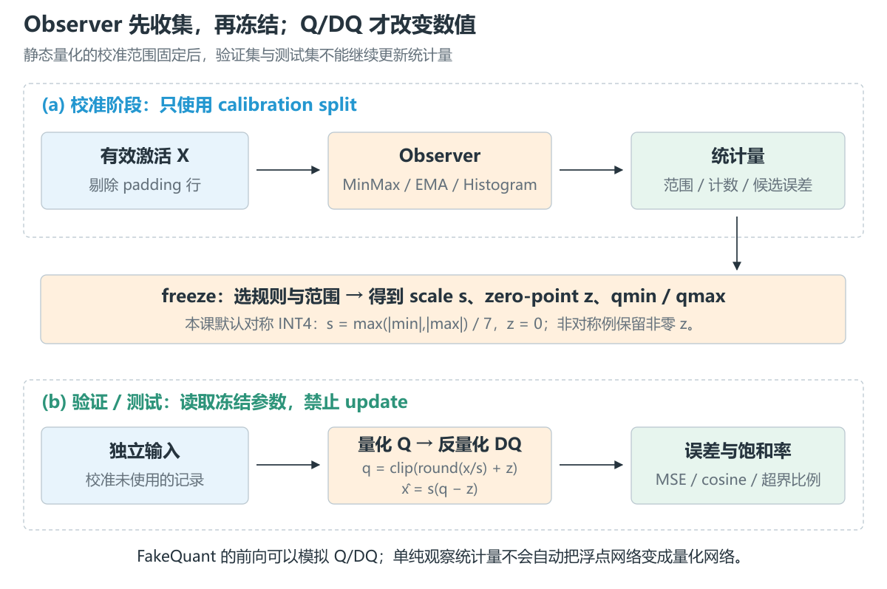
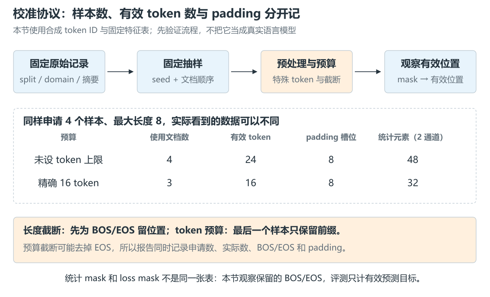
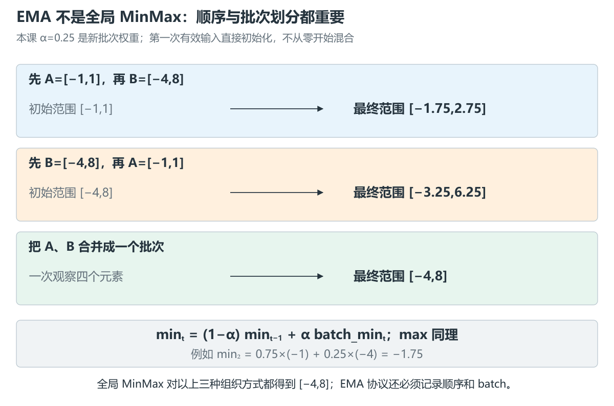
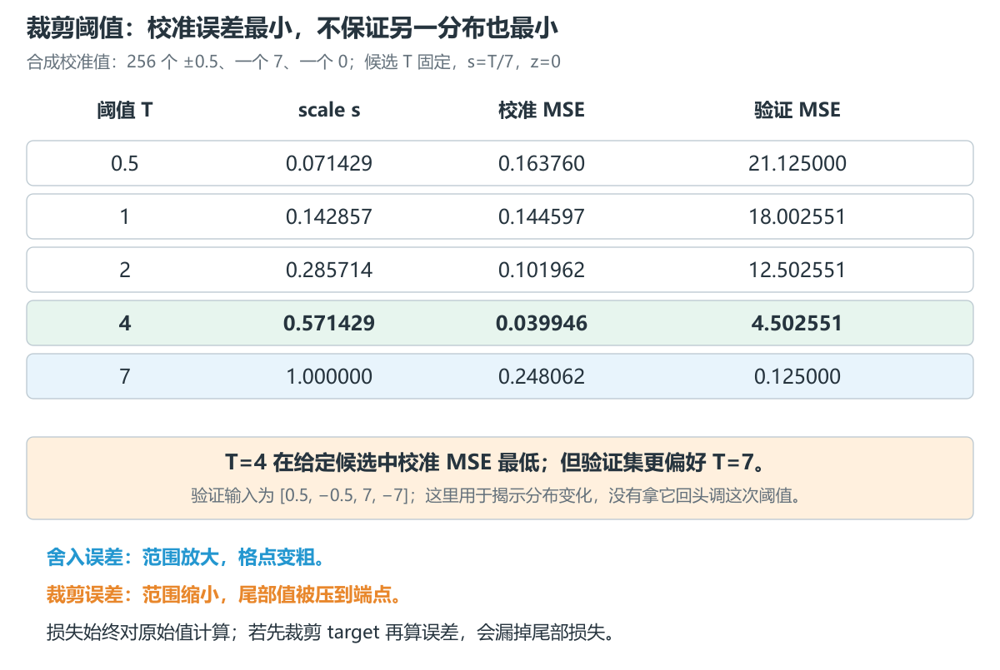
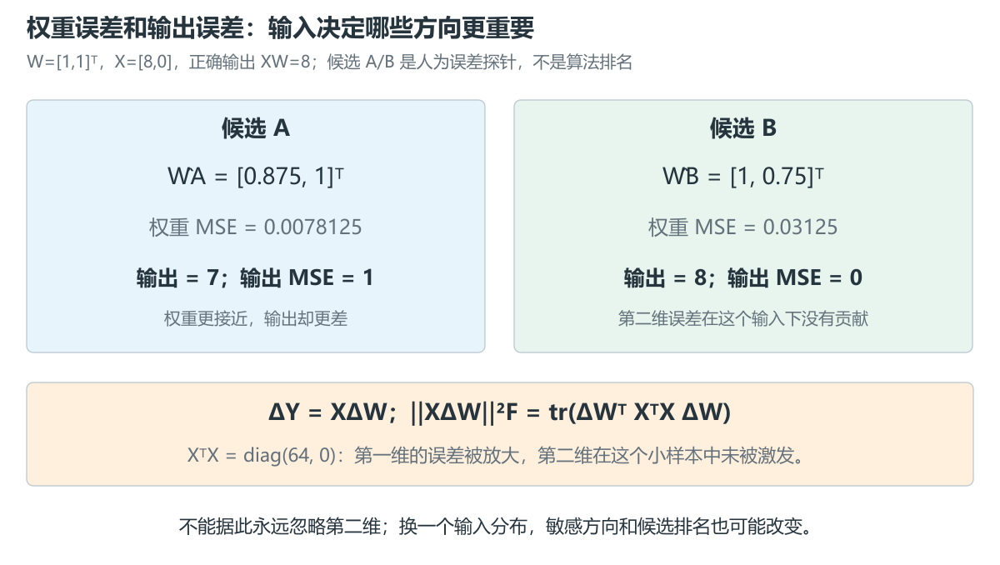
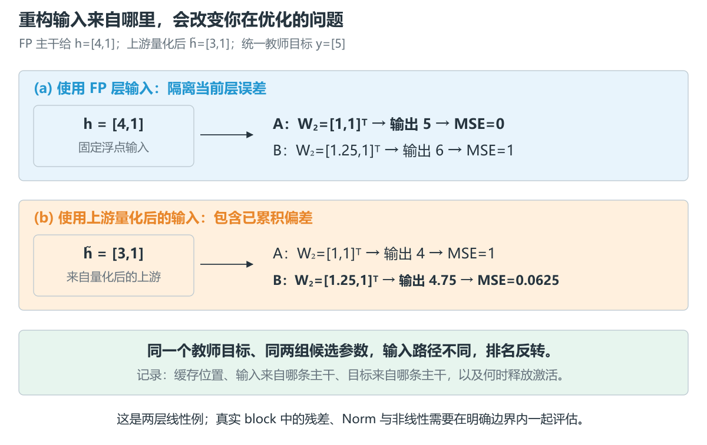
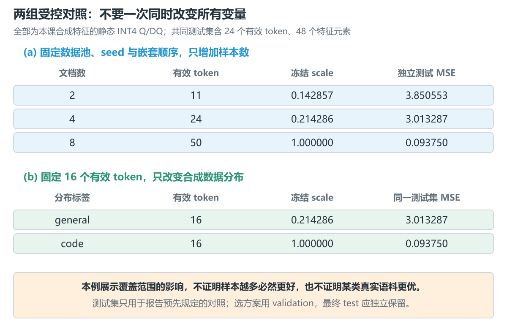

# 9.3 Calibration、Observer 与误差测量

[本篇目录](../README.md) · [总设计](../design.md) · [上一节 9.2](../02-numerical-representations-and-tensor-contracts/README.md) · [下一节 9.4](../04-quantization-algorithms-and-error-control/README.md)

> **已交付：CPU 校准与误差实验。** 本节包含校准协议、MinMax / EMA、固定分箱直方图、分位数与 MSE 裁剪搜索、20 个固定案例、7 张中文图和含答案练习。默认只用 Python 标准库；可选与 PyTorch 2.7.1 CPU Observer 对照。使用合成 token 与特征，未运行 Qwen、MQBench 模型实验或 A100/C500。

建议先读协议与 Observer，再完成两个受控对照，最后推导层重构目标。不要只观察 scale 的最终数字：它依赖哪些样本、哪些位置、怎样的统计过程，同样属于结果。

## 1. 本节为什么存在

9.2 已经规定了 Q/DQ 的数值与张量契约，但 scale 从哪里来还没有充分展开。

对静态激活量化，推理前尚不知道未来每个请求的激活。我们通常先用一批代表性输入运行浮点模型，收集范围或分布，再确定量化参数。这个过程叫 **calibration，校准**。对一些权重量化算法，输入还用于估计哪些权重误差更影响层输出。

如果只记录“128 条 WikiText”，另一位工程师仍无法复现：每条多长、选了哪些段落、是否拼接、使用哪版 tokenizer、加不加 BOS/EOS、padding 是否进入统计，都可能不同。

因此本节交付的不只是一种 Observer，还包括一份能说明**数据如何变成统计量、统计量如何变成参数、参数如何接受独立评测**的协议。

## 2. 本节需要解决的问题

1. 样本数、有效 token 数、padding 槽位数有何区别？
2. Observer、FakeQuant、校准与模型评测分别做什么？
3. 全局 MinMax、EMA、Percentile、Histogram、MSE / KL 搜索之间是什么关系？
4. 怎样控制数据量与数据分布两个变量？
5. 权重 MSE、层输出误差、block 重构误差、模型 PPL 与任务准确率为什么不能互相替代？
6. 使用浮点主干输入与上游量化后的输入，会怎样改变重构问题？

## 3. 前置知识

- [9.1](../01-quantization-system-overview/README.md)：Q、DQ、RQ、模型 Passport 与证据范围。
- [9.2](../02-numerical-representations-and-tensor-contracts/README.md)：scale、zero-point、舍入、分组轴、尾组和 mask。
- 基本均值、平方误差与矩阵乘法即可运行本节。迹 `tr()` 只是方阵对角线元素之和，第一次遇到时先看二维例子。

主实验量化的是 `[token,channel]` 激活，采用**静态 per-tensor、signed INT4 [-7,7]、FP64 scale、z=0**。位宽较低是为了放大教学现象，不代表建议将实际模型全部激活直接降为 INT4。

## 4. 核心概念：校准是一份实验协议

### 4.1 哪些量化需要输入数据

| 场景 | 校准输入的作用 |
| --- | --- |
| 简单 weight-only RTN | 可直接从权重求参数，不一定需要文本校准集 |
| 静态激活量化 | 估计未来激活的范围或分布，生成固定参数 |
| 动态 per-token 量化 | 运行时从当前 token 求参数；离线数据仍可用于选策略、评测与优化其他部分 |
| 层 / block 重构 | 提供输入与教师输出，衡量量化误差对计算的影响 |
| 输入敏感的权重量化 | 利用激活统计、重构目标或近似二阶信息指导优化 |

“weight-only”描述计算方案，不能据此认定量化算法完全不使用输入。反过来，校准也不一定要更新权重：Observer 收集统计与后续求参数可以独立进行。

### 4.2 Observer 与 FakeQuant 的职责

Observer 观察浮点值，保存极值、直方图等统计量。FakeQuant 的前向则可以模拟：

$$
\hat x=\operatorname{DQ}(\operatorname{Q}(x))
=s\left[\operatorname{clip}(\operatorname{round}_{\mathrm{even}}(x/s)+z)-z\right].
$$

输出通常仍放在浮点张量中，以便继续普通浮点计算。观察统计、启用假量化是两个开关；`model.eval()` 也不能代替这两个开关。[PyTorch FakeQuantize 2.7](https://docs.pytorch.org/docs/2.7/generated/torch.ao.quantization.fake_quantize.FakeQuantize.html)



本课明确使用 `collect → freeze → evaluate`：冻结后不许调用 Observer 的 update。如果测试样本继续改变 scale，它就不再是固定方案的独立测试。需要重新校准时先 reset，并保存成新的一次实验。

### 4.3 一份协议至少记录什么

| 项目 | 必须回答的问题 |
| --- | --- |
| 数据来源 | 数据集名、配置、revision、split、领域和内容摘要是什么？ |
| 抽样 | seed、抽样算法、候选顺序、实际样本 ID、是否去重？ |
| 数量 | 请求了几条，实际用了几条，有多少有效 token / 统计元素？ |
| tokenizer | 名称、revision、特殊 token、chat template 与编码选项？ |
| 长度 | 最大长度、左/右截断、EOS 是否保留、短样本如何处理？ |
| 拼接 | 是否跨文档串接、分隔符、窗口/stride、是否允许跨文档 Attention？ |
| padding | 左/右填充、pad ID、attention mask、统计 mask、loss mask？ |
| 前向 | model revision、eval 状态、dtype、输入来自浮点还是量化主干？ |
| 统计 | 目标层、粒度、Observer、EMA 系数含义、batch 大小与顺序？ |
| 评测 | 验证/测试 split、基线、指标、目标 token 数和分母约定？ |

只固定 seed 不够：数据原始顺序、库版本、tokenizer 或预处理变了，同一 seed 也不保证同一输入。因此协议保存实际 ID、处理后 token/mask 摘要；数据与特征表也各自留摘要。

### 4.4 本课的公开小数据

[corpus.json](data/corpus.json) 包含 24 条原创合成 token 序列：16 条 calibration、4 条 validation、4 条 test。`general`、`code` 只是两种合成分布的标签，不能拿结果评价真实自然语言或代码语料。

两组样本量/分布对照使用其中的 calibration 与 test；corpus 的 validation 预留给扩展练习。后面的裁剪反例另行给出四个验证值，其样本数量不与这份 corpus 混算。

token 0/1/2 分别表示 PAD/BOS/EOS。每个 ID 映射到固定的两个特征值，例如 token 3 为 `[0.25,0.5]`，token 8 为 `[7,-6]`。这个 lookup 便于控制实验，不模拟 Transformer 的上下文依赖。PAD 特征故意设成 `[999,-999]`，用于快速发现统计 mask 错误。

### 4.5 长度、token budget 和三个 mask



本课预处理顺序是：

```text
筛 split / domain → 固定 seed 打乱文档 → 取样本前缀
→ 为 BOS/EOS 留位置 → 右截断正文 → 添加特殊 token
→ 应用有效 token 预算 → 右 padding → 生成统计 mask
```

长度截断会保留预留的 EOS；精确 token 预算可能在最后一条的中途用完，此时只保留前缀，EOS 可能被去掉。两种截断规则分别记录。若所选样本不足以提供预算，程序报错，不通过重复样本或 padding 凑数。

申请 4 条 general 样本、最大长度 8，实际有 24 个有效 token、8 个 padding 槽位；再固定预算为 16，则实际用到 3 条样本、16 个有效 token、8 个 padding 槽位。每个 token 两个特征，因此统计元素数分别是 48 和 32。

在真实模型里还应区分：

- **attention mask**：决定哪些位置参与模型的注意力计算。
- **统计 mask**：决定哪些激活进入 Observer。本课保留 BOS/EOS，排除 PAD。
- **loss mask**：决定哪些目标参与损失。仅作为上下文的 token、padding 或被屏蔽标签不应计入分母。

传给模型 attention mask，并不保证所有 forward hook 收到的 padding 激活都是零。统计前仍需主动索引有效位置。截断和拼接还会改变真实模型的上下文；固定 token 数控制了预算，并没有让两组输入的语义完全相同。

## 5. 数学推导：从统计量到量化参数

### 5.1 全局 MinMax

第 t 批有效数据的极值记为 $m_t,M_t$。全局 MinMax 的更新是：

$$
l_t=\min(l_{t-1},m_t),\qquad h_t=\max(h_{t-1},M_t).
$$

首次有效输入直接初始化；没有有效元素的批次不更新。相同数据无论如何排列或分批，最终极值相同。优点是简单、内存小；问题是一个少见极值就可能拉宽范围，使大多数普通值落在更粗的格点上。

本课对称 INT4 使用 $a=\max(|l|,|h|)$、$s=a/7,z=0$，全零时约定 s=1。非对称 [0,15] 的参数先包含实数零，再按 9.2 的规则求 s 与整数 z。例如范围 `[-1,2]` 得 `s=.2,z=5`，实数零编码为 5。

### 5.2 EMA MinMax：平滑的是每批极值

令 $\alpha$ 为**新批次**权重：

$$
l_t=(1-\alpha)l_{t-1}+\alpha m_t,\qquad
h_t=(1-\alpha)h_{t-1}+\alpha M_t.
$$

不要把它解释成所有激活的均值，也不要把它当作全局极值。一个只有 1 个 token 的批次与一个有 100 个 token 的批次，在这个更新式里各占一次更新；若想按元素数加权，需要另一套明确的规则。



取 $\alpha=.25$，第一批 A=`[-1,1]`、第二批 B=`[-4,8]`：

$$
l_2=.75(-1)+.25(-4)=-1.75,\quad h_2=.75(1)+.25(8)=2.75.
$$

反过来则是 `[-3.25,6.25]`；把四个元素作为第一批一次送入，结果是 `[-4,8]`。所以 EMA 实验应额外固定批次边界和顺序。PyTorch 的 `averaging_constant` 对应这里的新批权重；其他框架的 `momentum/ema_ratio` 可能表示旧状态权重，必须看公式。[MovingAverageMinMaxObserver 2.7](https://docs.pytorch.org/docs/2.7/generated/torch.ao.quantization.observer.MovingAverageMinMaxObserver.html)

### 5.3 Percentile：丢掉多少尾部，先说明约定

本课把绝对值升序排列为 $a_{(1)}\le\cdots\le a_{(n)}$，使用 nearest-rank 定义：

$$
T_p=a_{(\lceil pn\rceil)},\quad 0<p\le1.
$$

例：`[1,2,3,100]`，p=.75 得 T=3，p=1 得 T=100。不同库可能在线性插值、双侧分位点或绝对值分位点之间选择，报告里只写“99.9%”不够。

若阈值为 0，例如数据大部分为零，本课不会把它直接当作正 scale；需明确全零或 epsilon 策略。分位数控制的是保留比例，未直接优化量化重构误差。

### 5.4 Histogram 先表示分布，再选择目标

直方图将区间切成有限个 bin，保存落入每个区间的数量。它是一种统计表示，可服务于分位数、MSE 或其他目标；**使用 Histogram 不等于一定使用 KL**。

本课使用两阶段、固定边界的简单参考：先决定范围，再统计。范围 `[-2,2]`，4 个 bin：

```text
[-2,-1)  [-1,0)  [0,1)  [1,2]
```

输入 `[-3,-2,-1,0,1,2,3]` 得计数 `[1,1,1,2]`，另有 underflow=1、overflow=1。最后一个 bin 包含右端点，其余右开。超界样本单独报告，不能悄悄扔掉。

流式直方图若扩张范围，旧计数怎样重分箱、近似误差怎样产生，又是一层实现选择。本课没有复刻框架的 rebin。PyTorch v2.7.1 `HistogramObserver._non_linear_param_search()` 使用近似 L2 目标；读源码时要核对具体方法。[固定源码](https://github.com/pytorch/pytorch/blob/v2.7.1/torch/ao/quantization/observer.py)

KL 方案则先构造归一化直方图 P，再为候选量化映射构造重建分布 $Q_T$，选择使 $D_{KL}(P\|Q_T)=\sum_iP_i\log(P_i/Q_{T,i})$ 较小的 T。尾部质量如何合并、空 bin 怎样处理、P 为正但 Q 为零时如何处理，都会影响结果。KL 分布接近也不自动等价于逐元素 MSE 小。本节解释这一目标，不提供完整 KL 优化器。

### 5.5 MSE 裁剪搜索：误差要对原始值计算

固定候选阈值 $\mathcal T$，对每个 T 建立对称范围 `[-T,T]`，取 $s_T=T/7,z=0$：

$$
L(T)=\frac1n\sum_{i=1}^{n}\left[x_i-s_T\operatorname{clip}\left(\operatorname{round}_{\mathrm{even}}(x_i/s_T),-7,7\right)\right]^2.
$$

选 $T^*=\arg\min_{T\in\mathcal T}L(T)$。这是**给定候选集内**的最优，不是所有实数阈值的全局最优；本课相同损失时优先保留较大的 T。

范围变小，格点更密，普通值的舍入误差可能减小；范围太小，尾部的裁剪误差增加。必须把两类误差一起计算。若先把 target 本身 clip 后再算损失，尾部被丢掉的部分就不会进入目标，错误地奖励过度裁剪。



例子有 256 个 `±.5`、一个 7、一个 0，共 258 元素。给定 `T=[.5,1,2,4,7]`，T=4 的校准 MSE 最低，约 .039946；T=7 的校准 MSE 约 .248062。

T=7 时 scale=1，`±.5` 在 nearest-even 下都变成零，贡献 $256\times.25$ 的平方误差；7 与 0 精确表示。因此 MSE=$64/258$。T=4 时普通值还原为 `±4/7`，每个误差大小为 1/14；7 被截为 4，贡献 9：

$$
L(4)=\frac{256(1/14)^2+9}{258}\approx0.039946.
$$

另一组验证值 `[.5,-.5,7,-7]` 更重视尾部，T=4 的 MSE 约 4.502551，T=7 仅 .125。这个例子展示分布变化；它没有据验证结果回头改变本次选择。实际选策略时可使用验证集，但最终测试集要继续独立保留。

## 6. 中文图解：误差层级与受控对照

### 6.1 指标先写分母与零值策略

把同形张量展平为 r 与 q，元素数 n：

$$
\mathrm{MSE}=\frac{\sum_i(r_i-q_i)^2}{n},\qquad
\mathrm{NMSE}=\frac{\sum_i(r_i-q_i)^2}{\sum_i r_i^2},\qquad
\cos(r,q)=\frac{r^Tq}{\|r\|_2\|q\|_2}.
$$

| 指标 | 看什么 | 容易忽略什么 |
| --- | --- | --- |
| max_abs | 最差一个位置偏离多少 | 不反映大部分位置表现 |
| MSE | 平均平方误差 | 受原始幅值与平均粒度影响 |
| NMSE | 相对参考能量的误差 | 参考全零时未定义 |
| cosine | 方向是否接近 | 整体缩放错误仍可能为 1 |
| saturation fraction | 超过冻结可表示区间的比例 | 小比例极端误差仍可能很重要 |

本课 NMSE 分母为零返回 JSON `null`；cosine 任一范数为零返回 null，不添加隐含 epsilon。两组全零可以 MSE=0，同时 cosine 未定义。`r=[1,2],q=[2,4]` 的 cosine=1，MSE=2.5，说明方向相同不能代表数值相同。

代码使用逐元素总和聚合。若先按文档算 MSE 再无权平均，短文档和长文档将获得同样权重；这是另一个目标。比较实验前先统一 mask、元素数和聚合方式。

### 6.2 权重 MSE 为什么不能代替层输出误差

固定 $Y=XW$、$\Delta W=\hat W-W$：

$$
\Delta Y=X\Delta W,\qquad
\|X\Delta W\|_F^2=\operatorname{tr}(\Delta W^TX^TX\Delta W).
$$

推导只用了 $\|A\|_F^2=\operatorname{tr}(A^TA)$。权重 MSE 对各位置直接计误差；层输出目标多了 $X^TX$，输入的幅度和相关性会重新分配误差代价。此处 X 的 token 排在行上；使用 `X[K,tokens]` 的论文记法时会出现 $XX^T$，先对齐形状再比较。



取 `W=[1,1]ᵀ,X=[8,0]`。候选 A=`[.875,1]ᵀ`，B=`[1,.75]ᵀ`：

| 候选 | 权重 MSE | 输出 | 输出 MSE |
| --- | --- | --- | --- |
| A | .0078125 | 7 | 1 |
| B | .03125 | 8 | 0 |

两组候选是人为构造的误差探针，不是 GPTQ/AWQ 的实际产物。X 没有激发第二维，B 在该方向的权重误差没有进入输出。不能因此永久忽略第二维：校准集若漏掉某些输入方向，优化器可能低估它们的重要性。这为下一节的重构与二阶方法建立直觉；[GPTQ](https://arxiv.org/abs/2210.17323v2) 的完整求解留到 9.4。

### 6.3 FP 输入与 quantized upstream 输入

设前一层的浮点输出为 $h_{\mathrm{FP}}$，上游量化后的输出为 $h_{\mathrm{Q}}$，当前 block 的浮点函数为 f，候选量化函数为 $\hat f_\theta$。常见的两个目标是：

$$
L_{\mathrm{isolated}}=\|f(h_{\mathrm{FP}})-\hat f_\theta(h_{\mathrm{FP}})\|^2,
$$

$$
L_{\mathrm{accumulated}}=\|f(h_{\mathrm{FP}})-\hat f_\theta(h_{\mathrm{Q}})\|^2.
$$

前者隔离当前 block 的量化误差；后者把上游已积累的输入偏差包含进来。还有“教师也使用量化主干输入”等变体，都应直接写出输入与 target 的来源，不能统称一次 reconstruction。



本课 `h_FP=[4,1],h_Q=[3,1]`，统一教师目标 y=5。当前层候选 A=`[1,1]ᵀ`，B=`[1.25,1]ᵀ`。FP 输入下 A 的误差为 0、B 为 1；量化上游输入下 A 为 1、B 为 .0625。这个可手算的例子说明为什么缓存激活时要记录来自哪条主干。

真实 block 可能含多层、Norm、残差和非线性，逐层局部误差不一定简单相加。选择 block 边界与选择参数优化目标都很重要；[BRECQ](https://arxiv.org/abs/2102.05426v2) 是后续经典量化支线的阅读入口，本节没有复现其训练过程。

### 6.4 小输出误差也不保证任务结果

再看两个样本的浮点 logits：`[[1,.875],[4,0]]`，正确标签都是 0。

- A=`[[.875,1],[4,0]]`：logits MSE 只有 .0078125，却翻转第一个样本的 argmax，准确率为 50%。
- B=`[[1,.5],[3,0]]`：logits MSE 为 .28515625，两个 argmax 都正确，准确率为 100%。

这是合成分类反例，说明决策边界附近的小扰动可能改变任务输出。它不证明某种量化算法具有这些真实准确率。必须把权重误差、层/块误差、完整模型质量分别报告。

### 6.5 两组受控实验



**实验 A：固定候选池与嵌套顺序，取 2 / 4 / 8 条 general 样本。** 有效 token 分别为 11 / 24 / 50，MinMax 得到范围随覆盖增加而扩大。同一个独立 test 特征集上，MSE 分别约 3.850553 / 3.013287 / .09375。

**实验 B：固定有效 token budget=16，比较两种合成分布。** 都从 4 条候选样本开始取前缀，实际用到 3 条；general 与 code 得到不同冻结范围，在同一 test 上 MSE 约 3.013287 与 .09375。

两组实验的 schema、位宽、舍入、粒度、seed、最大长度和测试集都不变。A 改变覆盖量；B 改变数据分布并保持预算。不能从这一个合成实验推出“越多越好”或“代码语料更好”。更多样本也可能带入偶发极值、加大格点间距；需要多个固定 seed 或嵌套抽样重复评估波动。

### 6.6 真实 LLM 的 PPL 怎样记账

语言模型对有效目标 token 的负对数似然为 $\ell_i=-\log p(x_i|\mathrm{context}_i)$，则：

$$
\mathrm{PPL}=\exp\left(\frac{\sum_{i\in\mathcal V}\ell_i}{|\mathcal V|}\right).
$$

分母是实际预测目标数，不是 padding 后序列长，也不一定等于 Observer 的有效 token 数。各 batch 应累计 NLL 总和与有效目标数后相除，不能直接平均 batch PPL。切窗口、stride 和只作上下文的 overlap 会改变有效目标与上下文，比较前必须一致；tokenizer 不同也会改变计量单位。[Transformers v4.51.3 PPL 说明](https://huggingface.co/docs/transformers/v4.51.3/perplexity)

本课 `classification_metrics()` 接收**已经对齐**的 logits 与标签，不自动做 causal shift。两个二分类均匀分布的有效目标应得到 PPL=2；第三个 masked 位置不计数。这个函数验证 NLL 的计数与数值稳定性，不能把它的结果当作 Qwen 的 PPL。

实现中对一行 logits 取 $m=\max_j z_j$，按下面的顺序计算正确类别 y 的损失：

$$
\ell=(m-z_y)+\log\sum_j\exp(z_j-m).
$$

先减最大值避免指数溢出；先算 `m-z_y` 再加对数项，避免一个很大的公共偏移吞掉小数。比如 `[10^{20},10^{20}]` 仍是均匀二分类分布，损失应为 ln2、PPL 为2。如果先算 `m + ln2`，有限精度可能把 ln2 舍掉，随后减 m 就错误地得到0。本课测试包含这个边界；它也说明公式在实数域等价，并不保证不同计算顺序在机器上等价。

## 7. 最小 CPU 实现与运行

从仓库根目录执行：

```bash
python -m scripts.experiments.lesson0903
python docs/chapters/part-09-quantization/03-calibration-observers-and-error-measurement/examples/inspect_protocol.py --token-budget 16
python docs/chapters/part-09-quantization/03-calibration-observers-and-error-measurement/examples/walk_observer.py --reverse
python docs/chapters/part-09-quantization/03-calibration-observers-and-error-measurement/examples/compare_objectives.py
```

默认实验只需 Python 3.11+ 标准库，20 个固定案例应全部 PASS。输出在 `.local/runs/part-09-quantization/03-calibration/`；[实验手册](lab.md) 列出参数、错误案例与预期数字。

共享实现位于 [calibration.py](../../../../zero2vllm/quantization/calibration.py)：

```python
from zero2vllm.quantization.calibration import RangeObserver

observer = RangeObserver(mode="ema", alpha=0.25)
observer.update([[-1, 1]])
observer.update([[-4, 8]])
parameters = observer.freeze(bits=4, scheme="asymmetric")
restored = parameters.qdq([[-1, 0, 1]])["dq"]
```

建议按数据流读：`prepare_samples → feature_rows → valid_rows → RangeObserver.update → freeze → qdq → error_metrics`。`mse_clip_search()` 只读取传入的校准值，遍历显式候选；评价原始值和 DQ 的误差。`FixedHistogram` 只统计固定边界，不兼任复杂阈值优化器。

## 8. 真实框架对应与 CNN 支线

### 8.1 PyTorch 对照

本轮检查 PyTorch **2.7.1+cpu**：MinMax 与 MovingAverageMinMax 各使用两批固定输入，统一为 unsigned affine `[0,15]`。比较极值、scale 和 zero-point；scale 允许声明的 FP32 与 FP64 表示差异。

```bash
python -m scripts.experiments.lesson0903 --torch-check
```

两组对照都通过，但不声称本课覆盖框架的全部 qscheme、epsilon、设备和序列化行为。尤其不能拿本课 symmetric narrow range 的参数直接对比另一个默认范围。

### 8.2 接入真实模型时怎样收集层输入

将本节合成 lookup 换成真实模型前向时，可按以下顺序实现：

1. 固定模型/tokenizer revision、校准集与预处理协议，先跑浮点基线。
2. 设定 eval 状态，明确 dtype；收集统计时关闭梯度，避免缓存整个计算图。
3. 在目标 Linear/block 的输入处挂 hook，并记录该位置属于浮点主干还是量化主干。
4. 依据模块的实际 shape 构造有效位置 mask。不能假定每个中间张量都仍然是 `[B,T,C]`。
5. 只缓存算法需要的数据，及时 detach、搬到 CPU 或分块消费；完成后移除 hook。
6. 冻结参数，用同样预处理的独立数据计算层/模型质量。

缓存所有层的输入可能占用 $\sum_lN_{\mathrm{token}}C_l\times\mathrm{dtype\ bytes}$ 的空间，还未包含复制与 target。大模型中通常需要按层/块处理、重放输入或累积充分统计量。序列长、token budget 和缓存策略要一起设计。

### 8.3 MQBench 的阅读对照

CNN 支线可从 [MQBench observer.py](https://github.com/ModelTC/MQBench/blob/main/mqbench/observer.py) 的 `MinMaxObserver`、`EMAMinMaxObserver`、`MSEObserver` 看相同职责。阅读时特别核对 EMA：该页实现用 `ema_ratio` 乘旧状态，对应本课的 `1-alpha`；MSE 逻辑也要看候选生成、FakeQuant 与 loss，而不能只看类名。

这里记录的是 **2026-09-20 的公开源码阅读**，没有固定该分支 commit，也没有运行 MQBench。CNN 的模型构建、量化图插入、校准与重构训练仍在经典支线单独交付；不把本课 PyTorch Observer 对照写成 MQBench 模型实测。

CNN 协议还需记录图像 resize/crop、归一化、随机增强、BatchNorm 状态和通道布局。图像样本数同样不能代替输入元素数，也不能把训练态的随机增强与固定评测预处理混为一次实验。详细定位见 [source-map.md](source-map.md)。

## 9. GPU / Runtime 实验

本节所有正式数值结果来自 CPU 合成特征，足以复核协议、统计与目标函数。A100/C500 上的真实模型校准时间、峰值显存、质量与推理性能均未实测。

后续对 Qwen3-8B 做真实实验时，先锁定模型/软件栈与一份固定浮点质量基线；再在每个平台记录校准数据、量化时间、CPU/GPU 内存占用、产物与独立评测。校准运行成功不等于量化算子快，也不等于服务 TPOT 已改善。

## 10. 常见误区

| 做法 | 会遗漏什么 | 本节对应检查 |
| --- | --- | --- |
| 只记“128条” | 长度、特殊 token、padding、实际预算 | 协议的 requested/used/token/mask |
| 只传 attention mask | 中间激活统计可能仍含 padding | 999 sentinel 反例 |
| EMA 只固定系数 | 批次划分与顺序也会改变结果 | 正序、逆序、合批手算 |
| Histogram 就是 KL | 统计表示与优化目标混淆 | 固定分箱与框架 L2 对照 |
| 先 clip target 再算 MSE | 没有统计被裁掉的误差 | 单个 7 裁到 .5 仍有 42.25 平方误差 |
| 测试时继续更新 Observer | 测试数据参与了参数拟合 | freeze 后 update 明确报错 |
| 层 MSE 小就宣称模型恢复 | 下游传播与任务边界未评测 | 两个 logits 候选的排名反转 |
| 分 batch 求 PPL 后平均 | 分母、指数非线性都不一致 | 先累计 NLL 与有效目标数 |

## 11. 工程边界

### 11.1 数据泄漏不只看 split 名字

本课拒绝重复 ID，以及跨 split 完全相同的 token 序列。真实数据还应检查近重复文档、切自同一原文的段落、训练与评测来源重合。精确匹配去重只能发现一类泄漏。

calibration 用于求参数；validation 用于比较候选策略和诊断；test 用于冻结方案后的报告。若读过 test 后不断改策略，它实际上已经成为验证集，应重新保留独立测试。图中的两组对照是预先规定的设置，没有据 test 搜索阈值。

### 11.2 从本课到真正的量化生产还缺什么

- 参考 Observer 是静态 per-tensor；per-channel/per-group 的统计要沿 9.2 的轴与 mask 契约扩展。
- 本课没有真正的 tokenizer、Transformer、长上下文、MoE 路由或图像模型；合成分布没有自然语料代表性。
- Percentile 使用完整值排序，MSE 搜索保存校准值；大规模实现需分块/抽样/统计近似，并报告近似口径。
- FixedHistogram 不自动扩范围、不做在线 rebin，也没有实现 KL 优化器。
- 指标在明确同形、有限数据上计算；零范数返回 null。参考类型为 float64，不模拟 GPU reduction 顺序。
- W/A/KV 的校准目标不同。KV 随上下文增长，不能直接把权重统计方法照搬过去；9.11 单独处理。

## 12. 练习

[16 组练习与参考答案](exercises.md) 包含计数、EMA、裁剪损失、零范数、矩阵误差、重构输入、NLL 聚合和真实实验设计。建议至少完成 1、4、7、10、12、15 题，再进入量化算法章节。

## 13. 实验产物

| 产物 | 作用 |
| --- | --- |
| [输入数据](data/corpus.json) | 24 条合成序列与显式特征表 |
| [协议说明](data/README.md) | 特殊 token、split、预算、统计口径 |
| [实验手册](lab.md) / [示例](examples/README.md) | 可运行命令与逐步核对 |
| [运行结果](results/summary.json) | 两组受控对照、裁剪与误差反例 |
| [Calibration Protocol](results/protocol.json) | 8 条校准样本、50 个有效 token 的完整处理记录 |
| [CPU Passport](results/cpu-passport.json) | 本节静态激活实验的数值/数据/证据范围 |
| [命令日志](results/commands.json) | 参数组合、边界报错和 PyTorch 对照 |
| [中文图与源稿](assets/README.md) | 7 张 PNG 与可编辑 SVG |
| [质量记录](../../../../reports/quality/lesson-9.3-delivery/README.md) | 回归、目录和文档检查 |

## 14. 完成标准与下一节

- [x] 实际样本、token、特殊 token、padding 和统计 mask 都能复核。
- [x] MinMax/EMA、Histogram、Percentile 与 MSE 搜索有可运行参考和边界检查。
- [x] 两组受控对照只改变声明的变量，参数冻结后使用独立输入评测。
- [x] 能手算权重/层误差、FP/量化主干输入与任务输出的不同结论。
- [x] 协议、源码、命令、数值、Passport 与插图均可公开阅读。

回到 **Qwen3-8B-W4A16-G128**：现在还要追问“算法是否使用校准输入、确切用了哪些 token、输入来自哪条主干、优化的是什么误差、最终在哪个独立任务上测过”。只有模型名字与几条校准参数，仍不足以重现一个量化模型。

下一节 [9.4 量化算法与误差控制](../04-quantization-algorithms-and-error-control/README.md) 将沿着优化变量与目标，逐步进入 clipping、rounding、二阶重构和等价变换，而不把算法名与 checkpoint 格式混成一层。

## 15. 源码与论文入口

- [源码定位与核验范围](source-map.md)。
- [PyTorch v2.7.1 Observer 源码](https://github.com/pytorch/pytorch/blob/v2.7.1/torch/ao/quantization/observer.py)：极值、EMA、参数计算与 Histogram 搜索。
- [PyTorch FakeQuantize 2.7](https://docs.pytorch.org/docs/2.7/generated/torch.ao.quantization.fake_quantize.FakeQuantize.html)：观察与假量化开关。
- [MQBench Observer](https://github.com/ModelTC/MQBench/blob/main/mqbench/observer.py)：经典支线源码阅读，main 分支会变化。
- [GPTQ v2](https://arxiv.org/abs/2210.17323v2) / [BRECQ v2](https://arxiv.org/abs/2102.05426v2)：后续层重构、二阶与 block 方法。
- [Transformers v4.51.3 的 PPL 说明](https://huggingface.co/docs/transformers/v4.51.3/perplexity)：有效目标与窗口协议。
