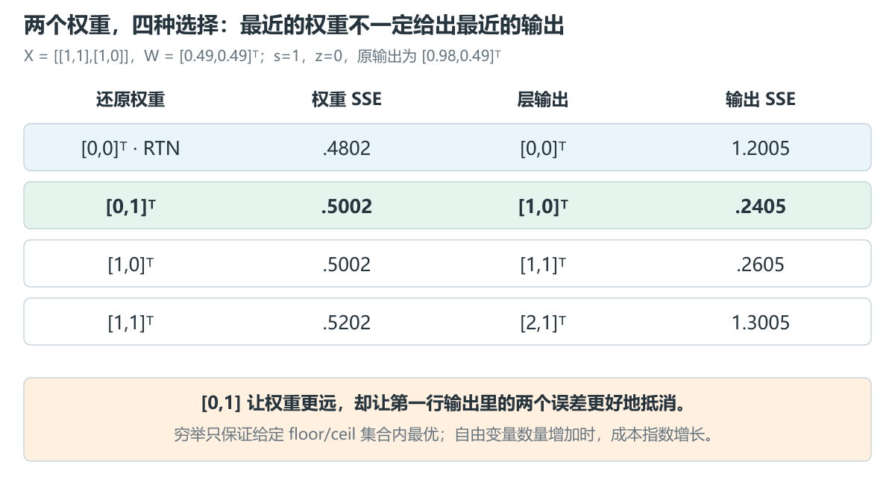
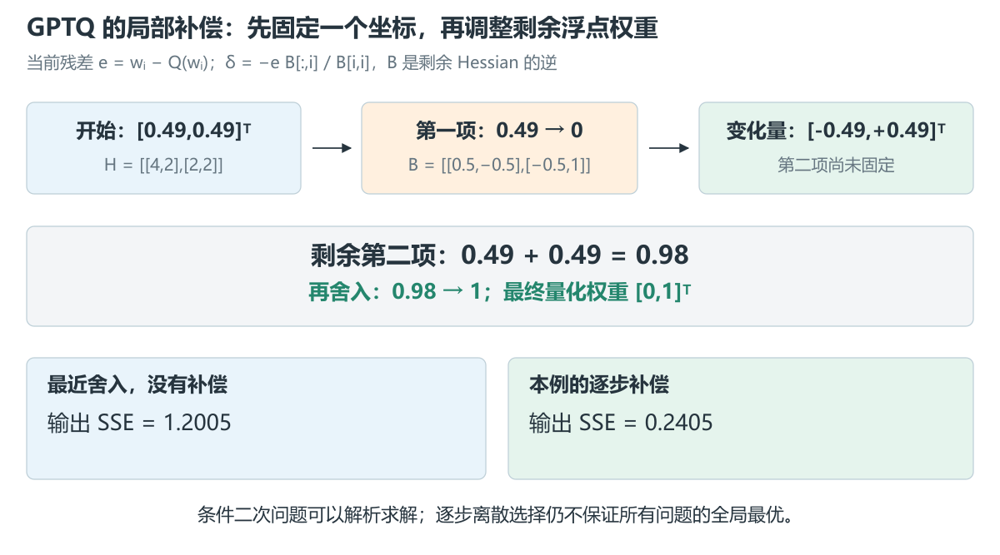
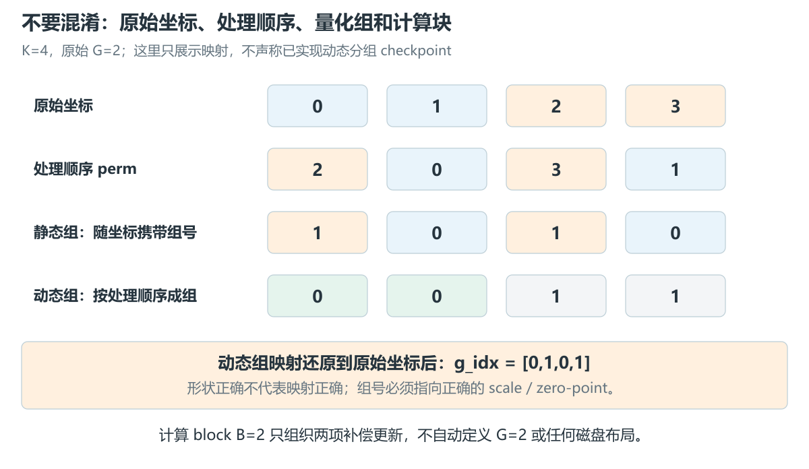
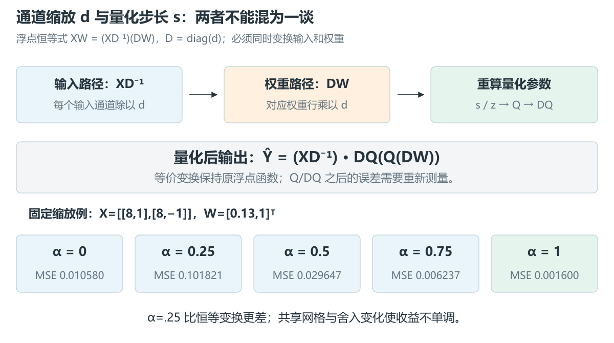
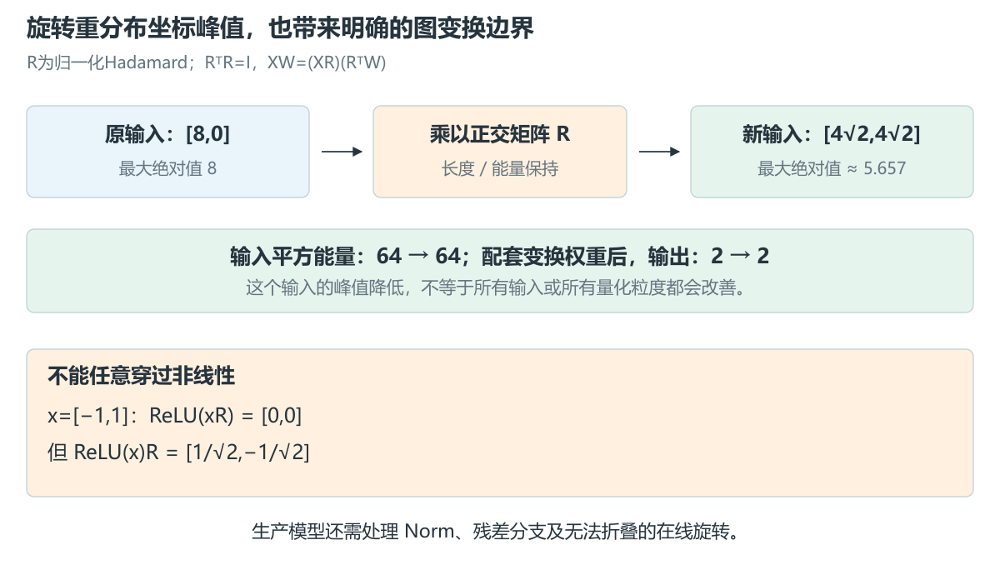
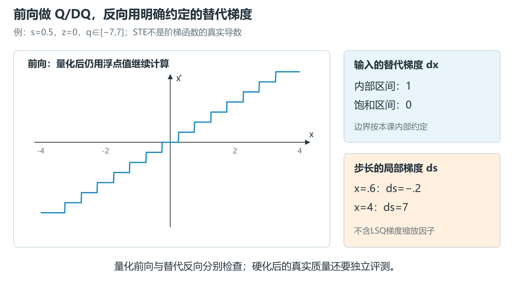
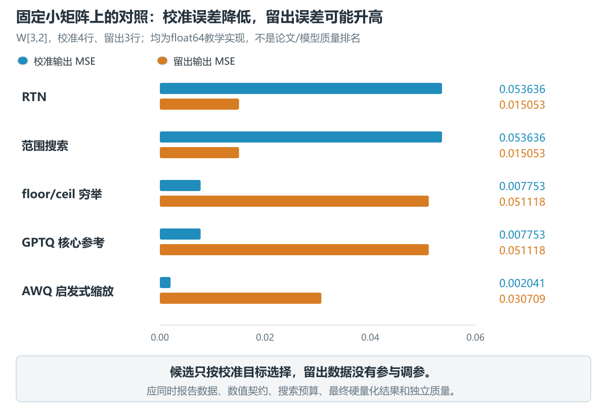

# 9.4 量化算法与误差控制

[本篇目录](../README.md) · [总设计](../design.md) · [上一节 9.3](../03-calibration-observers-and-error-measurement/README.md) · [下一节 9.5](../05-activation-quantization-and-mixed-precision/README.md)

> **已交付：算法推导与 CPU 小矩阵实验。** 包含 RTN、裁剪搜索、离散舍入优化、GPTQ 核心误差补偿、受 AWQ 启发的缩放搜索、正交变换与 STE。配 8 张中文原创图、23 个固定案例、18 组练习。默认仅需 Python 标准库；可选 PyTorch 2.7.1+cpu 独立数学对照。真实 Qwen、MobileNetV2 及 A100/C500 实验另行验收。

建议分三次学习：先做 RTN 与四种舍入选择，再推导 GPTQ，最后读变换与 QAT。第一次看不熟悉的矩阵公式时，先用旁边的二维例子算出数字，再回来看一般形式。

## 1. 本节为什么存在

9.2 说明一个数怎样落到量化格点，9.3 说明用什么数据和误差来评价它。本节开始回答：**当位宽、数据和计算目标已经给定，还可以怎样改变最终的量化结果？**

最直接的做法是给每个权重找最近格点。它确实能减小这个权重自己的误差，但一层的输出是许多乘积相加，误差可能叠加，也可能互相抵消。一个单独看略远的舍入选择，可能让输出更接近原模型。

还有另一条路：先改变浮点模型的表示，再做量化。例如把某个输入通道缩小，同时把对应权重放大，浮点输出可以不变，但量化误差的分布会变化。舍入、范围、误差补偿和等价变换由此进入同一个问题。

## 2. 本节需要解决的问题

1. 固定格点后，RTN 优化了什么，没有优化什么？
2. 修改 scale 与修改舍入方向为什么是两种优化？
3. GPTQ 怎样从层输出目标得到 Hessian、补偿方向和逐步更新？
4. Cholesky 因子、damping、计算 block、量化 group、act-order 分别起什么作用？
5. AWQ 与 SmoothQuant 都使用通道缩放，目标有什么区别？
6. 正交旋转保留什么，不能随意跨过哪些运算？
7. PTQ 能不能使用梯度？FakeQuant、STE 和 QAT 是什么关系？
8. 一个算法的收益怎样与校准成本、格式和运行时约束一起报告？

## 3. 前置知识与统一约定

- [9.2 数值与张量契约](../02-numerical-representations-and-tensor-contracts/README.md)：scale、zero-point、舍入、粒度。
- [9.3 校准与误差](../03-calibration-observers-and-error-measurement/README.md)：独立数据、层重构、FP/量化主干输入。
- 本节始终使用 $X[M,K]W[K,N]=Y[M,N]$。PyTorch Linear 保存的是 `[N,K]`，论文/源码的“量化一列”可能对应本课 W 的一行。

| 对象 | 本课约定 |
| --- | --- |
| 数值 | 输入、参考乘法和累加均为 float64；不是硬件 W4A16 实测 |
| 默认整数网格 | signed narrow INT4，q∈[-7,7]，z=0，nearest-even |
| 粒度 | 每个输出通道一个 scale，沿整个 K 共享；主实验 K=3 |
| 特殊手算例 | 人为固定 s=1，使四种舍入结果能直接手算 |
| 数据 | 原创合成 Linear，校准输入与留出输入分别固定 |
| 算法与格式 | 整数 code / DQ 值保存在 JSON；没有 packed checkpoint 或 GPU kernel |

沿 K 一组不意味着生产环境的 G128。小矩阵例子验证推导，真实模型需要另外固定模型 revision、分组、数据、导出格式和执行路径。

## 4. 核心概念：按优化变量看算法

### 4.1 先画清楚变量所在的位置


| 优化对象 | 可以改变什么 | 典型方法/思想 | 需要的信息 |
| --- | --- | --- | --- |
| 范围 | clipping 阈值、scale、部分方案的 zero-point | MSE clipping、可学习 clipping | 权重分布，或层输入/输出 |
| 舍入 | 一个数向上还是向下取格点 | AdaRound、AutoRound/SignRound | 层或 block 的重构目标 |
| 未量化权重 | 固定一个选择后，调整剩余浮点权重 | GPTQ 的误差补偿 | 输入的二阶统计 |
| 表示坐标 | 通道缩放、平移、正交变换 | AWQ、SmoothQuant、OS+、旋转方法 | 激活统计或重构目标 |
| 训练参数 | 浮点主权重、步长、阈值等 | QAT、LSQ、PACT | 任务/蒸馏目标和训练数据 |

这些分类会重叠。一个方法可以同时优化范围与舍入，也可以先旋转，再用 GPTQ 量化。不要用一个方法名替代整条量化配置。

### 4.2 PTQ 不等于“不使用梯度”

PTQ 从已有浮点模型出发，通常使用有限校准数据完成压缩；一些 PTQ 方法会对舍入变量、缩放或局部重构进行梯度优化。QAT 则在训练/微调中显式模拟量化，常以任务损失更新模型参数。

两者存在接近的实践形态。比较实验时应明确：更新了哪些参数、用了多少数据与步骤、目标是局部重构还是任务损失；“有没有 backward”不足以单独判定算法类别。

### 4.3 固定什么，才算受控比较

比较 RTN 与舍入优化，应共享同一网格；比较 clipping 或缩放时，网格变化正是研究变量，需要把变化记录下来。还要固定输入、浮点 target、位宽、评测集、数值精度和搜索预算。

**任何超参数都只根据校准/验证阶段选取。** 本节所有候选集预先写在输入文件里，选定结果后才计算留出误差，没有据留出结果回头选 alpha、阈值或方法。

## 5. 数学推导：从独立舍入到误差补偿

### 5.1 RTN 是什么基线

对于第 n 个输出通道，固定参数 $s_n>0,z_n$：

$$
q_{kn}=\operatorname{clip}\left(\operatorname{round}_{even}(w_{kn}/s_n)+z_n,q_{min},q_{max}\right),\qquad
\hat w_{kn}=s_n(q_{kn}-z_n).
$$

在这个固定网格上，最近舍入逐元素最小化平方距离，所以也最小化 $\|W-\hat W\|_F^2$。这里的前提是 scale、zero-point 和可用格点都已固定。换一种 scale，已经是在比较另一个优化问题。

RTN 不一定需要校准输入。其计算成本主要是读权重、生成参数、执行 Q/DQ；真正保存成 INT4 字节的过程放在 9.8。

### 5.2 为什么最近舍入不一定让输出最近

考虑：

$$
X=\begin{bmatrix}1&1\\1&0\end{bmatrix},\quad
W=\begin{bmatrix}0.49\\0.49\end{bmatrix},\quad
Y=XW=\begin{bmatrix}0.98\\0.49\end{bmatrix}.
$$

固定 s=1、z=0，每个权重只允许 floor/ceil 两种选择，即 0 或 1。两权重共有四种组合。



| 还原后的权重 | 权重 SSE | 输出 | 输出 SSE |
| --- | --- | --- | --- |
| [0,0]ᵀ，RTN | .4802 | [0,0]ᵀ | 1.2005 |
| [0,1]ᵀ | .5002 | [1,0]ᵀ | .2405 |
| [1,0]ᵀ | .5002 | [1,1]ᵀ | .2605 |
| [1,1]ᵀ | .5202 | [2,1]ᵀ | 1.3005 |

把第二个权重向上舍入，权重自身更远了，但第一行的两个误差抵消得更好。本课的 `optimize_rounding()` 会穷举这四种组合。对 KN 个自由舍入变量，最坏有 $2^{KN}$ 种组合，所以它只适合作为小规模正确性参照。

这份穷举只保证**各自 clipped floor/ceil 选项中的最优**，不搜索所有整数 code，更不等于一个真实模型的全局最优。超过默认16个自由变量会明确拒绝，避免读者误把它用于大模型。

### 5.3 范围搜索与舍入搜索分开

保持整数范围 [-7,7]，对一列权重先取 $a_n=\max_k|w_{kn}|$，再枚举比例 r：

$$
s_n(r)=\frac{r a_n}{7},\qquad r\in\{1,.9,.75,.5\}.
$$

本课可以按两种目标选 r：权重 MSE，或校准集上的层输出 MSE。每次都与**原始 W 或原始 XW**比较，而不是把 target 先裁掉。全零列约定 scale=1。

这里改变的是格点间距和边界。舍入优化则在固定格点上改变落点。两者可以组合，但要报告先后顺序；调完范围后沿用旧 scale 的舍入结果通常没有意义。

主实验的四个候选最终选 r=1，即没有裁剪收益。这是正常结果，不需要为了展示算法“有效”而改动测试输入。

### 5.4 可学习舍入与随机舍入

固定 scale 时，可以把整数选择写成：

$$
\hat w=s\left(\lfloor w/s\rfloor+h(v)\right),\qquad h(v)\in[0,1],
$$

暂时省略边界和 z，仅看内部格点。连续变量 v 让优化器可以逐步改变向上舍入的倾向；最后必须把软选择硬化为0或1，并重新评测。

[AdaRound](https://proceedings.mlr.press/v119/nagel20a.html)用重构与逐渐推动离散化的目标学习舍入；[AutoRound/SignRound 论文](https://arxiv.org/abs/2309.05516)展示使用带符号梯度优化舍入的路线。框架当前是否同时优化范围、支持哪些导出器，需要按具体版本核对，不能从论文名直接推断。

“soft loss 很低”不是最终产物的质量：如果很多 $h(v)$ 仍在 .5 附近，硬化后输出可能明显变化。算法比较表应使用最终硬量化值。

随机舍入是另一种选择。令 $w/s=a+f$，a为整数、$0\le f<1$，以概率 f 取 a+1，否则取 a。未饱和时 $E[\hat w]=w$；但一次采样的平方误差不保证优于 RTN，超出范围后也不再对原值无偏。它不等于依据层输出学出的舍入。

### 5.5 由层目标得到 Hessian

先看一个输出通道 $w\in\mathbb R^K$，记 $\Delta w=\hat w-w$。固定校准输入 X：

$$
L=\|X\Delta w\|_2^2
=\Delta w^TX^TX\Delta w
=\frac12\Delta w^TH\Delta w,\qquad H=2X^TX.
$$

这里 H 是这个固定输入、平方误差 Linear 问题的**精确 Hessian**；它并不是完整神经网络任务损失的精确 Hessian。若目标除以样本数或取平均，比例因子会改变。比较代码里的 damping 和损失时必须一起对齐。

H 的对角线反映各输入通道的平方能量，非对角项包含通道相关性。忽略相关性意味着漏掉误差能够互相补偿的方向。

### 5.6 固定一个权重后，怎样补偿其他权重

当前剩余可调整坐标记为 F，取其 Hessian $H_F$。现在固定第 i 个权重，量化残差为 $e=w_i-Q(w_i)$。于是变化量必须满足 $\delta_i=-e$。

在这个条件下最小化局部二次代价：

$$
\min_\delta\frac12\delta^TH_F\delta\quad\text{s.t.}\quad e_i^T\delta=-e.
$$

这里 $e_i$ 是第 i 个单位向量，和标量残差 e 不同。引入乘子 ν，求导得 $H_F\delta+\nu e_i=0$。令 $B=H_F^{-1}$，代回约束得到：

$$
\boxed{\delta=-\frac{e}{B_{ii}}B_{:,i}},\qquad
\Delta L=\frac{e^2}{2B_{ii}}.
$$

含义是：第 i 个权重必须移到选定格点，其他未量化权重沿相关方向调整，以减小这一决定带来的额外代价。已量化的坐标不能再被随意改写。



对前面的二维例子：

$$
H=\begin{bmatrix}4&2\\2&2\end{bmatrix},\qquad
B=\begin{bmatrix}.5&-.5\\-.5&1\end{bmatrix}.
$$

第一个权重 .49→0，e=.49，因此 $\delta=[-.49,+.49]^T$。第二个权重从 .49 变成 .98，再舍入到1。最终得到[0,1]，本例恰好和四选一的最优解一致。

**这不证明 GPTQ 总能找到离散全局最优。** 它固定顺序逐步决定；条件补偿可以解析求解，但所有离散选择的联合搜索仍然困难。[GPTQ 论文 v2](https://arxiv.org/html/2210.17323v2)将共享顺序、批量更新与 Cholesky 结合起来，使该思路适合更大的权重矩阵。

### 5.7 Cholesky：代码里的 Hinv 可能已不是逆矩阵

本课先形成 $H_\lambda=2X^TX+\lambda I$，然后取**上三角**因子 U，使：

$$
H_\lambda^{-1}=U^TU.
$$

在本课 W[K,N] 布局下，第 i 行对应一个输入通道；对所有输出通道同时量化：

$$
E_i=\frac{W_i-\hat W_i}{U_{ii}},\qquad
W_j\leftarrow W_j-U_{ij}E_i\quad(j\ge i).
$$

这里的分母是因子对角线 $U_{ii}$，不是逆矩阵对角线 Bii。把两份公式里的 Hinv 当成同一种对象直接替换，是常见错误。

二维例子的 U 为 $\begin{bmatrix}1/\sqrt2&-1/\sqrt2\\0&1/\sqrt2\end{bmatrix}$。第一步 E=.49√2，更新第二个权重时减去 $(-1/\sqrt2)(.49\sqrt2)$，仍得到增加 .49。

共享实现保留了 Cholesky、三角求解和每步 trace，便于阅读；PyTorch 独立对照则在每一步直接求剩余主子矩阵的逆，两条计算路径得到相同量化结果。

### 5.8 Damping 改变了什么

校准样本少、输入通道高度相关时，$X^TX$ 可能奇异。本课定义：

$$
\lambda=\rho\cdot\operatorname{mean}(\operatorname{diag}(2X^TX)).
$$

ρ默认为.01。加上λI使未被充分观测的方向受到约束，数值上也更容易分解。对应的目标变成：

$$
\frac12\operatorname{tr}(\Delta W^TH_\lambda\Delta W)
=
\|X\Delta W\|_F^2+\frac\lambda2\|\Delta W\|_F^2
$$

迹运算把各输出列的代价加起来。它包含额外正则项，不能把正则化目标直接叫作原始层 SSE。结果同时记录 `layer_sse`、`regularization_penalty`、`trace_objective`，核对它们的关系。

若所有输入全零，均值也是零，本课不偷偷加一个常数修复，而是报出非正定错误。真实框架可能检测 dead channels、置零对应权重并修正对角项；这是显式策略，不能据此认为这些通道在未来数据上永远无用。

### 5.9 Block size、group size 和 act-order



| 名称 | 作用 | 是否定义量化参数共享 |
| --- | --- | --- |
| block_size | 把一段补偿积累为矩阵更新，提高生产实现的运算效率 | 否 |
| group_size | 若干输入通道共享一组scale/z | 是 |
| act-order / desc_act | 常按 Hessian 对角能量降序处理通道 | 本身是顺序；与分组策略相互作用 |
| static groups | 预先按原始分组确定参数，重排时携带原组映射 | 是，参数归属依原始组 |
| dynamic groups | 沿处理顺序到达组边界时生成参数 | 是，参数生成时机与顺序相关 |
| g_idx | 某些格式中，原始输入坐标到量化组的映射 | 取决于导出格式，9.7再展开 |

例：K=4、G=2，原组编号[0,0,1,1]；处理顺序变成[2,0,3,1]。若按处理顺序的相邻两项建组，则原始坐标对应的组号是[0,1,0,1]。若保持静态原组，处理时读取的组号则是[1,0,1,0]。忘记还原顺序或误用组表，形状可能对得上，结果却已错误。

本课实现 lazy block 更新和 act-order，但只用每输出通道一个完整K组，**没有实现动态分组导出**。block_size=1、2、8在主案例得到相同 code；实际浮点实现中，分组参数生成时机及数值舍入可能引入其他差异。

“true sequential”还可能指模型内按子模块前向依赖，用已经量化的上游产生后续校准输入。它不等于这里逐个权重坐标的循环，应回到9.3的主干来源协议核对。

## 6. 中文图解：等价变换、旋转与训练

### 6.1 先把函数保持不变

取正对角矩阵 $D=\operatorname{diag}(d_1,\ldots,d_K)$：

$$
XW=(XD^{-1})(DW).
$$

本课用 d 表示**变换因子**，用 s 表示**量化步长**，避免把两种 scale 混在一起。只放大 DW 而忘记 XD⁻¹，会直接改变浮点函数。

加入权重量化后：

$$
\hat Y=(XD^{-1})\operatorname{DQ}(Q(DW)),\qquad
\hat W_{effective}=D^{-1}\operatorname{DQ}(Q(DW)).
$$

浮点等价不意味着量化也等价，因为格点和舍入的位置变了。`effective_w`只是把变换后的计算写回原坐标便于比较，不是可以直接导出为同一组INT4格点的权重。



### 6.2 AWQ 思路：观察激活，再搜索缩放

本课用每个通道的激活平均绝对值 $a_k=\operatorname{mean}_m|X_{mk}|$，枚举：

$$
d_{raw,k}=\max(a_k^\alpha,10^{-4}),\qquad
d_k=\frac{d_{raw,k}}{\sqrt{\min_j d_{raw,j}\;\max_j d_{raw,j}}},\quad
\alpha\in\{0,.25,.5,.75,1\}.
$$

分母使用分子归一化前的最大/最小值。对每个候选，先变换权重，再重算量化步长，最后比较原始坐标下的层输出。α=0得到恒等变换，能保留RTN基线。

例：X=[[8,1],[8,-1]]，W=[.13,1]ᵀ。α=0的层MSE约.010580；α=.25反而约.101821；α=1约.001600。放大显著通道不保证单调改善：量化参数、共享范围和其他通道误差会一起变化。

这只是**受 AWQ 启发的一层缩放实验**。[AWQ](https://arxiv.org/abs/2306.00978)的重点不是把少量权重永久留在高精度，而是利用激活信息选择合适的等价缩放。官方实现还涉及模块级评测、裁剪、图结构和折叠；本课没有复现完整AWQ生产流程。

“无需反向传播”与“完全不看重构误差”也不是一回事。所阅读的官方 `auto_scale.py` 会搜索候选并比较模块输出误差；它没有因此变成梯度训练。见[源码定位](source-map.md)。

### 6.3 SmoothQuant、OS+、OmniQuant 的位置

[SmoothQuant](https://arxiv.org/abs/2211.10438)主要面向W/A同时量化时的困难分配。常见因子按通道激活幅值a与权重幅值b构造 $d_k=a_k^\alpha/b_k^{1-\alpha}$，并明确零值保护：让XD⁻¹更容易量化，同时允许DW承担一部分范围变化。它与AWQ共享缩放恒等式，优化场景和参数选择不能因此混同。

[OS+](https://aclanthology.org/2023.emnlp-main.102/)进一步涉及通道平移。若使用输入平移c，线性层含偏置b，则需要同时保持：

$$
XW+b=((X-c)D^{-1})(DW)+(b+cW).
$$

忽略偏置补偿，或者在不满足条件的非线性两侧搬运变换，都可能破坏等价性。[OmniQuant](https://arxiv.org/abs/2308.13137)把可学习裁剪与等价变换结合，说明“一个算法只属于一行分类”并不成立。

折叠时还要处理Norm参数、偏置、Q/K/V共享输入、残差分支和激活函数。不能只在某一个Linear上改权重，就认定整个模型保持原函数。W/A策略在9.5继续展开。

### 6.4 正交旋转：能量不变，坐标峰值可以改变

若R为正交矩阵，$RR^T=I$，则：

$$
XW=(XR)(R^TW).
$$

归一化Hadamard二维例子：$R=\frac1{\sqrt2}\begin{bmatrix}1&1\\1&-1\end{bmatrix}$。输入[8,0]变成[4√2,4√2]，总平方能量仍为64，但最大绝对坐标从8变成约5.657。



这个例子帮助理解[QuaRot](https://arxiv.org/abs/2404.00456)使用旋转重新分布outlier的出发点；[SpinQuant](https://arxiv.org/abs/2405.16406)研究学习旋转，[OSTQuant](https://arxiv.org/abs/2501.13987)结合正交与缩放变换。

但旋转不保证每个输入的峰值都下降，也不保证每一种量化粒度都获益。通常 $\operatorname{ReLU}(XR)\ne\operatorname{ReLU}(X)R$，不能把R任意穿过非线性。归一化、残差与需要在线保留的旋转也有部署约束。本课只验证Linear边界内的恒等式，没有实现这些论文的全模型图变换。

### 6.5 FakeQuant 的前向与 STE 的反向

前向Q/DQ是阶梯函数，对输入的真实导数几乎处处为零。直接使用它难以训练，所以STE人为指定一个便于优化的替代梯度。



本课在z=0时采用一种常见的clipped STE，边界点采用内部约定：

$$
\frac{\partial\hat x}{\partial x}\approx
\begin{cases}1&q_{min}\le x/s\le q_{max}\\0&\text{其他}\end{cases}.
$$

对scale的局部替代导数为：

$$
\frac{\partial\hat x}{\partial s}\approx
\begin{cases}
q_{min}&x/s<q_{min}\\
\operatorname{round}(x/s)-x/s&q_{min}\le x/s\le q_{max}\\
q_{max}&x/s>q_{max}.
\end{cases}
$$

这不是量化函数的真实导数。[LSQ](https://arxiv.org/abs/1902.08153)的步长学习还涉及初始化、梯度缩放等训练设计；常见的scale梯度缩放因子为 $1/\sqrt{n q_{max}}$，n是共享该scale的元素数。本课只核对未缩放局部表达式，不把一次autograd对照叫作完整LSQ复现。

取s=.5、范围[-7,7]：x=.6时dx=1、ds=-.2；x=4已经饱和，dx=0、ds=7。PyTorch对照用显式detach构造这个替代反向，而不是拿有限差分验证一个本来就人为替代的梯度。

[PACT](https://arxiv.org/abs/1805.06085)学习激活裁剪范围；[LSQ+](https://arxiv.org/abs/2004.09576)加入可学习offset与初始化设计。学到的实数offset怎样转成导出格式中的整数zero-point，仍要经过数值契约检查；不能把两个变量直接当成同一个字段。

### 6.6 CNN 支线怎样使用这些方法

经典支线以MobileNetV2为目标，先固定浮点基线和图像预处理，然后比较RTN、局部舍入和block重构。[BRECQ](https://arxiv.org/abs/2102.05426)提示block边界与误差传播的重要性；[QDrop](https://arxiv.org/abs/2203.05740)在重构时随机去掉一部分激活量化影响，不能把它理解成随机删除网络权重。

本课的Linear穷举适合检查“为何允许非最近舍入”，但没有BatchNorm折叠、卷积图、训练循环或ImageNet评测。CNN支线的模型结果与LLM主线分开交付。

## 7. 最小 CPU 实现与运行

从仓库根目录运行：

```bash
python -m scripts.experiments.lesson0904
python docs/chapters/part-09-quantization/04-quantization-algorithms-and-error-control/examples/walk_rounding.py
python docs/chapters/part-09-quantization/04-quantization-algorithms-and-error-control/examples/walk_gptq.py --block-size 2
python docs/chapters/part-09-quantization/04-quantization-algorithms-and-error-control/examples/walk_transforms.py
```

默认不下载模型，不导入PyTorch，输出23个PASS。详细参数与预期结果见[实验手册](lab.md)。共享实现位于[algorithms.py](../../../../zero2vllm/quantization/algorithms.py)。

建议的阅读顺序：`column_grids → rtn → clipping_search → optimize_rounding → gram_hessian → gptq_reference → scaling_search`。Cholesky与三角求解是可读参考，不作为大矩阵数值库使用。

```python
from zero2vllm.quantization.calibration import AffineParameters
from zero2vllm.quantization.algorithms import optimize_rounding, gptq_reference

x = [[1, 1], [1, 0]]
w = [[0.49], [0.49]]
grids = [AffineParameters(1, 0, -7, 7, "symmetric")]
best = optimize_rounding(x, w, grids)
trace = gptq_reference(x, w, grids, damping=0)
assert best["best"]["q"] == trace["q"] == [[0], [1]]
```

### 同一主矩阵上的实际结果

主数据W[3,2]，校准X[4,3]，留出X[3,3]；各方法按校准目标选择结果后，用同一留出输入评分。



| 教学实现 | 权重MSE | 校准输出MSE | 留出输出MSE |
| --- | --- | --- | --- |
| RTN | .009103061 | .053635842 | .015052891 |
| 范围搜索 | .009103061 | .053635842 | .015052891 |
| floor/ceil穷举 | .009415986 | .007753189 | .051117517 |
| GPTQ核心参考 | .009415986 | .007753189 | .051117517 |
| AWQ启发式缩放 | .006474807 | .002040827 | .030709092 |

这个矩阵中，降低校准误差没有转化为更低的留出误差。范围搜索选择r=1；穷举与GPTQ偶然得到相同结果；缩放选择α=.75。这些都是固定合成输入上的观察，不是GPTQ、AWQ在真实模型上的质量排名。

## 8. 算法比较表与真实框架对应

| 方法 | 变量/目标 | 所需信息与成本 | 额外产物/部署约束 | 本课证据 |
| --- | --- | --- | --- | --- |
| RTN | 固定网格上逐元素最近舍入 | 权重；一次映射 | scale/z/分组 | 可运行参考 |
| Clipping | 范围；权重或输出误差 | 多候选扫描；层目标需校准输入 | 阈值最终折成量化参数 | 可运行搜索 |
| AdaRound/AutoRound路线 | 舍入倾向；层/block重构 | 输入/target缓存与迭代优化 | 硬化后整数权重；优化状态通常不进入推理 | 穷举教学参照；未运行论文训练器 |
| GPTQ | 离散选择与剩余权重补偿；二次层目标 | K×K统计、分解与权重更新 | 分组/重排映射；格式与kernel兼容 | 固定网格核心、独立数学对照 |
| AWQ路线 | 通道缩放、可配合裁剪；模块输出 | 激活统计与候选前向 | 图结构折叠、scale重算 | 单Linear缩放搜索 |
| SmoothQuant/OS+/OmniQuant | 缩放/平移/裁剪；重分配量化困难 | 激活统计，部分方法有学习过程 | Norm/偏置/分支配套处理 | 恒等式与方法说明 |
| QuaRot/SpinQuant/OSTQuant | 正交/缩放变换；分布或质量目标 | 固定或学习变换；训练成本依方法 | 有些变换可折叠，有些需在线算子 | Linear旋转恒等式 |
| LSQ/PACT等QAT | 主权重与量化器参数；任务/蒸馏目标 | 训练数据、梯度、优化器状态 | 冻结、硬量化、导出后的再次验证 | STE局部导数对照 |

GPTQ的H存储为O(K²)，构造统计量约O(MK²)，稠密分解约O(K³)，应用补偿约O(K²N)。大模型逐层/逐block处理并不消除这个局部成本。穷举则是指数级；不能拿六个权重的耗时外推真实模型量化时间。

可选PyTorch核验：

```bash
python -m scripts.experiments.lesson0904 --torch-check
```

本轮对照使用PyTorch2.7.1+cpu/float64：两种处理顺序的独立受约束求逆结果一致，四个输入位置的STE梯度一致。官方GPTQ/AWQ源码仅作为公开阅读，对照路径与版本范围见[source-map.md](source-map.md)。

## 9. GPU / Runtime 实验

本轮没有执行真实Qwen3-8B、MobileNetV2、GPU量化生产或服务性能实验。A100与C500后续应各自固定软件栈和可用后端，再完成：

1. 浮点基线与Calibration Protocol。
2. 同一W4A16/G128设置下的RTN/GPTQ/AWQ/AutoRound产物，逐项说明算法预算差异。
3. 验证/测试质量、量化时间与内存，保存最终硬量化产物。
4. 核对导出格式、实际加载与kernel；分别测prefill、decode和服务指标。

算法可以改善质量，但“量化过程更快”和“量化后的模型推理更快”是两项不同指标。一个格式可以装下某算法的结果，也不意味着每个后端都支持其group、zero-point或变换残留。

## 10. 常见误区

| 说法/做法 | 为什么不够准确 |
| --- | --- |
| GPTQ只是给权重round一下 | 后续权重已经接受输入相关的误差补偿 |
| 最近舍入最优，所以无需优化 | 它针对固定网格的权重距离，不是一般层输出目标 |
| Hinv永远就是H的逆 | 变量可能已被上三角Cholesky因子覆盖 |
| block_size=128就是G128 | 计算更新块与量化参数共享组不同 |
| act-order就是动态激活量化 | 它改变权重量化处理顺序，不定义运行时激活Q/DQ |
| AWQ永远保留一小部分FP16权重 | 显著通道的等价缩放不等于混合位宽保存 |
| 缩放/旋转在浮点等价，所以不会带来部署问题 | 图折叠边界、在线算子及量化格点都会影响执行 |
| PTQ不能反向传播 | PTQ可以对局部量化参数进行梯度优化 |
| STE梯度应该通过真实阶梯的有限差分 | STE有意使用替代导数，检查对象应是声明的反向规则 |
| 校准loss最低的算法就是最好的模型 | 还需独立模型质量和真实执行证据 |

## 11. 工程边界

- 默认参考只处理有限的小型float64矩阵；没有模拟FP16/BF16累加、TF32或GPU reduction顺序。
- GPTQ核心固定每输出通道网格，支持顺序/分块；不支持动态group、dead-channel自动修复、真实模型逐层遍历或导出。
- 舍入穷举限制自由变量，默认16、硬上限20；这不是大模型训练器。
- AWQ启发式例不包含完整模块裁剪、残差/Norm折叠；effective_weight只用于坐标还原后的误差比较。
- 随机舍入只展示概率定义，STE只展示一种明确的替代反向；不据此断言训练收敛或模型精度。
- main/calibration与held_out来自显式合成矩阵；不包含自然语料，不能报告模型PPL或任务准确率。
- 比较表记录搜索预算，不报告没有实测的GPU速度和质量。CPU Passport的模型质量与性能字段保持unknown。

## 12. 练习

[18组练习与答案](exercises.md)覆盖舍入枚举、矩阵目标、误差补偿、damping、分组映射、变换与STE。建议亲手完成2、5、6、9、12、15，再进入下一节。

## 13. 实验产物

| 文件 | 内容 |
| --- | --- |
| [固定输入](data/linear.json) / [说明](data/README.md) | 三组矩阵、校准与留出输入、搜索候选 |
| [实验手册](lab.md) / [短示例](examples/README.md) | 参数、逐步trace、错误检查 |
| [summary.json](results/summary.json) | 23个案例、实际算法对比、两类PyTorch核验 |
| [cpu-passport.json](results/cpu-passport.json) | 固定网格GPTQ参考的证据范围 |
| [命令记录](results/commands.json) | 文档命令与退出码 |
| [中文图与源稿](assets/README.md) | 8张PNG/SVG |
| [交付检查](../../../../reports/quality/lesson-9.4-delivery/README.md) | 回归、文档与目录检查 |

## 14. 完成标准与下一节

- [x] 用同一四选一例子解释RTN、输出目标与误差补偿。
- [x] 固定X[M,K]、W[K,N]方向，给出H、逆矩阵和Cholesky因子的关系。
- [x] 区分计算block、量化group与处理顺序，明确未实现的导出部分。
- [x] 原创图、命令、输入、输出、答案与Passport均可公开复核。
- [x] 方法说明、教学参考、真实框架阅读与未验证硬件分别标注。

再次看到 **Qwen3-8B-W4A16-G128**，除了问“用了哪个算法”，还应追问：优化了哪些变量、基于哪些输入与target、搜索多久、最终硬量化值怎样评测、额外变换是否已折叠。

下一节[9.5 Activation Quantization与混合精度策略](../05-activation-quantization-and-mixed-precision/README.md)把这些工具用于W/A精度分配、静态/动态scale和outlier处理。

## 15. 源码与论文入口

[source-map.md](source-map.md)按推导、课程实现、公开源码及论文列出定位与核验范围。以上方法链接均为公开资料；图与数值例由本课程重新设计。原论文的硬件性能或模型精度不能写成本课实测结果。
