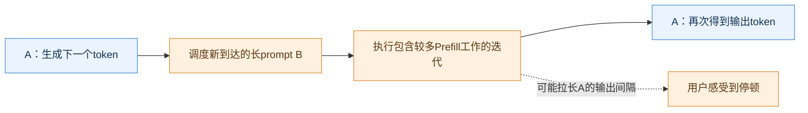
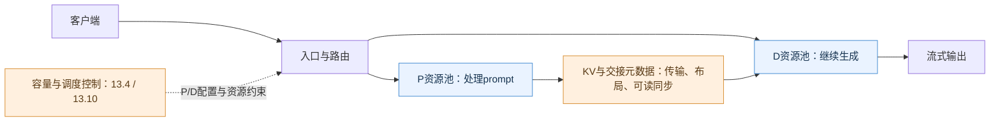

# 13.1 PD 分离的收益、代价与适用边界

[本篇目录](../README.md) · [全部课程](../../README.md) · [上一节 12.6](../../part-12-moe/06-moe-overlap-and-combined-tuning/README.md) · [下一节 13.2](../02-isolated-measurement-and-workload-protocol/README.md)

> **正文与离线分析实验已交付。** 面向推理、性能与平台工程师。本节提供原创示意图、6组手工构造请求轨迹、标准库分析器和练习答案；不包含GPU部署、真实KV传输或集群性能结论。后续13.2—13.12逐步补齐这些证据。

## 读完这一节，你应该能做什么

1. 从一次请求的时间线解释P/D干扰，并区分PD分离、TP/PP和多副本部署。
2. 为混部、Chunked Prefill和PD写出同预算对照，而不是比较不同数量GPU的总吞吐。
3. 用每请求的TTFT、TPOT和ITL联合判定SLO，保留失败与未完成请求。
4. 把KV传输、队列、资源碎片和平台维护成本纳入方案判断。
5. 给出有依据的下一步：保留混部、继续调度优化，或进入PD实测。

前置：理解[Prefill/Decode](../../part-01-inference/02-prefill-decode/README.md)、[性能指标](../../part-01-inference/04-performance-metrics/README.md)、Part 5的KV缓存与Part 6的调度。建议已有单实例服务与压测经验。本节代码仅需Python 3.11及以上，无第三方依赖；在仓库根目录运行，命令见[实验手册](lab.md)。

## 1. 从一个线上现象开始

一个流式问答服务在低负载时表现正常。加入长文档请求后出现两种投诉：新请求迟迟没有第一个字；已经开始回答的请求突然停顿，然后又继续输出。

这两种现象对应不同时间段。新请求可能在等待Prefill，也可能在等待可用KV块、路由或传输；已开始的请求可能在等待下一轮Decode。单看平均输出token/s，很难区分它们。

考虑一条**解释机制用的示意时间线**：请求A正在逐token生成；请求B携带很长的prompt进入同一实例。若某轮为B执行了较长的Prefill工作，A下一次可见输出就可能变晚。实际系统是否把两者放在同一个batch、Prefill拆多大，以及GPU执行多久，均取决于调度和算子；图中没有对应某张卡的实测时长。

**排查从时间线开始。** 检查长Prefill到达时，Decode的间隔是否变长；同时排除KV空间不足导致的抢占、客户端缓冲、网络拥塞等原因。TTFT或ITL变坏是现象，不能单凭现象断定必须PD分离。

## 2. PD到底分开什么

**Prefill/Decode disaggregation**把一次生成请求的两个阶段交给不同执行实例。P实例处理prompt并产生后续需要的状态；D实例接管状态，继续逐token生成。跨实例的交接通常涉及KV、token/请求元数据以及完成通知。

标准decoder-only模型中，P、D实例都需要执行模型；它不是“P只放前半模型，D只放后半模型”。每个实例仍可能包含多个rank，内部使用TP或PP。因此必须先定义“实例”：本篇指协同承担一个执行角色的完整模型执行组，而不等同于一个进程或一张卡。

| 部署方式 | 切分对象 | 一个请求怎样执行 | 资源决策 |
| --- | --- | --- | --- |
| 多个混部副本 | 不同请求 | 被选中的副本完成P和D | 扩增加完整服务能力的副本 |
| TP/PP | 模型计算/层 | 多个rank共同完成模型执行 | 选择模型组布局与通信路径 |
| PD分离 | 同一请求的执行阶段 | P产生状态，D接管并生成 | 分别选择P/D副本数与内部并行布局 |

图为概念职责图，未规定push还是pull、先选P还是先选D、首token由谁返回，也没有指定KV必须经过中间存储。真实实现可能直接点对点传输，也可能经过缓存系统；13.6—13.8分别讲协议与数据路径。

## 3. 为什么不能跳过Chunked Prefill基线

混部的优势是资源可以在两阶段间共享。短输入、低流量或阶段比例经常变化时，同一组GPU可以按当前工作量分配执行机会，不必提前固定成P池和D池。

Chunked Prefill把较长prompt的处理拆成多轮，让长Prefill不必一次占用过长的迭代。它仍属于混部调度，不需要为了阶段交接把KV搬到另一个实例。chunk/token预算减小后，已有Decode请求可能更快获得执行机会；但新请求完成整个Prefill可能需要等待更多轮。具体结果需测量，不能把某个chunk大小当通用最优值。

[vLLM调优文档](https://docs.vllm.ai/en/latest/configuration/optimization/#chunked-prefill)说明了Chunked Prefill与token预算的关系。本节只使用这个机制作为基线，正式命令要按锁定的vLLM版本核验，不能将动态文档中的默认值当成永久约定。

建议按下面顺序诊断：

1. **确认瓶颈**：队列等待、长迭代、抢占，还是GPU之外的等待？
2. **调好混部**：固定负载，对token预算、并发和缓存配置做有限搜索，记录TTFT与ITL之间的取舍。
3. **评估分离**：如果混部在给定预算内仍难以同时满足两阶段延迟要求，再计入KV成本比较PD。

这里并不要求混部始终优先。已有明确隔离需求、阶段规模差异或独立并行布局需求时，可以更早进入PD验证；关键是保留可比基线。

## 4. 收益来自哪里，代价落在哪里

### 4.1 三类潜在收益

**减少跨阶段干扰。** P/D使用独立GPU资源时，长Prefill不再直接占用D池上的模型执行机会。不过共享NIC、CPU、存储、路由服务仍可能产生争用，D池内部也会排队。

**分别选择并行布局。** P端与D端可能在不同batch和上下文长度下受到不同约束，适合的TP规模、token预算或实例数量不必相同。不能简单把P永久归为计算受限、D永久归为带宽受限；需观察实际shape、权重/KV读取和通信。

**独立扩缩容。** 输入长度增加时可以优先扩P；长输出与大量驻留请求也可能要求扩D。但扩容要经历资源分配、模型加载和预热，不会立即增加服务能力。扩容策略及Dynamo案例见13.10。

### 4.2 四类必须付出的成本

| 成本 | 需要问什么 | 可能出现的失败现象 |
| --- | --- | --- |
| KV交接 | 缺哪些块、搬多少字节、何时可读、是否需要重排 | TTFT增加，或首token之后发生长停顿 |
| 资源池失衡 | P/D比例是否匹配当前业务，能否及时调整 | 一边空闲，另一边排队；总卡数够却达不到SLO |
| 内存与布局 | 每实例模型、workspace、KV和图缓存是否放得下 | 小池OOM、重算增加、不同TP布局无法直接接管 |
| 控制和运维 | 谁路由、谁发现故障、谁回收KV与在途请求 | 缓存信息失真、重试风暴、取消后资源未释放 |

“需要多份权重”也要按基线解释：两个混部副本本来就各持有一份模型，1P+1D并不必然比它们多一倍权重。真正的预算比较应逐实例列出权重、KV、workspace和其他预留。

### 4.3 一个KV预算手算

对所有层采用相同全注意力MHA/GQA结构、K/V精度相同且不压缩的模型：

$$
B_{KV}=2L S H_{KV}d_hb.
$$

L是层数，S是待交接token数，H_KV是KV头数，d_h是head维度，b是每元素字节。注意用KV头数，不是Query头数。

假设L=32、S=8192、H_KV=8、d_h=128、b=2，则每token为128KiB，整个prompt为1GiB。若一条路径的**有效载荷带宽**假设为10GiB/s，仅B/BW一项就是100ms。这个例子未计注册、排队、重排和同步，不是某型号网卡实测，也不是用户可见等待的直接预测。

如果传输可与Prefill逐层重叠，一部分传输可能不暴露在关键路径上。若链路被多个请求共享，有效带宽又可能下降。MLA、滑窗、混合状态、量化scale/zero-point、GQA复制和重分片要另算；13.5会细分逻辑字节、每rank字节与线上字节。

## 5. 首token归属会改变你看到的指标

### 5.1 统一从客户端时间戳计算

令请求发送时刻为a，客户端观察到的输出token时刻为t₁…tₙ，n≥2：

$$
TTFT=t_1-a,\qquad ITL_i=t_i-t_{i-1},\quad i\ge 2,
$$

$$
TPOT=\frac{t_n-t_1}{n-1}.
$$

TPOT是**一个请求内部输出间隔的平均值**。它不是包含Prefill的总时长/n，也不能代替最大ITL。不同请求的TPOT分位数、所有token间隔的分位数、每请求最大ITL的分位数，是三种不同统计。

### 5.2 两种首token路径

| 路径 | 首次输出前可能包含 | 重点观察 |
| --- | --- | --- |
| D接管后返回首token | 入口、P队列/计算、暴露的KV等待、D接管/首次执行 | TTFT与后续ITL |
| P先返回首token | 入口、P队列/计算及首token输出 | 首token之后的交接停顿可能进入第一个ITL |

这是计时边界分类，不是对某个Connector实现的默认行为断言。必须沿真实请求确认首token来自哪里，D是继续生成还是重复计算了某些边界位置，客户端有没有缓冲。

例如发送时刻0，观察到token时刻`[100, 240, 270, 300] ms`。TTFT只有100ms，但第一个ITL是140ms，TPOT为200/3≈66.67ms。只展示TTFT，就会漏掉handoff造成的停顿。实验中的`pd_first_token_from_p`专门表达这个问题。

不能直接相加P队列P95、传输P95和D队列P95得到端到端P95；它们可能来自不同请求，也可能发生重叠。需要关联同一请求的事件，再统计完整分布。

## 6. 吞吐、SLO与goodput怎样一起看

本节采用一份**明确但不通用的演示SLO**：完成请求的TTFT≤200ms、TPOT≤50ms、最大ITL≤80ms。生产系统应由业务确定阈值和统计口径；本节额外使用最大ITL，是为了不让单次停顿被平均值掩盖。

设Q_r表示请求r成功完成且同时满足三个条件。固定观察时长T秒：

$$
G=\frac{\sum_r\mathbf{1}[Q_r]}{T},\qquad
R_{joint}=\frac{\sum_r\mathbf{1}[Q_r]}{N_{offered}}.
$$

G是合格请求吞吐（goodput，req/s），R_joint是所有已提供请求中的联合达标比例。本节失败、拒绝、取消、超时和观察截止时未完成的请求都保留在offered里，不能贡献goodput。返回了部分token不等于请求完成。

**两个阶段各有95%请求达标，不代表95%请求同时达标。** 例如A只违反TTFT，B只违反TPOT，两种失败并不重合。应按request ID逐条计算联合结果，然后再汇总。

总完成吞吐与goodput要一起报告。两个方案都完成4req/s，其中一个只有2个请求满足延迟条件，另一个有4个，业务价值并不相同。反过来，轻负载下goodput相同，也不能说明两者的最大服务容量相同。

[DistServe](https://www.usenix.org/conference/osdi24/presentation/zhong-yinmin)把阶段延迟目标、资源分配和并行布局一起考虑。本课采用这种评价视角，不把论文中的特定加速倍数迁移到自己的硬件。[vLLM的PD功能说明](https://docs.vllm.ai/en/latest/features/disagg_prefill/)仍标为实验功能，并提醒不能把启用分离本身当成吞吐提升保证；这与比较特定SLO下的合格吞吐是不同层面的判断。

## 7. 做一次同预算、可解释的对照

默认[数据文件](data/comparison.json)声明两个相同的假设GPU：混部使用两个完整副本；PD使用1P+1D。每个场景都在0、100、200、300ms提供同样四个请求，输入长度交替为1024/8192，要求输出4token，观察至1000ms。

所有token时刻均为**手工构造**。场景名称描述想研究的现象，不表示分析器实现了调度、传输或资源池模型。它不会根据输入长度计算GPU耗时。

| 场景 | 解释意图 | 完成请求 | 联合达标请求 | goodput（req/s） |
| --- | --- | --- | --- | --- |
| mixed_uncontrolled | 一个长停顿，一个首token过晚 | 4 | 2 | 2 |
| mixed_chunked | 间隔改善，仍有一个请求TTFT超标 | 4 | 3 | 3 |
| pd_fast_transfer | 此组交接延迟没有触发阈值 | 4 | 4 | 4 |
| pd_slow_transfer | Decode间隔短，但首token全部过晚 | 4 | 0 | 0 |
| pd_first_token_from_p | TTFT正常，首token后的长间隔超标 | 4 | 0 | 0 |
| pd_pool_imbalance | 排队增加，一个请求截止时未完成 | 3 | 2 | 2 |

这些数字用于检查统计和推理，**不能据此断言PD比Chunked Prefill快4/3倍**。只需改变相同轨迹的SLO，排名就可能变化；用真实数据时还要确认语义正确性、实际资源和负载身份。

运行与结果解释见[实验手册](lab.md)，实现位于[分析器](../../../../zero2vllm/reference/disaggregation.py)，输入错误案例与手算对照见[测试](../../../../tests/reference/test_disaggregation.py)。公开结果见[离线结果](results/baseline.json)。

## 8. 给方案评审写一张决策表

| 观察到的证据 | 下一步 | 暂时不能下的结论 |
| --- | --- | --- |
| 混部调参后满足SLO且成本可接受 | 保留基线，观察负载变化 | PD一定无价值 |
| 长Prefill与Decode停顿显著相关，预算内仍难达标 | 测P/D阶段曲线和真实KV路径 | 拆开后一定有足够吞吐 |
| PD的TTFT变差，Decode间隔改善 | 拆分入口/P队列/KV/D等待，检查首token归属 | 问题一定在网卡 |
| P排队而D空闲，或相反 | 对相同业务分布重新测容量与配比 | 永久采用1P:1D |
| 缓存命中率高但端到端不改善 | 量化远端读取/排队成本，比较重算 | 命中率越高越好 |
| 小样本中某方案胜出 | 扩大样本、重复测量、改变长度/速率 | 已找到生产最大容量 |

正式对照协议至少固定：模型/tokenizer revision、精度、生成参数、请求内容或稳定摘要、输入/输出长度分布、到达轨迹、缓存冷暖、GPU型号与数量、并行布局、框架/驱动/Connector版本、网卡拓扑、统计窗口和SLO。允许变化的因素单独列出；网络故障实验等有意变化不能伪装成稳态架构对照。

同卡数和同成本是两种协议。若GPU型号不同，只比较卡数不充分；PD使用额外网络或CPU资源，也要进入成本报告。任何“未达标”结果都要保留，否则选出来的配比会过于乐观。

## 9. 与Dynamo、Mooncake及两种硬件路线怎样衔接

vLLM执行模型并管理本地调度/缓存；跨实例需要额外请求协调与KV路径。[Dynamo架构](https://docs.nvidia.com/dynamo/dev/knowledge-base/concepts/architecture)可用于观察路由、worker和控制面的职责；Mooncake等数据系统的传输/存储层在13.7细讲。本节先判断“为什么拆、怎样评价”，13.10再跟进平台怎样作出这些决策。

A100和C500可以分别执行单阶段测量；只有一张卡时，不能把先测P再测D当作真实两池并发实验。沐曦路线需要独立检查MACA、vLLM适配版本、设备内存传输、网络和KV布局兼容性。不能因为公开CUDA部署脚本可运行，就声明C500也支持相同路径。

本节不提供看似通用的GPU启动命令：可复制执行的是离线分析程序。实机章节会在明确版本与设备条件后提供部署和压测命令，且分别报告“启动成功、输出正确、性能达标”。

## 练习、验收与下一节

完成[练习与答案](exercises.md)中的手算、改阈值、错误数据审计和方案评审题。最低交付是一份可复现的比较报告：说明每个请求为何达标或失败、窗口与资源预算，并列出还缺哪些实机证据。

本节的离线分析验收不等于整章的集群验收。下一节[13.2](../02-isolated-measurement-and-workload-protocol/README.md)将定义P-only/D-only真实测量口径，特别处理fake transfer、实际上下文、首token和输出计数。

## 参考资料与版本边界

核对日期：2026-10-28。以下动态文档用于机制和工程问题定位，未作为已锁定的GPU实验环境；本节代码独立于这些框架。

- [DistServe，OSDI 2024](https://www.usenix.org/conference/osdi24/presentation/zhong-yinmin)：阶段隔离、SLO与资源/并行放置联合优化。
- [vLLM Disaggregated Prefilling](https://docs.vllm.ai/en/latest/features/disagg_prefill/)：实验功能、交接与Connector阅读入口。
- [vLLM Chunked Prefill调优](https://docs.vllm.ai/en/latest/configuration/optimization/#chunked-prefill)：混部调度基线。
- [NVIDIA Dynamo Architecture](https://docs.nvidia.com/dynamo/dev/knowledge-base/concepts/architecture)：分布式请求与控制路径。

两张Mermaid图均为本课程原创概念示意，中文节点用于说明职责和因果关系；不是上游实现图，也不包含测量数据。
