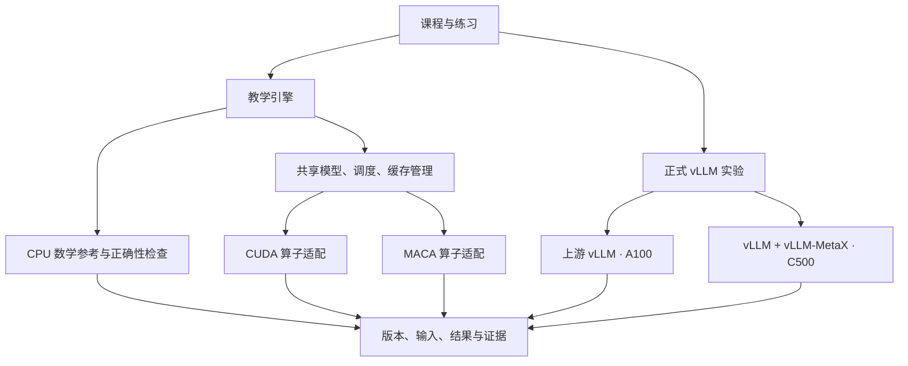

# 工程设计 v0.3

## 1. 目标与边界

用一套递进课程覆盖 vLLM 的推理原理、执行优化、模型与服务能力，并在单卡 A100、单卡 C500 上逐项建立真实验证记录。学生先学习生成、缓存和调度；工程师进一步学习量化、编译、推测、并行、MoE、分离式部署与平台适配。

完整范围见 [课程目录](../chapters/README.md) 和 [特性地图](../references/feature-map.md)，进入顺序与章节分工见 [学习路线](../chapters/learning-paths.md)。单卡是首批实测资源边界；多卡、特定模型与硬件专用特性均进入课程，以 CPU 推导/模拟、源码阅读和有条件的实机任务组织。

首版的验收单位是“**一章文字 + 对应代码 + 正确性检查 + 可复现实验**”。目录存在、配置可解析或代码能够导入，均不代表 GPU 支持已经完成。

读者前置要求是基础 Python。PyTorch、矩阵乘法和 Transformer 的必要知识由课程提供补充材料。

## 2. 三层结构

上图是目标架构。当前已实现 CPU 参考、逻辑块分配、配置检查、环境清单和首个实验；2.1 已实现 CPU PyTorch 多层 Decoder；请求调度、真实权重、缓存接入及 GPU 算子适配继续推进。

### 教学层

1. 用标准库展示一个可检查的因果 Attention 计算。
2. 增加 PyTorch 对等实现，使用相同权重和输入验证数值。
3. 接入一种真实稠密模型，补齐多层、多头、位置编码和权重加载。
4. 增加请求生命周期、连续批处理和分页存储。
5. 在清晰的实现上替换平台算子，并检查正确性和收益。

### 正式框架实验层

NVIDIA 路径使用上游 vLLM；沐曦路径使用官方 vLLM-MetaX 软件栈。项目维护环境配置、示例、测试场景和分析结果，通过官方插件机制理解适配过程。当前不维护一个复制的完整 vLLM 源码分支。

量化篇围绕算法与策略、手写算子、内核加速和正式引擎接入展开。先定义 packed tensor/scales/累加精度的契约，分别验证实现误差与策略质量，再比较算子和服务收益。具体递进实验见 [量化篇设计](../chapters/part-09-quantization/design.md)。

### 证据层

每个结果绑定环境、模型版本、输入和运行参数。CPU 实测、GPU 实测、模拟结果与预期值必须清楚标记。实际 GPU 验证从“可见一张卡 → 前向计算正确 → 模型生成正确 → 服务可用 → 性能实验”逐级推进。

## 3. 模块职责

| 模块 | 职责 | 状态 |
| --- | --- | --- |
| `reference/attention.py` | 单头随机模型、完整计算、缓存计算、生成、工作量计数 | 已实现 |
| `reference/blocks.py` | 逻辑 token 到物理块编号的映射，分配与回收 | 已实现、独立模拟 |
| `profiles.py` | 显式选择后端、检查版本记录、预览容器内启动参数 | 已实现 |
| `environment.py` | 采集 Python、平台、包版本和工具是否在 PATH 中 | 已实现 |
| `scripts/docs/course.py` | 从结构化目录生成标记区段，检查文档漂移、链接和引用 | 已实现 |
| `engine/` | 请求状态、调度、执行推进、结束与取消 | 规划 |
| `modeling/` | 最小 PyTorch Decoder 与逐层对齐；真实权重加载待做 | 2.1 已完成 CPU 验证 |
| `backends/` | 设备能力、注意力与其他算子、同步、图执行 | 规划 |
| `benchmarks/` | 负载生成、流式时间记录、指标汇总 | 规划 |

未来模块在有实际实现时建立，当前不添加空类或假后端。

## 4. 后端接口的设计原则

调度器只处理请求 ID、token 数、token 预算和逻辑缓存块，不直接导入 CUDA/MACA 专用算子。模型执行层负责把调度结果变成张量计算。

首个 PyTorch 引擎阶段再落实以下最小接口：

| 接口职责 | 输入 / 输出约定 |
| --- | --- |
| 能力查询 | 明确报告 dtype、注意力实现、图执行等可用能力，以及检查来源 |
| 缓存存储 | 接收 token slot 映射，持有实际设备张量；布局由实现管理 |
| Prefill | 接收 token、绝对位置、序列边界与缓存映射，返回 logits |
| Decode | 接收每个活跃请求的新 token 和有效上下文长度，更新缓存并返回 logits |
| 同步与计时 | GPU 性能测量明确使用事件或设备同步，记录具体方法 |

这些是设计约定，尚未冻结成一个通用抽象类。首先完成真实的 PyTorch 单后端实现，再用 C500 的实际差异检验抽象是否合适。

MACA 的设备 API 可能呈现 CUDA 风格。不能只凭 `torch.cuda.is_available()` 判断硬件厂商或算子兼容性；配置显式选择后端，实测同时记录设备名称和软件交付版本。

## 5. 依赖和环境隔离

- 入门参考代码：Python 3.11+，无第三方运行依赖，支持从工程根目录直接执行。
- GPU 运行：各自的 Linux 镜像与框架版本，以官方兼容组合和实机为准。
- GPU 容器无需安装当前教学包。宿主环境可检查 TOML 配置并生成参数；容器执行正式 vLLM 命令。
- `scripts/environment/collect.py` 仅依赖标准库，可随 `zero2vllm/` 源码目录放进 Python 3.10+ 镜像收集元数据，避免要求升级厂商镜像 Python。
- 后续 PyTorch 教学实现按测试环境增加独立依赖说明，避免在公共依赖中混装两种后端的软件包。

## 6. 模型与数值基准

第一课 `next-token-demo` 使用五个教学词项与显式设置的二维权重，便于手算；KV Cache 引导实验使用固定随机权重和小词表。两者验证数学行为。真实模型首选候选为 Qwen3-0.6B；7B/8B 级模型作为后续性能负载，均需两平台验证。

参考与优化实现对比时固定权重、输入 token、模型位置、dtype 和采样配置。优先逐步比较 logits，再比较贪心 token ID。浮点容差按 dtype 与实验观察制定，不要求 CPU 双精度与 GPU 半精度逐位一致。

第一篇的 `1e-12` 容差用于 Python float 参考路径；2.1 分别使用 float64 的 atol=1e-12/rtol=1e-10 与 float32 的 atol=1e-5/rtol=1e-4，不外推至 GPU 低精度。

## 7. 单卡部署约定

首个 GPU 实验采用 `tensor_parallel_size=1`，且运行环境只暴露一张完整 GPU。仅设置张量并行度并不能证明容器只看见一张卡；需在容器内单独确认设备可见性。

起步配置使用短上下文、低并发和 eager 模式，形成稳定基线。图执行、量化、前缀缓存等优化逐项开启、分别记录。当前配置值是待验证的起点，不是推荐性能参数。

profile schema 1 只接受模板列出的字段；未知字段和无效显存值会报错。新增优化使用独立的实验记录，若要扩展启动配置，需同步修改 schema、校验、参数生成和回归测试，避免参数被静默忽略。

CUDA 与 MACA 分别保存完整镜像摘要和包版本。优先对齐 vLLM 版本；无法对齐时如实记录差异，跨平台结果解释为完整推理栈的表现。

## 8. 工程验证

已实现检查涵盖因果性、缓存前后 logits、分块 prefill、多个随机种子、上下文边界、请求缓存隔离、块所有权、容量不足时的原子性，以及配置错误。

CI 已配置 Linux/Windows 与 Python 3.11/3.12 的 CPU 测试、Part 1 的 28 案例运行器、INT4 实验和课程同步检查。本地实际验证环境为 Windows/Python 3.11，远程 CI 结果尚未核验。

GPU 检查安排在维护者控制的机器上手动运行，提交可审阅的结果文件。后续拥有稳定机器和权限后再考虑自托管任务。

## 9. 教学内容的版本关系

每章标记适用代码版本、前置章节、实验设备与内容状态。源码导读固定上游 commit/tag 和插件版本。采用一个主源码树和阶段发布标签；不按章节复制多个持续分叉的项目。

目录和练习的结构化清单按篇保存在 [metadata/course/parts/](../../metadata/course/README.md)，中文和英文各有一个轻量索引维护篇顺序；注册项清单保存在 [features.json](../../metadata/upstream/features.json)。两者分别维护课程覆盖和来源盘点，不用于运行时探测硬件能力。

README 大纲、详细章节表、来源总表、注册项附录与知识库映射由 `scripts/docs/course.py` 更新指定区段。知识来源另存于 [sources.json](../../metadata/knowledge/sources.json)，课程中的 `reading` 连接到独立小节，`guide` 关联专题导读，`content` 区分教学骨架与完整正文。修改清单后生成并检查，CI 对不同步的内容返回失败。学习路线与正文保留人工编写，具体维护流程见[贡献说明](../../CONTRIBUTING.md)。

个人实验、配置与编辑资料统一放在已忽略的 `.local/`；旧整理资料保存在 `.local/archive/editorial/`。来源清单中的历史资料路径用于追溯，不是课程运行依赖。公开正文与 CPU 实验可以在不包含本地知识库的 checkout 中使用。Python 包仍为 `zero2vllm/`，不得将参考资料目录误当成安装的 vLLM 源码。

第一课的可观察展开位于 `zero2vllm/reference/next_token.py`：复用已有数学原语与生成循环，输出第一轮各中间量和逐步生成记录。展开结果对照 `forward_full`，测试另用独立手算值、非单位投影和因果性检查。正文见[第一课](../chapters/part-01-inference/01-next-token/README.md)。

Part 1 其余参考分别位于 `phases.py`、`kv_geometry.py`、`metrics.py`、`positions.py`、`sampling.py`。工作计数、假设估算、模拟事件与数学恒等式在报告中分别标明；各命令经 `scripts/experiments/part01.py` 统一执行。学习和代码入口见[Part 1 总表](../chapters/part-01-inference/README.md)。

量化参考位于 `zero2vllm/reference/quantization.py`，用独立教学格式实现 Q/DQ、INT4 打包和 Linear 数学对照。CLI 的 `quant-demo` 输出原始输入、packed 字节、scale、输出及两类误差；不计时、不调用 GPU，也不注册 vLLM 插件。后续 GPU 实现用它作为数值参考，不能复用其字节数假装测得设备显存。

按三种成果验收：基础章节提供最小实现；正式框架专题提供源码与可复现实验；没有设备的分布式章节先验收推导/模拟，平台实测状态独立保留。源码存在、参数可解析、模型成功加载、功能正确、性能有收益是不同层次的证据。

## 10. 当前需要机器信息的部分

待采集：A100 显存规格与具体形态、C500 实际显存、各自操作系统/CPU 架构/驱动/镜像版本、可访问的模型目录与镜像来源。这些决定 GPU 基线，CPU 章节与核心逻辑开发可以独立推进。

相关资料和查阅时间见 [参考资料](../references/README.md)。
